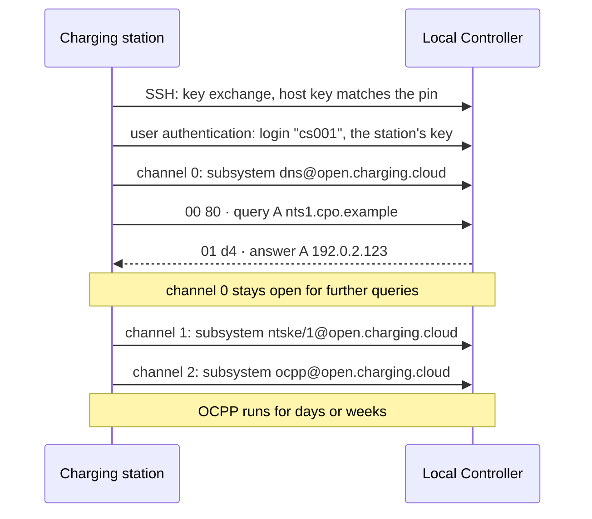

# DNS over SSH

**Version 0.1, Draft**, 2026-11-10
[CC-BY-SA 4.0](https://creativecommons.org/licenses/by-sa/4.0/) · [OpenChargingTechnology/Whitepapers](https://github.com/OpenChargingTechnology/Whitepapers) · building blocks in: [Vanaheimr/Hermod](https://github.com/Vanaheimr/Hermod) (SSH stack, DNS client and server), [OpenChargingCloud/WWCP_Node](https://github.com/OpenChargingCloud/WWCP_Node) (shared SSH listener, DNS configuration), [OpenChargingCloud/WWCP_OCPP](https://github.com/OpenChargingCloud/WWCP_OCPP) (OCPP Device Model)

DNS over TLS ([RFC 7858](https://datatracker.ietf.org/doc/html/rfc7858)) puts the byte stream of DNS
over TCP into a TLS connection, and inherits what TLS needs: a certificate issued for the name or
the IP address the resolver is dialled at, a certificate authority that issued it, and a clock to
check its validity. [Secure Name Resolution](../SecureDNS/README.md) answers these needs with
certificates for IP addresses, root CAs installed for name servers, pins and trust on first use. In
the private networks of a charging infrastructure, a station network behind a Local Controller, a
private APN, a laboratory, the same three needs are as hard to meet as they are for OCPP itself.

[OCPP over SSH](../OCPP-over-SSH/README.md) and [NTS Key Establishment over SSH](../NTS-over-SSH/README.md)
replace TLS by SSH for OCPP and for time. This paper does the same for name resolution, and stays as
close to DNS over TLS as it can:

- **A subsystem**, `dns@open.charging.cloud`, on an ordinary SSH `session` channel. It carries the
  byte stream of DNS over TCP unchanged: a two-octet length and a DNS message, in both directions,
  exactly what DNS over TLS carries inside TLS.
- **No framing of its own and no handshake.** Pipelining, out-of-order answers, idle timeouts,
  `edns-tcp-keepalive`, padding and DNS Stateful Operations work as they do over TCP and TLS. A
  name server behind the subsystem reads the stream of its TCP listener, and an unmodified resolver
  behind OpenSSH and `socat` serves it today (appendix B).
- **The server is authenticated by its host key**, pinned or certified. A pinned key names no host
  and has no validity period, so a resolver dialled by its IP address needs neither an IP address in
  a certificate nor an authentication domain name, and a station without a correct clock resolves
  names at once (section 1.3).
- **The client has an identity**: its SSH login, proven by its key. A resolver can answer per
  station or per group of stations, limit and log per identity, and not per source address.
- **One SSH connection for all of it.** A station keeps one SSH connection to its Local Controller,
  and names, time and OCPP are channels of it: one key exchange, one key, one pin, one login. The
  connection is the station's, not OCPP's, and whichever of them needs it first has it made.
- **A mapping onto the configuration** of [Secure Name Resolution](../SecureDNS/README.md): a
  transport `SSH` of `DNSServerController`, its variables, and the key purpose `DNS` of
  [OCPP over SSH](../OCPP-over-SSH/README.md).

This paper is part of the transport work of [EVQI](../EVQITransport/README.md): its section 5
discovers endpoints through HTTPS, SVCB and SRV records, which are only as trustworthy as the
channel they are fetched over (its section 5.2, step 6).

*Status*: this is a draft for discussion, version 0.1. Nothing of it is built in the reference
implementations yet; chapter 10 says which pieces exist and what is missing. The protocol itself was
tried end to end with unmodified software only, OpenSSH 10.0, `socat` and BIND 9.20 (appendix B).
The subsystem name, the variables, the security events and the key purpose are proposals. Chapter
12 lists the questions that version 0.2 should decide.

## Contents

1. [Motivation](#1-motivation)
2. [Design](#2-design)
3. [The protocol](#3-the-protocol)
4. [Identity and authentication](#4-identity-and-authentication)
5. [Authorization on the server](#5-authorization-on-the-server)
6. [Deployment profiles](#6-deployment-profiles)
7. [Configuration and the OCPP Device Model](#7-configuration-and-the-ocpp-device-model)
8. [Security considerations](#8-security-considerations)
9. [Alternatives](#9-alternatives)
10. [Implementation status and work plan](#10-implementation-status-and-work-plan)
11. [Test criteria](#11-test-criteria)
12. [Open questions](#12-open-questions)
13. [Relation to other white papers](#13-relation-to-other-white-papers)
- [References](#references)
- [Appendix A: Test vectors](#appendix-a-test-vectors)
- [Appendix B: DNS over SSH with OpenSSH, socat and BIND](#appendix-b-dns-over-ssh-with-openssh-socat-and-bind)

---

## 1. Motivation

### 1.1 What DNS over TLS needs

| | DNS over TLS, strict profile | DNS over SSH |
|---|---|---|
| Server authenticated by | a certificate whose chain ends at a trusted root | a host key, pinned or certified by an SSH CA |
| Name or address in the credential | yes: a resolver dialled by its IP address needs that address in its certificate, or an authentication domain name ([RFC 8310, section 6.1](https://datatracker.ietf.org/doc/html/rfc8310#section-6.1)) | no, for a pinned key |
| Certificate authority | yes, public or one's own | no, for a pinned key |
| Correct clock | yes, for the validity of the certificate | no, for a pinned key |
| Client identity | none in practice; access lists by source address | the SSH login and its key |
| Port | 853 | 22, or the SSH listener a node runs anyway |
| Interoperable today | yes | with OpenSSH and `socat` in front of any resolver (appendix B); no native implementation yet |

In a station network all four rows in the middle are a problem:

- **Names and addresses.** [Secure Name Resolution](../SecureDNS/README.md) asks to configure name
  servers by their IP addresses (its section 2.5), so that resolving a name does not need a resolved
  name first. A certificate then needs that address as a Subject Alternative Name. A Local
  Controller at `10.10.0.1` in one car park and another one at `10.10.0.1` in the next have the same
  address: a certificate of one CA for it is accepted at both, and a stolen key of one Local
  Controller is valid against the stations of the other
  ([Key Pins and Raw Public Keys](../EVQITransport/RawPublicKeys.md), sections 3.1 and 4).
- **No CA.** An internal CA has to be run, its root installed on every station as
  `NameServerRootCertificate`, and the certificates of every resolver renewed in time.
- **No clock.** A station without a battery-backed real-time clock cannot check the validity of a
  certificate after a reboot. For time servers, [Secure Time Synchronization](../SecureTimeSync/README.md)
  has an exception, `NoCertTimeCheckAfterReboot`; for name servers there is none (section 1.3).
- **Anonymous clients.** A resolver of DNS over TLS knows its clients by their source addresses,
  which behind NAT, a private APN or carrier-grade NAT say little. It cannot answer, limit or log
  per station.

### 1.2 What SSH brings

The points of [OCPP over SSH](../OCPP-over-SSH/README.md), section 1.2, hold here as well: bare
public keys without validity periods, client keys as the normal case, confinement per service, one
listener for everything a node serves, and the tooling of every operator. For name resolution, four
of them weigh more:

- **A pinned host key authenticates the server, not a name.** It needs no authentication domain
  name and no IP address in a certificate. The bootstrap problem of RFC 8310, section 6.1, does not
  arise.
- **No clock.** Names resolve at a cold start, before the station knows the time.
- **An identity per client**, for answers, limits and logs per station (section 4.3).
- **One connection for OCPP, time and names.** A station connected to its Local Controller over
  SSH opens a channel for DNS on the connection it has, as it does for NTS-KE (section 6.3).

### 1.3 Names, time and certificates at a cold start

A station that starts without a correct clock has to find its time before it can check a
certificate, and often has to resolve names before it can find its time:

| Step | Over TLS | Over SSH |
|---|---|---|
| 1. Resolve the name of an NTS-KE server, e.g. `nts1.cpo.example` | DNS over TLS: the resolver's certificate is valid from a date the station cannot compare with. Under the strict profile, the resolver is not used, and the name does not resolve. | DNS over SSH: the host key is pinned; no clock is needed. |
| 2. NTS key establishment | TLS: the certificate's validity again. Only `NoCertTimeCheckAfterReboot` of [Secure Time Synchronization](../SecureTimeSync/README.md) gets past it, and only once step 1 has worked. | [NTS-KE over SSH](../NTS-over-SSH/README.md): the host key is pinned. |
| 3. Connect to the CSMS | `wss://`: its certificate can be checked now. | `ssh://` with a pinned host key, or `wss://` with the clock now correct. |

Over TLS the chain breaks at step 1 unless the NTS-KE servers are given by IP address, or unless
name servers get an exception from the time check of their certificates, which would give an
attacker with an expired certificate a window at every reboot. Over SSH every step is anchored by
a pin, and the clock is correct before anything needs it.

DNSSEC is not part of this: the signatures it validates have a validity period, and a station that
validates them itself needs a correct clock, whatever the transport (section 8.3).

### 1.4 Where it is meant for

| Scenario | Who resolves through whom |
|---|---|
| **Station network behind a Local Controller** | the stations through their Local Controller, as a channel of the one SSH connection they keep to it (section 6.3); the Local Controller resolves upwards itself (section 6.4) |
| **CSMS behind a private APN** or a VPN | the stations through a resolver of the CPO with an SSH listener (section 6.1), or through the CSMS (section 6.2) |
| **Local Controller to its CPO** | the Local Controller's own resolver through a resolver of the CPO, over DNS over SSH or DNS over TLS |
| **Laboratories, test benches** | any node through any other, without a PKI |

### 1.5 Non-goals

- **No replacement of DNS over TLS, HTTPS or QUIC** towards public resolvers on the Internet. Where
  a resolver has a certificate a station can check, those remain the interoperable choice.
- **No change of DNS.** Every message is the same message as over TCP; only the transport underneath
  differs.
- **Stub to recursive, and forwarder to upstream.** Not between recursive resolvers and
  authoritative servers on the Internet.
- **No UDP.** SSH carries byte streams, and DNS over SSH is DNS over TCP inside it.
- **No new cryptography.** Everything cryptographic is SSH's own.
- **No replacement of DNSSEC.** SSH authenticates the resolver, not the data (section 8.3).

---

## 2. Design

### 2.1 Layers

```
DNS message          header · question · answer · authority · additional
     │
two-octet length     uint16 length · message      (RFC 1035, section 4.2.2; RFC 7766)
     │
subsystem            "dns@open.charging.cloud" on a "session" channel (RFC 4254, section 6.5)
     │
SSH connection protocol  channels, flow control per channel             (RFC 4254)
SSH user authentication  login = the station's identity, public key     (RFC 4252)
SSH transport            host key, key exchange, encryption              (RFC 4253)
     │
TCP
```

Over TLS the same stream sits on TLS instead of the three SSH layers; over TCP on TCP directly.

### 2.2 Decisions and rejected alternatives

| Alternative | Decision | Why |
|---|---|---|
| **Port forwarding** (`direct-tcpip`, `ssh -L 5353:127.0.0.1:53`), the usual way of DNS over SSH today | rejected | The resolver behind the tunnel sees a connection from `localhost` and no identity, and a login that may forward may forward anywhere. A station's login forwards nothing (chapter 5). |
| **DNS over TLS inside the SSH channel** | rejected | It brings back the certificate this paper removes. |
| **The framing of OCPP over SSH** (HELLO, WELCOME, BINARY frames) | rejected | DNS has a framing of its own, the two-octet length of DNS over TCP, and negotiates its versions and options inside its messages (EDNS(0)). A handshake would add a round trip, and code to every peer, for nothing it does not have. With the stream of DNS over TCP, a name server serves the subsystem with the code of its TCP listener, and an unmodified one with a relay (appendix B). |
| **`exec`** of a fixed command | rejected | It mixes the protocol name with a command line of the server, and is harder to filter than a subsystem. |
| **A channel type of its own** | rejected | Generic SSH clients and libraries can request subsystems, but rarely open custom channel types, and OpenSSH cannot hand them to a program. |
| **DNS inside OCPP messages** ([DNS-over-OCPP](../DNS-over-OCPP/README.md), upcoming) | complementary | It works over any OCPP transport, WebSocket included. Over SSH, a channel of its own keeps DNS out of the queue of OCPP messages: OCPP 1.6 and 2.0.1 allow one outstanding CALL per direction, and the channel has a flow-control window of its own. |
| **The stream of DNS over TCP in a subsystem channel** | **chosen** | Everything DNS over TCP and DNS over TLS specify applies unchanged, and the SSH login is the identity. |

---

## 3. The protocol

### 3.1 The subsystem

- **Name.** `dns@open.charging.cloud`. Names without an `@` are reserved for assignment through
  IANA; private extensions use `name@domain`, where the domain is controlled by whoever defines the
  name ([RFC 4251, section 6](https://datatracker.ietf.org/doc/html/rfc4251#section-6);
  [RFC 4250, section 4.6.1](https://datatracker.ietf.org/doc/html/rfc4250#section-4.6.1)).
- **No version in the name.** The stream of DNS over TCP has been the same since RFC 1035, and DNS
  negotiates its extensions inside its messages: the version of EDNS(0), its options, DNS Stateful
  Operations. An incompatible change of the stream would get a new name.
- **Not `dot`.** DNS over TLS has the ALPN token `dot` and DNS over QUIC `doq`. The subsystem carries
  DNS, not TLS, and is named after what it carries.
- **Registration.** The name stays private until a second, independent implementation exists. Then
  `dns` is registered in the IANA registry *Connection Protocol Subsystem Names*, which needs an
  *Expert Review* since [RFC 9519](https://datatracker.ietf.org/doc/html/rfc9519) and no RFC. A
  server then offers both names.
- **Opening it.** The client opens a `session` channel and sends a `subsystem` request with the name
  ([RFC 4254, section 6.5](https://datatracker.ietf.org/doc/html/rfc4254#section-6.5)), with *want
  reply* set, and waits for the answer before it writes. A server that does not offer the subsystem
  to this login answers `SSH_MSG_CHANNEL_FAILURE`.

### 3.2 The byte stream

From `SSH_MSG_CHANNEL_SUCCESS` on, the channel carries in both directions what a TCP connection
carries for DNS:

```
uint16  length    big-endian: the length of the message, without these two octets
byte[]  message   one DNS message
```

- **The client writes first.** There is nothing to wait for; the first two octets of the channel
  are the length of the first query.
- **Every rule of DNS over TCP applies**: [RFC 1035, section 4.2.2](https://datatracker.ietf.org/doc/html/rfc1035#section-4.2.2),
  [RFC 7766](https://datatracker.ietf.org/doc/html/rfc7766), and, where they say "TLS session",
  [RFC 7858, section 3.3](https://datatracker.ietf.org/doc/html/rfc7858#section-3.3) for the channel.
  Section 3.3 below lists those that matter most.
- **One message per length.** A message may be up to 65,535 octets long, as over TCP.
- **SSH packets do not delimit messages.** A channel's packets carry at most its maximum packet
  size, e.g. 32,768 octets for a session channel of OpenSSH, so a long message spans several
  `SSH_MSG_CHANNEL_DATA`, and one of them may hold the end of a message and the start of the next. A reader reads lengths and messages
  from the stream and never assumes one message per packet. This is the rule of
  [RFC 7766, section 8](https://datatracker.ietf.org/doc/html/rfc7766#section-8) for TCP
  segments: a server "MUST NOT close a connection simply because the first 'read' from the TCP
  layer does not contain the entire DNS message".
- **One writer at a time.** A side that writes several messages at once, e.g. a server answering
  pipelined queries in parallel, writes each length and its message whole before the next one
  begins; otherwise two messages longer than one SSH packet would interleave. Length and message
  should go to the channel in one write, as [RFC 7766, section 8](https://datatracker.ietf.org/doc/html/rfc7766#section-8)
  asks for TCP.

### 3.3 Rules carried over from DNS over TCP and TLS

- **Pipelining.** A client sends its next query without waiting for the answer to the last one
  ([RFC 7766, section 6.2.1.1](https://datatracker.ietf.org/doc/html/rfc7766#section-6.2.1.1);
  RFC 7858, section 3.3).
- **Answers out of order.** A server may answer in any order, and a client "MUST match responses to
  outstanding queries on the same TLS connection using the Message ID", and by the question where
  the answer has one (RFC 7858, section 3.3); over SSH on the same channel.
- **Connection reuse.** A client keeps the channel open for further queries
  ([RFC 7858, section 3.4](https://datatracker.ietf.org/doc/html/rfc7858#section-3.4)). One channel
  per server is enough; a server may limit the number of DNS channels per connection (section 5.4).
- **Idle timeouts.** A server closes a channel that has been idle for longer than its policy allows
  ([RFC 7766, section 6.2.3](https://datatracker.ietf.org/doc/html/rfc7766#section-6.2.3)). It closes
  the channel, not the SSH connection, which may carry OCPP and other channels (section 3.5).
- **Robustness.** Both sides are prepared for the other one to close an idle channel at any time,
  and a client re-sends the queries left unanswered on a closed channel over a new one.

### 3.4 EDNS(0) options

- **`edns-tcp-keepalive`** ([RFC 7828](https://datatracker.ietf.org/doc/html/rfc7828)) is used as
  over TCP, and its timeout applies to the channel. A server that announces it keeps the channel,
  not the SSH connection, open for that long.
- **Padding** ([RFC 7830](https://datatracker.ietf.org/doc/html/rfc7830)). SSH hides the content of
  a message, not its length (section 8.2). Clients pad their queries to a multiple of 128 octets and
  servers their answers to a multiple of 468, as
  [RFC 8467](https://datatracker.ietf.org/doc/html/rfc8467) recommends for encrypted transports.
- **DNS Cookies** ([RFC 7873](https://datatracker.ietf.org/doc/html/rfc7873)) protect against
  off-path spoofing, which an authenticated channel already excludes. They may be sent, and change
  nothing.
- **EDNS Client Subnet** ([RFC 7871](https://datatracker.ietf.org/doc/html/rfc7871)) is not sent
  by a station, as [Secure Name Resolution](../SecureDNS/README.md) section 2.7 says, and not added
  by a forwarding Local Controller: the resolver knows the station by its login (section 4.3).
- **The UDP payload size** of the OPT record means nothing in the channel; the answer is limited by
  the two-octet length only, as over TCP.

### 3.5 The end of a channel

- **The client ends a channel** by sending `SSH_MSG_CHANNEL_EOF` once it expects no further answers,
  or `SSH_MSG_CHANNEL_CLOSE`.
- **The server ends a channel**, after an idle timeout, when it stops, or after a protocol error, by
  sending the channel request `exit-status` ([RFC 4254, section 6.10](https://datatracker.ietf.org/doc/html/rfc4254#section-6.10)),
  then `SSH_MSG_CHANNEL_EOF` and `SSH_MSG_CHANNEL_CLOSE`, as an SSH server does when the program
  behind a subsystem exits. The exit status is `0` for an idle timeout, a client's EOF or a server
  that stops, and `1` after a protocol error. OpenSSH reports a channel without an exit status as a
  failure, exit code 255 ([NTS over SSH](../NTS-over-SSH/README.md), section 3.2).
- **Protocol errors** end the channel: a length of 0, or a message too short to hold the 12 octets
  of a DNS header. A message whose header can be read but whose rest cannot is answered with
  `FORMERR`, as over TCP.
- **A channel ends, the connection stays.** Neither side ends the SSH connection because a DNS
  channel ended. A client opens a new channel at its next query.

### 3.6 Mapping from DNS over TLS

| DNS over TLS | DNS over SSH |
|---|---|
| `tls://192.0.2.53:853` | `ssh://cs001@192.0.2.53:22`, subsystem `dns@open.charging.cloud` |
| TCP port 853 | the port of the SSH listener, 22 by default |
| ALPN `dot` | the subsystem name |
| certificate, issued for the name or address dialled | host key, pinned (section 4.1) |
| SPKI pin of the out-of-band key-pinned profile ([RFC 7858, section 4.2](https://datatracker.ietf.org/doc/html/rfc7858#section-4.2)) | host key pin, `SHA256:<base64>` |
| certificate of a CA | host certificate of an SSH CA, issued for the name or address dialled |
| no client authentication | SSH login and key (section 4.2) |
| TLS session resumption | a further channel of an open SSH connection (section 6.3) |
| the two-octet length and the message | unchanged |
| `close_notify` and TCP FIN of an idle connection | `exit-status`, EOF and CLOSE of the channel |

### 3.7 Latency

| | Round trips to the first answer |
|---|---|
| DNS over TLS 1.3, new connection | about 3: TCP, TLS, the query |
| DNS over SSH, new connection | about 7 to 9: TCP, version and key exchange, user authentication, channel, subsystem, the query |
| DNS over SSH, a new channel of an open connection, e.g. the station's shared connection to its Local Controller | about 3: channel, subsystem, the query |
| Either, on an open channel or connection | 1 |

The handshake is paid once per connection, the subsystem once per channel. A station keeps both
open, as it keeps a connection of DNS over TLS open (RFC 7858, section 3.4), so the steady state
costs one round trip per query, the same as over TLS.

---

## 4. Identity and authentication

### 4.1 How the server proves it

| Mechanism | Trust anchor | Needs a correct clock | Needs the name or address dialled | Suitable for |
|---|---|---|---|---|
| Pinned host key | `SSHHostKeyPins` of the server (section 7.1) | no | no | few resolvers; stations without a real-time clock; resolvers dialled by IP address |
| SSH host certificate | `SSHHostCAs`; one CA key, signed with `ssh-keygen -s -h` | only with a limited validity; `-V always:forever` is possible | yes: the name or address dialled must be a principal of the certificate | many resolvers; rotation without touching the stations |
| SSHFP record ([RFC 4255](https://datatracker.ietf.org/doc/html/rfc4255)) | DNSSEC | yes | yes | **not for the resolver itself** (below) |
| The host key of the shared connection | the pins the SSH peer is held to: those of `SSHClientController` ([OCPP over SSH](../OCPP-over-SSH/README.md), section 9.2) | as there | as there | a channel of the station's connection to an SSH peer (section 6.3) |

- **Pins are a set, in SHA-256.** A resolver that is about to change its host key is pinned with both
  keys for the time of the change, as [OCPP over SSH](../OCPP-over-SSH/README.md) section 10.4 says.
  MD5 fingerprints are not taken.
- **A host certificate names its host**, as an X.509 certificate does. A resolver dialled by its
  address needs that address among the principals of its certificate. Only a pinned key frees a
  resolver from the name or address it is dialled at.
- **SSHFP authenticates nothing here.** An SSHFP record of a resolver would have to be resolved, and
  validated, through a resolver the station already trusts. It may vouch for other SSH servers, and
  then only where the station validates DNSSEC itself or reaches a validating resolver over a secure
  transport ([RFC 4255, section 2.4](https://datatracker.ietf.org/doc/html/rfc4255#section-2.4)).
- **A host key nothing vouches for** is not believed, and the resolver is not used. There is no
  fallback to another transport of the same server, or to UDP. Whether `OnPinMismatch` and trust on
  first use of [Secure Name Resolution](../SecureDNS/README.md) apply to host keys is open
  (questions 3 and 4 of chapter 12).

### 4.2 How the client proves it

- **Public key**, the normal case: the station's own Ed25519 key for the purpose `DNS` (section 7.3),
  under its own identity as the login. The server finds the key among those it holds for that login,
  and only there.
- **The shared connection.** On a channel of the station's connection to an SSH peer, the station
  is who it signed in as on that connection. Nothing else is proven.
- **`none`** ([RFC 4252, section 5.2](https://datatracker.ietf.org/doc/html/rfc4252#section-5.2))
  for a public resolver that wants no identity, as anonymous DNS over TLS. A station's resolver
  should not offer it.
- **No passwords.** A password proves less than a key, and a station has a key anyway.
- **SSH user certificates** for large fleets: one CA line on the resolver instead of one key per
  station, as [OCPP over SSH](../OCPP-over-SSH/README.md) section 10.5 describes.

### 4.3 What the identity buys

Over TLS a resolver knows the source address of a query, which behind a Local Controller, NAT or a
private APN names a network, not a station. Over SSH it knows the login:

- **Answers per identity.** A resolver can hold views by login or by group of logins, as BIND or
  Unbound hold views by source address: the names of a tenant's CSMS only for that tenant's stations,
  a new address of a CSMS first for one group of stations and later for the others, the names of the
  station network only for stations of that network. Appendix B maps logins onto views of an
  unmodified BIND.
- **What a station may resolve.** A resolver can answer a station only for the names it needs: its
  CSMS, its time servers, its firmware and log servers, the OCSP responders and CRL distribution
  points of its certificates. A station that has been taken over then cannot resolve a server of the
  attacker, and cannot tunnel data out through queries for names of the attacker's zone.
- **Limits per identity.** Rate limits per login, not per source address, which many stations behind
  one Local Controller or one carrier-grade NAT share.
- **Logs per identity.** Which station asked for what, and which answer or refusal it got, for the
  analysis of an incident (section 8.4 on privacy).
- **Revocation.** A station withdrawn at the resolver is withdrawn, wherever it connects from.

### 4.4 Relation to the usage profiles of RFC 8310

[RFC 8310](https://datatracker.ietf.org/doc/html/rfc8310) distinguishes a *strict* from an
*opportunistic* profile. DNS over SSH knows only the strict one: the channel is encrypted, its server
authenticated, or the server is not used. Of the profiles of DNS over TLS it is closest to the
*out-of-band key-pinned privacy profile* of RFC 7858, section 4.2: a key, not a name, is what the
client checks. The bootstrap problem of RFC 8310, section 6.1, "it will typically only know the IP
address of its DNS server", is no problem for a pinned key, which needs nothing but that address.

---

## 5. Authorization on the server

### 5.1 Confinement

A login admitted for DNS opens `dns@open.charging.cloud`, the subsystems granted besides, and
nothing else: no shell, no `exec`, no SFTP, no pseudo-terminal, no port forwarding, no agent
forwarding. These are the rules of [OCPP over SSH](../OCPP-over-SSH/README.md), chapter 5, and a
node of the reference implementation holds station logins to them whatever their key lines say.

### 5.2 A grant per subsystem

DNS is granted to a station explicitly, like OCPP and NTS-KE: a key admitted for OCPP does not resolve
names by itself, and a key admitted for DNS does not reach OCPP. On a Local Controller the stations
of its network typically get all three, `ocpp@`, `ntske/1@` and `dns@`, so that one SSH connection
carries everything they need (section 6.2).

### 5.3 Access rules

The access rules of [OCPP over SSH](../OCPP-over-SSH/README.md), section 5.4, take the service
`subsystem:dns@open.charging.cloud` like any other. A Local Controller that serves names to its
stations, but not to its uplink:

```json
"ssh": {
  "accessRules": [
    { "action": "deny",  "service":   "subsystem:dns@open.charging.cloud", "localAddress": "192.0.2.10" },
    { "action": "allow", "principal": "station:*", "source": [ "10.10.0.0/16" ] },
    { "action": "deny",  "principal": "station:*" }
  ]
}
```

### 5.4 Limits

- **DNS channels per connection**: 2 are enough. [OCPP over SSH](../OCPP-over-SSH/README.md) section
  5.5 allows 4 sessions per SSH connection in the reference implementation, for OCPP, NTS-KE and
  SFTP; with DNS that is one channel each.
- **Outstanding queries per channel**: e.g. 100. A server that has as many queries of a channel in
  hand as it allows stops reading from that channel until it has answered some. The channel's
  window then fills, and the client's further queries wait in the client, not in the server.
- **Idle timeout**: as a server's TCP listener has, e.g. 30 s, announced by `edns-tcp-keepalive`
  (section 3.4).
- **Rate limits per login** (section 4.3).
- The login grace time and the limits per kind of login of the shared listener apply as for OCPP.

### 5.5 Revocation

Removing a station's DNS key, or the grant of `dns@`, ends its DNS channels: at once where the store
reports the change, otherwise at the next recheck, as [OCPP over SSH](../OCPP-over-SSH/README.md)
section 5.3 says for OCPP.

---

## 6. Deployment profiles

### 6.1 A name server with an SSH listener of its own

A resolver of the CPO gets an SSH listener next to its listeners for UDP, TCP and TLS. It is a
special-purpose SSH server: it serves `dns@open.charging.cloud` to stations and, optionally, a command
line to administrators, and refuses everything else. Its subsystem handler hands the channel's stream
to the code of its TCP listener, together with the login, which selects the view. The SSH stack then
shares a process with the resolver's cache, and needs to be as mature as its TLS stack; the
[SSH Conformance Tests](https://github.com/Vanaheimr/SSHConformanceTests) test Hermod's against
independent implementations.

### 6.2 A subsystem on the shared listener of a node

A Local Controller or a CSMS runs an SSH listener anyway, for its command line, SFTP, and OCPP and
NTS-KE over SSH. DNS becomes one more subsystem of it:

```text
SSH listener of a Local Controller (one port, one host key)
 ├─ shell                        administrators: the command line of the node
 ├─ sftp                         administrators
 ├─ ocpp@open.charging.cloud     charging stations
 ├─ wwcp@open.charging.cloud     neighbouring nodes
 ├─ ntske/1@open.charging.cloud  charging stations: the time server of the station network
 └─ dns@open.charging.cloud      charging stations: the resolver of the station network
```

- **One identity, one trust anchor.** The station signs in with its key under its own identity and
  verifies the host key it already pins for OCPP.
- **Attack surface.** The resolver's cache now shares a process with OCPP, the command line and the
  logins of all stations. Where this is not acceptable, the node relays the stream over a local
  socket to a separate resolver, as `socat` does in appendix B, and passes the login along.

### 6.3 A channel of the station's connection to an SSH peer

A station keeps one SSH connection to an *SSH peer*, e.g. its Local Controller
([OCPP over SSH](../OCPP-over-SSH/README.md), section 7.2), and whatever goes to that host over SSH
is a channel of it. A name server with `SSHConnection` `Shared` opens `dns@` as one of them, as
[NTS over SSH](../NTS-over-SSH/README.md) section 7 does for time, and OCPP for its messages. The
connection is the station's: none of the three owns it, and whichever needs it first has it made.



- **Nothing of its own.** No key, pin, login or port: the name server uses those of the connection
  to its SSH peer, and the resolver knows the station by the login of that connection.
- **No order among the channels.** A station that starts cold needs names and the time before it
  can check a certificate, and may need a name before it can reach its CSMS. So the diagram has the
  names first: the query has the connection made, and OCPP is the third channel of it.
- **About 3 round trips** for the first query, 1 for every further one (section 3.7).
- **Which connection.** The name server's `Address` names an SSH peer of the station, and the
  channel is opened on the connection to that peer (section 7.1). The hosts of the station's
  `ssh://` network connection profiles are its SSH peers, and so are the peers of
  `SSHPeerController` ([OCPP over SSH](../OCPP-over-SSH/README.md), section 7.3), which need no
  OCPP at all. A station with several back ends
  ([EVQI Transport](../EVQITransport/README.md), chapter 11) may have a resolver on each.
- **Not for the name of that connection.** A station that resolves through its connection to an SSH
  peer cannot resolve the name it dials that peer at through it: the connection would have to exist
  before it could be dialled. The peer is therefore named by an IP address, as station networks
  usually do (`ssh://10.10.0.1`), or by a name that another configured server resolves. Section 7.2
  makes this a rule for the CSMS.
- **Fate sharing.** While the connection to the peer is down, so is everything on it, name
  resolution included. The station keeps answers in its cache for their time to live, may serve
  stale answers ([RFC 8767](https://datatracker.ietf.org/doc/html/rfc8767)), and reconnects by IP
  address. A second name server that does not depend on that connection is recommended where the station resolves
  names for anything that has to work without its Local Controller; it should be as strong as the
  first, as the weakest configured server decides the security of all of them
  ([Secure Name Resolution](../SecureDNS/README.md), section 2.4).

### 6.4 The Local Controller as the resolver of its station network

A Local Controller between a station network and its uplink is the natural resolver of its stations,
as it is their natural time server:

- **Its own zone.** It answers the names of the station network itself: its own name, those of its
  services, and of the stations where they are addressed by name.
- **Forwarding.** Everything else it asks its upstream: over DNS over TLS or HTTPS towards a resolver
  of the CPO or a public one, held to pins as [Secure Name Resolution](../SecureDNS/README.md)
  describes; or over DNS over SSH, on its own SSH connection to its CSMS or to a resolver of the CPO.
  Its cache serves all its stations.
- **No identity upwards.** Upstream the Local Controller asks in its own name. It adds no EDNS Client
  Subnet and no identity of a station; the station's identity ends at the Local Controller, where
  views, limits and logs per station apply (section 4.3).
- **DNSSEC.** The Local Controller passes the DO bit and the signatures through, and validates them
  where it can. A station that validates itself is independent of the Local Controller's honesty for
  signed zones (section 8.3).

### 6.5 OpenSSH in front of an existing resolver

Because the subsystem carries the stream of DNS over TCP, an unmodified OpenSSH server can serve it
today: `sshd` starts `socat` for the subsystem, and `socat` connects to the TCP port of any resolver,
BIND, Unbound or the resolver of the operating system. A forced command per key binds each station's
connection to a source address of its own, by which the resolver's views tell the stations apart.
Appendix B gives a tested configuration. What is lost: the resolver sees no SSH connection, only a
TCP connection from a loopback address, and a key withdrawn from `authorized_keys` does not end a
channel that is already open.

### 6.6 Further uses of the channel

- **DNS Stateful Operations** ([RFC 8490](https://datatracker.ietf.org/doc/html/rfc8490)) need a
  transport that "guarantees in-order delivery" and clean session semantics (its section 4.2), and
  name DNS over TCP and TLS. The channel has both, so DSO and its keepalive and padding TLVs work in
  it unchanged.
- **DNS Push Notifications** ([RFC 8765](https://datatracker.ietf.org/doc/html/rfc8765)) on DSO
  would let a Local Controller or CSMS push changes of records to its stations, e.g. of the HTTPS
  and SRV records [EVQI Transport](../EVQITransport/README.md) section 5 discovers its endpoints by.
  A section of its own in a later version.
- **Zone transfers.** A Local Controller could keep the zone of its station network as a secondary
  of a primary at the CPO, over the same stream as zone transfers over TLS
  ([RFC 9103](https://datatracker.ietf.org/doc/html/rfc9103)), authenticated by SSH instead of TLS.
  Not part of this paper.

---

## 7. Configuration and the OCPP Device Model

### 7.1 `DNSServerController`: the transport `SSH`

[Secure Name Resolution](../SecureDNS/README.md) section 3.1.2 defines one instance of the component
`DNSServerController` per name server. DNS over SSH adds a value to its `Transport` and the
following variables, named like those of the NTP Client Controller in
[NTS over SSH](../NTS-over-SSH/README.md) section 7:

- **`Transport`** takes the value `SSH`.
- **`Port`** defaults to 22 for `SSH`.
- **`Address`** is the IP address or host name of the SSH server. IP addresses are recommended, and
  for a pinned host key nothing else is needed (section 4.1).

| Variable Name | req/opt | Mutability | Data Type | Default Value | Values List / Limits | Description |
|---|---|---|---|---|---|---|
| SSHUserName | optional | rw | string | "" | ≤ 32 characters | The login of the SSH user authentication. Empty: the station's own identity (`SecurityCtrlr.Identity`). |
| SSHHostKeyPins | optional | rw | string | "" | comma separated, ≤ 16 | SHA-256 fingerprints of the host keys the server may show, in the notation `SHA256:<base64>` of `ssh-keygen -l`. An MD5 fingerprint is `Rejected` with `reasonCode` `InvalidValue`. |
| SSHHostCAs | optional | rw | string | "" | comma separated, ≤ 4 | SHA-256 fingerprints of SSH CA keys that may sign the server's host certificate, for its `Address` as a principal. |
| SSHConnection | optional | rw | OptionList | `Dedicated` | `Dedicated`, `Shared` | `Dedicated`: an SSH connection of the name server's own. `Shared`: the subsystem is one more channel of the SSH connection the station keeps to the SSH peer `Address` names (section 6.3). |
| SSHClientPublicKey | optional | ro | string | "" | - | The public key the station authenticates with, as a line of `authorized_keys`: `SSHClientController.ClientPublicKey[DNS]`, or with `SSHConnection` `Shared` the key of the connection to that SSH peer. |
| SSHHostKeyFingerprint | optional | ro | string | "" | - | The SHA-256 fingerprint of the host key the server showed at its last handshake. |
| SSHStatus | optional | ro | OptionList | "" | `Accepted`, `PinMismatch`, `Untrusted`, `WeakAlgorithms`, `AuthenticationFailed`, `SubsystemRefused`, `NoSSHPeer` | The outcome of the last attempt: believed and served; a host key that neither a pin nor a CA vouches for; a host certificate that is invalid or not for `Address`; no strict KEX or only algorithms the station must not use (section 8.2); the station's key not taken; the subsystem refused; `Address` is no SSH peer of the station with `SSHConnection` `Shared`. Empty before the first attempt. |

The existing variables of `DNSServerController` keep their meaning, with these exceptions for `SSH`:

- `CertificatePins`, `RootPins`, `RootCAs` and `AuthenticationName` do not apply, and setting them
  for an `SSH` server is `Rejected`, as setting them for `UDP` is.
- `CertificateStatus`, `CertificateFingerprint` and `RootFingerprint` stay empty; `SSHStatus` and
  `SSHHostKeyFingerprint` take their place.
- `Problem` is `true` while `SSHStatus` is anything but `Accepted`.
- `KnownSince` is the time since when the server is believed with its current host key, which is the
  change detection of [Secure Name Resolution](../SecureDNS/README.md) section 2.3 for host keys.
- `OnPinMismatch` and `TrustOnFirstUse` are open questions (chapter 12, questions 3 and 4). Until
  they are decided, an `SSH` server takes `OnPinMismatch` `Refuse` and `TrustOnFirstUse` `None`
  only.
- `EncryptedOnly` of `DNSClientController` counts `SSH` as encrypted.

### 7.2 Rules for `SetVariablesRequest`

The rules of [Secure Name Resolution](../SecureDNS/README.md) section 3.1.3 apply: with `ACID` or
`BASE` the variables of a server are checked and applied as one change, and an `IndependentRequests`
change is checked entry by entry against the configuration as it is after the entries before it.
For `SSH` they are joined by:

- **A server must be believable.** An `SSH` server with neither `SSHHostKeyPins`, nor `SSHHostCAs`,
  nor `SSHConnection` `Shared` is `Rejected` with `reasonCode` `InvalidSSHHostKeyConfig`, the reason
  code of [OCPP over SSH](../OCPP-over-SSH/README.md) section 9.2: a name server without a way to
  authenticate it is never stored.
- **SSH variables belong to SSH servers.** `SSHUserName`, `SSHHostKeyPins`, `SSHHostCAs` and
  `SSHConnection` for a server whose `Transport` is not `SSH` are `Rejected` with `reasonCode`
  `InvalidValue`; so is a change of `Transport` away from `SSH` while one of them is set.
- **On a shared connection** (`SSHConnection` `Shared`), `Port`, `SSHUserName`, `SSHHostKeyPins`
  and `SSHHostCAs` do not apply and are `Rejected`; `Address` must be an SSH peer of the station -
  the host of one of its network connection profiles with an `ssh://` URL, or the `Address` of an
  instance of `SSHPeerController` - or the change is `Rejected` with `reasonCode` `InvalidValue`. In a request,
  `SSHConnection` is applied after `Transport` and before the other variables, as in [NTS over SSH](../NTS-over-SSH/README.md) section 7.
- **A CSMS must not cut itself off**, and the check of section 3.1.3 of Secure Name Resolution is
  extended: a server with `SSHConnection` `Shared` does not count for resolving the host name of the
  connection it runs over. A change after which the name of a CSMS connection would only resolve
  through that connection itself is `Rejected` with `reasonCode` `CSMSUnreachable`, although the
  name resolves now: it would not after the next reconnect.

### 7.3 Keys: the purpose `DNS` of `SSHClientController`

[OCPP over SSH](../OCPP-over-SSH/README.md) gives the station one SSH key per purpose, `Station`,
`NTS` and `SFTP` (its decision 9), as instances of the variables `ClientPublicKey`,
`ClientPendingPublicKey`, `ClientCertificate` and `ClientKeyMaxAge` of `SSHClientController`. This
paper adds the purpose `DNS`:

- **`SSHClientController.ClientPublicKey[DNS]`** is the key a station authenticates with at every
  `SSH` name server with a connection of its own. `DNSServerController.SSHClientPublicKey`
  reads it.
- **`SSHKeyPurposeEnumType`** of the messages `SignSSHKey`, `SSHKeySigned`, `InstallSSHKey` and
  `GetInstalledSSHKeys` gets the value `DNS`. At a Local Controller, `InstallSSHKey` with `DNS`
  admits the key to `dns@open.charging.cloud`.
- **`TriggerMessage`** asks for the key with `customTrigger` `SignSSHKey:DNS`.
- Enrolment and rotation follow [OCPP over SSH](../OCPP-over-SSH/README.md) sections 10.2 and 10.3
  unchanged; the `hostKeys` of an `InstallSSHKey` response are the pins for the Local Controller's
  name server as well.

Whether DNS needs a key of its own is question 2 of chapter 12.

### 7.4 Security events

| Security event | Critical | When |
|---|---|---|
| `InvalidNameServerHostKey` | yes | A name server over SSH showed a host key that neither a pin nor a CA vouches for, or an invalid host certificate; the analogue of `InvalidNameServerCertificate` of Secure Name Resolution and of `InvalidCsmsHostKey` of OCPP over SSH. TechInfo: the server, e.g. `ssh://192.0.2.53:22`, and the fingerprint shown. Sent once per change of the verdict, not at every attempt. |
| `NameServerHostKeyChanged` | no | A name server was believed with another host key than before, e.g. the second key of its pin set. |
| `NameServerAuthenticationFailed` | no | A name server did not take the station's key. |
| `InvalidSSHAlgorithms` | yes | (OCPP over SSH, section 9.4) A name server offered only algorithms the station must not use, or no strict KEX. TechInfo names the server. |
| `ReconfigurationOfSecurityParameters` | no | (existing) The DNS configuration, a pin or the station's DNS key changed. |

Like those of [Secure Name Resolution](../SecureDNS/README.md) section 3.1.4, they wait in a queue
kept on disk while the CSMS is out of reach: with name resolution broken is when they matter.

### 7.5 OCPP 1.6

The configuration keys of [Secure Name Resolution](../SecureDNS/README.md) section 3.2 take the
same extensions:

| Key Name | req/opt | Accessibility | Type | Default Value | Example | Description |
|---|---|---|---|---|---|---|
| dns.transports | optional | rw | CSL String | "UDP" | "SSH, TLS" | Takes `SSH` as well. |
| dns.sshUserNames | optional | rw | CSL String | "" | ", cs001" | See `SSHUserName`; an empty entry is the station's identity. |
| dns.sshConnection | optional | rw | CSL String | "Dedicated" | "Shared, Dedicated" | See `SSHConnection`. |
| dns.sshHostKeyPins.*n* | optional | rw | CSL String | "" | "SHA256:N09Y…fsUI" | The host key pins of the *n*-th server. A `SHA256:` fingerprint has 50 characters, so 9 fit into the 500 characters of a value. |
| dns.sshHostCAs.*n* | optional | rw | CSL String | "" | - | The SSH CAs of the *n*-th server. |
| dns.sshHostKeyFingerprints | optional | r | CSL String | "" | - | See `SSHHostKeyFingerprint`, per server. |

The station's DNS key is `SSHClient.ClientPublicKey.DNS` of [OCPP over SSH](../OCPP-over-SSH/README.md)
section 9.5; the messages of section 7.3 travel as `DataTransfer`, and the security events by the
security whitepaper's `SecurityEventNotification`.

### 7.6 Example

A station behind the Local Controller `10.10.0.1`, which it dials with `ssh://10.10.0.1:22` for OCPP,
resolves through that connection; as a second server it has a resolver of the CPO over SSH, pinned
with its current and its next host key. Only encrypted servers are asked.

*OCPP 2.x SetVariablesRequest* with `"dataConsistencyModel": "ACID"`:

```json
{
  "setVariableData": [
    { "component": { "name": "DNSClientController" },                      "variable": { "name": "Servers"              }, "attributeValue": "lc,cpo-1" },
    { "component": { "name": "DNSServerController", "instance": "lc" },    "variable": { "name": "Address"              }, "attributeValue": "10.10.0.1" },
    { "component": { "name": "DNSServerController", "instance": "lc" },    "variable": { "name": "Transport"            }, "attributeValue": "SSH" },
    { "component": { "name": "DNSServerController", "instance": "lc" },    "variable": { "name": "SSHConnection" }, "attributeValue": "Shared" },
    { "component": { "name": "DNSServerController", "instance": "cpo-1" }, "variable": { "name": "Address"              }, "attributeValue": "192.0.2.53" },
    { "component": { "name": "DNSServerController", "instance": "cpo-1" }, "variable": { "name": "Transport"            }, "attributeValue": "SSH" },
    { "component": { "name": "DNSServerController", "instance": "cpo-1" }, "variable": { "name": "SSHHostKeyPins"       }, "attributeValue": "SHA256:N09YbIseXi6qHT4L2l3MQ1bXfYFg8SSZmtmYTdOfsUI,SHA256:5xAUFY6gLcuSnCQmJPjuXZdQVcRWcgT72ayb8firQQ4" },
    { "component": { "name": "DNSClientController" },                      "variable": { "name": "EncryptedOnly"        }, "attributeValue": "true" }
  ]
}
```

The station then shows its DNS key in `DNSServerController[cpo-1].SSHClientPublicKey`, and the CSMS
enrolls it at the CPO's resolver. The server `lc` shows the station's OCPP key.

The section `dns` of the configuration file of the reference implementation, as proposed:

```json
"dns": {
  "servers": [
    { "id": "lc",    "address": "10.10.0.1",  "transport": "SSH", "ssh": { "connection": "shared" } },
    { "id": "cpo-1", "address": "192.0.2.53", "transport": "SSH",
      "sshHostKeys": [ "SHA256:N09YbIseXi6qHT4L2l3MQ1bXfYFg8SSZmtmYTdOfsUI",
                       "SHA256:5xAUFY6gLcuSnCQmJPjuXZdQVcRWcgT72ayb8firQQ4" ] }
  ],
  "encryptedOnly": true
}
```

---

## 8. Security considerations

### 8.1 Authentication

- **Host key verification is mandatory**, against a pin, an SSH CA, or the pins of the OCPP
  connection the channel runs on. A server whose host key nothing vouches for is not used, and the
  station falls back neither to another transport of that server nor to UDP. This is the strict
  profile of RFC 8310, and the only profile of DNS over SSH.
- **No password** is sent to a name server (section 4.2).
- **Station keys are made on the station** and never leave it, as in
  [OCPP over SSH](../OCPP-over-SSH/README.md) section 11.1.

### 8.2 Algorithms and traffic analysis

- **The algorithm profile** of [OCPP over SSH](../OCPP-over-SSH/README.md) section 11.2 applies:
  `mlkem768x25519-sha256` first, Ed25519 or ECDSA P-256 host keys, AEAD ciphers or
  encrypt-then-MAC, and **strict KEX required** against the Terrapin attack
  ([CVE-2023-48795](https://terrapin-attack.com)).
- **No compression.** `zlib` compresses a channel's stream as one: a query for a name that appeared
  in an earlier query of the same connection becomes shorter, and its length tells an observer so.
  Compression is `none`.
- **Lengths.** SSH encrypts a message, not its length: a packet's length, padded to the cipher's
  block size and with 4 to 255 octets of random padding
  ([RFC 4253, section 6](https://datatracker.ietf.org/doc/html/rfc4253#section-6)), still says
  roughly how long the DNS message was, and a name's length narrows down which name it was. Padding
  inside DNS (section 3.4) is therefore recommended, as for DNS over TLS.
- **Post-quantum.** The names a station resolves tell which back ends, payment providers and update
  servers it talks to, and when; for stations at private homes this is personal data. A recording
  decrypted years later would reveal it. The hybrid key exchange costs little on a connection that
  lives for weeks.

### 8.3 What SSH does not authenticate

SSH authenticates the resolver, not the data. A resolver that is compromised, or misconfigured,
answers wrongly over the best channel. [DNSSEC](https://datatracker.ietf.org/doc/html/rfc4033)
authenticates the data itself:

- **The AD bit** of a validating resolver means something only over a secure channel: a stub "MUST
  NOT place any reliance on signature validation allegedly performed on its behalf, except when"
  it obtained the data from a trusted resolver "via a secure channel"
  ([RFC 4035, section 4.9.3](https://datatracker.ietf.org/doc/html/rfc4035#section-4.9.3)). A
  channel of DNS over SSH to a host key the station pins is one.
- **Local validation** on the station makes it independent of its resolver for signed zones, but
  needs a correct clock for the validity of the signatures (section 1.3). Until its time is trusted,
  a station relies on the AD bit of its authenticated resolver.
- **A Local Controller's cache** serves all its stations, so a poisoned cache poisons all of them.
  The Local Controller asks upstream over an authenticated transport and validates DNSSEC where it
  can (section 6.4).

### 8.4 Confinement, identity and privacy

- **Authorization per subsystem.** A key admitted for DNS must not reach a shell, `exec`, SFTP, a
  forwarded port or another subsystem, and a key admitted for OCPP does not get DNS by itself
  (chapter 5).
- **Hop, not author.** The answer of a Local Controller is as trustworthy as the Local Controller.
  Who wrote a record is a question for DNSSEC, as who authored a command is one for
  [Signed OCPP Messages](../SignedMessages/README.md).
- **Query logs per identity are personal data** where a station stands at a private home: they say
  which station did what and when. A resolver should log refusals, policy decisions and errors per
  identity, and keep a log of every query only for a stated purpose and a limited time.
- **Towards passive observers** nothing is revealed but lengths and timing (section 8.2). Towards
  the operator of the resolver the station is no longer anonymous, which is the intent in a managed
  network. Where it is not, a resolver offers `none` (section 4.2).

### 8.5 Availability and denial of service

- **Fate sharing.** On a shared connection, DNS fails with everything else on it (section 6.3). One TCP connection
  also means one head-of-line: a lost segment holds up DNS and OCPP alike, which DNS over QUIC would
  avoid. The SSH channels do not hold each other up: each has a window of its own, so a long OCPP
  message does not wait in front of a DNS answer at the SSH layer.
- **Before allocation.** A two-octet length bounds a message at 64 KiB, and a server reads no more
  than it allows per channel (section 5.4).
- **Cost.** An SSH key exchange costs the server about as much as a TLS handshake, and a station
  pays it once per connection, not per query. Limits per kind of login keep stations from crowding
  out administrators on a shared listener.
- **A CSMS must not cut itself off** by a change of the DNS configuration (section 7.2).

### 8.6 Downgrade

- **The transport is configured, not negotiated.** A name server is `SSH`, `TLS` or `HTTPS`; nothing
  switches between them by itself, and a server that cannot be reached over SSH is not asked over
  UDP.
- **The weakest server decides.** A station that asks an `SSH` server and a `UDP` server in parallel
  has the security of the `UDP` server ([Secure Name Resolution](../SecureDNS/README.md), section
  2.4). `EncryptedOnly` keeps unencrypted servers out.
- **Inside SSH** the algorithms are negotiated; a station offers only those of section 8.2, and
  strict KEX is required.

---

## 9. Alternatives

The problems of section 1.1 can partly be solved within TLS, and interoperably:

| Approach | Without CA | Without correct clock | Without the address in a credential | Client identity | Interoperable today |
|---|---|---|---|---|---|
| DNS over SSH (this paper) | yes | yes | yes, with a pin | yes | with OpenSSH in front of a resolver (appendix B) |
| DNS over TLS, certificate for the IP address from one's own CA | no | no | no | no | yes |
| DNS over TLS, pinned certificate ([Secure Name Resolution](../SecureDNS/README.md), `CertificatePins`) | only with a self-signed certificate installed as its own root | no | no | no | yes |
| DNS over TLS, SPKI pin of [RFC 7858, section 4.2](https://datatracker.ietf.org/doc/html/rfc7858#section-4.2) | yes | depends on the client | yes | no | partly; Secure Name Resolution lists the notation as a ToDo |
| DNS over TLS with raw public keys ([RFC 7250](https://datatracker.ietf.org/doc/html/rfc7250); [Key Pins and Raw Public Keys](../EVQITransport/RawPublicKeys.md)) | yes | yes | yes | possible | hardly |
| DNS over QUIC ([RFC 9250](https://datatracker.ietf.org/doc/html/rfc9250)) | as DNS over TLS | as DNS over TLS | as DNS over TLS | no | partly |
| DNS inside OCPP ([DNS-over-OCPP](../DNS-over-OCPP/README.md), upcoming) | as the OCPP transport | as the OCPP transport | as the OCPP transport | the OCPP identity | no |

- **Interoperable DNS without a CA**, towards resolvers one does not run, is fastest reached with
  pins of [Secure Name Resolution](../SecureDNS/README.md).
- **DNS over SSH** pays off where the stations already speak SSH to their Local Controller or CSMS,
  where resolvers should know their clients, and where stations without a real-time clock must
  resolve names at a cold start.
- **Raw public keys** give TLS what a pinned host key gives SSH, without a second protocol stack;
  where a station's TLS stack supports them, they are the closest alternative.

---

## 10. Implementation status and work plan

### 10.1 What exists to build on

| Repository | What |
|---|---|
| Hermod, `Hermod/DNS/Server/DNSServer.cs` | `HandleFramedDNSStreamAsync(Stream, …)`, the one handler of the length-prefixed stream that serves both TCP and DNS over TLS; private today |
| Hermod, `Hermod/DNS/Client/DNSStreamPipeline.cs` | pipelined queries and answers out of order on one stream, used by the clients of TCP and DNS over TLS |
| Hermod, `Hermod/DNS/Server/DNSMessagePipeline.cs` | the zone, TSIG, SIG(0) and padding shared by every transport of the server |
| Hermod, `Hermod/SSH` | subsystems on the server (`SshSubsystemFactory`, `SshSubsystemContext` with the session and the channel), `SshClient.OpenSubsystemAsync`, a channel as a `Stream` (`SshMuxChannel.AsStream()`) |
| WWCP_Node | the shared SSH listener with subsystems per kind of login, access rules and limits ([OCPP over SSH](../OCPP-over-SSH/README.md), section 12.1); the `dns` configuration with pins ([Secure Name Resolution](../SecureDNS/README.md)) |
| Hermod (`SshSharedConnection`), WWCP_Node (`SSHPeer`), ChargingStation, Norn | one SSH connection of the station to an SSH peer, made by whoever needs it first, with OCPP and the key exchange of NTS as channels of it (`SSHConnection` `Shared` of [NTS over SSH](../NTS-over-SSH/README.md), section 7) |

### 10.2 What is missing

- **Hermod: the server side.** A public entry point for a framed stream on `DNSServer`, which a
  subsystem handler calls with the channel's stream, the transport name `SSH` and the login.
- **Hermod: the client.** `DNSTransport.SSH` and a client on `DNSStreamPipeline`, on an SSH
  connection of its own or on one it is handed.
- **Hermod: a resolver.** Hermod's DNS server answers authoritatively only
  (`AuthoritativeDNSRequestHandler`). A Local Controller needs a forwarding, caching
  `IDNSRequestHandler` that asks upstream through `DNSClient` (section 6.4).
- **Views per identity** in the request handlers (section 4.3).
- **WWCP_Node and WWCP_OCPP**: the subsystem on the shared listener, granted per station; the
  transport `SSH` and the variables of chapter 7; the key purpose `DNS`; the security events.

### 10.3 Work plan

1. Hermod: the server side, with the test criteria of chapter 11 that concern the server, against
   OpenSSH's `ssh -s` as an independent client.
2. Hermod: the client, against OpenSSH, `socat` and BIND as an independent server (appendix B).
3. Hermod: the forwarding, caching request handler.
4. WWCP_Node: `dns@open.charging.cloud` on the shared listener of the Local Controller and the CSMS,
   with the zone of the station network and the forwarder.
5. WWCP_Node and WWCP_OCPP: `Transport` `SSH`, the variables, `SSHConnection`, the key
   purpose and the security events, end to end in the
   [EVChargingTestEnvironment](https://github.com/OpenChargingCloud/EVChargingTestEnvironment).
6. [DNSConformanceTests](https://github.com/Vanaheimr/DNSConformanceTests): the test criteria of
   chapter 11 as conformance tests of Hermod.
7. Views per identity.

---

## 11. Test criteria

| # | Test | Expected result |
|---|------|-----------------|
| T1  | A query over the channel. | The same answer as over TCP from the same server. |
| T2  | Three queries in one write (appendix A). | Three answers, each matched to its query by ID and question, in whatever order they come. |
| T3  | A query written one octet per `SSH_MSG_CHANNEL_DATA`; an answer of 60,000 octets. | Both arrive whole. The server does not close the channel because a read held only part of a message. |
| T4  | A server answers two long messages in parallel. | Neither interleaves with the other on the channel. |
| T5  | A host key that is not pinned. | Not used; `SSHStatus` `PinMismatch`, `Problem` `true`, `InvalidNameServerHostKey` once; no query over UDP, TCP or TLS to that server. |
| T6  | The server changes to the second key of its pin set. | Used; `NameServerHostKeyChanged`; `KnownSince` updated. |
| T7  | A host certificate of a CA in `SSHHostCAs`, for the address dialled; then for another address. | Used; then not used, `SSHStatus` `Untrusted`. |
| T8  | A server without strict KEX. | Not used; `SSHStatus` `WeakAlgorithms`, `InvalidSSHAlgorithms`. |
| T9  | The server does not know the station's key. | `SSHStatus` `AuthenticationFailed`, `NameServerAuthenticationFailed`; no password sent. |
| T10 | A station's DNS login asks for a shell, `exec`, SFTP, `direct-tcpip` and `tcpip-forward`. | All refused. |
| T11 | A station admitted for OCPP only opens `dns@`. | `SSH_MSG_CHANNEL_FAILURE`; `SSHStatus` `SubsystemRefused`. |
| T12 | `SSHConnection` `Shared`: a query before OCPP is connected, then OCPP over the same peer. | The query has the connection made; one SSH authentication for both (the server's log); the connection and OCPP go on after the DNS channel ends. |
| T13 | `SSHConnection` `Shared` to an `Address` that is no SSH peer, e.g. while OCPP runs over `wss://`. | The server is not asked; `SSHStatus` `NoSSHPeer`. |
| T14 | `Transport` `SSH` with no pins, no CAs and `SSHConnection` `Dedicated`, with `ACID`. | Every entry of that server `Rejected`, `InvalidSSHHostKeyConfig`; nothing changed. |
| T15 | `CertificatePins` for an `SSH` server; `SSHHostKeyPins` for a `TLS` server. | `Rejected`, `InvalidValue`. |
| T16 | `SSHConnection` `Shared` with an `Address` that is no SSH peer of the station. | `Rejected`, `InvalidValue`. |
| T17 | The CSMS is dialled at `ssh://lc.example:22`, and the only name server is `SSHConnection` `Shared` to `lc.example`. | `Rejected`, `CSMSUnreachable`, although `lc.example` resolves now. |
| T18 | A cold start with the clock at 1970, name servers over SSH with pinned host keys. | Names resolve before the time is synchronized. |
| T19 | The server closes an idle DNS channel on a shared connection. | `exit-status` 0, EOF, CLOSE of that channel; the connection and OCPP go on; the next query opens a new channel. |
| T20 | Two stations ask for the same name at a server with a view per login. | Each gets the answer of its view. |
| T21 | The pins of a server change while its channel is open. | The connection is closed; the next query makes a new handshake judged by the new pins. |
| T22 | Queries with EDNS padding. | Queries padded to a multiple of 128 octets, answers to a multiple of 468. |
| T23 | The station's DNS key is withdrawn at the server while its channel is open. | The channel ends within the server's recheck interval. |

---

## 12. Open questions

1. **The subsystem name.** `dns@open.charging.cloud`, registered as `dns` once a second implementation
   exists (section 3.1)? Or a name that says it is stub to recursive?
2. **A key for DNS.** A fourth purpose `DNS` of `SSHClientController` (section 7.3), or does a station
   use its NTS key, or its OCPP key, for name servers as well? A key per purpose lets one be withdrawn
   without the others; one key fewer is one enrolment fewer. The decision touches decision 9 of
   [OCPP over SSH](../OCPP-over-SSH/README.md).
3. **`OnPinMismatch` for host keys.** For a TLS name server, `Record` and `Accept` let in a server
   whose certificate still names it and still chains to a trusted root. For an SSH name server the pin
   is the only check, so `Record` and `Accept` let in *any* server on the path, and its answers decide
   where the station connects. OCPP over SSH allows them for test benches and migrations (its decision
   15). Should name servers allow them at all? The proposal: `Refuse` only. A planned change of a host
   key needs no tolerance, as a pin set holds both keys.
4. **Trust on first use for host keys.** A value `HostKey` of `TrustOnFirstUse`, on probation as in
   [OCPP over SSH](../OCPP-over-SSH/README.md) section 10.4? A name server on probation would answer
   the very names the station needs to reach the CSMS that is to confirm it. The proposal: not for
   name servers; on a shared connection nothing but OCPP goes over it while its host key is on
   probation, so no name is asked there until a signed pin set confirms the key.
5. **The default login.** The station's identity (section 7.1), or a fixed name like `dns`, as
   [NTS over SSH](../NTS-over-SSH/README.md) has `ntske`? The identity serves views and logs; a fixed
   name suits a resolver behind OpenSSH with one account (appendix B.2).
6. **Which SSH peer.** `SSHConnection` `Shared` names its peer by `Address`. Should it instead follow
   whichever SSH peer OCPP is connected to, so that a station that moves to its next profile keeps a
   name server?
7. **`SetNetworkProfile`.** A new network connection profile can remove the `ssh://` connection a name
   server runs on. Should such a profile be checked as a change of the DNS configuration is (section
   7.2)?
8. **Views per identity.** Part of this paper, with a variable that tells a station which view it is
   in, or a matter of the resolver's operator?
9. **Padding.** Recommended, as in RFC 8467, or required over SSH?
10. **DNS Push Notifications** for the HTTPS and SRV records of EVQI (section 6.6): a section here, or
    a paper of its own?
11. **Standardization.** A private specification for now, and a proposal together with
    [OCPP over SSH](../OCPP-over-SSH/README.md) later? Or an Internet-Draft of its own, as DNS over SSH
    is not specific to charging?

---

## 13. Relation to other white papers

- [Secure Name Resolution for OCPP](../SecureDNS/README.md): defines `DNSClientController` and
  `DNSServerController`, the strict profile, `EncryptedOnly`, the rule of the weakest server and the
  check that keeps a CSMS from cutting itself off, all of which this paper extends by a transport
  `SSH` (chapter 7). Its ToDo list asks for DNS over QUIC; this paper adds a transport it did not
  list.
- [OCPP over SSH](../OCPP-over-SSH/README.md): the shared listener, the confinement of station logins,
  access rules, limits, `SSHClientController` and its key purposes, the messages for station keys, the
  algorithm profile. A DNS channel is one more channel of its connection (its section 7.2).
- [NTS Key Establishment over SSH](../NTS-over-SSH/README.md): the same pattern for time:
  `SSHConnection`, `SSHHostKeyPins` and `SSHHostCAs` mean here what they mean there. Together
  the three papers anchor names, time and the CSMS in pins, without a clock (section 1.3).
- [EVQI Transport](../EVQITransport/README.md): its section 5 discovers endpoints through HTTPS, SVCB
  and SRV records, fetched "DoT/DoH to a trusted resolver" (its section 5.2, step 6); DNS over SSH is a
  third way. Its chapter 11 lets a station keep several back ends, each of which may be its resolver.
- [Key Pins and TLS 1.3 Raw Public Keys for Local Controllers](../EVQITransport/RawPublicKeys.md):
  the same problem, solved inside TLS (chapter 9).
- [Secure Time Synchronization](../SecureTimeSync/README.md) and
  [Critical Legal Time Services](../CriticalLegalTimeServices/README.md): NTS-KE servers are found by
  name, and a station with a wrong clock has to find them before it can check a certificate
  (section 1.3).
- [DNS-over-OCPP](../DNS-over-OCPP/README.md) (upcoming): DNS inside OCPP messages, over any OCPP
  transport; complementary to a DNS channel beside OCPP (section 2.2).
- [Signed OCPP Messages and Signer Roles](../SignedMessages/README.md): SSH authenticates a hop, as
  TLS does.
- [Secure SSH Configuration](../SecureSSHConfiguration/README.md) (upcoming): the hardening of the SSH
  servers and clients this paper relies on.

## References

- [RFC 1035: Domain Names - Implementation and Specification](https://datatracker.ietf.org/doc/html/rfc1035) (section 4.2.2, TCP usage)
- [RFC 4035: Protocol Modifications for the DNS Security Extensions](https://datatracker.ietf.org/doc/html/rfc4035) (section 4.9.3, the AD bit)
- [RFC 4250: The Secure Shell (SSH) Protocol Assigned Numbers](https://datatracker.ietf.org/doc/html/rfc4250)
- [RFC 4251: The Secure Shell (SSH) Protocol Architecture](https://datatracker.ietf.org/doc/html/rfc4251)
- [RFC 4252: The Secure Shell (SSH) Authentication Protocol](https://datatracker.ietf.org/doc/html/rfc4252)
- [RFC 4253: The Secure Shell (SSH) Transport Layer Protocol](https://datatracker.ietf.org/doc/html/rfc4253)
- [RFC 4254: The Secure Shell (SSH) Connection Protocol](https://datatracker.ietf.org/doc/html/rfc4254)
- [RFC 4255: Using DNS to Securely Publish Secure Shell (SSH) Key Fingerprints](https://datatracker.ietf.org/doc/html/rfc4255)
- [RFC 7250: Using Raw Public Keys in TLS and DTLS](https://datatracker.ietf.org/doc/html/rfc7250)
- [RFC 7766: DNS Transport over TCP - Implementation Requirements](https://datatracker.ietf.org/doc/html/rfc7766)
- [RFC 7828: The edns-tcp-keepalive EDNS0 Option](https://datatracker.ietf.org/doc/html/rfc7828)
- [RFC 7830: The EDNS(0) Padding Option](https://datatracker.ietf.org/doc/html/rfc7830)
- [RFC 7858: Specification for DNS over Transport Layer Security (TLS)](https://datatracker.ietf.org/doc/html/rfc7858)
- [RFC 7871: Client Subnet in DNS Queries](https://datatracker.ietf.org/doc/html/rfc7871)
- [RFC 7873: Domain Name System (DNS) Cookies](https://datatracker.ietf.org/doc/html/rfc7873)
- [RFC 8310: Usage Profiles for DNS over TLS and DNS over DTLS](https://datatracker.ietf.org/doc/html/rfc8310)
- [RFC 8467: Padding Policies for Extension Mechanisms for DNS (EDNS(0))](https://datatracker.ietf.org/doc/html/rfc8467)
- [RFC 8490: DNS Stateful Operations](https://datatracker.ietf.org/doc/html/rfc8490)
- [RFC 8765: DNS Push Notifications](https://datatracker.ietf.org/doc/html/rfc8765)
- [RFC 8767: Serving Stale Data to Improve DNS Resiliency](https://datatracker.ietf.org/doc/html/rfc8767)
- [RFC 9103: DNS Zone Transfer over TLS](https://datatracker.ietf.org/doc/html/rfc9103)
- [RFC 9250: DNS over Dedicated QUIC Connections](https://datatracker.ietf.org/doc/html/rfc9250)
- [RFC 9519: Update to the IANA SSH Protocol Parameters Registry Requirements](https://datatracker.ietf.org/doc/html/rfc9519)
- [draft-ietf-sshm-strict-kex](https://datatracker.ietf.org/doc/draft-ietf-sshm-strict-kex/) (strict KEX, work in progress)
- [Terrapin Attack](https://terrapin-attack.com) (CVE-2023-48795)
- [IANA: TLS Application-Layer Protocol Negotiation (ALPN) Protocol IDs](https://www.iana.org/assignments/tls-extensiontype-values/tls-extensiontype-values.xhtml#alpn-protocol-ids) (`dot`, `doq`)

---

## Appendix A: Test vectors

The DNS messages below were written by a Python script after RFC 1035 and RFC 7830, sent with the
key of `cs001` through `ssh -s … dns@open.charging.cloud` to OpenSSH 10.0, relayed by `socat` to
BIND 9.20 (appendix B), and BIND's answers read back. BIND answered all three queries, so it parsed them; the answers are
BIND's, octet for octet. The first two octets of each block are the length of DNS over TCP, which is
all the subsystem adds to a DNS message.

### A.1 Query: `csms.example.org`, type A

ID `0x0001`, RD set, an OPT record with a UDP size of 1232 and a Padding option of 79 octets, which
pads the message to 128 octets (RFC 8467).

```
0000  00 80 00 01 01 00 00 01 00 00 00 00 00 01 04 63
0010  73 6d 73 07 65 78 61 6d 70 6c 65 03 6f 72 67 00
0020  00 01 00 01 00 00 29 04 d0 00 00 00 00 00 53 00
0030  0c 00 4f 00 00 00 00 00 00 00 00 00 00 00 00 00
0040  00 00 00 00 00 00 00 00 00 00 00 00 00 00 00 00
0050  00 00 00 00 00 00 00 00 00 00 00 00 00 00 00 00
0060  00 00 00 00 00 00 00 00 00 00 00 00 00 00 00 00
0070  00 00 00 00 00 00 00 00 00 00 00 00 00 00 00 00
0080  00 00
```

130 octets: the length `0x0080`, then the 128 octets of the message.

### A.2 Answer to A.1

`csms.example.org. 300 IN A 192.0.2.10`, with an OPT record whose Padding option of 403 octets pads
the message to 468 octets. Flags `0x8500`: QR, AA, RD.

```
0000  01 d4 00 01 85 00 00 01 00 01 00 00 00 01 04 63
0010  73 6d 73 07 65 78 61 6d 70 6c 65 03 6f 72 67 00
0020  00 01 00 01 c0 0c 00 01 00 01 00 00 01 2c 00 04
0030  c0 00 02 0a 00 00 29 04 d0 00 00 00 00 01 97 00
0040  0c 01 93 00 00 00 00 00 00 00 00 00 00 00 00 00
....  zeros up to and including offset 01d5
```

470 octets: the length `0x01d4`, then the 468 octets of the message.

### A.3 Answer to a query for `nosuch.example.org`, type A

ID `0x0003`, sent in the same write as A.1 and a query of ID `0x0002` for type AAAA. `NXDOMAIN`,
with the SOA record of the zone; padded to 468 octets as well.

```
0000  01 d4 00 03 85 03 00 01 00 00 00 01 00 01 06 6e
0010  6f 73 75 63 68 07 65 78 61 6d 70 6c 65 03 6f 72
0020  67 00 00 01 00 01 c0 13 00 06 00 01 00 00 01 2c
0030  00 26 02 6e 73 c0 13 0a 68 6f 73 74 6d 61 73 74
0040  65 72 c0 13 00 00 00 01 00 00 0e 10 00 00 02 58
0050  00 01 51 80 00 00 01 2c 00 00 29 04 d0 00 00 00
0060  00 01 73 00 0c 01 6f 00 00 00 00 00 00 00 00 00
....  zeros up to and including offset 01d5
```

470 octets.

### A.4 `SSH_MSG_CHANNEL_REQUEST` for the subsystem

The request of [RFC 4254, section 6.5](https://datatracker.ietf.org/doc/html/rfc4254#section-6.5)
for recipient channel 0, with *want reply*, as the payload of an SSH packet before encryption:
message number 98, the channel, `string "subsystem"`, `boolean TRUE`, `string "dns@open.charging.cloud"`.
Written by the same script after RFC 4254, not by an SSH implementation; OpenSSH sent this request
for every `ssh -s` of appendix B.

```
0000  62 00 00 00 00 00 00 00 09 73 75 62 73 79 73 74
0010  65 6d 01 00 00 00 17 64 6e 73 40 6f 70 65 6e 2e
0020  63 68 61 72 67 69 6e 67 2e 63 6c 6f 75 64
```

46 octets.

---

## Appendix B: DNS over SSH with OpenSSH, socat and BIND

Everything in this appendix was run on 2026-11-10 on Debian 13 with OpenSSH 10.0p2, `socat` 1.8.0.3,
BIND 9.20.29, and `dig` and `kdig` (Knot 3.4.6) as clients, all on one host. Addresses and ports are
those of the test; a Local Controller would listen on its station network. Paths and the account
`stations` are shown as they would be installed: the test ran from a temporary directory, under an
existing account, with `StrictModes no` for that directory.

### B.1 The server: `sshd` in front of BIND

`sshd` knows the subsystem by a `Subsystem` line, which is also what makes it accept the name at all:

```
# sshd_config (excerpt)
Port 2222
HostKey /etc/dns-ssh/ssh_host_ed25519_key
AuthorizedKeysFile /etc/dns-ssh/authorized_keys
PasswordAuthentication no
KbdInteractiveAuthentication no
AllowUsers stations
Subsystem dns@open.charging.cloud /usr/bin/socat STDIO TCP:127.0.0.1:5300
```

One account, `stations`, holds the keys of all stations, each with `restrict` and a forced command.
The forced command connects to BIND from a loopback address of the station's own, so that BIND knows
who is asking:

```
restrict,command="/usr/bin/socat STDIO TCP:127.0.0.1:5300,bind=127.0.1.1" ssh-ed25519 AAAA… cs001
restrict,command="/usr/bin/socat STDIO TCP:127.0.0.1:5300,bind=127.0.1.2" ssh-ed25519 AAAA… cs002
```

BIND holds a view per station, or per group of stations, by those addresses:

```
options {
    listen-on port 5300 { 127.0.0.1; };
    response-padding { any; } block-size 468;
    …
};
view "tenant-b" {
    match-clients { 127.0.1.2; };
    zone "example.org" { type primary; file "b.zone"; };   // csms → 198.51.100.10
};
view "tenant-a" {
    match-clients { any; };
    zone "example.org" { type primary; file "a.zone"; };   // csms → 192.0.2.10
};
```

- **Confinement.** `restrict` refuses port, agent and X11 forwarding and a pseudo-terminal; the forced
  command runs instead of anything the station asks to execute. In the test, `ssh … id` ran `socat`,
  not `id`, and a `-L` forwarding was refused with *administratively prohibited*.
- **A subsystem not configured** is refused by `sshd` before any forced command: *subsystem request for
  foo@open.charging.cloud … failed, subsystem not found*.
- **The exit status.** When the client ends its side, `socat` closes its connection to BIND and exits
  with 0, which `sshd` passes on as the `exit-status` of section 3.5; the test's client saw 0.
- **The account's shell** starts the forced command and must write nothing to standard output, as
  for SFTP: the stream is binary.
- **What is lost**, compared with a resolver that serves the subsystem itself (sections 6.1, 6.2):
  BIND sees TCP connections from loopback addresses, not logins; a key removed from
  `authorized_keys` ends no channel that is open; limits per station are what `sshd` and BIND offer.

### B.2 The client: any DNS client, through `ssh -s`

`ssh -s` connects a subsystem to its standard input and output, and `socat` turns every TCP connection
of a local DNS client into one `ssh -s`. Any client of DNS over TCP then works unchanged:

```
#!/bin/sh
# dns-over-ssh-cs001.sh
exec ssh -i cs001 -o IdentitiesOnly=yes -o BatchMode=yes \
         -o StrictHostKeyChecking=yes -o UserKnownHostsFile=known_hosts \
         -p 2222 -s stations@127.0.0.1 dns@open.charging.cloud
```

```
socat TCP-LISTEN:5353,bind=127.0.0.1,reuseaddr,fork EXEC:./dns-over-ssh-cs001.sh
```

`known_hosts` holds the pinned host key, e.g.
`[127.0.0.1]:2222 ssh-ed25519 AAAAC3NzaC1lZDI1NTE5AAAAIBjFQJRI0L0M9LckjDfArX4qMR47YMMTTdRhx5dKJ3PY`.

### B.3 Results

| Test | Result |
|---|---|
| `dig +tcp +keepalive +padding=128 @127.0.0.1 -p 5353 csms.example.org A` as cs001 | `NOERROR`, `192.0.2.10`; `TCP-KEEPALIVE: 30.0 secs` and a Padding option of 369 octets in BIND's answer, which is 468 octets long |
| the same as cs002 | `198.51.100.10`: the view of cs002 |
| `kdig +tcp +keepopen` with three questions | three answers on one connection: `NOERROR` with the address, `NXDOMAIN`, `NOERROR` without data |
| three queries in one write to `ssh -s` (appendix A) | three answers, matched by ID; `ssh` exits with 0 after its standard input ends |
| a host key that is not in `known_hosts` | *Host key verification failed*, exit code 255; nothing sent |
| a key `sshd` does not know | *Permission denied (publickey)*, exit code 255 |
| the subsystem `foo@open.charging.cloud` | *subsystem request failed on channel 0*, exit code 255 |
| `ssh … id` with a station key | the forced `socat` runs; no output of `id` |
| `ssh -N -L 5400:127.0.0.1:5300` with a station key | *channel 1: open failed: administratively prohibited*; `dig` on port 5400 gets no answer |

BIND padded its answers because it saw the queries arrive over TCP. The idle timeout BIND announced
with `edns-tcp-keepalive` became, through the relay, the idle timeout of the channel (section 3.4).

---

## License

© 2026 GraphDefined GmbH

This document is published under the
[Creative Commons Attribution Share Alike 4.0 International (CC-BY-SA 4.0)](https://creativecommons.org/licenses/by-sa/4.0/).
You are free to share, adapt, and build upon it, even for commercial purposes, as long as you give
appropriate credit and distribute your work and contributions under the same license.

Verbatim quotations from the OCPP specifications remain © Open Charge Alliance and are subject to
their license (CC BY-ND 4.0).
