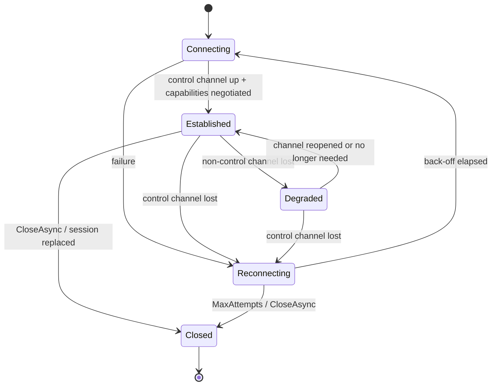
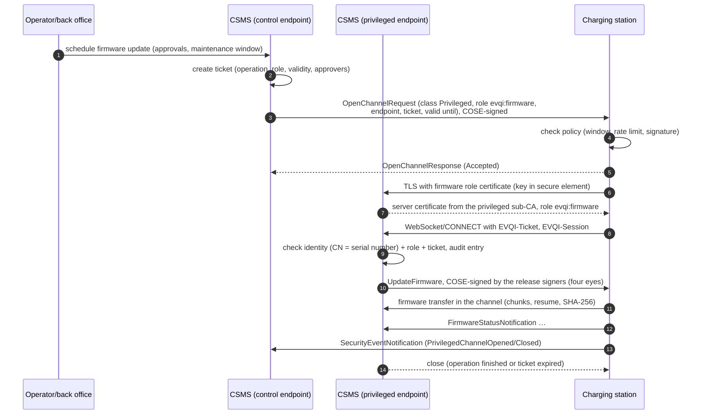
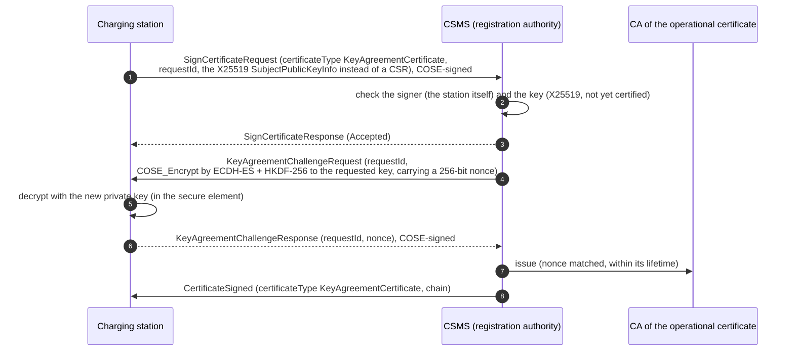
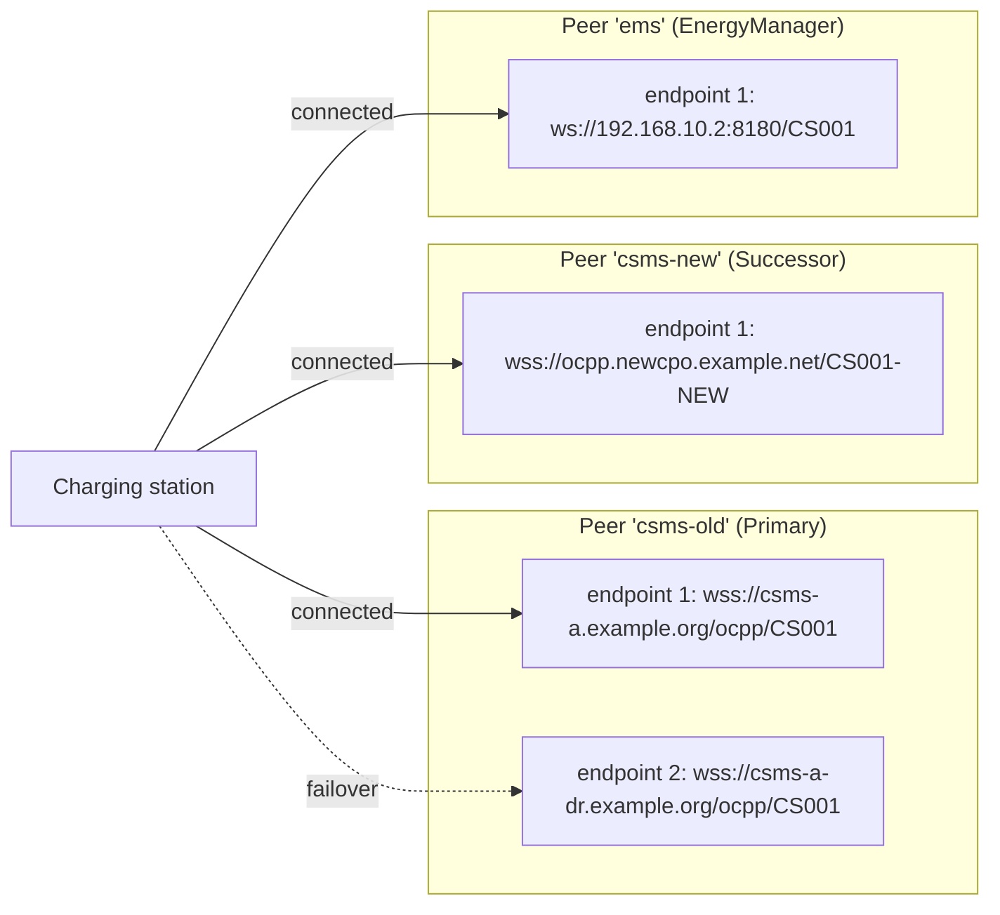

# EVQI Transport: Multi-Channel Communication between Charging Stations and CSMS

**Version 0.2, Draft**, 2026-11-10
[CC-BY-SA 4.0](https://creativecommons.org/licenses/by-sa/4.0/) · [OpenChargingTechnology/Whitepapers](https://github.com/OpenChargingTechnology/Whitepapers) · reference implementations: [Vanaheimr/Hermod](https://github.com/Vanaheimr/Hermod) (transport), [OpenChargingCloud/WWCP_OCPP](https://github.com/OpenChargingCloud/WWCP_OCPP) (OCPP), [OpenChargingCloud/ChargingStation](https://github.com/OpenChargingCloud/ChargingStation) (station)

This document describes the transport layer of
[EVQI – "Unified data exchange for electrical Vehicle charging"](https://nlnet.nl/project/EVQI/),
funded by the NLnet NGI0 Commons Fund. EVQI aims at an open, real-time communication and
validation layer with cryptographic integrity anchors, metrological correctness and low-latency
communication. It is a concept and a work plan, not yet a specification.

It elaborates the outline in
[Resilient, high-available and pooled parallel Connections](../AdvancedConnections/README.md) and
builds on [TLS Client/Server Configuration for OCPP v2.x](../TLSConfiguration/README.md),
[Metrological CBOR](../MetrologicalCBOR/README.md) and
[OCPP 2.x Firmware Updates with Software Separation](../FirmwareUpdateSeparation/README.md).

Chapters 1 to 10 are about the connections between a station and **one** CSMS. Chapters 11 and 12
extend this to **several** back ends at the same time, and to what a server does with a second
connection under an identity that is still connected.

The companion document [Key Pins and TLS 1.3 Raw Public Keys for Local Controllers](RawPublicKeys.md)
covers the hop from a station to a Local Controller, for which no public certificate exists
(section 6.9); its [specification](KeyPinsSpecification.md) says what a node has to do.

---

## Contents

0. [Summary](#0-summary)
1. [Starting point](#1-starting-point)
2. [Transport options: HTTP/1.x, HTTP/2, HTTP/3](#2-transport-options-http1x-http2-http3)
3. [WebTransport](#3-webtransport)
4. [Concept: channel sessions (`IChannelSession` / `IChannel`)](#4-concept-channel-sessions-ichannelsession--ichannel)
5. [Connection setup and discovery via DNS (HTTPS RR, SRV)](#5-connection-setup-and-discovery-via-dns-https-rr-srv)
6. [Security: role certificates, multiple client certificates, privileged channels](#6-security-role-certificates-multiple-client-certificates-privileged-channels)
7. [Message representation and message signatures: Metrological CBOR and COSE](#7-message-representation-and-message-signatures-metrological-cbor-and-cose)
8. [Reconnect policies](#8-reconnect-policies)
9. [Resource and denial-of-service protection](#9-resource-and-denial-of-service-protection)
10. [Mapping to OCPP 1.6 and OCPP 2.x](#10-mapping-to-ocpp-16-and-ocpp-2x)
11. [Several back ends: multi-homed stations](#11-several-back-ends-multi-homed-stations)
12. [Duplicate connections on the server](#12-duplicate-connections-on-the-server)
13. [Implementation status](#13-implementation-status)
14. [Work plan](#14-work-plan)
15. [Open questions and decisions](#15-open-questions-and-decisions)
16. [References](#16-references)

---

## 0. Summary

**The problem.** OCPP-J knows exactly one WebSocket connection per charging station, and on it each
side may have only one CALL outstanding at a time. Everything shares this connection: small
real-time data, transactions, configuration, certificates and firmware commands. Large transfers
(logs, firmware) therefore run over separate HTTP or FTP URLs today, with credentials in the URL
and without uniform authorization or logging, or they clog the only channel. The OCPP 2.1
specification admits as much: frequent large SEND messages "may cause a delay for other messages"
(Part 4, §4.2.4).

**The proposal.** A *channel session* (`IChannelSession`) bundles several named *channels*
(`IChannel`) between one charging station and one CSMS. Every channel is a complete OCPP-J
WebSocket (RFC 6455 framing) with its own priority and its own CALL slot. It runs over one of
three bindings:

| Binding | A channel is | Transport connections per station |
|---|---|---|
| **HTTP/1.x** | its own TCP+TLS connection (RFC 6455) | one per channel |
| **HTTP/2** | its own stream via Extended CONNECT (RFC 8441) | one per role/certificate domain |
| **HTTP/3** | its own QUIC stream via Extended CONNECT (RFC 9220) | one per role/certificate domain |

**WebTransport** is treated as a separate research track (chapter 3): structurally the best fit,
but still a draft and not OCPP-J compatible.

**The load-bearing decisions:**

1. **The control channel is today's OCPP-J WebSocket, unchanged.** Everything else is used only
   after a capability negotiation, which keeps the system fully backward compatible.
2. **The synchronicity rule is per connection** (Part 4, §4.1.1: "this rule is per OCPP-J
   connection"). Every channel therefore has its own outstanding CALL. Message IDs already have
   to be unique across all connections of the same charging station identity (§4.1.4): the
   specification already allows for several connections per identity.
3. **Privileges are bound to the TLS connection.** HTTP/2 (RFC 8740) and QUIC (RFC 9001, §4.4)
   forbid client authentication after the handshake. A channel with elevated privileges therefore
   always needs its own TLS connection with its own role certificate. That is intended: firmware
   updates run over an explicit, time-limited *on-demand channel*, not over the everyday
   WebSocket, and they are logged separately and tamper-evidently.
4. **Messages are signed by default.** Future OCPP messages use
   [Metrological CBOR](../MetrologicalCBOR/README.md) as their default representation and carry
   COSE signatures (RFC 9052). Justified exceptions are allowed. The role in the connection's
   certificate is therefore only an **upper bound**: a message is executed only if both the
   connection's role and the role of the message's signer permit it (chapter 7).
5. **Reconnects and resources are governed per session.** The control channel follows the OCPP
   back-off rule exactly (§5.4). Other channels reconnect afterwards and only when needed,
   privileged ones never automatically. The server holds budgets per identity and per node and
   sheds bulk channels first under load.
6. **Discovery via DNS:** HTTPS RR (RFC 9460) first, then SRV (RFC 2782), then A/AAAA. The TLS
   certificate is always checked against the *configured* name, never against the DNS target.

**Several back ends and duplicate connections.** A station may be connected to several back
ends at once (chapter 11), e.g. a CSMS and its successor during a migration, an energy manager or
an observer.
- Exactly one of them, the *primary*, controls the station.
- Every other peer has an explicit rights profile, a registration and an offline queue of its own.
- Every response leaves on the connection its request came over.

On the server side (chapter 12), a second connection of an identity that is still connected no
longer simply replaces the first. The server probes the old one and refuses the newcomer while the
old one lives, unless the newcomer proves that it is the same client. Every endpoint may pin its
HTTP binding (section 2.6).

**The initial questions, answered briefly:**

- *Is an HTTP/2 WebSocket limited to one stream?* One WebSocket is one stream; RFC 8441 defines it
  that way. Several WebSockets over *one* HTTP/2 connection were always possible. What is
  missing is the session layer above them.
- *Does HTTP/2 schedule by priority itself?* No. RFC 9218 only carries a priority signal; every
  sender schedules on its own. Hermod does so in both directions by now: the server sends by
  priority, and so does the client since Vanaheimr/Hermod#63. Since Vanaheimr/Hermod#62 and
  Vanaheimr/Hermod#66 a stalled reader no longer holds up the other streams of its connection.
  Loss-induced head-of-line blocking at the TCP level remains inherent to HTTP/2; only HTTP/3
  removes it.

---

## 1. Starting point

### 1.1 OCPP-J today

The following points are normative (OCPP 2.1 Edition 2, Part 4; OCPP-J 1.6):

| Topic | Rule | Source |
|---|---|---|
| Roles | charging station = WebSocket client, CSMS = server; the station keeps the connection open all the time | 2.1 Part 4 §3, §3.1 |
| Identity | identity as the last path segment of the connection URL; the CSMS is RECOMMENDED to check it against the credentials | §3.1.1 |
| Versions | negotiated via `Sec-WebSocket-Protocol` (`ocpp1.6`, `ocpp2.0.1`, `ocpp2.1`, registered with IANA) | §3.1.2 |
| Synchronicity | at most one outstanding CALL per sender, **per OCPP-J connection** (2.1: SHALL NOT, 1.6: SHOULD NOT) | §4.1.1 |
| Message IDs | unique across every WebSocket connection using the same charging station identity | §4.1.4 |
| SEND (new in 2.1) | unconfirmed, may be sent while a CALL is outstanding; warning about delaying other messages | §4.2.4 |
| Reconnect | 2.0.1/2.1: increasing back-off with a random part (`RetryBackOffWaitMinimum`, `RetryBackOffRandomRange`, `RetryBackOffRepeatTimes`); 1.6: no back-off rule | 2.1 §5.4, §8; 1.6J §5.4 |
| Local Controller | one WebSocket connection to the CSMS **per connected station** | 2.1 §6.2 |
| Signed messages (2.1) | JWS-wrapped messages with action `<Action>-Signed` | 2.1 §7 |
| File transfer | firmware download and log upload via URLs (`FileTransferProtocols`: FTP, FTPS, HTTP, HTTPS, SFTP); log upload by HTTP PUT, Basic Auth credentials inside the URL; no standardized resume (2.1, N01.FR.27) | 2.1 Part 2, L01/N01 |
| Security profiles | 1 (Basic without TLS), 2 (TLS + Basic), 3 (mTLS); one profile per port is allowed | 2.1 Part 2 A; 1.6 Security WP §2 |
| Certificates | station: CN = serial number; CSMS: CN = FQDN; Extended Key Usage should **not** be used (ISO 15118) | 2.1 Part 2, A00.FR.5xx |
| Firmware authenticity | firmware signature via a separate manufacturer PKI (Firmware Signing Certificate) | 2.1 Part 2 A, L01 |

### 1.2 What hurts

1. **Head-of-line blocking on two levels.** Everything shares one ordered byte stream, and each
   side has a single CALL slot. A large report (`NotifyReport`, `NotifyMonitoringReport`) or a
   stream of SEND messages delays time-critical control.
2. **Large files travel outside OCPP.** Firmware and logs use separate HTTP/FTP servers.
   Credentials sit in URLs, authorization and logging are not uniform, there is no resume and no
   priority control, and every firewall rule is extra infrastructure.
3. **No least privilege.** Whoever controls the one everyday connection (or holds the one client
   certificate) can do everything: load management, network profiles, certificates, firmware.
4. **Privileged operations are not logged separately.** Calibration law demands traceability for
   updates of legally relevant software (section 6.7).
5. **The number of connections scales badly.** A Local Controller with 20 stations holds 21
   connections to the CSMS. After a CSMS restart all stations reconnect at the same time.
6. **Message-level authenticity is optional.** Signed messages exist in OCPP 2.1 but are not
   required, so a TLS-terminating intermediary (Local Controller, load balancer) can read and
   alter everything it relays.

### 1.3 Requirements

| ID | Requirement |
|---|---|
| R1 | Several parallel channels per station with different priorities (real-time, control, bulk) |
| R2 | Bindings: several HTTP/1.x connections, WebSockets over HTTP/2 and over HTTP/3 |
| R3 | Evaluate WebTransport as a separate option |
| R4 | One API across all bindings (`IChannelSession` / `IChannel`) |
| R5 | Mapping to OCPP 1.6 and 2.x, backward compatible |
| R6 | Automatic reconnect policies |
| R7 | Bounded number of TCP connections; a node must not be taken down by a connection flood |
| R8 | Connection setup via DNS SRV and HTTPS RR |
| R9 | Several TLS client certificates between two hosts, with a role extension (RBAC) as in Modbus/TLS |
| R10 | Privileged operations (e.g. firmware) only over explicit on-demand channels with elevated privileges and separate logging (metrological log) |
| R11 | Metrological CBOR as the future default representation, COSE signatures on all messages by default |

### 1.4 Non-goals

- No new wire protocol below WebSocket in stage 1. Every channel speaks OCPP-J (JSON or CBOR).
- No change to the semantics of existing OCPP messages; extensions are additive only.
- No server-initiated connections to the station. The station stays the client (NAT, cellular).

---

## 2. Transport options: HTTP/1.x, HTTP/2, HTTP/3

### 2.1 HTTP/1.x + RFC 6455: one connection per channel

Every channel is its own TCP+TLS connection with its own upgrade handshake.

- **Advantages:** works through every proxy, load balancer and OCPP peer. Hermod's HTTP/1.1
  WebSocket stack is the production OCPP transport (verified with the Autobahn test suite).
  Channels are loss-independent: a lost packet on the bulk channel does not disturb the control
  channel. Different client certificates per channel are trivial because every connection has its
  own handshake.
- **Disadvantages:** every channel costs a TCP and a TLS handshake, socket and TLS buffers on the
  server, and its own keepalive. Prioritization between channels exists only indirectly (TCP
  shares fairly; the application can throttle the bulk channel). The "session" is an application
  fiction: the server has to join connections via a session token (section 4.6).

### 2.2 HTTP/2 + RFC 8441: streams over one connection

Every channel is a stream opened with Extended CONNECT (`:protocol = websocket`); the RFC 6455
framing runs unchanged inside DATA frames.

- **Scheduling.** RFC 9218 (Extensible Prioritization) only signals urgency (0–7) and the
  incremental flag. The protocol enforces nothing; every sender decides locally what to send next.
  Hermod implements this in both roles: `HTTP2SendOrder.PickNext` picks the lowest urgency, then
  non-incremental before incremental, then the least recently served stream, and each pick sends
  one DATA frame of at most the window or frame size (16 KiB by default). A real-time channel with
  `u=0` therefore overtakes a running bulk transfer with `u=6, i` after at most one frame, in both
  directions (uplink since Vanaheimr/Hermod#63).
- **Flow control.** Windows per stream and per connection. Since Vanaheimr/Hermod#62 (server) and
  Vanaheimr/Hermod#66 (client), a channel whose reader stalls no longer blocks the others: the
  client returns connection window on receipt, the server additionally as soon as the peer would
  otherwise starve. The stream window is 1 MiB, the connection window 4 MiB (configurable).
- **Limits:**
  - **TCP head-of-line blocking:** one lost segment halts *all* streams of the connection until it
    has been retransmitted. On lossy cellular links this is the relevant disadvantage compared
    with HTTP/3.
  - **Shared fate:** if the TCP connection breaks, all channels are gone.
  - **One TLS identity per connection:** RFC 8740 forbids TLS 1.3 post-handshake client
    authentication in HTTP/2. Channels with different role certificates need separate
    connections (section 6.4).
  - **Connection reuse (RFC 9113 §9.1.1):** clients may reuse a connection for other origins
    covered by the certificate. For EVQI this must be ruled out across certificate domains.
  - **Infrastructure:** many reverse proxies and load balancers terminate HTTP/2 and speak
    HTTP/1.1 to the backend; RFC 8441 must then be supported end to end. Check this before every
    rollout, and keep the fallback to HTTP/1.x working at all times.

### 2.3 HTTP/3 + RFC 9220: QUIC streams

Every channel is a bidirectional QUIC stream, again via Extended CONNECT.

- **Advantages:**
  - **Loss recovery per stream:** a lost packet halts only the channel it belongs to. This is the
    "transport-loss-independent" variant.
  - **Prioritization in the QUIC sender:** Hermod packs every datagram by `QuicStream.SendUrgency`
    (lowest urgency first, then non-incremental, then round-robin) in both roles.
  - **Cellular-friendly:** connection IDs let the connection survive NAT rebinding; the server
    validates the new path.
- **Limits:**
  - **UDP/443 is filtered** in corporate and some cellular networks. A fallback (HTTP/2, then
    HTTP/1.x) is mandatory.
  - **One TLS identity per connection** (RFC 9001 §4.4: no post-handshake client
    authentication).
  - **0-RTT is unsuitable for OCPP CALLs with side effects** (replay). It stays off, as it is in
    Hermod today.
  - **Maturity:** by its own README, Hermod's HTTP/3 stack is a reference implementation, "not for
    production traffic". Field use requires hardening (chapters 13, 14).

### 2.4 Comparison

| Property | HTTP/1.x (N connections) | HTTP/2 | HTTP/3 |
|---|---|---|---|
| Transport connections per station | N (one per channel) | 1 per certificate domain | 1 per certificate domain |
| Cost of a new channel | TCP + TLS handshake | one CONNECT stream | one CONNECT stream |
| Loss independence between channels | yes | **no** (TCP HOL) | yes |
| Priority between channels | only indirectly (throttling in the sender) | RFC 9218, both directions (Hermod) | QUIC sender urgency (Hermod) |
| A failure takes down | only the channel | all channels of the connection | all channels of the connection (but survives NAT rebinding) |
| Middlebox traversal | very good | good (TLS + ALPN `h2`), check proxies | medium (UDP) |
| Different client certificates | per channel | per connection | per connection |
| Maturity in Hermod | production | implemented, client scheduling new | reference implementation |

**Recommendation:** all three bindings behind the same API. HTTP/1.x is the always-available
fallback and the first production target. HTTP/2 becomes the default binding once the gaps of
chapter 13 are closed. HTTP/3 is preferred where UDP gets through and the stack has been hardened.

### 2.5 The binding of a connection today

Sections 2.1 to 2.4 compare the bindings. This section says which one the reference
implementation's OCPP connections use today, and section 2.6 how an endpoint chooses one.

As of Hermod `f7b00ef2`.

- **The station, WWCP and OCPP speak WebSockets over HTTP/1.1 only.** `OCPPWebSocketClient` and
  `WWCPWebSocketClient` derive from Hermod's HTTP/1.1 `WebSocketClient`, whose upgrade request is
  always an HTTP/1.1 GET. The only related setting, `ApplicationProtocols`, is handed to TLS as
  the ALPN list and changes nothing about what is spoken afterwards.
- **Hermod has the other two bindings, but nothing above Hermod uses them:**

  | | HTTP/2 (RFC 8441) | HTTP/3 (RFC 9220) |
  |---|---|---|
  | Client | `HTTP2ClientConnection.OpenWebSocketAsync`; several WebSockets on one connection, with RFC 9218 priorities in both directions | `Http3ClientConnection.SendExtendedConnect`, low-level only; one QUIC stream per WebSocket |
  | Server | `HTTP2Server` with a connect handler | `Http3ServerConnection` with a connect handler |
  | ALPN | `h2` only; fails if the server picks anything else | `h3` only |
  | Sub-protocol (`ocpp2.1`) | no parameter; only via extra headers | the same |
  | Ping API, keep-alive | none for the WebSocket; HTTP/2 keep-alive off by default, while the server closes after 120 s without frames | none; QUIC keep-alive off by default |
  | Client certificate | one fixed certificate per connection, no selection callback | public API only for self-signed ECDSA P-256 certificates: a CA-issued station certificate cannot be presented |
  | Server sees the client certificate in the connect handler | no | on the connection object, not on the request |
  | A refusal's headers (`Retry-After`) | lost | available |
  | Maturity, by its own README | reference implementation, not for production | reference implementation, not for production |

- **No fallback and no discovery.** Nothing tries `h3`, then `h2`, then `http/1.1`. `Alt-Svc` is
  parsed and not acted on. HTTPS records (RFC 9460) can be queried but are not used to choose a
  connection.
- **TLS-bound TOTP** needs a TLS exporter. .NET's `SslStream`, which the HTTP/1.1 and HTTP/2 stacks
  use, has none, so the binding can be computed neither by the client nor by the server there;
  QUIC (Hermod's own TLS) exports keying material.

### 2.6 Pinning the binding per endpoint

Each endpoint (one way to reach a back end: URL, credentials, client certificate; section 11.3.1)
gets an option `binding`:

| Value | Meaning | URL schemes |
|---|---|---|
| `http/1.1` | RFC 6455 upgrade. With `wss`, ALPN offers `http/1.1` only. Today's behaviour, what every OCPP-J peer supports, and the **default** until `h2` and `h3` are ready for production (section 13.5). | `ws`, `wss` |
| `auto` | the station chooses and falls back (below); meant to become the default later | `ws`, `wss` |
| `h2` | RFC 8441 Extended CONNECT. With `wss`, ALPN offers `h2` only; refused if the server picks something else or does not announce `SETTINGS_ENABLE_CONNECT_PROTOCOL`. With `ws`, HTTP/2 with prior knowledge (h2c), since RFC 9113 removed `Upgrade: h2c`; for test benches only. | `wss` (`ws` for tests) |
| `h3` | RFC 9220 over QUIC, on the URL's port over UDP. | `wss` only: QUIC is always TLS |

**Pinned means strict** (decided, question 26). A pinned binding never falls back; failing to get
it is reported as such ("pinned to h3, no answer over UDP"). That is what pinning is for:
- conformance and interoperability tests;
- sites whose middleboxes are known, e.g. a reverse proxy that terminates HTTP/2 and does not pass
  RFC 8441 through to its back end, which `http/1.1` avoids;
- making sure that a channel session (section 4.8) really runs over one multiplexed connection.

**`auto`** follows the order of section 4.5, item 7, `h3` → `h2` → `http/1.1`, and keeps it
cheap:
- `h3` is tried only where it is known to be offered: the `alpn` of an HTTPS record, `Alt-Svc`
  from an earlier connection, or a remembered success.
- Otherwise one TLS handshake offers `h2` and `http/1.1` together, and the server chooses.
- If the server chooses `h2` but does not announce Extended CONNECT, the station reconnects once
  with `http/1.1` and remembers that.
- The choice is remembered per endpoint and network and checked again from time to time, with
  jitter, so that nothing oscillates.

**What a binding does not change.** The security profile, the client certificate, the
credentials and the sub-protocol are the same on every binding. A binding never weakens TLS:
`h2c` exists only below `ws://`, which is security profile 1 anyway. Each endpoint keeps its own
TLS identity. HTTP/2 and HTTP/3 forbid a second client authentication on an existing connection
(RFC 8740, RFC 9001 §4.4).

---

## 3. WebTransport

### 3.1 What WebTransport is

WebTransport over HTTP/3 (draft-ietf-webtrans-http3; Hermod implements -13) opens a *session* via
Extended CONNECT (`:protocol = webtransport`). Inside the session there are:

- unidirectional and bidirectional streams that **either side** can open,
- unreliable datagrams (RFC 9297 / RFC 9221),
- session-level flow control via capsules,
- a session-bound keying material exporter (draft §4.7).

For environments that block UDP there is the draft WebTransport over HTTP/2
(draft-ietf-webtrans-http2). Hermod does not implement it.

### 3.2 What it would mean between charging station and CSMS

- **One stream per operation instead of one channel per class.** A firmware image is a
  unidirectional stream, and so is a log upload. FIN marks the end; `RESET_STREAM` and
  `STOP_SENDING` abort a single transfer. Transfers do not block each other.
- **Server-initiated streams.** Within an existing session the CSMS can open a stream towards the
  station, e.g. to deliver a file, without first asking the station to connect. The NAT problem is
  solved inside the session. Hermod's `Http3ServerConnection` already supports this
  (`IWebTransportHost`).
- **Datagrams for ephemeral telemetry**, such as live power values for display or local load
  management, where a lost value is replaced by the next one. Datagrams are **not** suitable for
  data relevant to calibration law or billing.
- **The exporter** can bind application signatures and audit entries to exactly this session
  (section 6.7).

### 3.3 Limits

1. **Draft status.** The wire format is still changing. Interoperability exists mainly between
   browsers and servers; embedded implementations are rare.
2. **No RFC 6455 framing.** OCPP-J cannot be carried over unchanged. A binding of its own is
   needed, e.g. one message per bidirectional stream, or length-prefixed messages on a stream:
   a new OCPP transport profile and therefore standardization work.
3. **UDP filtering** as with HTTP/3. The fallback would be WebTransport over HTTP/2, which Hermod
   lacks, or falling back to OCPP-J channels.
4. **Privileges:** as with HTTP/3, one TLS identity per QUIC connection, shared by all sessions on
   it. Privileged operations still need a connection of their own.
5. **Gaps in Hermod:** `WebTransportStream` does not expose `SendUrgency`. The session API is
   synchronous and polling-based (matching the deterministic core) and reachable only through the
   core, not through the Task facade `Http3Client`.

### 3.4 Assessment

| | OCPP-J channels (H1/H2/H3) | WebTransport |
|---|---|---|
| OCPP compatibility | immediate (channel = OCPP-J) | new binding needed |
| Field readiness | H1 today, H2 soon | research |
| File transfers | bulk channel with chunks | ideal (one stream per transfer) |
| Server-initiated | only on request via the control channel | native |
| Unreliable telemetry | no | datagrams |

**Recommendation:** EVQI stage 1 relies on OCPP-J channels. WebTransport is a research track (work
package G): an "OCPP over WebTransport" prototype in Hermod, measurements against the channel
variant and, if successful, a proposal to the Open Charge Alliance. The `IChannel` API is cut so
that a WebTransport binding can implement it later (channel = bidirectional stream with message
framing, channels accepted on both sides).

---

## 4. Concept: channel sessions (`IChannelSession` / `IChannel`)

### 4.1 Terms

| Term | Meaning |
|---|---|
| **Station identity** | the OCPP identity (`identifierString`, at most 48 characters) |
| **Channel session** | the logical association of one station identity with one CSMS endpoint; spans one or more transport connections; has a lifecycle and a reconnect policy |
| **Channel** | named, bidirectional, message-oriented (RFC 6455 semantics); ordered and reliable within itself; its own CALL slot |
| **Channel class** | `Control`, `Realtime`, `Bulk`, `Privileged`; determines priority, lifetime, role and reconnect behaviour |
| **Binding** | HTTP/1.x, HTTP/2, HTTP/3 (later WebTransport) |
| **Certificate domain** | the pair of endpoint and client certificate (= role); exactly one transport connection for HTTP/2 and HTTP/3; channels of different domains **never** share a connection |

### 4.2 Channel classes

| Class | Examples | Lifetime | Priority (RFC 9218) | Role | Reconnect |
|---|---|---|---|---|---|
| `Control` | today's OCPP-J traffic: boot, heartbeat, status, transactions, remote control, charging profiles | permanent | `u=1` | `operational` | always, OCPP §5.4 |
| `Realtime` | `NotifyPeriodicEventStream` (SEND), live power for load management, display | permanent or on demand | `u=0` | `operational` | after the control channel |
| `Bulk` | log upload, `DataCollectorLog`, large reports, local authorization lists | on demand, idle timeout | `u=6, i` | `operational` or `diagnostics` | only with pending work, with resume |
| `Privileged` | firmware, security configuration, certificates, metrological parameters | explicit, time-limited | own connection (`u=3`) | `firmware`, `security-admin`, `metrology` | **never automatically** |

One rule matters: **messages that depend on each other's order stay on one channel.**
Transaction-related messages (`TransactionEvent`, or Start/Stop/MeterValues in 1.6) and the
related status notifications belong to the control channel; billing-relevant meter values do not
move to the real-time channel.

### 4.3 Specification (C# sketch, Hermod style)

```csharp
namespace org.GraphDefined.Vanaheimr.Hermod.Channels
{

    public enum ChannelClass      { Control, Realtime, Bulk, Privileged }
    public enum TransportBinding  { HTTP1, HTTP2, HTTP3, WebTransport }
    public enum ChannelCloseScope { Channel, Connection, Session }

    /// <summary>RFC 9218: urgency 0 (highest) to 7, default 3.</summary>
    public readonly record struct ChannelPriority(Byte Urgency, Boolean Incremental);

    public sealed record ChannelOptions(String           Name,
                                        ChannelClass     Class,
                                        ChannelPriority  Priority,
                                        String?          Role            = null,   // selects the certificate domain
                                        String?          Representation  = null,   // "cbor" or "json"
                                        TimeSpan?        IdleTimeout     = null,
                                        TimeSpan?        MaxLifetime     = null,
                                        String?          Ticket          = null);  // Privileged only

    public sealed record ChannelCloseInfo(UInt16             Code,
                                          String?            Reason,
                                          ChannelCloseScope  Scope,          // what went down with it?
                                          Boolean            ClosedByPeer,
                                          TimeSpan?          RetryAfter);    // server hint, if any

    public interface IChannelSecurity
    {
        String?            LocalRole        { get; }
        String?            PeerRole         { get; }   // from the peer's certificate
        X509Certificate2?  PeerCertificate  { get; }
        Byte[]?            ExportKeyingMaterial(String Label, Int32 Length);   // where the TLS stack offers it
    }

    public interface IChannel : IAsyncDisposable
    {
        String                  Name            { get; }
        ChannelClass            Class           { get; }
        TransportBinding        Binding         { get; }
        String                  SubProtocol     { get; }   // e.g. "ocpp2.1"
        String                  Representation  { get; }   // "cbor" or "json"
        ChannelPriority         Priority        { get; }
        IChannelSecurity        Security        { get; }

        Task                    UpdatePriorityAsync (ChannelPriority Priority, CancellationToken CancellationToken = default);

        Task                    SendTextAsync       (String Text,                CancellationToken CancellationToken = default);
        Task                    SendBinaryAsync     (ReadOnlyMemory<Byte> Data,  CancellationToken CancellationToken = default);
        Task<ChannelMessage?>   ReceiveAsync        (CancellationToken CancellationToken = default);   // null = closed

        Task                    CloseAsync          (UInt16 Code, String Reason, CancellationToken CancellationToken = default);
        Task<ChannelCloseInfo>  Completion          { get; }
    }

    public interface IChannelSession : IAsyncDisposable
    {
        String                          SessionId     { get; }
        String                          PeerIdentity  { get; }
        ChannelSessionState             State         { get; }   // Connecting, Established, Degraded, Reconnecting, Closed
        IReadOnlyCollection<IChannel>   Channels      { get; }

        Task<IChannel>                  OpenChannelAsync    (ChannelOptions Options, CancellationToken CancellationToken = default);
        IAsyncEnumerable<IChannel>      AcceptChannelsAsync (CancellationToken CancellationToken = default);   // server; client only with WebTransport

        Task                            CloseAsync          (UInt16 Code, String Reason, CancellationToken CancellationToken = default);
        Task<ChannelCloseInfo>          Completion          { get; }
    }

}
```

**Semantics:**

- **Ordering and reliability** hold per channel as in RFC 6455. There is no ordering across
  channels.
- **Backpressure:** `Send…Async` completes once the transport has accepted the data (flow-control
  window or socket buffer). Every channel has its own limit for pending data (like today's
  `MaxBackpressure`).
- **Priority is a hint.** Every binding maps it as well as it can (section 4.4).
  `UpdatePriorityAsync` can always be called; with HTTP/1.x it is implemented locally (throttling).
- **Closing:** `ChannelCloseInfo.Scope` states whether only this channel, the whole transport
  connection or the session is affected. The application must be able to tell the three cases
  apart.
- **Pull core, event adapter:** the API is pull-based (`ReceiveAsync`). WWCP_OCPP works with events
  today (`OnTextMessageReceived` etc.). A thin adapter runs a receive loop and raises today's
  events, so WWCP_OCPP stays usable unchanged.

### 4.4 Semantics per binding

| | HTTP/1.x | HTTP/2 | HTTP/3 | WebTransport (later) |
|---|---|---|---|---|
| Channel = | TCP+TLS connection + upgrade | Extended CONNECT stream | Extended CONNECT stream | bidirectional stream in a session |
| Session = | group of connections held together by a session token | connection(s) per certificate domain + token | as HTTP/2 | WT session |
| Priority | local throttling, otherwise TCP fairness | RFC 9218 in both directions + PRIORITY_UPDATE | QUIC sender urgency + PRIORITY_UPDATE | stream urgency (missing in Hermod) |
| Loss on channel A disturbs channel B | no | yes | no | no |
| Server opens a channel | only on request via the control channel | as HTTP/1.x | as HTTP/1.x | native |
| Limits per connection | – | `SETTINGS_MAX_CONCURRENT_STREAMS` | `MAX_STREAMS` | WT stream limits |

### 4.5 Discussion: where the abstraction leaks

1. **Different shared fate.** With HTTP/1.x a channel dies alone; with HTTP/2 and HTTP/3 all
   channels of a connection die together. The API makes this visible through `Scope` instead of
   hiding it. With HTTP/1.x the session is a fiction that lives as long as the control channel
   does. If that fails, the server closes the session's other channels; otherwise orphaned
   channels remain.
2. **Priority is a hint, not a guarantee.** HTTP/1.x cannot really prioritize between channels, it
   can only throttle the bulk channel. HTTP/2 can, until the next lost TCP segment. HTTP/3 does it
   best.
3. **Loss independence holds only *between* channels.** Within a channel everything stays ordered
   and reliable; two transfers on the same bulk channel still block each other. Only WebTransport,
   with one stream per transfer, solves that.
4. **Server-initiated channels do not exist** (except with WebTransport). The CSMS requests a
   channel via the control channel (`OpenChannel`, chapter 10), and the station opens it.
5. **Privileges bound to the connection.** A channel with a different role needs a different
   connection. With HTTP/2 and HTTP/3 the goal "one connection per station" therefore holds per
   certificate domain: one connection in everyday operation, briefly two during a firmware update.
6. **Existing identity logic.** Today's CSMS implementations commonly close all older connections
   when a new one with the same identity arrives ("newest wins"). An additional channel with the
   same identity would kill the control channel at such a peer. A station therefore opens extra
   channels **only** after a successful capability negotiation and only to the endpoints the CSMS
   announced, and "newest wins" in the CSMS becomes *per channel*.
7. **Binding choice and fallback** are policy, not API. The order is HTTP/3 → HTTP/2 → HTTP/1.x.
   Candidates come from the ALPN of the HTTPS RR (chapter 5), from `Alt-Svc` (RFC 7838) or from
   earlier connections. The choice is remembered per network and re-checked periodically with
   jitter, so nothing oscillates.

### 4.6 Conventions on the wire

- **URLs:** the station identity stays the last path segment (OCPP §3.1.1).
  - Control channel: unchanged, e.g. `wss://csms.example.com/ocpp/CS001`.
  - Further channels: to a channel endpoint **announced** by the CSMS, e.g.
    `wss://csms.example.com/ocpp-channels/CS001`. A path of their own keeps channels out of the
    "newest wins" logic of older peers.
  - Privileged channels: to an endpoint of their own, e.g. `wss://ops.csms.example.com/ocpp/CS001`
    (section 6.5).
- **Headers** (on the HTTP/1.1 upgrade or in the Extended CONNECT):
  - `EVQI-Session: <token>` – assigns the channel to its session. The token is an opaque,
    short-lived value signed by the CSMS and obtained during the capability negotiation. It serves
    **only for correlation, not for authentication**: every channel authenticates itself
    (certificate or Basic Auth) and must yield the same identity.
  - `EVQI-Channel: <name>; class=<class>; repr=<cbor|json>`
  - `EVQI-Ticket: <ticket>` – privileged channels only (section 6.5).
- **Subprotocol:** every channel negotiates the same OCPP version as the control channel
  (`ocpp2.1` etc.). A channel speaks OCPP-J, as JSON in text frames or as CBOR in binary frames
  (chapter 7).
- **Messages:** message IDs are unique across all channels (OCPP already requires this). Responses
  travel on the channel the request came on. Every channel has its own CALL slot.
- **Per-channel authorization:** for every message the receiver checks whether it is allowed on
  this channel and with this role (sections 6.3, 7.4, 10.5). Violations are answered with
  `CALLERROR` `SecurityError` (present in OCPP-J 1.6 and 2.x).

### 4.7 Lifecycle of a session



If a session loses its control channel, the session as a whole is `Reconnecting`. All other
channels are closed and reopened only after a new negotiation. A new session of the same identity
replaces the old one completely, with all its channels.

### 4.8 Strategies for several channels

**Why at all.** OCPP-J allows one outstanding CALL per sender **per connection** (Part 4
§4.1.1), and everything on one connection is delivered in order. Parallelism, and freedom from
head-of-line blocking, therefore need more than one connection or stream. A channel session
provides them: channel classes (`Control`, `Realtime`, `Bulk`, `Privileged`; section 4.2), a
capability negotiation (section 10.2) and a session token (section 4.6). What follows from
having several back ends at once is in section 11.6.

**Ways of using several channels, and when each makes sense:**

| Strategy | Example | Ordering | Assessment |
|---|---|---|---|
| **By class** (section 4.2) | transactions on `Control`, live power on `Realtime`, logs on `Bulk` | kept, because messages that depend on each other stay on one channel | the default |
| **By latency** | a dedicated channel for `Authorize`, `RequestStartTransaction` and `RemoteStartTransaction`, so that a large report never delays a driver at the plug | as above; the channel carries only independent requests | worth it at sites with heavy reporting; a class `Interactive`, or `Realtime` widened, rather than a new mechanism |
| **By affinity** | a Local Controller or gateway with one stream per station behind it (section 10.4) | per station | the main gain of HTTP/2 for a Local Controller: 21 connections become one |
| **Round-robin pool** | N identical control channels | **lost** across channels; acceptable only for independent requests (`Get*`, queries) | not for a station's own traffic; a transaction's messages must stay on one channel |

**Per binding:** with `http/1.1` every channel is a TCP and TLS connection of its own, which also
allows a different client certificate per channel. With `h2` and `h3` the channels are streams of
one connection per certificate domain (section 4.1).

---

## 5. Connection setup and discovery via DNS (HTTPS RR, SRV)

### 5.1 Goals

Load balancing and failover across several CSMS nodes, protocol selection (ALPN
`h3`/`h2`/`http/1.1`), port and address hints and ECH, without changing the station's
configuration.

### 5.2 Procedure

1. **The starting point** is the configured OCPP endpoint URL. In OCPP 2.x it lives in the
   NetworkConnectionProfile slot (`ocppCsmsUrl`). Choosing between slots
   (`NetworkConfigurationPriority`) remains OCPP's job; discovery works *within* one slot.
2. **HTTPS RR (RFC 9460)** for the host of the URL. For port 443 this is the host name itself,
   otherwise port prefix naming applies, `_8443._https.csms.example.com` (§9.1). RFC 9460 §9.6
   explicitly applies to WebSocket as well. The ServiceMode records, sorted by SvcPriority, yield
   TargetName, `alpn`, `port`, `ipv4hint`/`ipv6hint` and `ech`; AliasMode points to another name.
3. **Without an HTTPS RR: SRV (RFC 2782)** under `_ocpp._tcp.<host>`, as already proposed in
   [TLS Configuration §1.39](../TLSConfiguration/README.md#139-dns-service-records): priority,
   weighted random selection, failover to the next target. The service name "ocpp" is **not**
   registered with IANA (as of 2026-10-03); it should be registered per RFC 6335 before
   production use.
4. **A/AAAA** with Happy Eyeballs (RFC 8305) across IPv6 and IPv4.
5. **TLS:** SNI and certificate validation against the **configured origin name**, not against the
   DNS target (RFC 9460 §9.4: the TLS SNI indicates the origin, not the TargetName). The CSMS
   certificate carries the FQDN in its CN (OCPP A00.FR.510). A manipulated DNS can therefore only
   redirect the station to servers that hold a valid certificate for the configured name: an
   outage is possible, redirection to a foreign server is not.
6. **DNS transport:** DoT/DoH to a trusted resolver, or DNSSEC validation where available.
7. **Robustness:** if DNS is unreachable, stale records are used ("serve stale", RFC 8767), plus a
   last-known-good endpoint list. A DNS outage must not prevent reconnecting.
8. **Interplay with reconnects:** failed targets rotate in priority order; after K failures across
   all targets the name is resolved again.

**Privileged endpoints are not discovered via DNS.** The CSMS announces their URL over the already
authenticated control channel, and the station accepts it only if the server certificate there
carries the matching role (chapter 6). Without DNSSEC, DNS is not authenticated and must not
decide the path to elevated privileges.

### 5.3 Status in Hermod

- **Available:**
  - Record types SRV, SVCB, HTTPS, TLSA, A/AAAA and TXT with parsers.
  - Transports UDP, TCP, DoT and DoH; a DNSSEC validator.
  - **SRV is already used when connecting:** `ATCPClient` with `DNSService` (`SRV_Spec`), available
    through the HTTP client and the `WebSocketClient`.
- **Gaps:**
  - An empty SRV answer fails the connection instead of falling back to A/AAAA.
  - There is no failover to the next SRV target. The existing `DNSSRVManager` with health tracking
    is not wired in.
  - HTTPS/SVCB records are not used to choose the connection; their SvcParams are raw bytes, and
    the JSON path stores presentation format instead of wire format there.
  - Happy Eyeballs, ECH and serve-stale are missing.
  - The Modbus client takes no `SRV_Spec`.

---

## 6. Security: role certificates, multiple client certificates, privileged channels

### 6.1 Model: Modbus/TCP Security

The Modbus/TCP Security specification (Modbus.org) carries a client's role as an X.509 extension in
its client certificate: OID `1.3.6.1.4.1.50316.802.1`, value a DER `UTF8String`. The server derives
from the role which function codes and registers are allowed. Hermod implements this in
`Hermod/Modbus/SunSpec`:

- `SunSpecRoles.RoleOid` and the four mandatory roles.
- `RoleExtractor.TryExtractRole` checks strictly: exactly one `UTF8String`, no trailing data, no
  NUL.
- `ModbusPKI.BuildSunSpecRoleExtension` creates the extension (non-critical).
- `ModbusTlsFrontend` reads the role once per connection; `AuthorizationPolicy` decides per
  request, and a denial is Modbus exception 0x01.
- `OnModbusRequest` and the OpenTelemetry metrics record the decisions.
- The Modbus/TLS energy meter writes denials and write accesses into a signed, hash-chained log
  book.

On the client side there is one certificate per connection, and the role is chosen by picking the
certificate file.

### 6.2 Transfer to EVQI

- **One role per certificate**, same encoding as Modbus (one `UTF8String`) but **its own OID**.
  Using the Modbus.org OID for OCPP semantics would be wrong. The OID comes from the arc of
  GraphDefined GmbH, IANA Private Enterprise Number **60483** (`1.3.6.1.4.1.60483`), whose
  arc `.42` is assigned to EVQI (2026-11-01) and recorded in the
  [GraphDefined OID registry](https://github.com/Vanaheimr/Styx/blob/master/OID-Registry.md):

  | OID | Meaning |
  |---|---|
  | `1.3.6.1.4.1.60483.42` | EVQI |
  | `1.3.6.1.4.1.60483.42.1` | EVQI role extension (one DER `UTF8String`, as in Modbus/TCP Security) |
  | `1.3.6.1.4.1.60483.42.2` | certificate policy "EVQI Privileged Operations" |
  | `1.3.6.1.4.1.60483.42.3` | certificate policy "EVQI Key Agreement" (section 6.8) |

  One role per certificate matches "one certificate domain = one connection" exactly, and
  `RoleExtractor` can be reused with a different OID.
- **The certificate role is an upper bound.** It states the most a connection may ever do. Because
  messages are signed by default, what is actually executed is further limited by the role of the
  message's signer (section 7.4).
- **No Extended Key Usage for roles.** OCPP advises against EKU (ISO 15118 compatibility,
  A00.FR.5xx); the role is an extension of its own.
- **Criticality:** the *operational* certificate (security profile 3, CN = serial number) carries
  the role **non-critical**, so it keeps working with legacy CSMS implementations. *Privileged*
  certificates carry it **critical**: a validator that does not know the extension rejects the
  certificate, so a stolen firmware certificate is accepted nowhere as an ordinary station
  certificate. The EVQI endpoints must accept exactly this OID explicitly. The behaviour of
  SslStream/Windows and of OpenSSL with unknown critical extensions has to be pinned down by
  tests.
- **A sub-CA of its own for privileged operations** under the CSO root, with the certificate policy
  `1.3.6.1.4.1.60483.42.2`. The privileged endpoint trusts *only* this sub-CA. This is defence in
  depth: even if role checking had a bug, an operational certificate would not chain there.
- **Both directions:** in OCPP the *station executes commands*. The station must therefore check
  that privileged commands arrive over a connection whose **server certificate** carries the
  matching role; conversely the CSMS checks the role in the station's **client certificate**.
  Roles appear in both certificates.
- **Key storage:** privileged keys belong in a secure element or TPM 2.0, or in an HSM on the CSMS
  side. Hermod, Styx and WWCP_Node have no TPM/PKCS#11 binding today, and WWCP_Node stores private
  keys unencrypted, protected by file permissions. That is a work package.
- **Short-lived privileged certificates (option):** issued per maintenance window via a CSR, in
  OCPP 2.x e.g. by `SignCertificateRequest` with a new `certificateType` for role certificates.
  This limits the damage of a lost key and makes revocation lists largely unnecessary.

### 6.3 Role model (proposal)

| Role | May (excerpt) | Channel class |
|---|---|---|
| `evqi:operational` | everyday operation: boot, heartbeat, status, transactions, authorization, remote start/stop, charging profiles, reservations, `TriggerMessage`, `GetVariables`, periodic event streams | Control, Realtime, Bulk |
| `evqi:diagnostics` | `GetLog` uploads, `DataCollectorLog`, large reports, monitoring reports | Bulk |
| `evqi:security-admin` | `InstallCertificate`, `DeleteCertificate`, `CertificateSigned`, `SetNetworkProfile`, `SetVariables` on `SecurityCtrlr`/`OCPPCommCtrlr`/`EVQICtrlr` (1.6: `ChangeConfiguration` of security keys), signature policies and user roles | Privileged |
| `evqi:firmware` | `UpdateFirmware` / `SignedUpdateFirmware`, `PublishFirmware` / `UnpublishFirmware`, `FirmwareStatusNotification`, firmware transfer, for firmware components without regulatory classification | Privileged |
| `evqi:metrology` | parameters and software relevant to calibration law, including metrologically classified firmware components, retrieval of the metrological log | Privileged |

The split between `evqi:firmware` and `evqi:metrology` follows the firmware component model of
[Firmware Updates with Software Separation](../FirmwareUpdateSeparation/README.md): a component's
regulatory classification decides which role may update it.

Customer-related data (`CustomerInformation`) may deserve a role of its own for data protection
reasons. The model is a proposal and is to be agreed with operators, manufacturers and PTB.

### 6.4 Certificate selection per channel

- **Client:** every channel belongs to a certificate domain through its role. With HTTP/1.x every
  connection picks its certificate (Hermod: `LocalCertificateSelector` on the `WebSocketClient`).
  With HTTP/2 and HTTP/3 there is a connection pool keyed by (endpoint, role); coalescing across
  domains is ruled out.
- **Server:** separate endpoints per domain (host name/SNI or port) are the simplest and most
  robust solution. They allow separate infrastructure, network segmentation, HSM integration and
  logging. With TLS 1.3 the server could also hint the matching CA on one endpoint via the
  `certificate_authorities` extension of the CertificateRequest; EVQI does not need this.

### 6.5 On-demand channel with elevated privileges: procedure



Rules:

1. The request on the control channel is harmless in itself: it only asks for a connection. It is
   signed nevertheless (chapter 7), so that its origin from the CSMS is verifiable even across a
   Local Controller.
2. The station executes privileged commands **only** on a privileged channel and only with a valid
   signature of an authorized signer (section 7.4). For the migration there is the station policy
   `PrivilegedActionsOnControlChannel` with the levels `Allowed` (legacy behaviour),
   `AllowedAndLogged` and `Rejected` (target, answered with `CALLERROR SecurityError`).
3. **No automatic reconnect.** Within the ticket's validity a few retries are allowed (e.g. 3);
   after that a new ticket is required.
4. The channel closes when the operation ends or the ticket expires, at the latest after
   `MaxLifetime`.
5. The firmware signature of the manufacturer PKI remains the authenticity anchor of the image.
   The privileged channel and the message signatures govern *who* may trigger an update, and they
   log it. The mechanisms complement each other.

### 6.6 Local Controller and privileged channels

A Local Controller terminates TLS (OCPP 2.1 §6.5). If the privileged channel ran through it, it
would itself need the firmware role, which is to be avoided. Two options:

- **(a)** For privileged channels the station connects directly to the `ops` endpoint. This
  requires network reachability.
- **(b)** The Local Controller tunnels the privileged channel blindly: via classic CONNECT (TCP)
  over HTTP/2 or via CONNECT-UDP (RFC 9298) over HTTP/3. The TLS connection then runs end to end
  from the station to the CSMS.

Message signatures (chapter 7) keep the commands authentic in both cases, but only option (b) or
(a) keeps the transport privileges away from the Local Controller. Decision open (chapter 15).

### 6.7 Separate logging (audit log and metrological log)

- **What:** every message on privileged channels; opening, closing and rejecting channels; role
  violations; the ticket lifecycle. On the station additionally every step of a firmware update
  (download, check, installation, restart, version change).
- **How:** append-only, hash-chained, signed per entry, with sequence numbers to detect gaps.
  Signed messages are stored **as received**, as COSE objects, so they can be verified again years
  later (deterministic encoding, chapter 7). Proposed fields: `seq`, `ts`, `prevHash`,
  `sessionId`, `channel`, `ticket`, `role`, `signerKid`, `peerCertSHA256`, `direction`,
  `messageType`, `action`, `messageId`, `payloadSHA256` or the COSE object itself, `result`. Where
  the TLS stack offers an exporter, an exporter value binds the entry to the connection (Hermod's
  own QUIC TLS stack has `ExportKeyingMaterial`; for SslStream this remains to be checked).
- **Reuse:** WWCP_Node already has a fitting format, `Logging/SignedLog.cs` (JSON Lines under
  `logs/metrological/`, hash chain, ECDSA P-256, `Verify`, `Log.Metrological(…)`), and the
  Modbus/TLS energy meter uses the same pattern. EVQI builds on it rather than inventing a third
  format.
- **Calibration law:** for updates of legally relevant software, MID and WELMEC Guide 7.2 require,
  among other things, traceability, typically through an event logger. Which events are relevant
  to calibration law, and which log format a conformity assessment accepts, is to be clarified
  with PTB (chapter 15).
- **Retrieval:** OCPP 2.1 knows the log types `DiagnosticsLog`, `SecurityLog` and
  `DataCollectorLog`. New would be `EVQIAuditLog` and `MetrologicalLog` (section 10.6, E6). The
  upload uses the bulk channel; until standardized, via `DataTransfer`/`customData`.

### 6.8 Key-agreement certificates

Section 7.2 encrypts to a recipient's public key with ECDH-ES. That key needs a certificate of its
own: the sender must know that the key belongs to the party it means to address, and a Local
Controller that relays the message must not be able to put its own key in its place. Decided on
2026-11-01 (chapter 15, question 12):

| Field | Value |
|---|---|
| Subject | the holder's identity, by the naming rule of its TLS certificate: station CN = serial number, CSMS CN = FQDN (section 1.1) |
| Public key | ECDH on P-256 (mandatory to implement); X25519 and brainpoolP256r1 optional |
| `keyUsage` | `keyAgreement` only, critical |
| Extended Key Usage | absent, as for every EVQI certificate (section 6.2) |
| EVQI role extension | absent: a key-agreement key decrypts, it authorizes nothing |
| Certificate policy | `1.3.6.1.4.1.60483.42.3` "EVQI Key Agreement" |
| Validity | 90 days by default, never beyond the holder's operational certificate |

- **P-256 as the baseline,** because the key belongs in the secure element (section 6.2, key
  storage), and P-256 is the one curve every common secure element computes ECDH on; some offer
  nothing else. X25519 is cheaper in software and needs no on-curve check, only RFC 7748's check of
  the output; brainpoolP256r1 is there where national requirements ask for it. A sender supports
  every curve the profile allows; the recipient chooses.
- **`keyAgreement` and nothing else, marked critical.** A validator that honours it refuses the key
  for TLS and for signatures, so key separation does not depend on discipline. For X25519 and
  X448, RFC 8410 §5 requires `keyAgreement` anyway.
- **A certificate policy rather than the role extension.** The policy marks the certificate as
  EVQI's key-agreement certificate, so a sender can refuse an ordinary certificate that merely
  happens to carry an ECDH-capable key. The role extension stays reserved for what authorizes.

**Issuer: the CA of the holder's operational certificate.** Not a hierarchy of its own: a sender
already validates the holder's identity under that trust anchor, and a separate CA would add a
trust anchor to distribute without adding a check. And not the privileged sub-CA of section 6.2:
the privileged endpoint trusts only that sub-CA, and a key-agreement certificate confers no
privilege. Within the one CA, the certificate policy keeps the two kinds of certificate apart.

**Issuance:**

- The holder generates the key pair itself, in the secure element or TPM where there is one. The
  private key never leaves it.
- OCPP 2.x: `SignCertificateRequest` with a new `certificateType` `KeyAgreementCertificate`,
  answered by `CertificateSigned` with the same type. It is the path of the operational
  certificate and runs on the control channel (section 10.5): it concerns the holder's own key and
  grants nothing. OCPP 1.6: `DataTransfer` until standardized (E11).
- Proof of possession: for P-256 and brainpool, the PKCS#10 request is signed with the
  key-agreement key itself. That is the one signature the key ever makes, over a structure that
  cannot be mistaken for an OCPP message. X25519 cannot sign; its request proves possession by
  decrypting a challenge (below).
- The CSMS keeps the issued certificate per station: it is the first sender that needs it.

**Proof of possession for a key that cannot sign (X25519), decided on 2026-11-01:** the
requester proves that it can do with the key exactly what the certificate will certify, which is
to decrypt what was encrypted to it. This is the indirect proof of possession of CRMF
(RFC 4211, section 4) carried out with COSE, and it needs nothing beyond the ECDH-ES of
section 7.2.



Rules:

1. **The request names a key, not a CSR.** A PKCS#10 request needs a signature by the key it
   carries, so for X25519 the request carries the bare `SubjectPublicKeyInfo`. Who asks is
   established by the request itself: it arrives over the station's own authenticated connection
   and is signed by the station (section 7.3). Proof of possession adds that the requester also
   holds the private key.
2. **The challenge is encrypted to the requested key.** It is a `COSE_Encrypt` with one
   `ECDH-ES + HKDF-256` recipient, which names the key by `kid` = SHA-256 of the
   `SubjectPublicKeyInfo` (there is no certificate yet for `x5t` to name). It carries no PartyU or
   PartyV information. Identities written into the recipient's headers are read back from those
   same headers, so whoever relays the challenge relays them too, and they would bind nothing. What
   binds the answer to the request is the `requestId` and the station's signature on the answer.
   The content is an AEAD of section 7.2. The nonce is 32 bytes from a dependable source of
   randomness.
3. **One challenge per request, used once, short-lived.** The nonce expires after
   `EVQICtrlr.KeyAgreementChallengeTimeout` (5 minutes by default). It is bound to the `requestId`
   (OCPP 2.1's, otherwise one the CSMS assigns) and is forgotten once answered, right or wrong.
   A wrong or late answer means no certificate, and a `SecurityEventNotification`
   `KeyPossessionNotProven`.
4. **The answer travels signed, and in the clear.** A Local Controller relaying the response sees
   the nonce, but only after the station has already used it. The nonce is single-use, and the
   station's signature binds it to the `requestId`. Encrypting the answer would add nothing.
5. **Signing keys keep their CSR.** P-256 and brainpool keys prove possession by the signed PKCS#10
   request as before. The challenge is for keys that cannot sign, which today means X25519.

**Rotation:**

- Renewal starts when a third of the validity is left, so the old and the new certificate overlap.
- The holder keeps the private key of the previous certificate until that certificate has expired
  plus a grace period for messages in flight (7 days by default), then deletes it. This bounds what
  a later compromise of the key reveals, which is the forward secrecy that section 7.2 says is
  missing, to the messages of about one validity period.
- Data stored encrypted for longer is re-encrypted by whoever keeps it. Old keys are not kept for
  its sake.
- After a compromise: revoke at the CA, issue a new certificate and announce it (below). As with
  the short-lived role certificates of section 6.2, the short validity is what makes revocation
  lists largely unnecessary.
- Device model: `EVQICtrlr.KeyAgreementCertificateLifetime` and
  `EVQICtrlr.KeyAgreementKeyRetention`.

**How a sender learns the recipient's current certificate:**

- **The CSMS** knows each station's certificate from issuance.
- **A station** learns the CSMS's certificate from `NotifyKeyAgreementCertificate` (CSMS → CS,
  signed, carrying the chain). The CSMS sends it after session setup when the station's copy is
  missing or outdated, and on every rotation. `GetKeyAgreementCertificate` fetches it on demand,
  in either direction.
- **Third parties** (a manufacturer receiving a station's log, a contract holder): the same message
  carries their certificate to a station, and the CSMS hands a station's certificate to a third
  party it forwards data for. Validation then runs against the trust anchor of that party.
- **Every certificate is validated before use, however it arrived:** chain to the expected trust
  anchor, certificate policy `1.3.6.1.4.1.60483.42.3`, `keyUsage: keyAgreement`, validity, and a
  subject that names the party the sender means to address. This makes the delivery path
  irrelevant to security. A Local Controller that relays `NotifyKeyAgreementCertificate` can drop
  it but cannot substitute its own key, because it has no certificate under the station's or the
  CSMS's name. A sender without a valid certificate for its recipient encrypts to nobody else and
  does not fall back to plaintext.
- **Which key a message is for:** the recipient structure carries the SHA-256 thumbprint of the
  recipient's certificate as `x5t` (RFC 9360) rather than a `kid`. During the overlap the recipient
  picks the matching private key, and it refuses a thumbprint that matches none of its
  certificates instead of trying its keys in turn.

### 6.9 Local Controllers without a PKI: key pins and raw public keys

Towards its stations a Local Controller is the TLS server (OCPP 2.1 Part 4 §6.5), in a private
network for which no public CA issues a certificate. The companion document
[Key Pins and TLS 1.3 Raw Public Keys for Local Controllers](RawPublicKeys.md) compares an internal
PKI, a pinned self-signed certificate, TLS 1.3 raw public keys (RFC 7250) and OCPP over SSH, and
proposes:

- **Key pins:** per endpoint, SHA-256 over the Local Controller's SubjectPublicKeyInfo (TLSA
  `3 1 1`). On a key-pinned endpoint they replace the chain, name and validity checks, and only
  there.
- **One key, three wrappers:** the same key in a CA-issued certificate, in a self-signed carrier
  certificate or raw. Unmodified stations, stations with a verify callback and stations with RFC
  7250 share one listener and one pin.
- **Distribution** by the CSMS, signed end to end (chapter 7); trust on first use only on request,
  and on probation until the CSMS confirms the pin.
- **Roles:** a raw key carries no role extension (section 6.2), so its role is configuration.
  Privileged channels keep their role certificates (section 6.6).

Its work packages are phase K of chapter 14.

---

## 7. Message representation and message signatures: Metrological CBOR and COSE

### 7.1 Metrological CBOR as the default representation

Today OCPP-J messages are JSON text. EVQI makes **CBOR** (RFC 8949) in deterministic encoding
(RFC 8949, §4.2.1) the future default representation of OCPP messages, with every measured value
encoded as a [Metrological CBOR](../MetrologicalCBOR/README.md) value (CBOR tag 44252, registered
with IANA on 2026-08-19).

- **Why CBOR:**
  - **Exact values with unit, SI prefix and measurement uncertainty.** A reading stays the reading
    the instrument displayed: `1.10 kWh` remains distinguishable from `1.1 kWh`, `5.00 mA` is not
    silently turned into `0.005 A`, and the uncertainty is stated according to GUM. JSON numbers
    can express none of this reliably.
  - **Deterministic encoding.** The bytes of a message are a function of its content. That makes
    messages signable without a separate canonicalization step, and a re-encoded message still
    verifies.
  - **Compactness.** Signatures, certificates and binary data are byte strings instead of base64
    text. Once every message is signed, the signature is often the largest field; in a textual
    encoding it grows by a third again.
  - **Robust degradation.** A generic CBOR decoder that does not know tag 44252 still sees a
    well-formed array of standard numbers.
- **Framing:** the OCPP-J message array maps one-to-one onto a CBOR array
  (`[MessageTypeId, MessageId, Action, Payload]`), sent in WebSocket **binary** frames. In
  version 1 the payload is a CBOR map with the field names of the OCPP JSON schemas as text keys;
  integer keys for further compactness are an option for later (chapter 15).
- **Negotiation per channel:** the representation is part of the capability negotiation
  (`representations: ["cbor", "json"]`) and fixed for the lifetime of a channel
  (`EVQI-Channel: …; repr=cbor`). The control channel stays JSON towards legacy peers.
- **Gateways to JSON-only peers:** [metrological-text.md](../MetrologicalCBOR/metrological-text.md)
  defines the text form of a metrological value and the CBOR ↔ JSON document conversion. A
  signature covers CBOR bytes, though, so a gateway must carry a signed object **unchanged** (as a
  byte string, e.g. base64url inside JSON) instead of converting or re-signing its content.

### 7.2 COSE-signed OCPP messages

- **Structures (RFC 9052):**
  - `COSE_Sign1` for a message with one signer.
  - `COSE_Sign` for several signers on one message, e.g. a firmware update approved under the
    four-eyes principle carries two signatures.
  - **Countersignatures (RFC 9338)** for parties that endorse a message without adding content
    (Local Controller, a CSMS forwarding data to third parties).
  - The layering follows the [worked example of Metrological CBOR](../MetrologicalCBOR/tag-44252-signed-example.md):
    the meter signs its readings, the station signs its own statement around them, the operator
    countersigns.
- **What a signature covers:** besides the payload, the protected header carries the algorithm,
  the key identifier (`kid`, e.g. an RFC 9679 thumbprint, or `x5t`/`x5chain`) and the OCPP context:
  message type, message ID, action, sender and destination identity, a timestamp, and for
  responses the ID of the request. A signature can therefore not be replayed into another message,
  towards another station or later. Freshness rests on the timestamp window plus message ID
  uniqueness, which OCPP already requires per identity; it presupposes trustworthy time (see
  [Secure Time Synchronization](../SecureTimeSync/README.md)).
- **Confidentiality where needed:** `COSE_Encrypt0`/`COSE_Encrypt` with an AEAD algorithm
  (AES-GCM, ChaCha20-Poly1305), e.g. end to end through a Local Controller. Message-level
  encryption without authentication is not used.
  - **Delivering the key by ECDH-ES (RFC 9053 §6.3).** The parties that need confidentiality
    through an intermediary are exactly the ones that share no application-level secret: TLS ends
    at the Local Controller, and CSMS and station know each other only by certificate. Rather than
    distributing a symmetric key per pair, the sender encrypts to the recipient's **public key** —
    `COSE_Encrypt` with `ECDH-ES + HKDF-256` for one recipient, or `ECDH-ES + A128KW` (192, 256)
    when one content key goes to several. The Local Controller relays the message and cannot read
    it. The same holds wherever a content key must reach a party with which nothing was shared in
    advance: a CSMS forwarding data to a third party, data addressed to a contract holder, a
    station's log for its manufacturer. A pre-shared key (`direct`, AES key wrap) remains the
    simpler choice between parties that are provisioned with one anyway.
  - **A key-agreement key of its own.** The recipient's ECDH key is not its TLS client key and not
    its signing key: one key used for two purposes invites cross-protocol attacks. It needs a
    certificate profile of its own with `keyUsage: keyAgreement` (section 6.8).
  - **No forward secrecy.** The recipient's key is static, so whoever later obtains its private
    key reads every message ever encrypted to it. That is acceptable for short-lived commands; for
    data kept for years it argues for rotating key-agreement keys and deleting the old ones.
  - **One ephemeral key per message, from a dependable source of randomness.** A reused ephemeral
    key gives every message to the same recipient the same content key. Styx and COSE.TS take the
    ephemeral key from the caller precisely so that its origin is a decision made on purpose.
  - **Sign, then encrypt.** ECDH-ES authenticates nobody: an encrypted message says nothing about
    who sent it. The signed object goes inside the envelope, and the signature remains what gives
    a message its standing.
- **JSON channels:** the JSON counterpart is the JWS format of OCPP 2.1 §7 (`<Action>-Signed`), with
  the same semantics.
- **Algorithms:** those permitted by OCPP (ES256 etc.), plus brainpool curves (ESB256) where
  metrology requires them, EdDSA, and ML-DSA as the post-quantum option.
- **Implementation:** [Styx COSE](https://github.com/Vanaheimr/Styx/tree/master/Styx/Illias/COSE)
  already provides `COSE_Sign1`, `COSE_Sign` with several signers, countersignatures,
  `COSE_Encrypt0`/`COSE_Encrypt`, `COSE_Mac0`/`COSE_Mac`, COSE keys with RFC 9679 thumbprints, the
  fully-specified algorithms of RFC 9864, the brainpool curves and ML-DSA, ECDH-ES with HKDF on
  every EC2 curve and on X25519 and X448, and ChaCha20-Poly1305 beside AES-GCM.
  [COSE.TS](https://github.com/Vanaheimr/COSE.TS) provides the same in TypeScript, and the
  [conformance suite](https://github.com/Vanaheimr/MCBORConformanceTests) holds the two to the same
  bytes, including messages they must refuse.

### 7.3 Signed by default, justified exceptions

**All future OCPP messages are signed by default.** Exceptions are allowed when they are justified,
declared in a policy table (device model and capability negotiation) and still authorized and
logged at the connection level. Examples of justified exceptions:

- high-frequency SEND telemetry on the real-time channel, signed per batch or by periodic signed
  checkpoints (e.g. a hash chain over the last N messages) instead of per message;
- pure liveness messages such as `Heartbeat`;
- constrained devices during the migration, for a limited time.

Exceptions never cover privileged operations: messages on privileged channels are always signed.

### 7.4 Certificate roles as an upper bound

Authorization works on two levels:

1. **Connection role:** the role extension of the TLS certificate (chapter 6). It states what may
   happen on this channel at all: the **upper bound**.
2. **Signer role:** the role of whoever signed the message: a person, a system or a device. It is
   bound to the signing key, e.g. by the same role extension (`1.3.6.1.4.1.60483.42.1`) in the
   signer's certificate, or by a signed role assignment. It states who actually authorized this
   message.

**Effective permission = connection role ∩ signer role.** A message is executed only if both
permit it.

- A powerful signer cannot exceed the channel's ceiling: a firmware command signed by the release
  manager is still rejected on the control channel.
- A privileged channel does not make an unsigned or wrongly signed message admissible.
- Unsigned messages (the exceptions of section 7.3) are authorized by the connection role alone.
  Exceptions must therefore be confined to low-privilege actions.

Consequences:

- **End-to-end authority across TLS-terminating intermediaries.** A Local Controller or load
  balancer can relay a command but cannot forge it, because it lacks the signer's key.
- **A stolen connection credential is not enough** for privileged actions. The signer keys can
  live in the HSM or smart card of the operator's staff, and the four-eyes principle becomes two
  signatures in one `COSE_Sign`.
- **Non-repudiation.** The audit log keeps the original COSE objects (section 6.7), verifiable
  long after the event thanks to deterministic encoding.
- **Metrology end to end.** A meter reading signed by the meter is authenticated independently of
  every transport and every intermediary, as German calibration law's transparency requirements
  expect.

---

## 8. Reconnect policies

### 8.1 Starting point

- **OCPP 2.x §5.4:** the first attempt comes after `RetryBackOffWaitMinimum` plus a random value up
  to `RetryBackOffRandomRange`. The waiting time then doubles up to `RetryBackOffRepeatTimes`
  times, with a new random part on every attempt, and stays constant afterwards; it resets after
  success. BootNotification is sent only when something changed.
- **OCPP 1.6J** has no back-off rule.
- **Hermod:** `WebSocketClientReconnectPolicy` (by default 1 s initial, 30 s maximum, ×2, ±20 %
  jitter, unlimited attempts). `Retry-After` is honoured up to 5 min. 408, 429 and 5xx count as
  temporary; a clean close, a protocol violation or any other HTTP status is final. Close code
  1013 ("Try Again Later") is not treated specially.
- **WWCP_OCPP:** the `OCPPCommCtrlr` variables exist but are not read anywhere; Hermod's default
  policy runs instead. The random part differs: OCPP adds `[0, RandomRange]`, Hermod multiplies by
  ±20 %. OCPP conformance needs an additive mode in the policy.

### 8.2 Policy per channel class

| Class | When to reconnect | Back-off | Particulars |
|---|---|---|---|
| `Control` | always | exactly OCPP §5.4 (`OCPPCommCtrlr` variables; mirrored as configuration keys for 1.6) | binding fallback H3 → H2 → H1 after N failures |
| `Realtime` | once the control channel is up and negotiated, random delay 0–5 s | like Control, capped | skipped while no streams are configured |
| `Bulk` | only while a transfer is pending | like Control | resume from the last acknowledged offset |
| `Privileged` | never automatically | at most 3 retries within the ticket's validity | then a new ticket is required |

### 8.3 Server hints and storm avoidance

- **Server hints:**
  - `503` or `429` with `Retry-After` on the upgrade or CONNECT.
  - WebSocket close 1013 ("Try Again Later"), optionally with a waiting time in the reason text.
  - `GOAWAY` (HTTP/2, HTTP/3) for an orderly drain before a restart.

  The client waits `max(own back-off, server hint)` plus its own random part, capped.
- **Restart storms:** after a CSMS restart the random part spreads the reconnects. The server also
  admits gradually (token bucket) and randomizes its `Retry-After` values, so that rejected
  stations do not all return in the same second.
- **Liveness:** WebSocket ping (`WebSocketPingInterval`) per channel with HTTP/1.x. With HTTP/2 or
  HTTP/3 one `PING` or QUIC keepalive per connection covers all channels. Note: Hermod's HTTP/2
  server closes a connection after 120 s without inbound frames, so without keepalive a quiet
  channel dies; QUIC has a 30 s idle timeout, likewise without keepalive by default.
- **Queues:** transaction messages buffered while offline stay on the control channel, in order.
  Bulk transfers resume instead of restarting.

---

## 9. Resource and denial-of-service protection

### 9.1 Connection budget

| Scenario | today | HTTP/1.x binding | HTTP/2 or HTTP/3 binding |
|---|---|---|---|
| 10,000 stations, Control + Realtime permanent, 5 % with an active bulk transfer | 10,000 | 20,500 | 10,000 |
| plus 20 firmware updates in progress | – | +20 | +20 (own certificate domain) |
| Local Controller with 20 stations, towards the CSMS | 21 | up to 41 (with Realtime) | 1 (all station channels as streams) + 1 own channel |

Per station:

- HTTP/1.x: number of transport connections = Σ open channels.
- HTTP/2 and HTTP/3: number of transport connections = number of active certificate domains
  (typically 1, briefly 2).

The gain is largest for the Local Controller: its connections to the CSMS, one per station today
(OCPP 2.1 §6.2), become one.

### 9.2 Limits on the station

- at most 4 channels per session (Control, Realtime, Bulk, Privileged), at most 1 bulk transfer at
  a time;
- at most 1 new channel per 10 s;
- no speculative extra channels without a capability negotiation;
- privileged channels only with a valid ticket;
- with HTTP/1.x never more connections to the same CSMS than the negotiated channel count.

### 9.3 Limits on the server (CSMS node)

**Before authentication** (cheap, per source):

- accept rate per IPv4 /24 or IPv6 /64 prefix;
- a bounded number of concurrent TLS handshakes;
- handshake and header timeouts;
- a maximum header size.

Per-IP limits must be generous: behind a carrier-grade NAT many stations share one IPv4 address.
The real limits apply per identity.

**After authentication** (per identity):

| Limit | Proposal |
|---|---|
| Sessions per identity | 1 (a new session replaces the old one completely) |
| Channels per session and class | Control 1, Realtime 1, Bulk 1, Privileged 1 |
| Channel with a foreign session token | reject (403) |
| CALLs in progress | 1 per channel and direction (OCPP rule) + a cap on response queues |
| Message size | Control 64 KiB, Realtime 16 KiB, bulk chunk 1 MiB (for the assembled message, not just the frame) |
| Message rate | token bucket per channel |
| HTTP/2 `MAX_CONCURRENT_STREAMS` for station connections | 8 |
| Idle timeouts | short for Bulk and Privileged; Control and Realtime kept alive by pings |
| Signature verification | rate-limited per identity, verified before any expensive processing |

**Per node:**

- a cap on concurrent bulk transfers;
- memory budget = Σ flow-control windows of open channels, windows sized by channel class;
- **load shedding by class:** Bulk first (503 + randomized `Retry-After`), then Realtime; Control
  and Privileged stay;
- an orderly restart drains via `GOAWAY` and readmits gradually.

**Authenticate before the upgrade.** Reject before sending `101` or `200`, so the cost asymmetry
lies with the attacker.

### 9.4 Status in the code

- **Hermod HTTP/1.1 WebSocket server:**
  - Available:
    - handshake timeout 10 s, maximum handshake size 64 KiB;
    - `MaxClientConnections` 8192;
    - message size limit 64 MiB;
    - authentication before the `101`.
  - Gaps:
    - `MaxConnectionsPerIP` is off by default, and when it triggers the socket is closed without
      an HTTP answer.
    - There is no accept rate limiter.
    - 503 with `Retry-After` is only available through a custom `OnValidateWebSocketConnection`
      handler.
- **Hermod HTTP/2:**
  - `MAX_CONCURRENT_STREAMS` is fixed at 100 and not configurable on the server.
  - The server has no total or per-IP connection limit.
  - Message-size and decompression limits for WebSockets over HTTP/2 and HTTP/3 are being added
    (fix in progress).
- **Hermod HTTP/3:**
  - `maxConnections` 1024.
  - `Http3Tunnel` has no write backpressure and an unbounded receive queue.
- **WWCP / CSMS:**
  - `MaxConnections` 250.
  - No limits per identity, no message rates, no cap on outstanding requests.

---

## 10. Mapping to OCPP 1.6 and OCPP 2.x

### 10.1 Principles

| ID | Principle |
|---|---|
| P1 | The control channel is plain OCPP-J. An EVQI station works with every CSMS, an EVQI CSMS with every station. |
| P2 | Extra channels only after a successful capability negotiation, and only to announced endpoints. |
| P3 | Every channel has full OCPP-J semantics: CALL/CALLRESULT/CALLERROR (2.1 also CALLRESULTERROR and SEND), its own CALL slot, IDs unique per identity. |
| P4 | Per-channel authorization by class, connection role and signer role; a violation → `CALLERROR SecurityError`. |
| P5 | Extensions are additive: in 1.6 via `DataTransfer` and configuration keys, in 2.x via `DataTransfer`, `customData` and a device model component, later as a proposal to the OCA. |
| P6 | Messages are signed by default (COSE for CBOR, JWS for JSON); exceptions are declared. |

### 10.2 Capability negotiation: `ChannelSession`

After every (re)connect of the control channel the station asks. Under §5.4 a BootNotification is
sent only after changes, so it cannot serve this purpose.

```json
[2, "a1b2c3", "DataTransfer", {
  "vendorId":  "org.openchargingcloud.evqi",
  "messageId": "ChannelSession",
  "data": {
    "bindings":        ["h3", "h2", "http/1.1"],
    "channelClasses":  ["Realtime", "Bulk", "Privileged"],
    "roles":           ["evqi:operational", "evqi:firmware"],
    "representations": ["cbor", "json"],
    "signatures":      ["COSE", "JWS"],
    "maxChannels":     4
  }
}]
```

The response contains:

- `sessionToken` (signed, short-lived);
- the channel endpoint URL(s) and the allowed bindings;
- the agreed representation and signature policy, including the list of message types exempt from
  signing;
- limits (channels, message sizes, rates);
- the list of channels to keep open permanently, e.g. `Realtime`.

If the CSMS does not know the message, it answers `UnknownVendorId`, and the station stays with one
channel (P1).

### 10.3 OCPP 1.6 (OCPP-J 1.6 + Security Whitepaper Edition 3)

- **Control channel:** unchanged `ocpp1.6`.
- **Negotiation and requests:** via `DataTransfer` (`ChannelSession`, `OpenChannel`,
  `ChannelStatus`).
- **Configuration:** keys of their own via `GetConfiguration`/`ChangeConfiguration`, e.g.
  `EVQIEnabled`, `EVQIChannelEndpoint`, `EVQIRetryBackOff…`. The 2.x reconnect back-off is mirrored
  because 1.6 has none.
- **Bulk without new messages:** `GetDiagnostics.location` or `GetLog.log.remoteLocation` receives a
  URI with the scheme `evqi:` (e.g. `evqi:transfer/7f3c…`). The station then uploads over the bulk
  channel instead of FTP or HTTP. Legacy stations never receive such a scheme, because it is used
  only after negotiation.
- **Firmware:** `SignedUpdateFirmware` (Security Whitepaper) on the privileged channel, the image via
  an `evqi:` location inside the channel. Unsigned `UpdateFirmware` is rejected in EVQI mode.
- **Security-relevant keys** (`SecurityProfile`, `AuthorizationKey`) may only be changed over the
  privileged channel (`security-admin`). The whitepaper already forbids lowering the security
  profile via OCPP (A00.FR.005/006).
- **Signatures:** 1.6 has no signed messages of its own; in EVQI mode the JWS format of OCPP 2.1 §7
  or COSE on CBOR channels is used.
- **Synchronicity:** only SHOULD NOT in 1.6, but likewise per connection. One CALL per channel.

### 10.4 OCPP 2.0.1 and 2.1

- **Control channel:** unchanged (`ocpp2.0.1` or `ocpp2.1`).
- **Device model:** a new component `EVQICtrlr` with the variables `Enabled`, `SupportedBindings`,
  `SupportedChannelClasses`, `MaxChannels`, `AvailableRoles`, `Representations`,
  `SignaturePolicy`, `PrivilegedActionsOnControlChannel`, `AuditLogEnabled`, `DiscoveryMode`
  (HTTPS RR/SRV/off). The CSMS reads them via `GetVariables`/`NotifyReport`.
- **Reconnect:** `OCPPCommCtrlr` as specified for the control channel; variables for Bulk and
  Realtime in `EVQICtrlr`.
- **Real-time:** the periodic event streams of 2.1 keep their control messages
  (`Open…`/`Close…`/`AdjustPeriodicEventStream`) on the control channel; the data
  (`NotifyPeriodicEventStream`, SEND) moves to the real-time channel. That removes exactly the delay
  §4.2.4 warns about.
- **Bulk:**
  - `GetLog` with an `evqi:` `remoteLocation`. It replaces the HTTP PUT with credentials in the URL
    and brings the resume that OCPP 2.1 itself notes as missing (N01.FR.27).
  - Large `NotifyReport`/`NotifyMonitoringReport` sequences and `SendLocalList` travel on the bulk
    channel.
- **Firmware:** `UpdateFirmware`, `PublishFirmware` and `FirmwareStatusNotification` on the
  privileged channel (`evqi:firmware` or `evqi:metrology`, by component classification), plus a
  summary as `SecurityEventNotification` on the control channel.
- **Security:** `InstallCertificate`, `DeleteCertificate`, `CertificateSigned`, `SetNetworkProfile`
  and `SetVariables` on security components only via `security-admin`.
- **Signatures:** JWS per OCPP 2.1 §7 on JSON channels, COSE on CBOR channels (chapter 7).
  WWCP_OCPP currently has an older signature format of its own (`SignaturePolicy`, embedded
  signatures without JSON canonicalization); EVQI moves to the standardized formats.
- **Local Controller:**
  - With HTTP/2 the LC opens **one** connection to the CSMS and one Extended CONNECT stream per
    station over it, with the station's path. The property "the CSMS cannot tell the difference"
    (§6.1) is preserved per stream.
  - Privileged channels bypass the LC or run through a blind tunnel (section 6.6). Message
    signatures make commands verifiable end to end, as OCPP 2.1 §6.5 already recommends for
    critical commands.

### 10.5 Assignment of messages to channels

| Message (2.x) | 1.6 equivalent | Channel | Connection role |
|---|---|---|---|
| BootNotification, Heartbeat, StatusNotification | same | Control | operational |
| TransactionEvent, MeterValues | Start-/StopTransaction, MeterValues | Control (ordering!) | operational |
| Authorize, RequestStart-/StopTransaction | Authorize, RemoteStart/Stop | Control | operational |
| Set-/Clear-/GetChargingProfile, GetCompositeSchedule | same | Control | operational |
| ReserveNow, CancelReservation, UnlockConnector, ChangeAvailability, TriggerMessage | same | Control | operational |
| GetVariables | GetConfiguration | Control | operational |
| SetVariables (not security-relevant) | ChangeConfiguration | Control | operational |
| Open/Adjust/ClosePeriodicEventStream | – | Control | operational |
| NotifyPeriodicEventStream (SEND) | – | **Realtime** | operational |
| GetLog → upload, LogStatusNotification | GetDiagnostics/GetLog → upload | request Control, data **Bulk** | diagnostics |
| GetBaseReport → NotifyReport, GetMonitoringReport → NotifyMonitoringReport | – | request Control, reports **Bulk** | diagnostics |
| SendLocalList | same | **Bulk** | operational |
| CustomerInformation, NotifyCustomerInformation | – | Bulk | own role (data protection) |
| UpdateFirmware, PublishFirmware, UnpublishFirmware, FirmwareStatusNotification | (Signed)UpdateFirmware, (Signed)FirmwareStatusNotification | **Privileged** | firmware / metrology |
| InstallCertificate, DeleteCertificate, CertificateSigned, SetNetworkProfile, SetVariables (security) | corresponding Security Whitepaper messages, ChangeConfiguration (security) | **Privileged** | security-admin |
| SecurityEventNotification | same | Control | operational |
| SignCertificate (operational certificate) | same | Control | operational |
| SignCertificate (role certificate) | – | Privileged | security-admin |
| SignCertificate, CertificateSigned (key-agreement certificate, section 6.8) | `DataTransfer` (E11) | Control | operational |
| NotifyKeyAgreementCertificate, GetKeyAgreementCertificate | `DataTransfer` (E11) | Control | operational |
| KeyAgreementChallenge (proof of possession for X25519, section 6.8) | `DataTransfer` (E11) | Control | operational |

The column states the connection role, i.e. the upper bound. The required signer role per message
is part of the authorization table (E3) and of the signature policy (E10).

### 10.6 Proposed OCPP extensions

| No. | Extension | Purpose | Priority |
|---|---|---|---|
| E1 | `ChannelSession` (capabilities + session token + endpoints) | prerequisite for everything else; protects legacy peers | high |
| E2 | `OpenChannel` (CSMS → CS), `ChannelStatusNotification` (CS → CSMS) | request and monitor on-demand channels | high |
| E3 | per-channel and per-role authorization table in the device model (connection role and signer role) | least privilege, auditable | high |
| E4 | role certificate profile (OID `1.3.6.1.4.1.60483.42.1`) + `SignCertificate` for role certificates | RBAC as in Modbus/TLS, short-lived certificates | high |
| E5 | in-band transfer via `evqi:` URIs (chunks, resume from offset, SHA-256) | replaces FTP/HTTP with credentials in the URL | medium |
| E6 | log types `EVQIAuditLog`, `MetrologicalLog`; security events `PrivilegedChannelOpened/Closed/Rejected`, `RoleViolation`, `SignatureViolation` | separate logging, retrievable | medium |
| E7 | reconnect parameters for 1.6; semantics of `Retry-After` and close code 1013 | uniform reconnect behaviour | medium |
| E8 | discovery options in the NetworkConnectionProfile (HTTPS RR/SRV) | DNS-based load balancing and failover | low |
| E9 | headers `EVQI-Session`, `EVQI-Channel`, `EVQI-Ticket` | correlation on the wire | high (part of E1/E2) |
| E10 | CBOR representation with Metrological CBOR, COSE signatures, sign-by-default policy with declared exceptions | exact measurement data, end-to-end authenticity | high |
| E11 | key-agreement certificate profile (policy `1.3.6.1.4.1.60483.42.3`), `certificateType` `KeyAgreementCertificate` for `SignCertificate`/`CertificateSigned`, `NotifyKeyAgreementCertificate`, `GetKeyAgreementCertificate`, `KeyAgreementChallenge` and the security event `KeyPossessionNotProven` | end-to-end confidentiality through a Local Controller (sections 6.8, 7.2) | medium |

The path to standardization: implement first as `DataTransfer` with a `vendorId` of its own and try
it out at plugfests, then propose it to the Open Charge Alliance. E1 to E3 can be cut as an
"OCPP Multi-Channel Profile" of their own, E10 and E11 as an "OCPP CBOR/COSE Profile".

---

## 11. Several back ends: multi-homed stations

Chapters 1 to 10 split the traffic between a charging station and **one** CSMS into channels. This
chapter is about **several** back ends at the same time. OCPP 2.x lets a CSMS store several
*network connection profiles* in numbered slots, but the slots are a failover list: the station
uses the first one that works and switches to the next only when that one fails. There is no way
to keep a second CSMS connected while the first one is still in charge. That is what a CSMS
migration, a hot standby, an energy manager or a monitoring back end need.

A station that is connected to two back ends at the same time has to answer questions OCPP never
asks:
- which one registers it;
- which one may stop a transaction;
- which one answers an `Authorize`;
- where the response to a request goes;
- what happens to the messages one of them missed while it was offline.

**In brief** (decided on 2026-11-10, questions 13 to 27 of chapter 15):

1. **Peers, not URLs.** The unit of configuration is a *peer*: a back end with an identity of its
   own, one or more *endpoints* and a *role*. The endpoints are URLs tried in order, which is what
   OCPP's slots are. A backup URL of the same CSMS is an endpoint, not a second peer.
2. **Exactly one primary per station.** One peer is the *primary*: it registers the station, owns
   new transactions and may control everything its connection's role allows.
   - Every other peer is a *secondary* with an explicit rights profile: what it receives and which
     requests it may send.
   - Four presets cover the usual cases: `Successor`, `Observer`, `EnergyManager`, `Service`.
     `Custom` takes explicit lists.
3. **Everything per peer.** Each peer has its own registration (BootNotification), heartbeat,
   offline queue, credentials, client certificate, trust anchors and, where it differs, its own
   identity (OCPP 2.1 `NetworkConnectionProfile.identity`).
4. **Responses follow the connection.** A request is answered on the connection it came over,
   never via a routing lookup by name. The alias `CSMS` (`CentralSystem` in OCPP 1.6) resolves to
   the primary only for what the station sends by itself.
5. **Switchover is an explicit act.** A secondary becomes primary by a local operator action, a
   request of the current primary, or a scheduled time. Running transactions stay with the peer
   that started them. Automatic promotion on failure is offered and off by default (split brain).
6. **Transport per endpoint.** An endpoint may pin its HTTP binding, strictly, or leave it to
   `auto` (section 2.6). Several channels to the same peer are a channel session (chapter 4). Two
   peers never share a transport connection.

OCPP's slots stay valid: they become the endpoint list of the primary peer
(`NetworkConfigurationPriority` is its order), and use case B10 *Migrate to new CSMS* keeps
working as a sequential migration. Parallel peers are an extension next to them.

A second connection under one identity is also a problem for the server, which today lets the
newest one win. Chapter 12 covers that side.

### 11.1 Starting point

#### 11.1.1 What OCPP offers

| Topic | OCPP 1.6 (+ Security Whitepaper Ed. 3) | OCPP 2.0.1 / 2.1 |
|---|---|---|
| Where the CSMS is | outside the protocol (vendor configuration) | `NetworkConnectionProfile` in numbered slots, set by `SetNetworkProfile` (B09) |
| Several back ends | no | several **slots**, one active connection |
| Order and failover | – | `OCPPCommCtrlr.NetworkConfigurationPriority` (comma separated slot list), `NetworkProfileConnectionAttempts` (attempts before the next slot) |
| Migration | – | B10 *Migrate to new CSMS*: new profile in a slot, new priority, reset; fallback to the old slot if the new one fails |
| Identity per back end | one | 2.1: optional `identity` and `basicAuthPassword` per profile (security profiles 1 and 2) |
| Local Controller | – | Part 4 §6: the LC opens one connection to the CSMS per station behind it |
| Several connections of one identity | – | Part 4 §4.1.4: message IDs unique across all WebSocket connections of the same identity, so the specification already allows for more than one |

The slot mechanism is a **failover list**. At any time exactly one slot is in use; nothing in
OCPP describes two CSMS that are connected at the same time, nor how a station would divide its
messages and its obedience between them.

#### 11.1.2 What the reference implementation does today

As of ChargingStation `0ba7c99`, WWCP_Core `4920c0b`, WWCP_OCPP `a06dc241`.

The charging station has its own list of connections (`OCPP/ConnectionStore.cs`, stored as
`ocpp-connections/connections.json` with the credentials in a separate, owner-readable
`authentications.json`):

| Field | Meaning |
|---|---|
| `url` | `ws://`, `wss://`, `http(s)://` (taken as the same endpoint) or `ssh://` (OCPP over the SSH subsystem `ocpp@open.charging.cloud`) |
| `ocppVersion` | `OCPP1.6` or `OCPP2.1`; selects which of the station's two OCPP nodes dials |
| `connectionType` | `CSMS`, `CSMSBackup`, `LocalController`; deliberately **only a label** that nothing reads |
| `autoConnect` | whether the station dials it at start and keeps coming back; off by default |
| `authenticationId`, `certificateId` | references to HTTP Basic/TOTP credentials and to a TLS client certificate |
| `sshHostKey` | the pinned host key of an `ssh://` connection; empty means trust on first use, written back |

At start, every connection with `autoConnect` is dialled, oldest first, each on its own and
unaffected by how the others went (`ChargingStation.Connections.cs`, `DialConfiguredConnections`).
Each one reconnects by itself. A connection test on the web page dials a throw-away client and
leaves nothing behind.

`SetNetworkProfile` is answered `Accepted` and stores nothing. The OCPP 2.1 node carries an
`OCPPCommCtrlr` with fixed values (`NetworkConfigurationPriority` = `1`,
`NetworkProfileConnectionAttempts` = `3`), but nothing reads them: the station's connections are
not slots, and changing the variables changes nothing about what is dialled.

#### 11.1.3 What goes wrong with two connections of the same OCPP version

Both connections are opened and kept, but:

1. **The last one up wins the name.** Every connection is registered in the node's routing table
   under the same next hop, `CSMS` (2.1) or `CentralSystem` (1.6). `Routing.AddOrUpdateStaticRouting`
   replaces the entry of equal priority (WWCP_Core `Routing.cs`), and it is called again on every
   reconnect (`ANetworkingNode.ConnectWebSocketClient`, `OnWebSocketConnectionAccepted`). The
   route therefore flips to whichever connection reconnected last. It is never removed when a
   connection closes: `RemoveStaticRouting` has no caller.
2. **Everything the station says by itself goes to that one connection**: BootNotification,
   heartbeats, status and transaction events, security events, the offline queue.
3. **Responses can take the wrong connection.** In standard networking mode an incoming request
   gets the connection's next-hop name as its source (`OCPPWebSocketAdapterIN.ProcessJSONMessage`),
   so a request from CSMS A has the source `CSMS`. Its response is addressed to `CSMS` and sent
   via a routing lookup (`OCPPAdapter.SendJSONResponse`). If CSMS B connected last, the response
   to A's request goes to B. (Found by reading the code; not reproduced in a test yet.)
4. **Registration is per OCPP node, not per connection** (`ChargingStation.Registration.cs`).
   Once one CSMS has accepted the node, a second connection coming up only flushes the queue,
   towards the routing winner. The second CSMS never receives a BootNotification.

One 1.6 connection and one 2.1 connection at the same time work, because they belong to two
different nodes with separate routing tables, registrations and queues.

### 11.2 Use cases and requirements

#### 11.2.1 Use cases

| ID | Use case | Peers | What the second peer needs |
|---|---|---|---|
| U1 | **CSMS migration** (new operator, new platform, or OCPP 1.6 → 2.1) | old CSMS, new CSMS | registration, a full copy of what the station reports, its own credentials, a client certificate issued by its own PKI and the root CA of its own server, all before the cut-over; no control until the cut-over; a way back |
| U2 | **Hot standby of the same CSMS** | one CSMS, several URLs | nothing new: this is failover between endpoints of **one** peer (OCPP's slots) |
| U3 | **Local Controller plus direct path** | LC (primary), CSMS (service) | diagnostics, firmware or certificate operations that should not pass through the LC (cf. section 6.6) |
| U4 | **Energy manager / grid operator** | CSMS, EMS or grid gateway | to set external limits (`ChargingStationExternalConstraints` in 2.x) and read measurements; nothing else |
| U5 | **Observer** | CSMS, data platform, OEM service, Eichrecht transparency back end | status, meter values and transaction events, read-only |
| U6 | **Service / commissioning** | CSMS, manufacturer service back end | temporary, on demand, diagnostics and configuration under a role of its own |
| U7 | **Shared station** (optional, later: question 20) | two CSMS | each owns some EVSEs (e.g. a semi-public site); see section 11.4.2 |

#### 11.2.2 Requirements

| ID | Requirement |
|---|---|
| R1 | Several peers connected at the same time, independent of their OCPP versions |
| R2 | Exactly one peer controls the station at any time; every other peer's rights are explicit and enforced |
| R3 | Every response leaves on the connection its request came over |
| R4 | Registration, heartbeat, offline queue and ordering guarantees per peer |
| R5 | A switchover of the primary without losing or duplicating a transaction, and a way back |
| R6 | Credentials, client certificate, trust anchors and identity per peer |
| R7 | Backward compatible: a peer that knows nothing of this paper sees an ordinary OCPP station |
| R8 | OCPP's slots and B10 keep working, mapped onto the new model |
| R9 | Transport options per endpoint: HTTP binding, channels (chapter 4) |
| R10 | Servers handle duplicate connections of one identity safely: no takeover of a live connection by stolen credentials, fast recovery from half-open connections, visible alarms |
| R11 | Configurable locally (web interface, CLI, file) and remotely via OCPP, with the same rules |

#### 11.2.3 Non-goals

- No consensus protocol between back ends. The station does not ask peers to agree; it follows
  its own configuration.
- No new message types are required for the basic model. Extensions for remote configuration are
  additive (section 11.7).
- No server-initiated connections to the station (NAT, cellular), as in section 1.4.

### 11.3 Model: peers, endpoints, roles

#### 11.3.1 Terms

| Term | Meaning |
|---|---|
| **Peer** | a back end the station talks to: a CSMS, a Local Controller, a gateway, an EMS, a service back end. Has an id (local, stable), a kind (label), an OCPP version, a role and one or more endpoints. |
| **Endpoint** | one way to reach a peer: URL, credentials, client certificate, transport options. A peer's endpoints are tried in order; at most one of them is connected at a time (failover, like OCPP's slots). |
| **Connection** | the live transport to one endpoint; possibly several channels of a channel session (chapter 4). |
| **Primary** | the one peer that controls the station. |
| **Secondary** | every other peer, with a rights profile. |
| **Rights profile** | two allow-lists: what the station sends to the peer (*outbound*) and which requests the station accepts from it (*inbound*). |
| **Owner** | the peer a transaction belongs to: the primary at the moment the transaction started. |
| **Peer identity** | the identity the station uses towards a peer (last URL path segment, Basic Auth login); the station's own identity unless set per peer. |

#### 11.3.2 Peers and endpoints



- Endpoints of one peer are alternatives: same peer, same registration, same queue, same owner of
  transactions. Failover between them follows `NetworkProfileConnectionAttempts` and the OCPP
  back-off (section 8).
- Peers are parallel. Each has its own state, and none of them waits for another.
- Today's `connectionType` `CSMSBackup` becomes an endpoint of the CSMS it backs up; `CSMS` and
  `LocalController` become the peer's kind, which stays a label.

#### 11.3.3 Roles and rights

| Role / preset | Dialled | BootNotification, heartbeat | Outbound (station → peer) | Inbound (peer → station) | Authoritative for |
|---|---|---|---|---|---|
| **Primary** | always | yes | everything | everything its connection role allows (section 7.4) | authorization, transaction responses, configuration, firmware, certificates, network profiles |
| **Successor** | always | yes | everything the station reports, as copies; no `Authorize` (section 11.4.3); `SignCertificate` for its own client certificate | read-only: `Get*`, `TriggerMessage` (answered to itself), `GetLog`; `CertificateSigned` **for its own client certificate**; `InstallCertificate` **of its own CSMS root CA** (section 11.3.4) | nothing until it is promoted |
| **Observer** | always | yes | a configurable subset: status, meter values, transaction events, security events | none, or `Get*` only | nothing |
| **EnergyManager** | always | yes | meter values and status of the EVSEs it limits | `SetChargingProfile` / `ClearChargingProfile` of its own external-constraint profiles, `GetCompositeSchedule` | the limits it set |
| **Service** | on demand | yes | none, apart from the responses to its requests | diagnostics (`GetLog`, `GetBaseReport`, `GetVariables`), under a role of its own; firmware only over a privileged channel (section 6.5) | nothing |

The presets are defaults. A rights profile is two explicit lists, so a site can narrow or widen a
preset without inventing a new role. A peer with the role `Custom` has no preset and takes its two
lists as given (question 14). A request outside the inbound list is answered with
`CALLERROR` `SecurityError`, as for a violation of the connection role. The effective
right is the intersection of the peer's rights profile, the connection role (section 6) and,
for signed messages, the signer's role (section 7.4).

A secondary never controls anything the primary controls: availability, reset, firmware, network
profiles, the security profile, the trust anchors of other peers and the configuration of other
peers belong to the primary or to the local operator. The one exception is a successor's own CSMS
root CA (section 11.3.4).

#### 11.3.4 Identity, credentials and certificates per peer

- **Identity.** By default the station's own identity. A peer may know the station under another
  one (OCPP 2.1 `NetworkConnectionProfile.identity`), which is common in a migration where the
  new operator has its own naming scheme.
- **Credentials.** Per endpoint, by reference, as today (`authenticationId`). Rotating a password
  of one peer never touches another.
- **Client certificate.** Per endpoint (`certificateId`). A successor typically issues its own
  station certificate under its own PKI before the cut-over: `SignCertificate` /
  `CertificateSigned` are therefore allowed for a successor, and the resulting certificate is
  bound to that peer's endpoints only.
- **Trust anchors.** Which root CAs a peer's server certificate must chain to is set per endpoint.
  A successor may install the root CA of its own CSMS itself (`InstallCertificate` with
  `CSMSRootCertificate`; decided, question 15), so that a migration needs nothing from the old
  operator but the successor's place in the peer list. That root CA is scoped to the successor:
  - it validates the server certificates of the successor's endpoints and nothing else: no other
    peer's endpoints, no firmware signatures, no ISO 15118 certificates;
  - it goes when the peer goes, and a successor can neither remove nor replace any other root CA;
  - installing it is a security event towards the primary and is shown on the station's web page.

  Every other trust anchor stays a decision of the primary or of the local operator.
- **Pins.** A CA-checked endpoint may be held to certain certificates and roots (`pins`), each
  named by the fingerprint of the certificate or by the pin of its key, `spki:<64 hexadecimal
  digits>` or `sha256//<base64>`. Such pins narrow the chain that is still checked. A key-pinned
  endpoint (`serverKeyPins`) is the other mode, in which the key replaces the chain. Both, and the
  notations, are in the companion document
  [Key Pins and TLS 1.3 Raw Public Keys for Local Controllers](RawPublicKeys.md), sections 5.1
  and 7.1.

### 11.4 Behaviour of a multi-homed station

#### 11.4.1 Registration, heartbeat and offline queue per peer

- Every peer gets its own BootNotification and keeps its own registration state (`Accepted`,
  `Pending`, `Rejected`), heartbeat interval and retry timer. Until a peer has accepted the
  station, nothing but the BootNotification is sent to it, as OCPP requires.
- Every peer has its own **offline queue**. A secondary that is offline for a day does not hold
  up the primary, and the primary's queue is never flushed towards a secondary.
- Secondary queues are bounded, by default to 10,000 messages or 7 days, whichever is reached
  first (question 19). When a bound is reached the oldest entries are
  dropped first, transaction messages last, and the peer is told at reconnect with a security
  event (`QueueOverflow`, with the number of dropped messages).
- **Ordering** holds per peer: messages to one peer leave in the order they were produced. There
  is no ordering across peers.

#### 11.4.2 Transactions and ownership

- A transaction is **owned** by the peer that was primary when it started. Its owner receives all
  of its messages and answers for it: authorization (`Authorize`, `idTokenInfo` in the 2.x
  `TransactionEventResponse`, 1.6 `StartTransaction.conf`), remote stop, limits of
  `TxProfile` charging profiles.
- Secondaries whose outbound list contains transaction messages receive copies. Their answers are
  recorded for comparison (section 11.4.6) and otherwise ignored.
- **OCPP 2.x:** the station assigns `transactionId`, so all peers see the same id. `seqNo` is
  counted **per peer**, so that every peer sees a gap-free sequence of what it actually received.
- **OCPP 1.6:** the CSMS assigns `transactionId` in `StartTransaction.conf`. The station keeps a
  mapping per peer from its internal transaction to that peer's id and uses it in `MeterValues`
  and `StopTransaction` to that peer.
- **Per EVSE (U7, optional; later, question 20).** A site may assign EVSEs to peers. Each peer is then primary for its
  EVSEs and observer, or nothing, for the others. Station-wide operations (reset, firmware,
  network) stay with one designated peer. This variant is optional and not needed for the other
  use cases.

#### 11.4.3 Requests the station sends that expect an answer

| Request | To the primary | To secondaries |
|---|---|---|
| BootNotification, Heartbeat | yes | yes, each its own |
| StatusNotification, MeterValues, NotifyEvent, SecurityEventNotification | yes | per outbound list |
| TransactionEvent (2.x), Start/StopTransaction (1.6) | the owner | per outbound list, answers ignored |
| Authorize | the owner (the primary) | no; optional `AuthorizeFallback` (section 11.4.6) |
| SignCertificate, Get15118EVCertificate, GetCertificateStatus | the primary | `SignCertificate` for the peer's own client certificate only |
| DataTransfer | by `vendorId`: to the peers whose outbound list names that vendor id | – |
| FirmwareStatusNotification, LogStatusNotification, NotifyReport | the peer that asked | – |

#### 11.4.4 Requests the station receives

- From the primary: everything its connection role allows.
- From a secondary: what its inbound list allows; `CALLERROR` `SecurityError` otherwise.
- **Conflicts** are resolved by kind, not by "last writer wins":
  - Charging profiles combine as OCPP already defines it: the primary sets `TxDefaultProfile`,
    `TxProfile` and `ChargingStationMaxProfile`; an energy manager sets
    `ChargingStationExternalConstraints`. The composite schedule is the minimum. The station
    reports external limits to the primary with `NotifyChargingLimit`, so the primary is not
    surprised.
  - `ChangeAvailability`, `Reset`, `UpdateFirmware`, `SetNetworkProfile`, `InstallCertificate` and
    security-relevant `SetVariables`: primary only. The one exception is a successor installing
    its own CSMS root CA (section 11.3.4).
  - A `TriggerMessage` of a secondary triggers the message towards that secondary only.

#### 11.4.5 Switchover of the primary

```mermaid
sequenceDiagram
    participant Old as Peer csms-old (Primary)
    participant CS as Charging station
    participant New as Peer csms-new (Successor)
    Note over CS,New: New is connected, Accepted, has its own client certificate
    Old->>CS: SetVariables OCPPPeerController[csms-new].Role = Primary (or local operator, or PromoteAt)
    CS->>CS: new transactions → csms-new; running ones stay with csms-old
    CS->>New: SecurityEventNotification PrimaryChanged
    CS->>Old: SecurityEventNotification PrimaryChanged
    Note over CS,Old: csms-old becomes Observer for KeepPreviousFor, then is dialled no more
    CS-->>Old: messages of transactions csms-old still owns
```

- **Triggers:** a local operator (web interface, CLI), a request of the current primary
  (section 11.7.2), or a scheduled `PromoteAt`. A successor cannot promote itself.
- **Running transactions** stay with their owner until they end (question 16). A site that wants a hard cut
  instead can set `TransferOpenTransactions`: the new primary then receives the remaining
  messages of the running transactions as well, and becomes their owner.
- **The previous primary** becomes an observer for `KeepPreviousFor` (default 7 days), so that it
  receives the end of its transactions and the migration can be rolled back by the same
  operation in reverse.
- **Automatic promotion** when the primary is unreachable is possible (`PromoteAfterOffline`),
  but **off by default** (question 17): two back ends that each believe they are in charge are worse than a
  station that waits. Failover to another *endpoint* of the same primary is the normal answer to
  an unreachable back end.

#### 11.4.6 Comparison and authorization fallback during a migration

- **Shadow comparison.** The station records where a successor's answers differ from the
  primary's (e.g. an `idTokenInfo` status, a heartbeat interval) and shows the differences in the
  web interface. This is the cheapest test of a migration: it runs on real traffic and changes
  nothing.
- **`AuthorizeFallback`** (offered, off by default; question 18): when the primary answers `Unknown` or `Invalid`, the
  station asks the successor. This helps while token lists are migrated, but it widens what is
  accepted, so it is a deliberate, time-limited decision of the operator and every fallback
  acceptance is logged.

### 11.5 Routing in the networking node

#### 11.5.1 One networking node id per peer

Each peer is registered in the routing table under **its own** `NetworkingNode_Id` (the peer id,
or the id the peer signs with in overlay networking). The well-known names `CSMS` (2.x) and
`CentralSystem` (1.6) become **aliases** that resolve to the current primary. The routing table
already has priorities and weights (`Reachability.Priority`, `Weight`); the alias uses them:

| Destination | Entry | Priority |
|---|---|---|
| `csms-old` | connection to csms-old | 0 |
| `csms-new` | connection to csms-new | 0 |
| `ems` | connection to ems | 0 |
| `CSMS` (alias) | → `csms-old` while it is primary | 0 |

A switchover changes the alias, nothing else. A message the station sends by itself is addressed
to the alias, or, where the rights profile says so, to each secondary's own id.

#### 11.5.2 Responses follow the connection

A response, a `CALLERROR` and a `CALLRESULTERROR` leave on the connection the request came over.
The adapter knows that connection when it processes the request; it hands it to the response
instead of looking up the source name in the routing table. A routing lookup is only needed in
overlay networking, where a request may have travelled over several hops; there the source is a
real node id and not an alias.

#### 11.5.3 Route lifecycle

- A route is added when a connection is accepted and **removed** when it closes, so that a message
  for a peer that is offline goes to that peer's queue instead of to a dead socket.
- The alias `CSMS` is never removed; while the primary is offline, messages for it go to the
  primary's queue.
- `LearnRouteBack` (learning the way back from an incoming request) stays, but never overrides a
  peer's own route and never sets the alias.

#### 11.5.4 Local Controller

For a station behind a Local Controller, the LC is simply a peer of kind `LocalController`,
usually the primary. A direct connection of the same station to the CSMS (U3) is a second peer
with the `Service` role. The CSMS then sees the same identity twice, once via the LC and once
directly. That is exactly the case of chapter 12: the CSMS must keep both, which works if the
direct connection uses a path of its own (as section 4.6 proposes for extra channels) or if
its duplicate policy is `Parallel` for that identity.

### 11.6 Several channels to several peers

1. **Two peers never share a transport connection**, even where HTTP/2 connection reuse
   (RFC 9113 §9.1.1) would allow it because one certificate covers both hosts. Peers differ in
   identity, credentials and trust anchors.
2. **No extra channel without negotiation.** A server with today's "newest wins" (section 12.1)
   would answer a second connection of the same identity by closing the first. That would close
   the control channel.
3. **Channels per peer, limits per peer.** The station limits of section 9.2 apply to each
   peer separately, plus a limit on the sum.

### 11.7 Configuration and mapping to OCPP

#### 11.7.1 The station's own configuration

The connection list becomes a peer list. The file keeps the separation of today: credentials stay
in `authentications.json`, which only its owner may read, and are referred to by id.

```json
{
  "peers": [
    {
      "id":           "csms-old",
      "description":  "CSMS of the current operator",
      "kind":         "CSMS",
      "role":         "Primary",
      "ocppVersion":  "OCPP1.6",
      "endpoints": [
        { "url": "wss://csms-a.example.org/ocpp/CS001",     "authenticationId": "basic-a", "binding": "http/1.1" },
        { "url": "wss://csms-a-dr.example.org/ocpp/CS001",  "authenticationId": "basic-a", "binding": "http/1.1" }
      ]
    },
    {
      "id":           "csms-new",
      "description":  "CSMS of the new operator, in a parallel run",
      "kind":         "CSMS",
      "role":         "Successor",
      "ocppVersion":  "OCPP2.1",
      "identity":     "DE*NEW*E000123",
      "promoteAt":    "2026-12-01T03:00:00Z",
      "endpoints": [
        { "url": "wss://ocpp.newcpo.example.net/", "certificateId": "newcpo-station", "binding": "auto" }
      ]
    },
    {
      "id":           "ems",
      "description":  "Building energy manager",
      "kind":         "EnergyManager",
      "role":         "EnergyManager",
      "ocppVersion":  "OCPP2.1",
      "rights": {
        "outbound": [ "MeterValues", "StatusNotification" ],
        "inbound":  [ "SetChargingProfile:ChargingStationExternalConstraints", "ClearChargingProfile", "GetCompositeSchedule" ]
      },
      "endpoints": [
        { "url": "ws://192.168.10.2:8180/", "authenticationId": "ems-totp" }
      ]
    }
  ],
  "switchover": {
    "keepPreviousFor":           "P7D",
    "transferOpenTransactions":  false,
    "promoteAfterOffline":       null,
    "authorizeFallback":         false
  }
}
```

Rules that the store enforces, as today in one place for the web interface and for OCPP:

- exactly one `Primary`; a peer without endpoints, or with endpoints of different OCPP versions,
  is refused;
- `rights` are only allowed for secondaries; a preset without `rights` uses its defaults;
- a change of `role` is a switchover (section 11.4.5) and is logged as one;
- changes apply **live**: a new peer is dialled, a removed one hung up, a changed endpoint
  reconnected. Today a change only takes effect at the next start.

**Migration of today's file:** every connection becomes a peer with one endpoint; `CSMSBackup`
connections are attached as endpoints to the `CSMS` connection of the same OCPP version, or stay
separate peers with the `Observer` role where that is ambiguous. The oldest `autoConnect`
connection becomes the primary, since the station dials it first today. A file with
`autoConnect` connections of **both** OCPP versions has two back ends in charge today, one per
OCPP node. The model has one, so the migration makes the other version's connection a
`Successor`. That changes what it may do, so the page says so (question 13). The migration is written to
the log and shown once on the web page.

#### 11.7.2 OCPP 2.x

**Slots stay what they are.** The network profile slots are where every endpoint is stored, and
`SetNetworkProfile` remains the one way to write a URL and its credentials via OCPP.
`NetworkConfigurationPriority` lists the **primary's** slots in order, as OCPP has it; each
secondary lists its own slots in `OCPPPeerController.Endpoints` (below); a slot named nowhere is
unused. B10 *Migrate to new CSMS* therefore still works: it writes a slot, changes
`NetworkConfigurationPriority` and resets. A CSMS that knows nothing of this paper touches only
the primary and sees an ordinary station.

**Parallel peers** need two components (names decided, question 25), named as in the
[Secure Name Resolution](../SecureDNS/README.md) paper (`…Controller`, instances created through a
list variable, changes as `ACID` or `BASE` of
[Safe & Secure Device Model Updates](../SafeAndSecureDeviceModelUpdates/README.md)):

`OCPPPeersController` (no instance):

| Variable | Mutability | Type | Description |
|---|---|---|---|
| `Peers` | rw | string | comma separated peer ids; a new id adds a peer (needs its `Role`, `OCPPVersion` and one endpoint in the same `ACID`/`BASE` change), an id taken out removes it |
| `Primary` | rw | string | the id of the primary; writing it is a switchover |
| `MaxPeers` | ro | integer | how many peers the station takes |
| `KeepPreviousFor` | rw | integer (s) | section 11.4.5 |
| `TransferOpenTransactions` | rw | boolean | section 11.4.5 |
| `AuthorizeFallback` | rw | boolean | section 11.4.6 |

`OCPPPeerController` (instance = peer id):

| Variable | Mutability | Type | Description |
|---|---|---|---|
| `Role` | rw | OptionList | `Primary`, `Successor`, `Observer`, `EnergyManager`, `Service`, `Custom` |
| `Kind` | rw | OptionList | `CSMS`, `LocalController`, `Gateway`, `EnergyManager`, `Service` (label) |
| `OCPPVersion` | rw | OptionList | `OCPP16`, `OCPP201`, `OCPP21` |
| `Identity` | rw | string | the identity towards this peer |
| `Endpoints` | rw | string | comma separated network profile slot numbers, in order; for the primary the same list as `NetworkConfigurationPriority` |
| `PromoteAt` | rw | dateTime | scheduled switchover |
| `Outbound`, `Inbound` | rw | string | the rights profile, as comma separated message names |
| `Connected` | ro | boolean | monitorable |
| `RegistrationStatus` | ro | OptionList | `NotAsked`, `Pending`, `Accepted`, `Rejected` |
| `QueueLength` | ro | integer | messages waiting for this peer |

Only the primary may write these components, and only over a connection with the
`evqi:security-admin` role where the roles of section 6.3 are in use. A secondary may read its
own instance.

#### 11.7.3 OCPP 1.6

1.6 has no network profiles. The station offers configuration keys with a common prefix,
mirroring the 2.x variables: `MultiHoming.Peers`, `MultiHoming.Primary`,
`MultiHoming.<peer>.Role`, `MultiHoming.<peer>.Url`, … as the Secure Time Synchronization and
Secure Name Resolution papers do for their settings. Credentials keep using the 1.6 Security
Whitepaper mechanisms; a password per peer is written through `MultiHoming.<peer>.AuthorizationKey`
(write-only, like `AuthorizationKey`).

### 11.8 Web interface

#### 11.8.1 Today

The station's web interface has three pages for its outgoing connections and two for what it
serves. All three connection pages need `connections:read` to look and `connections:edit` to
change anything; testing needs `connections:run`. The roles `cpo` and `installer` have all three.

| Page | Shows | Can change |
|---|---|---|
| **Connections** | per connection: description, type (raw enum), OCPP version, transport (SSH / TLS / no TLS), whether it connects by itself, URL, what it proves itself with, the pinned SSH host key, when it was written, warnings (e.g. Basic Auth without TLS, a certificate that is gone); the live state (connected, lost, not reached, refused, not dialled, failed), since when, the next attempt, and the last sentence said about it; the station's SSH public key | add, change, remove a connection; "Test it" dials the fields on screen once (DNS, TCP, handshake, two seconds connected, close) and shows every step |
| **Authentication** | credentials (HTTP Basic or HTTP TOTP), login, which connections use them | add, change (the secret is write-only), remove (refused while in use); TOTP: validity, length, hash, alphabet, TLS channel binding |
| **Client keys** | client certificates with validity, issuer, fingerprint, warnings, the CSR | make a key and a CSR, import a certificate, remove |
| **Nameplate** | the registration of the OCPP 1.6 and the OCPP 2.1 node: state and since when | (the nameplate itself; saving it hangs up, redials and registers again) |
| **Commissioning** | whether OCPP commissioning over SSH is served, the URL, the tools connected now | on/off, live |

What the pages do not offer:

- **Changes are dialled at the next start.** The page says so ("What is written here now is
  dialled at the next start"). Only saving the nameplate or changing the EVSEs redials earlier.
- **No live control**: no "connect now", no hang-up, no order or priority. The list shows newest
  first, the station dials oldest first.
- **Which connection carries the route to the CSMS is not shown**, and registration appears per
  OCPP node on the Nameplate page and only indirectly, in the sentence of the connection that came
  up last, on the Connections page.
- **Nothing about the transport actually negotiated** (HTTP version, sub-protocol, server
  certificate) for a live connection; only the test dialog shows the sub-protocol.

#### 11.8.2 Proposed

- **A Peers page** instead of the Connections page. Per peer: role (with the primary marked),
  kind, OCPP version, identity, endpoints in order with the one in use, registration state with
  next try, heartbeat interval, queue length, last message in each direction, the transport in
  use (binding, sub-protocol, TLS version, server certificate), and the rights profile.
- **Live control** (`connections:run`): connect now, hang up, try the next endpoint. Changes are
  applied live (section 11.7.1); the "next start" notes disappear.
- **Switchover** (`connections:edit`, with a confirmation that names what happens to running
  transactions): make primary, schedule `PromoteAt`, roll back. Every switchover in a history list.
- **Migration view** for a successor: the differences of the shadow comparison (section 11.4.6).
- **Duplicate-connection events** of chapter 12 as seen from the station: "refused because another
  connection of this identity is alive at the peer", with time and peer. These are the visible
  traces of cloned identities and stolen credentials.
- Small fixes found on the way: a confirmation before removing anything; the client certificate
  page lists the connections that use a certificate and refuses to remove one in use, as the
  Authentication page already does.

---

## 12. Duplicate connections on the server

A server that accepts OCPP connections (a CSMS, a Local Controller towards its stations, a
gateway, a station serving commissioning tools) has to decide what a second connection of an
identity that is still connected means. "Newest wins" is the common answer and the right one for a
dead connection the server has not noticed yet. For a live one it is the wrong answer, and with
several peers, channels (chapter 4) and direct paths past a Local Controller (section 11.5.4) it
becomes the common case rather than an exception. This chapter takes up W-1 of section 13.4.

Every OCPP server of the reference implementation (CSMS, Local Controller, gateway, and the
station's own commissioning listener over SSH) lets the **newest connection of an identity win,
unconditionally**. The older one is closed with `1000` *"Newer connection detected!"*, whether it
was alive or not, and without any limit on how often that may happen. An attacker with a
station's password can knock the station off its CSMS as often as it likes, at the cost of one
handshake each time. The station reconnects within seconds and knocks the attacker off in turn,
so neither stays connected for long. Two stations configured with the same identity do the same
to each other in a loop. Section 12.1 has the details.

**In brief** (decided on 2026-11-10, questions 21 to 24 of chapter 15): a server that receives a
second connection for an identity that is still connected first checks whether the old connection
is alive, with a WebSocket ping and a short timeout (`Probe`, the default). A newcomer that proves
it is the same client instance, with a *continuity token*, replaces the old connection at once.
Otherwise:
- a live connection is not taken over by a newcomer that merely holds the same credentials: the
  newcomer gets `409` with `Retry-After`;
- takeovers are rate-limited per identity;
- every refused or forced takeover is an alarm.

### 12.1 Today

As of WWCP_Core `4920c0b`, WWCP_OCPP `a06dc241`, Hermod `f7b00ef2`.

**Who is connecting.** The WebSocket server (`WWCPWebSocketServer`, under the OCPP 1.6 and 2.x
nodes' `OCPPWebSocketServer`) takes the identity from the last path segment, else from the
credentials: the TLS client certificate's CN, the HTTP Basic login or the TOTP login. Where both
are present and the server can check the credentials, they must name the same node or one allowed
to act for it (`AllowToActFor`, for a Local Controller); otherwise `403` before the `101`. Over
SSH (`WWCPSshServer`) the identity is the SSH login, and the HELLO may name another node only
under the same rule.

**What a second connection does:**

| | WebSocket (HTTP/1.1) | SSH subsystem |
|---|---|---|
| Decision | `WWCPWebSocketServer.Supersedes` returns `true`: newest wins, always | `Register` keeps only the newest |
| When | before the new connection's `101`; the close of the old one is awaited (up to 5 s) | after the new connection's WELCOME; the close is not awaited |
| Old connection gets | close `1000` *"Newer connection detected!"*, then TLS and TCP are closed | CLOSE `1000` *"Newer connection detected!"* on the channel |
| Liveness of the old one checked | no (`IsAlive` is never set to `false`; `LastReceivedTimestamp` is not consulted) | no |
| Setting to change it | none | none |
| Logged | `DebugX.Log`, which reaches the event log in debug builds only | the same; the station's commissioning page logs a tool going away |

**What else follows from it:**

- **The server's own liveness check** is the WebSocket ping: every 30 s of silence, and the
  connection is dropped after three unanswered ones, i.e. after about 90 s. SSH relies on the
  transport's `keepalive@openssh.com` (60 s × 3 in WWCP_Node); the message layer sends no pings
  by default and does not evaluate PONGs.
- **No limits per identity**: no budget for takeovers, no rate limit on WebSocket upgrades or on
  failed authentications, no `429`. `MaxConnectionsPerIP` exists in Hermod and is off.
- **Routes** point to the server object and are never removed; a message for a node whose
  connection has ended returns `UnknownClient`. **Pending requests** are matched by request id
  alone and are not tied to the connection they were sent on, so a request sent over a connection
  that is then replaced waits for its full timeout.
- **The client reconnects at once.** Hermod's WebSocket client treats a close by the server as a
  loss, reconnects with its policy (1 s initial delay) and resets the back-off after every
  successful connect. Two clients of one identity therefore replace each other every one or two
  seconds, indefinitely.
- **Without authentication** (`RequireAuthentication = false`) the path alone names the identity,
  so any client can take over any station's live connection by naming it.
- **Found on the way, outside this chapter, and fixed since** (2026-11-09: WWCP_Core 232bd69d and
  d325bb34, WWCP_OCPP cc593c5f, ChargingStation f4a90c9; Hermod in PR Vanaheimr/Hermod#240):
  - **Security profile 3 on one port with profile 2.** Profile 3 worked on a port of its own:
    authentication off, a client certificate required. A port that required authentication took
    HTTP Basic and TOTP only, and answered a station with nothing but its certificate `401`. Now
    a client certificate the TLS handshake took counts as authentication there too.
    `RequireACertificateOf` says per networking node that a password alone opens nothing. That is
    the rule "weaker never displaces stronger" of section 12.3, applied at the door.
  - **TOTP was never sent.** Hermod's HTTP/1.1 `WebSocketClient` kept a `TOTPConfig` and never
    turned it into a header, so a station connection with HTTP TOTP credentials sent no
    `Authorization` header at all. Now a TOTP login goes from the station through WWCP_OCPP and
    WWCP_Core to Hermod, and the password goes in `Authorization: TOTP`, made anew for every
    attempt. A configuration that asks for TLS channel binding is refused clearly, because
    `SslStream` exports no keying material (section 2.5).
- **HTTP/2 and HTTP/3:** Hermod has WebSocket servers for both (RFC 8441, RFC 9220), but no OCPP
  or WWCP server uses them, and they have no identity registry.

### 12.2 Threats and legitimate cases

| ID | Case | What "newest wins" does | What should happen |
|---|---|---|---|
| T1 | Stolen password, station online | every attacker connection knocks the station off; the station knocks the attacker off; repeat | the attacker is refused while the station's connection is alive, and an alarm is raised |
| T2 | Two stations with the same identity (cloned SD card, copied configuration) | the same loop, hard to diagnose | the second one is refused and both the server and the refused station say so |
| T3 | Stolen password, station offline | the attacker connects; when the station comes back it knocks the attacker off, and the loop starts | the station can come back; the takeover is an alarm either way |
| L1 | Half-open connection: the station lost its path (NAT timeout, cellular handover, power cut), the server still holds the old socket for up to 90 s | the station's reconnect replaces it at once (good) | the same, within seconds |
| L2 | The station's software reconnects without closing its old connection (watchdog, restart of the OCPP client) | replaced at once (good) | the same, even if the old socket still answers pings |
| L3 | Legitimate parallel connections: the channels of a channel session, a station both behind an LC and direct (section 11.5.4) | each new one kills the others | kept side by side |

L1 and L2 are why "oldest wins" is no answer either: a server that simply refuses newcomers locks
a station out for as long as it takes to notice a dead connection.

### 12.3 Policies

The policy is a setting of the server, with overrides per identity or per login group:

| Policy | A newcomer while the identity is connected | Use |
|---|---|---|
| `Replace` | the old connection is closed (`4000`), the newcomer accepted | today's behaviour; compatibility |
| `Probe` | the old connection is probed (section 12.4). Alive: the newcomer is refused with `409` and `Retry-After`. Dead: the old one is closed (`4001`) and the newcomer accepted. | **the default** (question 21) |
| `KeepExisting` | the newcomer is refused with `409` while the old connection is registered; the server's own pings remove a dead one | strict sites that accept up to 90 s of lock-out after a path change |
| `Parallel` | both are kept, up to `MaxPerIdentity`, as long as they differ in path or channel (session token, section 4.6) | channels, Local Controller plus direct path |

Three rules apply under every policy except `Replace`:

1. **Proof of continuity replaces at once.** A newcomer that presents the continuity token of the
   existing connection (section 12.5), or the same TLS client key as the existing connection,
   replaces it immediately without a probe: that is L2.
2. **Weaker never displaces stronger.** A newcomer authenticated with a static password never
   displaces a live connection authenticated with a client certificate or with a TLS-bound TOTP.
3. **A takeover budget.** At most `TakeoverBudget` takeovers per identity and window (proposed: 3
   per 10 minutes). Beyond that, newcomers without proof of continuity are refused for a
   cool-down period, and an alarm is raised.

### 12.4 The probe

- **Only after authentication.** An unauthenticated or wrongly authenticated newcomer is refused
  before anything touches the old connection. Probing costs the server one frame.
- **One at a time.** While a probe of an identity is running, further newcomers of that identity
  are refused with `409` at once.
- **HTTP/1.1 WebSocket:** a Ping frame with 16 random bytes on the old connection. Alive means a
  Pong with the same payload, or any other frame, within `ProbeTimeout` (proposed 3 s: well below
  the server's handshake timeout of 10 s and below what clients wait for a `101`).
- **HTTP/2 and HTTP/3:** a `PING` of the transport connection (RFC 9113 §6.7, QUIC PING) and the
  WebSocket ping on the stream.
- **SSH:** `keepalive@openssh.com` on the transport, or a PING of the message layer, whose PONG
  then has to be evaluated (it is not today).
- The newcomer's handshake waits for the probe; its `101` or `409` comes afterwards.

### 12.5 Continuity token

A probe cannot tell L2 (the same client, reconnecting while its old socket is still alive) from T1
(another client with the same password). A token can:

- With the `101`, the server sends a fresh random token (128 bit) in the response header
  `OCPP-Connection-Token` (question 22). It is bound to the identity and to this connection.
- The client keeps it (per endpoint, on disk, so that it survives a restart) and presents it on
  its next connection as `OCPP-Previous-Connection`.
- If the token names the identity's current connection, the newcomer replaces it at once. Each
  connection gets a new token, so a token works once.
- The token is not a credential: the newcomer authenticates as usual. It is only sent over TLS,
  and an attacker who has the password but never saw this TLS session does not have it.
- **T3:** the server remembers the token of a connection for a while after it ended
  (`TokenGrace`, 24 h). A newcomer presenting such a token while *another* client holds
  the identity is the previous holder coming back. It is refused, as anyone would be, but with a
  **high-severity alarm** ("the identity changed hands while its holder was away"). A site can
  choose `PreferPreviousHolder` to let it displace the current one instead.

A client that knows nothing of tokens sends none and is handled by the probe, so the mechanism is
backward compatible.

### 12.6 Close codes, refusals and the client's reaction

| Signal | Meaning | Client reaction |
|---|---|---|
| close `4000` *Superseded* | replaced by a newer connection of the same identity that proved continuity, or under `Replace` | if the client has a newer connection of its own to that endpoint: nothing. Otherwise **no immediate reconnect**: wait `SupersededBackOff` (proposed 5 min plus jitter), then report a security event `ConnectionSuperseded` |
| close `4001` *Unresponsive* | did not answer a probe and was replaced | reconnect normally; it was a network problem |
| `409 Conflict` + `Retry-After` on the upgrade | another connection of this identity is alive | honour `Retry-After` (the server randomizes it); after three in a row, a security event `DuplicateIdentity` once connected, and a visible warning on the station's web page |

The codes come from the private range 4000–4999 of RFC 6455 §7.4.2 (question 23). A refusal is
`409` rather than `429` or `403` (question 24): it says what is wrong, and clients do not take it
as final. Together with the
back-off on `4000` and `409` they end the loop of T1 and T2: today's client resets its back-off
after every successful connect, which is exactly what keeps the loop going.

### 12.7 Alarms and logging

- Every takeover, every refused newcomer and every probe result is an event in the node's log in
  release builds as well, with the identity, both remote addresses, the authentication method, the
  TLS client key fingerprint and whether a token was presented. Today it is a debug-only line.
- Counters per identity; crossing a threshold (e.g. three refusals in an hour) is an operator alarm.
- A station learns of a refusal through `409` and `4000`, and reports it to its peer at the next
  opportunity with `SecurityEventNotification`, as in section 12.6.

### 12.8 Configuration

```json
"duplicateConnections": {
  "policy":               "Probe",
  "probeTimeout":         "PT3S",
  "continuityTokens":     true,
  "tokenGrace":           "PT24H",
  "preferPreviousHolder": false,
  "takeoverBudget":       { "count": 3, "per": "PT10M", "coolDown": "PT30M" },
  "overrides": [
    { "identities": [ "LC01" ], "policy": "Parallel", "maxPerIdentity": 21 }
  ]
}
```

One section for the WebSocket and the SSH servers of a node. The decision itself stays in one
place per server, as today (`Supersedes`), and becomes a function of the policy, the probe and the
two connections instead of a constant.

### 12.9 Credentials remain the first line

A duplicate policy limits what stolen credentials can do; it does not make them harmless. The
stronger measures are those of the other papers: client certificates whose keys live in a secure
element (security profile 3), and
[TOTP with TLS channel binding](../OCPP/OCPPwithHTTPBasicAuthPlusTOTP.md), with which a captured
password is worthless after its validity period and outside its TLS session.

---

## 13. Implementation status

As of: Hermod `22768a4a1`; WWCP_OCPP `6d12a82`, WWCP_Core `a83151c`, WWCP_Node `97d764b`;
Styx `master`. W-1 as of WWCP_Core `5efb78cc` and WWCP_OCPP `b13c9ffe`.

### 13.1 Hermod and Styx: available

| Area | Status |
|---|---|
| HTTP/1.1 WebSocket | production; reconnect policy with `Retry-After`; client certificate visible to server handlers (`WebSocketServerConnection.ClientCertificate`); client certificate selection via `LocalCertificateSelector`; SRV via `DNSService` |
| HTTP/2 | Extended CONNECT in both roles; `OpenWebSocketAsync(…, Priority)`; `WebSocketConnection.UpdatePriorityAsync`; RFC 9218 scheduling in both roles; flow control without mutual blocking; configurable connection window (4 MiB default) |
| HTTP/3 / QUIC | Extended CONNECT, WebSockets, datagrams, WebTransport (draft -13) including server-initiated streams; urgency scheduling in the QUIC sender; path validation on NAT rebinding |
| DNS | SRV/SVCB/HTTPS/TLSA, DoT, DoH, DNSSEC validator |
| PKI / RBAC | `PKIFactory` with `AdditionalExtension`; Modbus/TLS roles (extension, extraction, authorization, audit hook) |
| CBOR / COSE (Styx) | Metrological CBOR (tag 44252); COSE Sign1/Sign, countersignatures, Encrypt0/Encrypt, Mac0/Mac, keys and thumbprints, RFC 9864 algorithms, brainpool, ML-DSA, ECDH-ES with HKDF, ChaCha20-Poly1305 |

### 13.2 Hermod: gaps for EVQI

| No. | Gap |
|---|---|
| H-1 | **The HTTP/2 CONNECT handler does not see the client certificate**, and `RequireAuthentication` does not apply to CONNECT. Without both, roles cannot be checked over HTTP/2 WebSockets. |
| H-2 | H2/H3 `WebSocketConnection`: message-size and decompression limits (fix in progress), no ping API, no subprotocol |
| H-3 | Three WebSocket framing implementations (H1, H2, H3); a transport-neutral framing is missing |
| H-4 | HTTP/2 client: no subprotocol parameter; response headers of a refusal not available (no `Retry-After`); one client certificate without a selection callback; pool without tunnels and WebSockets; keepalive off by default (quiet channels die after 120 s at the server) |
| H-5 | HTTP/2 server: no connection limit (total, per IP); `MAX_CONCURRENT_STREAMS` not configurable; a `priority` header in CONNECT responses does not change the server's own send order |
| H-6 | Shared port for HTTP/1.1 and HTTP/2: the `HTTP11Fallback` receives no socket information, so `WebSocketUpgrade` answers 403 when `OnValidateTCPConnection` handlers exist |
| H-7 | HTTP/3: Extended CONNECT and WebTransport only in the core, not in the Task facade; `Http3Client` IPv4 only; `SendExtendedConnect` sets no urgency; `WebTransportStream` without `SendUrgency`; `Http3Tunnel` without backpressure; keepalive off; WebTransport over HTTP/2 missing; stack not production-hardened |
| H-8 | Reconnect: close code 1013 not treated specially; no additive (OCPP-conformant) jitter mode |
| H-9 | DNS: no SRV failover and no fallback on an empty answer; HTTPS RR not used to choose the connection; SvcParams untyped (and wrongly encoded in the JSON path); no Happy Eyeballs, no serve-stale, no ECH |
| H-10 | No audit log for TLS/WebSocket (only EventSources and the SSH audit); no TPM/PKCS#11 binding |

### 13.3 WWCP_OCPP / WWCP_Core: available

- **Networking nodes** with several WebSocket clients and servers at the same time, a routing table,
  overlay messages (NetworkPath, source routing) and forwarding filters.
- **OCPP 2.1 extras:**
  - SEND and CALLRESULTERROR (JSON and binary);
  - periodic event streams;
  - a binary message format with selectable serialization formats; `BinaryDataTransfer`;
  - `BinaryStreams` (GetFile/SendFile) with demo handlers.
- **Signed messages** (own format) and signature-based user roles.
- **Security profiles 1–3** in the CSMS application, with `LoginGroup`.
- **WWCP_Node:** metrological log (`SignedLog`), web/SSH RBAC for persons.

### 13.4 WWCP_OCPP / WWCP_Core: gaps

| No. | Gap |
|---|---|
| W-1 | Duplicate connections are handled per identity ("newest wins"), not per channel; `WWCPWebSocketServer.Supersedes` is the one place that decides which older connections a newer one replaces. Done in WWCP_Core `b6b3b4e8`: the identity is the last path segment, and the credentials (client certificate CN, else HTTP Basic username, else TOTP login) must name the same networking node or one allowed to connect as it (`AllowToActFor`, for a local controller per OCPP 2.1 Part 4 §6.2 and §6.5); otherwise 403 before the 101 where the server can check the credentials itself, and no registration where only the application can. A newer connection replaces the older ones in one step; a late close of an older connection does not take it down, and a connection that ends without a close frame is unregistered, in `AOverlayWebSocketServer` too since `5efb78cc`. Passwords and one-time passwords no longer appear in the debug log, and credentials in the query string are gone. Still open: a station certificate's CN is its serial number (OCPP 2.1 Part 2 A00.FR.511), so a serial number other than the identity needs `AllowToActFor`; no test covers the certificate path over TLS. What a server does with a second connection of a live identity, by policy: chapter 12. |
| W-2 | Routing: all connections register with the same priority, so the last connection wins; the high-availability networking with several prioritized connections described in the overlay README is not implemented. With two back ends of one OCPP version this sends the station's own messages, and possibly responses, to whichever connected last (section 11.1.3); one id per peer and an alias for the primary: section 11.5. |
| W-3 | The OCPP 2.x reconnect back-off is not implemented (variables present, unread); `SetNetworkProfile` is a stub. |
| W-4 | No limits per identity, no message rates, an unbounded table of outstanding requests. |
| W-5 | Firmware and log transfer: the messages exist, the transfer code is missing (handlers are stubs); `SecurityEventNotification` is not sent automatically. |
| W-6 | The own signature format lacks canonicalization and should give way to COSE/JWS; `SecureDataTransfer` should be replaced by `COSE_Encrypt0` with an AEAD algorithm. |
| W-7 | Roles for OCPP messages exist only in outline: the only enforcement is that `SetVariables` requires the role "admin" once roles are configured. |
| W-8 | No CBOR serialization format for OCPP messages yet. |

### 13.5 Bindings above Hermod: gaps

What an OCPP connection needs before `h2` and `h3` can carry it (sections 2.5 and 2.6):

| Layer | Needed for `h2` / `h3` |
|---|---|
| Hermod | an adapter that makes the HTTP/2 and HTTP/3 `WebSocketConnection` an `IMessageConnection` (pull-based today; WWCP is event-based); sub-protocol and `sec-websocket-version`; a ping API; the refusal's headers; keep-alive on by default for WebSockets; an asynchronous WebSocket open for HTTP/3; client certificates from a CA for QUIC; a dialer that pins or falls back. `HTTP2ClientConnection` can already run over a caller's own TLS stream, which is the way to one handshake offering `h2` and `http/1.1`. |
| WWCP_Core | a client class next to `WWCPWebSocketClient` (`WWCPSshClient` is the model of a second transport, behind `IWWCPClient`); `ConnectWebSocketClient` takes the concrete HTTP/1.1 type today; a server built on the HTTP/2 and HTTP/3 connect handlers, whose handler must see the client certificate |
| WWCP_OCPP | an OCPP client class implementing `IOCPPMessageTransport`; a `Binding` parameter on `ConnectOCPPClient` |
| Station | `binding` on the endpoint, the negotiated binding in the connection's state (section 11.8.2) |

Until Hermod's own assessment changes (phases A and C of chapter 14), `http/1.1` stays the production
binding. `h2` and `h3` are for test benches.

---

## 14. Work plan

Sizes: **S** ≈ days, **M** ≈ 1–3 weeks, **L** ≈ 1–2 months (one person, rough).

### Phase 0: done (September/October 2026)

HTTP/2 client writer loop with RFC 9218 priority (Vanaheimr/Hermod#63); no mutual blocking for a
stalled reader (Vanaheimr/Hermod#62) and client backpressure (Vanaheimr/Hermod#66);
`INITIAL_WINDOW_SIZE` correction (Vanaheimr/Hermod#64); robustness on connection end, GOAWAY and
transport close (Vanaheimr/Hermod#65, Vanaheimr/Hermod#67, Vanaheimr/Hermod#68,
Vanaheimr/Hermod#69, Vanaheimr/Hermod#72, Vanaheimr/Hermod#75, Vanaheimr/Hermod#79); `MAX_HEADER_LIST_SIZE`
(Vanaheimr/Hermod#71); bounded buffered responses (Vanaheimr/Hermod#70); `content-length` check
(Vanaheimr/Hermod#76); `Stream.Reset` via `CancelAsync` (513797ae). Metrological CBOR registered
with IANA (tag 44252), COSE in Styx.

### Phase A: Hermod groundwork

| WP | Content | Size | Acceptance |
|---|---|---|---|
| A1 | WebSocket framing: re-align the H2/H3 copy (in progress), then one transport-neutral framing for H1/H2/H3 | M | one framing, Autobahn suite green against every binding |
| A2 | Harden H2/H3 WebSockets: limits for assembled messages and decompressed data (in progress), ping API, subprotocol (H-2) | S | tests with a deflate bomb and an overlong fragment chain |
| A3 | HTTP/2 CONNECT: client certificate and authentication in the connect handler; priority override; `Retry-After` and headers in the client; configurable `MAX_CONCURRENT_STREAMS`; server connection limits; tunnel keepalive (H-1, H-4, H-5) | M | role check over an H2 WebSocket in a test; load test with a connection flood |
| A4 | HTTP/3: Extended CONNECT/WebSocket in the Task facade, IPv6, urgency for CONNECT and WT streams, tunnel backpressure, keepalive (H-7) | M | channel tests over H3 with loss simulation |
| A5 | Reconnect: close code 1013, additive OCPP jitter, helper for 503 + `Retry-After` when shedding load (H-8) | S | unit tests against the formula of OCPP §5.4 |
| A6 | DNS discovery: typed SvcParams, HTTPS RR → SRV → A/AAAA, wire in `DNSSRVManager`, Happy Eyeballs, serve-stale (H-9) | M | DNSConformanceTests scenarios; validation against the origin name |
| A7 | Shared TLS port H1/H2 with full context for the fallback (H-6) | S | `OnValidateTCPConnection` behind ALPN too |

### Phase B: channel core (HTTP/1.x first)

| WP | Content | Size | Acceptance |
|---|---|---|---|
| B1 | `IChannelSession`/`IChannel`, channel classes, `ChannelCloseInfo`, event adapter for WWCP | M | API review, tests against a fake binding |
| B2 | HTTP/1.x binding: connection group, session token, lifecycle (control channel fails → session fails) | M | integration tests: channel loss, session replacement, reconnect |
| B3 | Session policy: reconnect per class (section 8.2), station limits (section 9.2) | S | tests for connection count and back-off sequence |

### Phase C: HTTP/2 and HTTP/3 bindings

| WP | Content | Size | Acceptance |
|---|---|---|---|
| C1 | HTTP/2 binding with a connection pool per certificate domain, no coalescing across domains | M | latency measurement: real-time message during a 100 MB bulk transfer |
| C2 | HTTP/3 binding | M | as C1, additionally with packet loss (H2/H3 comparison) |
| C3 | Binding choice and fallback (HTTPS RR ALPN, `Alt-Svc`, remembered choice, periodic re-check) | S | tests with blocked UDP and a proxy without RFC 8441 |
| C4 | `binding` per endpoint (section 2.6): `http/1.1` pinned is today's behaviour with ALPN `http/1.1`; a pinned binding never falls back; `auto` is C3 with one handshake offering `h2` and `http/1.1`; the gaps of section 13.5, for `h2` with A3 and for `h3` with A4 | M | a pinned endpoint never speaks anything else; an OCPP 2.1 station talks to a CSMS over RFC 8441, and over RFC 9220 with a CA-issued station certificate |

### Phase D: security

| WP | Content | Size | Acceptance |
|---|---|---|---|
| D1 | Role extension `1.3.6.1.4.1.60483.42.1`, creation via `PKIFactory`, extraction following `RoleExtractor`, criticality behaviour tested | S | certificates for every role; rejection of the unknown critical extension by legacy validators demonstrated |
| D2 | Certificate selection per domain (client), role check per channel and message (server), roles checked in both directions | M | negative tests: operational certificate at the privileged endpoint, role violation → `SecurityError` |
| D3 | Privileged endpoint, ticket lifecycle, on-demand procedure (section 6.5) | M | end-to-end firmware update in a test network |
| D4 | Audit log based on WWCP_Node `SignedLog` (both sides), storing COSE objects, exporter binding where available | M | chain verification; tampering test |
| D5 | Key storage abstraction (TPM 2.0 / PKCS#11) for privileged keys | L | firmware role key not exportable |
| D6 | Key-agreement certificates (section 6.8): profile, issuance via `SignCertificate` with `certificateType` `KeyAgreementCertificate`, overlapping renewal, deletion of the previous key, key in the secure element where available | M | certificate for every station and the CSMS; a renewal loses no message; a deleted key opens nothing; an X25519 key is certified only after its challenge was answered, and a wrong or late answer gets no certificate |

### Phase S: representation and signatures

| WP | Content | Size | Acceptance |
|---|---|---|---|
| S1 | CBOR representation of OCPP messages in WWCP (new serialization format, binary frames, negotiation per channel), measured values as Metrological CBOR | M | round trip JSON ↔ CBOR for all 2.1 messages; deterministic bytes |
| S2 | COSE signing and verification in the OCPP adapter (Styx COSE): protected OCPP context, freshness, countersignatures | M | replay and cut-and-paste tests fail as intended |
| S3 | Sign-by-default policy with declared exceptions; two-level authorization (connection role ∩ signer role) | M | table-driven tests per message and role |
| S4 | Signer key and role management (signer certificates with the role extension, four eyes via `COSE_Sign`) | M | firmware update with two signatures end to end |
| S5 | JSON gateway carrying COSE objects unchanged; JWS per OCPP 2.1 §7 on JSON channels | S | signature still verifies after the gateway |
| S6 | End-to-end encryption by ECDH-ES (sections 6.8, 7.2): `NotifyKeyAgreementCertificate`/`GetKeyAgreementCertificate`, validation of recipient certificates, sign-then-encrypt in the OCPP adapter; `x5t` on recipient structures is available in Styx (`9e0633a7`) and COSE.TS (`3b19e5b`) | M | a command from the CSMS opens at the station and not at the Local Controller; a substituted certificate is refused |

### Phase E: OCPP mapping in WWCP

| WP | Content | Size | Acceptance |
|---|---|---|---|
| E1 | "Newest wins" per channel (W-1); binding identity to credentials and keeping credentials out of logs are done (WWCP_Core `b6b3b4e8`) | S | two channels of one station coexist; a newer connection replaces only the one of its own channel |
| E2 | Limits per identity, message rates, cap on outstanding requests (W-4) | S | load test with an abusive station |
| E3 | OCPP 2.x back-off from `OCPPCommCtrlr`, mirrored for 1.6 (W-3) | S | conformance with §5.4 |
| E4 | `ChannelSession`, `OpenChannel`, `ChannelStatusNotification` via `DataTransfer` (1.6 and 2.x), `EVQICtrlr` | M | station and CSMS negotiate; legacy peers stay with one channel |
| E5 | Per-channel authorization table (section 10.5) | S | table-driven tests |
| E6 | Bulk transfer with `evqi:` URIs based on `BinaryStreams` (chunks, resume, hash); `GetLog`/`GetDiagnostics` | M | upload with an interruption and resumption |
| E7 | Privileged firmware procedure including `SignedUpdateFirmware`/`UpdateFirmware`, security events, log retrieval | M | end to end between a charging station and a CSMS |

### Phase P: several back ends (chapter 11)

Every step comes with a test that is red on the code before it.

| WP | Content | Size | Acceptance |
|---|---|---|---|
| P1 | Responses, `CALLERROR` and `CALLRESULTERROR` leave on the connection of their request (section 11.5.2), OCPP 1.6 and 2.x: WWCP_OCPP `OCPPAdapter`, `OCPPWebSocketAdapterIN` | S | two CSMS connected, B last; a request from A is answered to A |
| P2 | A route is removed when its connection closes (section 11.5.3): WWCP_Core `ANetworkingNode`, `Routing` | S | after a drop, the station's next message waits in the queue instead of being written to a closed socket |
| P3 | Each configured connection gets its own next-hop id; `CSMS`/`CentralSystem` is an alias of the primary (section 11.5.1): ChargingStation `Dial`, `DialOverSSH`; WWCP_Core `Routing` | S | the route of the alias does not change when a secondary reconnects |
| P4 | Registration and heartbeat per connection (per peer from P6 on) instead of per OCPP node: ChargingStation `Registration.cs` | M | two CSMS of one version each receive a BootNotification |
| P5 | Offline queue per peer, secondaries bounded to 10,000 messages or 7 days (section 11.4.1): WWCP_OCPP, a queue per destination instead of per node | M | a secondary offline for hours neither blocks nor receives the primary's queue; an overflow drops the oldest first, transaction messages last, and reports `QueueOverflow` |
| P6 | `ConnectionStore` becomes a peer store (peers, endpoints, roles, rights), with migration of today's file (section 11.7.1) | M | every existing `connections.json` loads, and nothing is dialled differently than before; a second OCPP version's `autoConnect` connection becomes a successor, and the page says so |
| P7 | Changes applied live: dial, hang up, reconnect a changed endpoint | S | no "next start" left on the page |
| P8 | Failover between the endpoints of a peer, OCPP back-off (chapter 8) | S | the second endpoint is used after `NetworkProfileConnectionAttempts` failures of the first |
| P9 | Rights profiles: inbound filter (`SecurityError`), outbound fan-out; the presets and `Custom` | M | table-driven tests per preset |
| P10 | A successor's own client certificate and CSMS root CA, scoped to its endpoints (section 11.3.4) | S | the successor's root CA validates its own server and nothing else; it cannot remove or replace another root CA; the primary receives the security event |
| P11 | Transaction owner; `seqNo` per peer (2.x); `transactionId` mapping per peer (1.6) | M | a transaction started before a switchover ends at its owner, with a gap-free sequence at every peer |
| P12 | Switchover by the local operator, by the primary, by `PromoteAt`; `KeepPreviousFor`; security events; `PromoteAfterOffline`, off by default | M | switchover and rollback during running transactions |
| P13 | Shadow comparison, `AuthorizeFallback` (off by default) | S | differences shown; every fallback acceptance in the log |
| P14 | `SetNetworkProfile` stores endpoints in slots; `OCPPCommCtrlr.NetworkConfigurationPriority` and `NetworkProfileConnectionAttempts` are read and written for real instead of being fixed values | M | B09 and B10 against a test CSMS |
| P15 | `OCPPPeersController`, `OCPPPeerController` (2.x), `MultiHoming.*` keys (1.6), with `ACID`/`BASE` (section 11.7.2) | M | a successor added, promoted and rolled back via OCPP alone |
| P16 | The Peers page and the rest of section 11.8.2, alongside P6 to P13 | M | every state of section 11.8.2 shown; switchover and rollback from the page |
| P17 | Channels per peer: M1 for every peer | – | M1's acceptance criteria, with two peers at once |

P1 to P5 remove what is wrong today and are worth doing on their own. P6 to P13 deliver the
migration case U1.

### Phase R: duplicate connections on the server (chapter 12)

| WP | Content | Size | Acceptance |
|---|---|---|---|
| R1 | Replacements, refusals and probes logged in release builds, with counters per identity (section 12.7): WWCP_Core `WWCPWebSocketServer`, `WWCPSshServer` | S | a takeover appears in the node's log of a release build |
| R2 | Policies `Replace`, `Probe` (the default), `KeepExisting`; the probe; `409` with `Retry-After`; close codes `4000`/`4001`: WWCP_Core `Supersedes` and `RegisterNewWebSocketConnection`, Hermod for a ping with an awaited pong | M | T1 and T2 of section 12.2 end in a refusal and an alarm; L1 recovers within the probe timeout |
| R3 | The client's reaction to `4000` and `409` (section 12.6): no back-off reset, `Retry-After`, security events: Hermod `WebSocketClient` and its reconnect policy, WWCP_OCPP | S | two clients of one identity no longer alternate |
| R4 | Continuity tokens (`OCPP-Connection-Token`, `OCPP-Previous-Connection`), kept on disk per endpoint; `TokenGrace`; `PreferPreviousHolder`: WWCP_Core server, Hermod client, ChargingStation | M | L2 replaces at once; T3 raises the high-severity alarm |
| R5 | Takeover budget and cool-down | S | the fourth takeover in ten minutes is refused |
| R6 | `Parallel` per path or channel, `MaxPerIdentity`, together with E1 | S | a station behind an LC and its direct service connection coexist |
| R7 | The same for SSH: PONGs of the message layer evaluated, probe, policies: WWCP_Core `WWCPSshServer`, Hermod `SshMessageServer` | S | the commissioning listener refuses a second tool session of a live login |
| R8 | Pending requests bound to their connection, failed at once when it closes or is replaced: WWCP_OCPP `OCPPAdapter` | S | a request over a replaced connection fails at once instead of after its timeout |

Phase R is independent of phase P and can run in parallel. Found on the way and fixed apart from
this plan (section 12.1): profile 2 and 3 on one port, with a certificate made mandatory per
networking node, and the one-time password the WebSocket client never sent.

### Phase K: key pins and raw public keys (section 6.9)

The packages K1 to K8 of [RawPublicKeys.md](RawPublicKeys.md#11-work-plan): key pins over
self-signed certificates with `SslStream` first, in Hermod, ChargingStation, LocalController,
WWCP_OCPP and the CSMS (K1–K4). Then RFC 7250 in Hermod's own TLS 1.3 for HTTP/3 (K5) and through
BouncyCastle for HTTP/1.1 and HTTP/2 (K6), negative and interoperability tests (K7) and a
specification (K8). Independent of the other phases, except that K4 needs the message signatures
of phase S. Size: **M–L**.

Status, 2026-11-12: K1 to K4 are built: Hermod `8ac43004`, ChargingStation `9344871`,
LocalController `b3bd90d`, WWCP_Core `cae5410f`, WWCP_OCPP `18d45f41`, CSMS `bdab32e`
([RawPublicKeys.md, section 10.8](RawPublicKeys.md#108-what-is-built)). K4 is built for OCPP 2.1:
a CSMS confirms a learned pin with a signed pin set and rolls a Local Controller's key over, and
takes what is sent in a station's name only from that station or from a login marked as a Local
Controller's ([section 5.7](RawPublicKeys.md#57-distribution)). K5 to K8 are open.

Status, 2026-11-13: K5 and K6 are built in Hermod (`5e8f64e8`, `d4c1eac8`): raw public keys over
HTTP/3 and, with BouncyCastle, over HTTP/1.1, HTTP/2 and WebSockets. K7 is built as well (Hermod
`30dd670c`, WWCP_OCPP `dd939b01`, LocalController `8e16c36`). K8 is the [specification](KeyPinsSpecification.md). The nodes above Hermod do not present raw
keys yet ([section 10.10](RawPublicKeys.md#1010-what-is-not-built-or-differs-from-this-paper)).

### Phase F: load and abuse tests

10,000 simulated stations; CSMS restart (storm); carrier-grade NAT scenario; slowloris on upgrade
and CONNECT; deflate bombs; signature-verification floods; latency comparison of the bindings under
loss. The result is limits for section 9.3 and an operations manual. Size: **M**.

### Phase G: WebTransport (research)

An "OCPP over WebTransport" prototype: one stream per transfer, datagrams for ephemeral telemetry,
server-initiated streams. Then a measurement against the channel variant and a decision on a
proposal to the OCA. Size: **L**.

### Phase H: standardization and documentation

Propose an "OCPP Multi-Channel Profile" (E1–E3, E9, then E4–E7) and an "OCPP CBOR/COSE Profile"
(E10) to the OCA; register the service name `ocpp` (SRV) and possibly the URI scheme `evqi:`
(provisionally per RFC 7595) with IANA; publish the EVQI arc `1.3.6.1.4.1.60483.42`; conformance
tests in OCPPConformanceTests, HTTP2ConformanceTests and MCBORConformanceTests. The close codes of
section 12.6 and the token headers of section 12.5 are registered together with the channel
headers (question 23). Size: **M**, ongoing.

### Milestones

| | Result | Prerequisites |
|---|---|---|
| **M1** | Multi-channel over HTTP/1.x in a test network: Control + Realtime + Bulk, negotiation, reconnect | A2, A5, B1–B3, E1–E5 |
| **M2** | Privileged firmware channel with signed commands and audit log | D1–D4, S2–S4, E6–E7 |
| **M3** | CBOR representation with COSE signatures by default | S1–S5 |
| **M4** | HTTP/2 binding production-ready, Local Controller over one connection | A1, A3, A7, C1, C3, F |
| **M5** | HTTP/3 binding and DNS discovery | A4, A6, C2 |
| **M6** | WebTransport prototype with assessment | G |
| **M7** | End-to-end encryption through a Local Controller | D6, S2, S6 |
| **M8** | CSMS migration in a parallel run: a successor registered, compared, promoted and rolled back, with running transactions ending at their owner | P1–P13, P16 |
| **M9** | No takeover of a live connection by stolen credentials: `Probe` by default on every WebSocket and SSH server, with continuity tokens and alarms | R1–R8 |
| **M10** | A station authenticates its Local Controller by key pin, without a PKI and without a synchronized clock; RFC 7250 on that hop | K1–K7 |

M1 and M2 are independent of each other and can run in parallel. M1 delivers the most benefit
fastest because HTTP/1.x is already in production. M8 and M9 need none of the other milestones, and
P1 to P5 are worth doing first: they fix what goes wrong today with two back ends of one OCPP
version.

---

## 15. Open questions and decisions

1. **Channel endpoint:** a path of its own (proposed) or the same path with headers? A path of its
   own protects against "newest wins" at legacy peers but requires an announcement.
2. **OID:** the EVQI arc is `1.3.6.1.4.1.60483.42`, assigned on 2026-11-01 (section 6.2). Still
   open: one role per certificate (proposed) or a list of roles? Criticality as in section 6.2?
3. **Privileged channels behind a Local Controller:** direct path or blind tunnel (section 6.6)?
4. **Session token:** format (COSE, JWS?), lifetime, binding to the control connection.
5. **Short-lived role certificates** per maintenance window, or long-lived ones in a secure element?
6. **Approval process** for privileged operations (four eyes?): not part of the transport layer, but
   it has to be reflected in the ticket, in the signatures and in the log.
7. **Calibration law:** which events are relevant to calibration law, and which log format does a
   conformity assessment accept? To be agreed with PTB.
8. **HTTP/3 in production:** what hardening does Hermod's reference implementation need (load
   tests, fuzzing, interop) before stations use it?
9. **CBOR keys:** text keys (OCPP JSON field names, proposed for version 1) or integer keys from a
   registry for further compactness?
10. **Signature exceptions:** which message types may be exempt, and is a periodic signed
    checkpoint sufficient for high-frequency telemetry?
11. **Freshness:** width of the timestamp window, and behaviour while time is not yet synchronized
    after a cold start.
12. **Key-agreement certificates:** decided on 2026-11-01 as section 6.8 describes them. A
    profile of their own (`keyUsage: keyAgreement`, certificate policy
    `1.3.6.1.4.1.60483.42.3`), issued by the CA of the holder's operational certificate, valid for
    90 days with overlapping renewal, announced by `NotifyKeyAgreementCertificate` and addressed
    by `x5t`. An X25519 key, which cannot sign, proves possession by answering a challenge
    encrypted to it (decided on the same day).

**Several back ends and duplicate connections** (chapters 11 and 12), all decided on 2026-11-10:

13. **Primary:** one per station, not one per OCPP version. A 1.6 primary with a 2.1 successor is
    the migration case U1. A file that dials `autoConnect` connections of both versions today is
    migrated to a primary and a successor, and the page says so (section 11.7.1).
14. **Roles:** the presets `Primary`, `Successor`, `Observer`, `EnergyManager` and `Service`, plus
    `Custom` with explicit lists (section 11.3.3).
15. **A successor's certificates:** it may obtain its own client certificate (`SignCertificate`)
    before the cut-over, **and install its own CSMS root CA**. Both are bound to its own endpoints:
    the root CA validates the successor's server and nothing else, and every other trust anchor
    stays with the primary or the local operator (section 11.3.4).
16. **Running transactions at a switchover** stay with their owner; `TransferOpenTransactions`
    makes a hard cut (section 11.4.5).
17. **Automatic promotion** when the primary is unreachable (`PromoteAfterOffline`): offered, off
    by default (split brain).
18. **`AuthorizeFallback`** to the successor: offered, off by default, every acceptance logged
    (section 11.4.6).
19. **Secondary queues:** 10,000 messages or 7 days; the oldest first, transaction messages last;
    a `QueueOverflow` security event (section 11.4.1).
20. **Ownership per EVSE** (U7): later; the model leaves room for it (section 11.4.2).
21. **The servers' default duplicate policy** is `Probe`; `Replace` remains as a compatibility
    setting (section 12.3).
22. **Continuity token:** `OCPP-Connection-Token` with the `101`, `OCPP-Previous-Connection` on
    the next connection, 128 bit, valid once; `TokenGrace` 24 h; the station keeps it per endpoint
    on disk, across restarts (section 12.5).
23. **Close codes** `4000` *Superseded* and `4001` *Unresponsive* from the private range; their
    registration in 3000–3999 comes later, together with the headers of this paper (section 12.6).
24. **A refused duplicate** is answered `409 Conflict` with `Retry-After` (section 12.6).
25. **Names:** `OCPPPeersController` and `OCPPPeerController` (2.x), configuration keys
    `MultiHoming.*` (1.6), in line with the other papers' `…Controller` names (sections 11.7.2,
    11.7.3).
26. **A pinned binding is strict**, with no fallback; `auto` is the preferring mode (section 2.6).
27. **Place:** chapters 11 and 12 of this paper, not a paper of their own. They were drafted on
    2026-11-09 as *Multi-Homed OCPP: Parallel Connections to Several Back Ends*.

---

## 16. References

**OCPP** (Open Charge Alliance):

- OCPP 2.1 Edition 2, Part 2 (Specification: B09 *Setting a new NetworkConnectionProfile*, B10
  *Migrate to new CSMS*, `OCPPCommCtrlr`) and Part 4 (JSON over WebSockets: §4.1.1, §4.1.4
  message IDs, §6 Local Controller), 2025-12-03
- OCPP-J 1.6 Specification; OCPP 1.6 Security Whitepaper Edition 3 (2025-05-17)

**IETF:**

- RFC 6455 The WebSocket Protocol (§5.5.2 Ping, §5.5.3 Pong, §7.4.2 close codes 4000–4999) ·
  RFC 7692 Compression Extensions for WebSocket
- RFC 8441 Bootstrapping WebSockets with HTTP/2 · RFC 9220 Bootstrapping WebSockets with HTTP/3
- RFC 9113 HTTP/2 (§6.7 PING, §9.1.1 Connection Reuse) · RFC 9114 HTTP/3 · RFC 9000 / RFC 9001 QUIC
  (RFC 9001 §4.4: no post-handshake client authentication)
- RFC 8740 Using TLS 1.3 with HTTP/2 (no post-handshake client authentication)
- RFC 9218 Extensible Prioritization Scheme for HTTP
- RFC 9297 HTTP Datagrams · RFC 9221 QUIC Datagrams · RFC 9298 Proxying UDP in HTTP
- draft-ietf-webtrans-http3 (Hermod: -13) · draft-ietf-webtrans-http2
- RFC 9460 SVCB and HTTPS Resource Records (§9.1 port prefix naming, §9.4 origin for SNI, §9.6 WebSocket)
- RFC 2782 DNS SRV · RFC 6335 IANA service names · RFC 8305 Happy Eyeballs v2 · RFC 8767 Serve-Stale
- RFC 7838 HTTP Alternative Services · RFC 7301 TLS ALPN · RFC 7595 URI schemes · RFC 7515 JWS
- RFC 9110 HTTP Semantics (409 Conflict, 429 Too Many Requests, `Retry-After`)
- RFC 8949 CBOR (§4.2.1 deterministic encoding) · RFC 9052 COSE · RFC 9338 COSE Countersignatures ·
  RFC 9679 COSE Key Thumbprint · RFC 9864 Fully-Specified Algorithms for JOSE and COSE

**Further:**

- Modbus/TCP Security Protocol Specification (Modbus.org), role OID `1.3.6.1.4.1.50316.802.1`
- IANA Private Enterprise Numbers: 60483 – GraphDefined GmbH
- [GraphDefined OID registry](https://github.com/Vanaheimr/Styx/blob/master/OID-Registry.md): the arcs under 60483
  (<https://www.iana.org/assignments/enterprise-numbers/?q=graphdefined>)
- WELMEC Guide 7.2 (Software Guide, Measuring Instruments Directive)
- EVQI project page: <https://nlnet.nl/project/EVQI/>

**Related whitepapers in this repository:**

- [Metrological CBOR (CBOR tag 44252)](../MetrologicalCBOR/README.md) and
  [A signed metrological record, end to end](../MetrologicalCBOR/tag-44252-signed-example.md)
- [Resilient, high-available and pooled parallel Connections](../AdvancedConnections/README.md)
- [TLS Client/Server Configuration for OCPP v2.x](../TLSConfiguration/README.md)
- [OCPP 2.x Firmware Updates with Software Separation](../FirmwareUpdateSeparation/README.md)
- [Secure Time Synchronization for OCPP v1.6 and v2.x](../SecureTimeSync/README.md)
- [Alternative HTTP Authentication Methods for OCPP](../HTTPAuthExtensions/README.md)
- [HTTP Basic Authentication with Time-Based One-Time Passwords](../OCPP/OCPPwithHTTPBasicAuthPlusTOTP.md)
  and [Time-Based One-Time Passwords for M2M Authentication](../TimeBasedOneTimePasswords/README.md)
- [Secure Name Resolution for OCPP](../SecureDNS/README.md)
- [Safe & Secure OCPP v2.x Device Model Updates](../SafeAndSecureDeviceModelUpdates/README.md)

**Implementations:**

- [Vanaheimr Hermod](https://github.com/Vanaheimr/Hermod): `Hermod/HTTP1/WebSocket`,
  `Hermod/HTTP2`, `Hermod/HTTP3`, `Hermod/QUIC`, `Hermod/DNS`, `Hermod/Modbus/SunSpec`,
  `Hermod/PKI`
- [Vanaheimr Styx](https://github.com/Vanaheimr/Styx): `Styx/Illias/CBOR`, `Styx/Illias/COSE`
- [OpenChargingCloud WWCP_OCPP](https://github.com/OpenChargingCloud/WWCP_OCPP) and
  [WWCP_Core](https://github.com/OpenChargingCloud/WWCP_Core) (networking nodes)
- [OpenChargingCloud ChargingStation](https://github.com/OpenChargingCloud/ChargingStation)
  (the station of chapter 11)

---

## License

© 2026 GraphDefined GmbH

This document is published under the
[Creative Commons Attribution Share Alike 4.0 International (CC-BY-SA 4.0)](https://creativecommons.org/licenses/by-sa/4.0/).
You are free to share, adapt, and build upon it, even for commercial purposes, as long as you give
appropriate credit and distribute your work and contributions under the same license.

Verbatim quotations from the OCPP specifications remain © Open Charge Alliance and are subject to
their license (CC BY-ND 4.0).
