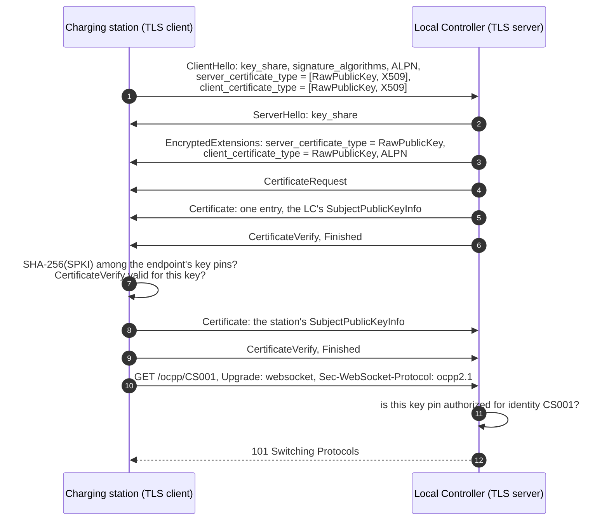
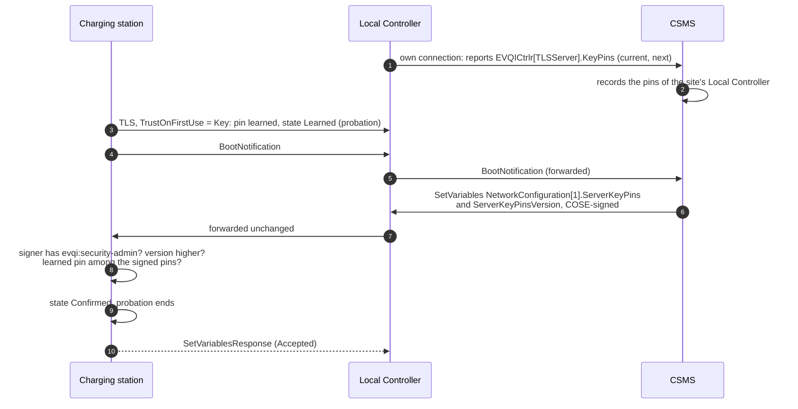

# EVQI Transport: Key Pins and TLS 1.3 Raw Public Keys for Local Controllers

**Version 0.1, Draft**, 2026-11-10
[CC-BY-SA 4.0](https://creativecommons.org/licenses/by-sa/4.0/) · [OpenChargingTechnology/Whitepapers](https://github.com/OpenChargingTechnology/Whitepapers) · reference implementations: [Vanaheimr/Hermod](https://github.com/Vanaheimr/Hermod) (transport), [OpenChargingCloud/WWCP_OCPP](https://github.com/OpenChargingCloud/WWCP_OCPP) (OCPP), [OpenChargingCloud/LocalController](https://github.com/OpenChargingCloud/LocalController), [OpenChargingCloud/ChargingStation](https://github.com/OpenChargingCloud/ChargingStation) (station)

This document belongs to [EVQI Transport](README.md). It is about one hop: from a charging station
to a **Local Controller** in the same private network, and to other local servers like it. A
Local Controller has to offer an OCPP WebSocket server, and no public certificate authority will
issue a certificate for it. Today this leaves an internal PKI or
[OCPP over SSH](../OCPP-over-SSH/README.md). This document
adds a third way, TLS 1.3 with raw public keys (RFC 7250), weighs its advantages and
disadvantages, and proposes how to build it, in C# included.

It is a concept, not yet a specification. Step 2, the C# implementation, is planned in chapter 10.

---

## Contents

0. [Summary](#0-summary)
1. [Starting point](#1-starting-point)
2. [How TLS 1.3 raw public keys work](#2-how-tls-13-raw-public-keys-work)
3. [Advantages and disadvantages](#3-advantages-and-disadvantages)
4. [The alternatives compared](#4-the-alternatives-compared)
5. [Proposal: key pins](#5-proposal-key-pins)
6. [Wire profile](#6-wire-profile)
7. [Mapping to OCPP and to the configuration](#7-mapping-to-ocpp-and-to-the-configuration)
8. [Security considerations](#8-security-considerations)
9. [Library support](#9-library-support)
10. [Implementation in C#](#10-implementation-in-c)
11. [Work plan](#11-work-plan)
12. [Open questions](#12-open-questions)
13. [References](#13-references)

---

## 0. Summary

**The problem.** OCPP 2.1 treats a Local Controller as a CSMS towards its stations (Part 4 §6.5).
The station checks the Local Controller's certificate like a CSMS certificate: a chain up to a
`CSMSRootCertificate` (A00.FR.308) and a common name equal to the FQDN the station dialled
(A00.FR.309, A00.FR.510). A Local Controller sits in a garage or a car park, under a private address
or a local name, often without internet access. Public CAs may not issue certificates for such
names and addresses. What remains is an internal PKI, with a CA, names, validity periods, a
correct clock at the station and revocation that is unreachable offline.

**The observation.** What a station really needs to know about its Local Controller is one thing:
*is this the key of my Local Controller?* A chain, a name and a validity period are the means a
PKI uses to answer that question for strangers. Station and Local Controller are not strangers:
they are commissioned together. SSH host keys, EEBUS SHIP and the RPK mode of LwM2M answer the
question directly, by pinning the key.

**The proposal: pin the key, not the name.**

1. **Key pin.** Per endpoint the station holds the SHA-256 hash of the Local Controller's DER
   encoded *SubjectPublicKeyInfo* (SPKI), as DANE writes it in a TLSA record `3 1 1`. The pin
   is the whole trust decision: no chain, no name, no validity period, no revocation lookup. The
   signature in CertificateVerify, i.e. the proof that the server holds the key, is always checked.
2. **One key, three wrappers.** The same key, and therefore the same pin, can be presented
   - in a **CA-issued certificate** (for unmodified stations, OCPP as written),
   - in a **self-signed certificate** whose content nobody reads (works with every TLS stack today,
     .NET's `SslStream` included), or
   - as a **raw public key** (RFC 7250, negotiated in the TLS 1.3 handshake; no certificate at all).
3. **Raw public keys are the lean wire format of key pins, not a trust model of their own.** A
   station that can negotiate them does; one that cannot gets a certificate around the same key
   (section 5.3). The pin, its provisioning and its rollover are identical, so nothing has to be
   provisioned twice.
4. **Strict separation.** An endpoint is either checked by CA (chain and name) or by key pin,
   never by both and never by whichever happens to fit. The CVEs of chapter 3.3 are exactly
   about that seam.
5. **Distribution.** Pins come from the CSMS, signed end to end through the Local Controller
   (EVQI chapter 7), or from commissioning. Trust on first use exists only as an explicit option,
   and a learned pin stays on probation until the CSMS confirms it.
6. **Rollover.** Up to four pins per endpoint, so that the next key is known before it is used.
7. **Stations by key, too.** The Local Controller authorizes stations by their key pins, like
   `authorized_keys` of the SSH path. The station may present the key of its OCPP Charging
   Station certificate raw.

**Advantages of raw public keys** (chapter 3): no CA, no names, no clock, no X.509 parser on the
station, the smallest handshake, and an explicit, negotiated meaning. Everything above TLS stays
as it is: WebSocket, ALPN, HTTP/2 and HTTP/3 (EVQI chapter 2), TLS exporters. A stolen Local
Controller key is useless outside the stations pinned to it, which fulfils OCPP's own requirement
of Part 4 §6.5 better than a shared trust anchor does.

**Disadvantages** (chapter 3): outside OCPP 2.1 (A00.FR.506 asks for X.509), patchy library
support (not in .NET's `SslStream`, Java, Go, Mbed TLS or browsers; in OpenSSL only since 3.2), no
roles in the credential, keys without expiry, pins to be distributed, and young code paths with
real authentication bypasses (OpenSSL CVE-2024-12797, wolfSSL CVE-2026-55960).

**Recommendation.**

| Stage | What | Where it works |
|---|---|---|
| 1 | Key pins over a **self-signed certificate** (option B) | every station whose TLS stack has a verify callback; in Hermod on all three bindings (`SslStream` for HTTP/1.1 and HTTP/2, its own TLS 1.3 for HTTP/3) |
| 2 | **RFC 7250** negotiated on top, same pins (option C) | stations with OpenSSL ≥ 3.5 LTS, GnuTLS, wolfSSL, rustls; Hermod's own TLS 1.3 (HTTP/3) and BouncyCastle (HTTP/1.1, HTTP/2) |
| always | the Local Controller keeps presenting a **CA-issued certificate** to stations that ask for X.509 without a pin | unmodified OCPP 2.x stations |

**OCPP over SSH** stays where SSH is the management plane anyway, and for commissioning. Both
paths share one trust model: a host key pin is a key pin. The SSH path's open question on implicit
trust on first use is answered here the same way for both (section 5.6).

---

## 1. Starting point

### 1.1 The Local Controller in OCPP 2.1

OCPP 2.1 Part 4 §6.5 (*Local Controller Security*) says:

- Towards its stations the Local Controller acts as the CSMS and is the TLS server.
- With client certificates, it holds a CSMS certificate and a Charging Station certificate of its
  own, unique to it.
- It shall be possible to tell it apart from the CSMS by the URL in its CSMS certificate.
- Since it stands in the field, its certificates may be stolen. A stolen CSMS certificate of a
  Local Controller shall only work towards the stations attached to it, *not with any other
  Charging Stations in the infrastructure*.
- It terminates TLS and can read and change everything. Signed messages are recommended.

Part 2, chapter A, adds what the station checks:

| Requirement | Content | Consequence for a Local Controller |
|---|---|---|
| A00.FR.308 | path validation of the server certificate (RFC 5280 §6) | a CA whose root is installed as `CSMSRootCertificate` |
| A00.FR.309, A00.FR.510 | the common name is the FQDN of the endpoint | a name, and a name service that resolves it locally |
| A00.FR.512 | `dNSName` SANs only where a CSMS has several network paths | IP addresses are not foreseen |
| A00.FR.506 | certificates are X.509 | raw public keys are outside the specification |
| A00.FR.310 | a failed check raises `InvalidCsmsCertificate` | reused for pin mismatches (section 7.5) |

### 1.2 Why there is no public certificate

- **Names and addresses.** The Local Controller is reached as `192.168.10.5`, `lc.local` or
  `lc-garage.internal`. Since 2015 the CA/Browser Forum's Baseline Requirements forbid publicly
  trusted certificates for internal names and reserved IP addresses.
- **A public name for a private address** is possible: `lc-4711.cpo.example.org`, resolving to
  `192.168.10.5`, with a certificate by ACME DNS-01. It costs a lot:
  - The Local Controller needs internet access and write access to the CPO's DNS zone.
  - Every station needs the Web PKI roots, i.e. trusts about 150 CAs for its Local Controller.
  - Every name appears in the Certificate Transparency logs, a list of all sites.
  - The CA/Browser Forum's ballot SC-081 shrinks the validity of public certificates to 47 days by
    2029. A Local Controller that cannot reach its CA for a few weeks loses its certificate, and its
    stations can no longer authenticate it.
- **The clock.** Every X.509 check reads the station's clock. A station without a battery-backed
  clock starts at 1970 or at its build date and can check no validity period before it has
  synchronized its time, while authenticated time synchronization in turn needs TLS (see
  [Secure Time Synchronization](../SecureTimeSync/README.md)).
- **Revocation.** CRL distribution points and OCSP responders of an internal CA are rarely
  reachable from a site's private network, and an unreachable status is in practice accepted.

An internal PKI is therefore the conformant answer, not the simple one. The
[TLS configuration paper](../TLSConfiguration/README.md) already notes that OCPP defines no way to
configure the TLS listener of a Local Controller at all, and names pairing and pinning as an
option for exactly this hop.

### 1.3 The same problem elsewhere

- **Building energy managers.** The example of [EVQI section 11.7.1](README.md#1171-the-stations-own-configuration)
  dials an energy manager at `ws://192.168.10.2:8180/`, without TLS, because there is no
  certificate for `192.168.10.2`. With a key pin it becomes `wss://`.
- **The station's own commissioning listener.** The station offers OCPP for commissioning tools.
  As a TLS server it has the Local Controller's problem in reverse: the tool pins the station's key,
  read from a label or the station's display.
- **Gateways and test benches** in private networks.

### 1.4 Precedents

| Where | How the key is trusted |
|---|---|
| SSH (RFC 4251), and OCPP over SSH in EVQI | host key in `known_hosts`, user keys in `authorized_keys`, trust on first use |
| EEBUS SHIP | TLS with self-signed certificates; a device is trusted by its SKI after pairing |
| OMA LwM2M | the security mode *RPK* over DTLS, next to *PSK* and *Certificate* |
| CoAP (RFC 7252 §9) | *RawPublicKey* mode of DTLS |
| DANE (RFC 6698, RFC 7671) | TLSA `3 1 1`: the server's SPKI hash, published in DNSSEC |
| Chrome | `--ignore-certificate-errors-spki-list`; Hermod's HTTP/3 server computes the value (`ServerCertificate.SubjectPublicKeyInfoPin`) |
| curl | `--pinnedpubkey sha256//…`: SHA-256 over the SPKI |

### 1.5 Non-goals

- The Local Controller's **uplink** to the CSMS. The CSMS has a public name or the operator's
  PKI; nothing changes there.
- **Browsers.** No browser supports raw public keys or key pins over TLS. A browser reaches a
  server without PKI at best through WebTransport's `serverCertificateHashes`, a hash of the whole
  certificate, valid for at most 14 days. The Local Controller's web interface is a topic of its own.
- **Privileged channels** (EVQI 6.5, 6.6) keep their role certificates, see section 5.9.

---

## 2. How TLS 1.3 raw public keys work

### 2.1 Negotiation

RFC 7250 adds a certificate type `RawPublicKey` (2) next to `X509` (0) and two extensions:

| Extension | Code | In TLS 1.3 sent in | Says |
|---|---|---|---|
| `client_certificate_type` | 19 | ClientHello: the types the client can *present*, by preference; EncryptedExtensions: the type the server chose | how the client authenticates |
| `server_certificate_type` | 20 | ClientHello: the types the client can *accept*, by preference; EncryptedExtensions: the type the server chose | how the server authenticates |

If `RawPublicKey` was negotiated, the Certificate message holds at most one entry, with the DER
encoded SubjectPublicKeyInfo (RFC 9846 §4.4.2, RFC 7250 §3): a server always sends one, a client
may send none when it has no key. A server that does not know the
extensions ignores them and sends X.509: unmodified servers keep working. A server must not choose a
type the client did not offer, and a client must reject such a choice.



### 2.2 What is left out, what remains

| Left out | Remains |
|---|---|
| the certificate chain, intermediate CAs | the full TLS 1.3 handshake: (EC)DHE, forward secrecy, AEAD |
| subject, names, SANs, the name check | CertificateVerify: the proof that the peer holds the private key |
| validity period, clock | ALPN, SNI (when a name is dialled), session resumption, 0-RTT rules |
| revocation (CRL, OCSP, stapling) | TLS exporters (RFC 9846 §7.5, RFC 9266) |
| extensions: key usage, policies, EVQI roles | encrypted Certificate messages: a passive observer sees neither key |

Mixed cases are allowed: an RPK server and an X.509 client, or the reverse.

### 2.3 Sizes

A P-256 SPKI has 91 bytes, an Ed25519 SPKI 44. An ECDSA chain of leaf and sub-CA has about
1–1.5 kB, an RSA chain 2–4 kB. On a Local Controller's LAN this does not matter. It matters on
narrowband links and in the many handshakes after a site-wide power cut, and only slightly.

---

## 3. Advantages and disadvantages

### 3.1 Advantages

1. **No CA.** No root, no sub-CA, no issuing process, no CSRs, no renewals, no
   `InstallCertificate` of a root that then vouches for every connection of the station.
2. **No name.** The station dials an address or a local name. A changed DHCP address or a renamed
   host changes the URL, not the trust.
3. **No clock.** No validity period is read. A station without a real-time clock can authenticate
   its Local Controller right after a power cut, before its time is synchronized. This breaks the
   circle of time and TLS for the local hop.
4. **No revocation infrastructure.** Revoking means removing a pin. No CRL has to be reachable,
   and no "status unknown" is accepted out of necessity.
5. **Scope of a stolen key.** A stolen Local Controller key is accepted only by stations that
   pinned it, i.e. by the stations of that Local Controller. With an internal PKI its certificate
   works against every station that trusts the same CA and dials the same name, and local names
   such as `lc.local` repeat from site to site. Part 4 §6.5 asks for exactly the narrow scope.
6. **Less parsing.** The station parses a SubjectPublicKeyInfo, not an X.509 certificate with its
   extensions, and builds no chain. X.509 parsing and path building are among the most frequent
   sources of vulnerabilities of TLS stacks.
7. **An explicit meaning.** With a self-signed certificate both sides pretend that a certificate
   matters and then ignore it in a callback. With RFC 7250 both sides have negotiated that nothing
   but the key counts. No subject or validity period can be misread.
8. **The smallest handshake** (section 2.3).
9. **Everything above TLS stays.** OCPP-J, the WebSocket, ALPN, HTTP/2 with RFC 8441 and HTTP/3
   with RFC 9220 (QUIC uses the TLS 1.3 handshake, RFC 9001), the channel sessions of EVQI
   chapter 4 and the TLS-bound TOTP of EVQI section 2.5. OCPP over SSH replaces all of this.
10. **Compatible on the same port.** The server answers RPK only to clients that offer it. All
    others get X.509 on the same port.
11. **Privacy.** In TLS 1.3 the Certificate messages are encrypted, so passive observers learn no
    key, as with certificates.
12. **Proven model.** The trust model is that of SSH, SHIP and LwM2M, well understood in
    commissioning practice.

### 3.2 Disadvantages

1. **Outside OCPP 2.1.** A00.FR.506 asks for X.509, A00.FR.308 and A00.FR.309 for a path and a
   name. RPK, like any key pin, is an extension to be negotiated per endpoint (chapter 7) and needs
   a firmware change on the station. An unmodified station cannot use it, and an OCPP conformance
   test does not cover it.
2. **Library support.** .NET's `SslStream` (SChannel, OpenSSL and Apple PAL), System.Net.Quic,
   Java's JSSE, Go's `crypto/tls`, Mbed TLS and every browser lack it. OpenSSL has it since 3.2;
   OpenSSL 3.0 LTS, still common on embedded Linux and in Debian 12 and Ubuntu 24.04, does not
   (chapter 9).
3. **Middleboxes.** A TLS-terminating reverse proxy in front of the Local Controller would have to
   support RFC 7250 itself. Hardly one does. For a Local Controller that terminates TLS itself this
   does not matter; for a CSMS behind a cloud load balancer it rules RPK out.
4. **No roles in the credential.** The EVQI role extension (EVQI 6.2) lives in a certificate. With
   a raw key the role is part of the configuration of whoever holds the pin (section 5.9).
5. **No expiry.** A key is valid until somebody removes its pin. Rollover must be designed
   (section 5.5) and keys must be watched for their age, or they live forever.
6. **Pins have to be distributed.** The PKI's question "who vouches for this key?" does not
   disappear, it moves from the handshake to provisioning (section 5.7). Done carelessly, it
   degrades to trust on first use without confirmation.
7. **Young code paths.** RPK is rarely used, so its code is rarely exercised, and it has failed
   where it meets the X.509 path (section 3.3).
8. **Tooling.** `openssl s_client -enable_server_rpk` and Wireshark know RPK. curl, browsers,
   most OCPP test tools and the usual monitoring probes do not.

### 3.3 What the vulnerabilities teach

| Vulnerability | What went wrong |
|---|---|
| OpenSSL [CVE-2024-12797](https://security-tracker.debian.org/tracker/CVE-2024-12797) (3.2 to 3.4, fixed in February 2025) | A client that authenticated the server by RPK did not abort the handshake when the key did not match, despite `SSL_VERIFY_PEER`. Clients that checked `SSL_get_verify_result()` were safe. |
| wolfSSL [CVE-2026-55960](https://nvd.nist.gov/vuln/detail/CVE-2026-55960) (builds with `HAVE_RPK`, fixed in 5.9.2) | A raw public key that was never negotiated was accepted in place of an X.509 certificate, bypassing chain validation. |

Both failures sit at the seam between the two paths: a key accepted where a certificate was
expected, or a failed check that did not end the handshake. Hence the strict separation of
section 5.4, the result check of section 6, rule 7, and the negative tests of section 10.7.

---

## 4. The alternatives compared

| | **A** internal PKI | **A′** public name | **B0** self-signed as root | **B** key pin over X.509 | **C** raw public key | **D** OCPP over SSH |
|---|---|---|---|---|---|---|
| OCPP 2.1 as written | yes | yes | formally yes | no | no | no |
| unmodified stations | yes | yes | yes | no | no | no |
| CA to operate | yes | public, ACME | no | no | no | no (SSH CA optional) |
| clock needed | yes | yes | yes | no | no | no |
| name needed | FQDN, local DNS | public FQDN, DNS | FQDN | no | no | no |
| revocation | CRL/OCSP, rarely reachable | public, needs internet | `DeleteCertificate` | remove the pin | remove the pin | remove the host key |
| a stolen LC key works against | every station of the CA that dials the same name (local names repeat) | every station that dials the name | every station that installed it, possibly for every name (see below) | the stations that pinned it | the stations that pinned it | the stations that pinned it |
| roles in the credential (EVQI 6.2) | yes | no | possible | no | no | no |
| handshake (server credential) | 1–4 kB | 2–5 kB | ~0.5 kB | ~0.5 kB | 44–91 bytes | SSH host key |
| station's stack | any | any | any | verify callback | RFC 7250 (chapter 9) | SSH client |
| Hermod (.NET) today | yes | yes | yes | yes, `SslStream` | no: BouncyCastle or own TLS (chapter 10) | yes |
| HTTP/2, HTTP/3 bindings | yes | yes | yes | yes | HTTP/2 yes, HTTP/3 with Hermod's TLS | no, SSH channels instead |
| tools | all | all | all | most (`curl --pinnedpubkey`) | few | `ssh -s` |

**A, internal PKI.** The CPO's CA issues the Local Controller a CSMS certificate for its FQDN.
Conformant, and it carries roles. It needs a CA and its operation, a local name service, a correct
clock at the station, and it gives a stolen key a scope wider than Part 4 §6.5 wants. A sub-CA per
site with name constraints narrows the scope, at the price of even more PKI.

**A′, public name.** See section 1.2: possible, and fragile for sites that are offline at times.

**B0, the self-signed certificate as `CSMSRootCertificate`.** The Local Controller's self-signed
certificate (CN = its FQDN) is installed at the station as a root. This works with unmodified
stations today and is the cheapest way to start. But a root vouches for every connection of the
station, the CSMS's included. If the station's TLS stack accepts the self-signed certificate as an
issuer, its stolen key can sign a certificate for the real CSMS's name. The certificate must
therefore carry `basicConstraints CA:FALSE` and no `keyCertSign`, and every station stack must be
tested to refuse what it "issues". Name, clock and expiry stay: `notBefore` far in the past and
`notAfter` at `99991231235959Z` (RFC 5280 §4.1.2.5).

**B, key pin over X.509.** The Local Controller wraps its key in a self-signed certificate whose
fields nobody evaluates. The station compares SHA-256 over the leaf's SPKI with the endpoint's
pins and ignores chain, name and dates. This works with every TLS version and every stack that has
a verify callback, `SslStream` and Mbed TLS included. On OpenSSL the pin is a DANE record:
`SSL_dane_tlsa_add` with `3 1 1`; a DANE-EE match skips chain and validity, and
`DANE_FLAG_NO_DANE_EE_NAMECHECKS` switches off the name check (to be confirmed in K7, chapter 11).
The weakness is the callback itself: "ignore all policy errors" is one keystroke away from "accept
everything".

**C, raw public key.** B without the certificate, negotiated (chapter 2).

**D, OCPP over SSH.** Implemented: `ssh://` endpoints, the subsystem `ocpp@open.charging.cloud`,
the station pins the host key (`sshHostKey`), the Local Controller knows every station's key.
Mature key management, natively multiplexed channels, the same listener for shell, SFTP and
OCPP. But it is not OCPP-J: a second protocol stack in the station, other keep-alive semantics
(EVQI chapter 12), no HTTP bindings, and every OCPP tool needs SSH.

**E, others, briefly.**

- *External PSK* (RFC 9846 §2.2, RFC 9258): a symmetric secret per station that both sides keep
  secret; a stolen Local Controller exposes all of them.
- *DANE* proper: needs DNSSEC, which a site's private network rarely has. The pin format of this
  document is TLSA `3 1 1`, so a site with DNSSEC can publish the pins as TLSA records (Hermod's DNS
  client knows the record type).
- *SRP* (RFC 5054): TLS 1.2 only.
- *Delegated credentials* (RFC 9345): presuppose a certificate.

**Assessment.** B and C share the trust model and differ only in the wire format. B works today
everywhere; C is cleaner and leaner, but needs support on both sides. A remains for stations that
cannot be changed. D is the right choice where SSH is the management plane anyway. Chapter 5
therefore builds on key pins and treats RFC 7250 as their preferred encoding.

---

## 5. Proposal: key pins

### 5.1 The key pin

- **Definition:** SHA-256 over the DER encoded SubjectPublicKeyInfo of the key. This is the
  matching data of a TLSA record with selector 1 and matching type 1, of RFC 7469's `pin-sha256`
  and of curl's `--pinnedpubkey`.
- **Notation:** 64 hexadecimal digits, with or without colons, as the fingerprints of the other
  white papers. Base64 (RFC 7469, curl, Chrome, `ServerCertificate.SubjectPublicKeyInfoPin` in
  Hermod) is the same hash in another notation and is accepted on input in curl's notation,
  `sha256//<base64>`.
- **Computation:**
  `openssl pkey -in lc.key -pubout -outform DER | openssl dgst -sha256`, from a certificate
  `openssl x509 -in lc.pem -pubkey -noout | openssl pkey -pubin -outform DER | openssl dgst -sha256`.

**Not a certificate pin.** The [Secure Name Resolution](../SecureDNS/README.md) (section 2.3) and
[Secure Time Synchronization](../SecureTimeSync/README.md) (section 3.2.4) papers pin the SHA-256
of the *whole certificate*, deliberately, and only to *narrow* a chain that is still checked. A
key pin is a different thing:

| | Certificate pin (SecureDNS, SecureTimeSync) | Key pin (this paper) |
|---|---|---|
| hash over | the whole DER certificate | the DER SubjectPublicKeyInfo |
| DANE equivalent | `1 0 1` (PKIX-EE: the chain is still checked) | `3 1 1` (DANE-EE: nothing else is checked) |
| role | narrows a CA's trust | replaces it |
| chain, name, validity | still checked | not checked |
| survives a renewal with the same key | no | yes |
| works with raw public keys | no | yes |
| variable names | `CertificatePins`, `RootPins` | `ServerKeyPins` |

**Not an SSH fingerprint.** OpenSSH's `SHA256:…` hashes the SSH wire format of a key, not its
SPKI. The two never match, even for the same key, and the same key should not serve both anyway
(section 5.10).

### 5.2 What a key pin replaces, and what not

A key-pinned endpoint skips path validation (A00.FR.308), the name check (A00.FR.309), the
validity period and revocation. It keeps:

- the verification of CertificateVerify against the presented key,
- the TLS handshake itself, with TLS 1.3 wherever raw public keys are offered (section 6, rule 1),
- the station's OCPP identity in the URL and its authentication (section 5.8),
- message signatures (EVQI chapter 7), the upper bound of roles (EVQI 7.4) and the privileged
  channels (EVQI 6.5).

### 5.3 One key, three wrappers

The Local Controller has **one** TLS server key per listener (plus the next one, section 5.5). It
presents it

- in its **CA-issued CSMS certificate** (Part 4 §6.5), when it has one and the station offers no
  `RawPublicKey`,
- in a **self-signed carrier certificate** generated from the key, when it has no CA certificate,
- **raw**, when the station offers `RawPublicKey`.

The pin is the same in all three cases. A site can thus start with A or B0 and move its stations
to key pins one by one, without a new key and without a flag day. A carrier certificate can be
regenerated at any time; its pin stays. The exception is B0: stations that installed the
certificate itself as their root need exactly that certificate, so it stays unchanged as long as
such stations exist.

### 5.4 Strict separation

- An endpoint is either **CA-checked** or **key-pinned**. It is key-pinned when `ServerKeyPins` is
  set or `TrustOnFirstUse = Key`. A key-pinned endpoint without pins is learning (section 5.6) and
  checks no CA either. There is no third mode "pin or CA, whichever fits".
- A key-pinned endpoint never falls back to the CA path, not even on a mismatch.
- A CA-checked endpoint never accepts a raw public key. Its client does not offer
  `RawPublicKey`, and aborts if the server chooses it anyway.
- A key-pinned endpoint offers `RawPublicKey` according to `RawPublicKeys` (section 7.2) and checks
  the leaf's SPKI the same way, whether it came raw or in a certificate.
- **The same on the server.** The Local Controller authenticates each station identity either by
  key pin (section 5.8) or by CA-issued certificate and its CN (A00.FR.511), never by both. A
  certificate accepted by its pin contributes its pin and nothing else: its CN names no identity.

### 5.5 Pin sets and rollover

An endpoint holds up to **four** pins: the current key, the announced next key, and room for a
transition. Rollover of a Local Controller key:

1. The Local Controller generates the next key in advance and reports both pins (section 7.4).
2. The CSMS adds the next pin to every station of the site.
3. The CSMS sees, by `GetVariables` or a `Delta` monitor on `ServerKeyPins`, when every station
   has it, and tells the Local Controller to switch.
4. After a grace period the CSMS removes the old pin.

The Local Controller reports the creation date of its key. A key policy (e.g. one year) is the
CPO's; the CSMS warns about old keys.

**After a compromise** the new pin must reach the stations over a path the old key does not
control: the CSMS's signature (EVQI chapter 7) through the Local Controller, which a compromised
Local Controller can withhold but not forge, or a technician on site. While stations reach the CSMS
only through the compromised Local Controller, it can delay the rollover. An internal PKI has the
same limit: a revocation list it withholds does not arrive either.

### 5.6 Mismatches and trust on first use

- **A mismatch is always a refusal.** The `Record` and `Accept` of `OnPinMismatch` in the SecureDNS
  paper exist because a chain is still checked there. With a key pin nothing else is checked, so
  `Accept` would mean "accept anyone". A key-pinned endpoint has no `OnPinMismatch`.
- **Trust on first use is explicit.** `TrustOnFirstUse = Key` learns the pin from the first
  handshake, writes it into the configuration, logs it and reports it (section 7.5). The default
  is `None`: an endpoint without pins and without trust on first use is CA-checked, not
  unauthenticated.
- **A learned pin is on probation** until the CSMS confirms it (section 5.7, way 1). On probation
  the station sends `BootNotification` and executes only a signed pin set. It treats everything
  else as on an unauthenticated connection. There are three outcomes:
  - The signed pins contain the learned one: the pin is `Confirmed`, and probation ends.
  - They do not: the peer is not the Local Controller the CSMS knows. The station takes the signed
    pins, which are authoritative, drops the connection and reports `KeyPinRejected`. The next
    connection is held to the signed pins: the real Local Controller is accepted, the impostor
    refused.
  - Nothing arrives within a configurable time (e.g. 10 minutes): the station discards the learned
    pin, drops the connection, reports `KeyPinProbationExpired` and learns again after its
    back-off.

  A learned pin is never kept unconfirmed, so an impostor that answered first cannot lock the real
  Local Controller out.
- **The same for SSH.** The OCPP-over-SSH plan asked for trust on first use only when configured
  (`"tofu"`). The station learns implicitly instead, whenever `sshHostKey` is empty, like OpenSSH's
  `StrictHostKeyChecking=accept-new` (EVQI section 11.1.2); the plan records this as a deviation
  (its section 5.6). This paper proposes the same rule for both: learning only when configured,
  probation until confirmed.

### 5.7 Distribution



The ways, in order of preference:

1. **By the CSMS, signed.** The CSMS knows its Local Controllers: they connect to it with
   credentials of their own. It writes the pins into the stations' configuration with a message
   signed end to end (EVQI chapter 7). The Local Controller forwards it but cannot change it. An
   impostor between station and Local Controller is detected even if it forwards everything
   faithfully, since the signed pin names the real Local Controller's key, not the impostor's.
   This needs a CSMS signing anchor in the station, from manufacturing or commissioning.
2. **At commissioning.** The Local Controller shows its pins on its web page, on its command line
   and as a QR code on its label. The installer enters or scans them on the station's web page, over
   the station's SSH commissioning listener or with a commissioning tool. In the other direction the
   station shows its own key pin for the Local Controller's list (section 5.8): pairing, as in SHIP.
3. **DANE**, where the site has DNSSEC: the pins as TLSA `3 1 1` records under
   `_443._tcp.<name>`. Rare in private networks.
4. **Trust on first use** (section 5.6), for laboratories, test benches and small sites, confirmed
   by way 1 wherever there is a CSMS.

**Authority.** Writing key pins changes the security configuration, an action of the role
`evqi:security-admin` (EVQI 6.3). A Local Controller holds no privileged role (EVQI 6.6), and its
connection to the station is an everyday one. EVQI 7.4 lets the connection's role bound what a
message may do, so it would refuse every pin set sent through the Local Controller. Pin sets are
therefore an exception: a write of the key pin variables of section 7.2 is executed over any channel
if a signer with `evqi:security-admin` signed it. The authority lies in the signature alone, which
the Local Controller can neither forge nor change. Unsigned writes follow
`PrivilegedActionsOnControlChannel` (EVQI 6.5, rule 2).

**Replay.** Replaying an older signed pin set needs no forgery: a Local Controller, or whoever
held an old key, could bring back pins that were removed. Every pin set therefore carries a version,
`ServerKeyPinsVersion`, and the station accepts only a higher one than it holds. This needs no
clock, unlike the timestamp window of EVQI 7.2, which a station without a synchronized clock cannot
apply.

### 5.8 Stations by key

- The station presents a key, raw or in a certificate. The Local Controller keeps per station
  identity a list of authorized key pins, like the per-station keys of the SSH path (its decision
  3), and checks after the upgrade request that the key belongs to the identity in the URL. This
  is the key pin's equivalent of the CN check of A00.FR.511. For an identity authenticated by key,
  an unknown key is refused with `access_denied` or HTTP 401, not silently admitted. Identities
  authenticated by CA certificate, i.e. unmodified stations of security profile 3, keep that path
  (section 5.4).
- **No new key is needed.** A station with an OCPP Charging Station certificate (security profile
  3) presents the key of that certificate raw. A station without one generates a key, in a secure
  element or TPM where there is one.
- The list reaches the Local Controller like the station pins reach the station: from the CSMS,
  which learns each station's pin from its device model (`EVQICtrlr[TLSClient].KeyPin`, read-only),
  or at commissioning.
- With client keys, HTTP Basic authentication (security profile 2) becomes unnecessary on this
  hop. Whether it remains as a second factor is open (chapter 12).
- RFC 7250 allows mixing: a Local Controller may authenticate itself raw and still require a
  station's X.509 certificate, or the other way round.

### 5.9 Roles and privileged channels

- A raw key has no role extension. The **role belongs to the pin**: the station's endpoint says
  what its Local Controller may do, the Local Controller's list says per station key what that
  station may do. As upper bounds, as with role certificates (EVQI 6.2, 7.4).
- A Local Controller should hold no privileged role anyway (EVQI 6.6). Key pins are therefore
  meant for the everyday channel classes Control, Realtime and Bulk. Privileged channels keep
  their role certificates and run directly to the CSMS or tunnelled through the Local Controller
  (EVQI 6.6, options a and b).

### 5.10 Key types and key separation

- **Mandatory:** ECDSA P-256 (`ecdsa_secp256r1_sha256`, `0x0403`), since secure elements and TPM
  2.0 support it. **Optional:** Ed25519 (`0x0807`). No RSA: its keys make neither raw keys nor
  pins smaller.
- A key pin covers the algorithm: the SPKI contains its OID. Post-quantum keys (ML-DSA, which
  Hermod's TLS 1.3 already knows as `0x0904` to `0x0906`) change nothing in the model; their SPKIs
  are large, the pins are not.
- **One key, one purpose.** The TLS key is not the SSH host key, not the message signing key
  (EVQI chapter 7) and not the key-agreement key (EVQI 6.8). The same key in the three wrappers of
  section 5.3 is one purpose: TLS server authentication.

---

## 6. Wire profile

Rules for an endpoint with `RawPublicKeys` ≠ `Off`, numbered for reference:

1. **TLS 1.3 only.** RFC 7250 also works with TLS 1.2, but there the Certificate messages travel
   in the clear, so a passive observer sees both keys. A client that offers `RawPublicKey` offers
   TLS 1.3 only.
2. **Offer.** `server_certificate_type` = `[RawPublicKey]` for `Require`, `[RawPublicKey, X509]`
   for `Prefer`. `client_certificate_type` lists `RawPublicKey` first when the station has a client
   key and the endpoint allows it.
3. **Unsolicited types.** A client that did not offer a type aborts when the server chooses it:
   `unsupported_extension` if the extension was not offered at all (RFC 9846 §4.2), `illegal_parameter`
   if the type was not on the list. The server, in turn, refuses a client Certificate of another
   type than the one it chose (`bad_certificate`).
4. **At most one entry.** A server's RPK Certificate message has exactly one CertificateEntry, a
   client's one or, without a key, none. The entry's extensions are ignored; there is no OCSP
   stapling for raw keys.
5. **The SPKI is parsed strictly:** known algorithm OID, curve parameters for EC keys, a point on
   the curve, no trailing data. Only then is it hashed and compared.
6. **CertificateVerify** is verified against the presented key with a signature scheme the
   verifying side offered (`signature_algorithms` of the ClientHello for the server's, of the
   CertificateRequest for the client's), as always.
7. **The result ends the handshake.** A mismatch aborts with `bad_certificate` (client) or
   `access_denied` (server) and is never only logged. Where a library reports the result
   separately, as OpenSSL does with `SSL_get_verify_result()`, the application checks it before it
   sends a byte (lesson of CVE-2024-12797).
8. **Server choice.** The server chooses `RawPublicKey` when the client offers it and the server
   has a key for it; otherwise it presents its certificate (CA-issued or carrier, section 5.3).
9. **Resumption.** A ticket remembers the key pin it was issued under. When the pin is no longer
   authorized, the server refuses the resumption and requires a full handshake. The client does
   the same for a server pin it has removed.
10. **ALPN, SNI, exporters** as without RPK. `h2` and `h3` are unaffected.

---

## 7. Mapping to OCPP and to the configuration

### 7.1 The station's own configuration

An endpoint of the peer list of EVQI section 11.7.1 gets five fields, next to `sshHostKey`
for `ssh://` endpoints:

```json
{
  "url":                   "wss://192.168.10.5/ocpp/CS001",
  "binding":               "http/1.1",
  "serverKeyPins":         [ "6A1F0C…9B2E", "C47D18…03A5" ],
  "serverKeyPinsVersion":  3,
  "rawPublicKeys":         "Prefer",
  "trustOnFirstUse":       "None",
  "clientKeyId":           "tls-p256-1"
}
```

| Field | Meaning |
|---|---|
| `serverKeyPins` | up to four key pins; set, or `trustOnFirstUse` = `Key`, means key-pinned (section 5.4) |
| `serverKeyPinsVersion` | the version of the last signed pin set (section 5.7) |
| `rawPublicKeys` | `Off` (key pin over X.509 only), `Prefer`, `Require` |
| `trustOnFirstUse` | `None` or `Key` (section 5.6) |
| `clientKeyId` | the station's TLS key, presented raw or in its certificate; by reference, like `certificateId` |

The endpoint also keeps the state of its pins: `Configured`, `Learned` or `Confirmed`.

### 7.2 OCPP 2.x

OCPP 2.1 represents every network profile slot as an instance of the component
`NetworkConfiguration` and lets the CSMS set its variables one by one with `SetVariables`
(Part 2, B09). EVQI adds five variables there, per slot:

| Variable | Required | Mutability | Type | Default | Values | Description |
|---|---|---|---|---|---|---|
| ServerKeyPins | optional | rw | string | "" | comma separated, ≤ 4 | key pins (64 hexadecimal digits, with or without colons) of the keys the server of this slot may present. Set: the slot is key-pinned, chain, name and validity are not checked. Written only signed and together with a higher `ServerKeyPinsVersion` (section 5.7). |
| ServerKeyPinsVersion | optional | rw | integer | 0 | ≥ 0 | the version of the pin set; only a higher one is accepted (section 5.7) |
| ServerKeyPinState | optional | r | OptionList | `Configured` | `Configured`, `Learned`, `Confirmed` | where the pins come from |
| RawPublicKeys | optional | rw | OptionList | `Off` | `Off`, `Prefer`, `Require` | section 6, rule 2. Only allowed with `ServerKeyPins` or `TrustOnFirstUse = Key`. |
| TrustOnFirstUse | optional | rw | OptionList | `None` | `None`, `Key` | section 5.6 |

- Four pins without colons take 259 characters, so they fit into `SetVariableData.attributeValue`
  of OCPP 2.0.1 (1000) and 2.1 (2500), and into the usual `ReportingValueSize`.
- A station that does not know the variables answers `UnknownVariable`. The CSMS thus learns which
  stations can be key-pinned.
- The `SecurityProfile` of the slot keeps its meaning for the station's authentication (2: Basic,
  3: client key or certificate). Key pins change how the **server** is authenticated, not the
  profile number. Whether a change from a CA-checked to a key-pinned slot counts as a downgrade
  (reason code `NoSecurityDowngrade`) is open (chapter 12).
- The station's own TLS key: `EVQICtrlr[TLSClient].KeyPin` (read-only), so that the CSMS can
  authorize it at the Local Controller.
- Dependent variables (pins only with TLS, `RawPublicKeys` only with pins) follow the rule of the
  SecureDNS paper: set in the right order, or as one change with `ACID` from
  [Safe & Secure Device Model Updates](../SafeAndSecureDeviceModelUpdates/README.md).

### 7.3 OCPP 1.6

OCPP 1.6 has one connection and no slots. Configuration keys, as in the time sync paper:
`evqi.serverKeyPins` (CSL), `evqi.serverKeyPinsVersion`, `evqi.rawPublicKeys`, `evqi.trustOnFirstUse`, read-only
`evqi.serverKeyPinState` and `evqi.clientKeyPin`.

### 7.4 The Local Controller

- **Keys:** current and next TLS server key per listener, with their creation dates.
- **Device model** towards the CSMS: `EVQICtrlr[TLSServer].KeyPins` (read-only, current key
  first), `EVQICtrlr[TLSServer].KeyCreated` (read-only), and `EVQICtrlr[TLSServer].RawPublicKeys`
  (`Off`, `On`).
- **Authorized station keys:** a list per station identity, with the role of each key (section
  5.9). In a device model variable it would exceed every value size. The CSMS writes it with a
  message of its own, or it is maintained locally; open (chapter 12).
- **Web interface and command line:** show the pins, as text and as a QR code; generate the next
  key; switch; show which stations have connected with which pin and type (RPK, carrier
  certificate, CA certificate).

### 7.5 Security events and logging

| Event | When |
|---|---|
| `InvalidCsmsCertificate` (existing, A00.FR.310) | a key pin mismatch, `techInfo` "key pin mismatch: <pin>"; once per change of the verdict |
| `KeyPinLearned` (new) | a pin was learned on first use |
| `KeyPinConfirmed` (new) | the CSMS confirmed a learned pin |
| `KeyPinRejected` (new) | the CSMS's signed pins do not contain the learned pin; they replace it |
| `KeyPinProbationExpired` (new) | no signed pin set arrived during probation; the learned pin is discarded |

On the Local Controller, refused station keys are logged per identity, as refusals of a
credential (EVQI 12.7). All of it goes into the security log; the metrological log only where the
CPO opts in, as for name servers.

---

## 8. Security considerations

- **The pin store is a trust store.** Whoever can write `ServerKeyPins` can redirect a station to
  any server. Over OCPP, writing needs the signature of a security administrator and a higher
  version (section 5.7); locally it needs the commissioning login. Every change is logged and
  reported.
- **Trust on first use** trusts whoever answers first. Without the confirmation of section 5.7 it
  protects only against attackers who arrive later. It is therefore off by default and on
  probation when on.
- **Type confusion** is the main implementation risk (section 3.3). The negative tests of section
  10.7 are part of the definition of done, not an extra.
- **A key without expiry** can outlive its owner. Key age is reported and watched (section 5.5).
- **Theft of the Local Controller.** The thief can serve the pinned stations until the pin is
  removed, as with a stolen certificate until it is revoked, but no other station. Detection: a
  Local Controller that suddenly connects from elsewhere, or a second one under the same key
  (EVQI chapter 12).
- **Downgrade.** The certificate type negotiation is part of the transcript that Finished
  protects. An attacker who strips `RawPublicKey` from the ClientHello breaks the handshake, and
  even a successful strip would only lead to the carrier certificate, which is checked against the
  same pin.
- **Active probing.** Anyone who can connect to the Local Controller learns its public key, as
  they would learn its certificate. A key pin is no secret.
- **Key storage.** P-256 keys in a secure element or TPM 2.0 where available. Hermod, Styx and
  WWCP_Node have no PKCS#11 or TPM binding yet (EVQI 6.2), and the work package there applies here.
- **Message signatures stay necessary.** Key pins authenticate the hop, not the author. The Local
  Controller can still read and change what it forwards; EVQI chapter 7 covers that.

---

## 9. Library support

As of November 2026. "Yes" means RFC 7250 in TLS 1.3, client and server, unless noted.

| Library | RFC 7250 | Notes |
|---|---|---|
| OpenSSL ≥ 3.2 | yes | `SSL_CTX_set1_server_cert_type`, `SSL_CTX_set1_client_cert_type`, `SSL_add_expected_rpk` (a wrapper around DANE's `SSL_dane_tlsa_add`), `SSL_get0_peer_rpk`, `SSL_get_negotiated_server_cert_type`; `s_client`/`s_server` `-enable_server_rpk`, `-enable_client_rpk`. Use a release with the fix for CVE-2024-12797. 3.5 is the current LTS line; 3.0 LTS has no RPK. |
| GnuTLS | yes | since the 3.6 series (2019), certificate type `GNUTLS_CRT_RAWPK` |
| wolfSSL | yes, build option | `HAVE_RPK` / `--enable-rpk`, off by default; at least 5.9.2 (CVE-2026-55960) |
| rustls | yes | `AlwaysResolvesServerRawPublicKeys`, `AlwaysResolvesClientRawPublicKeys` |
| picotls | server side only | `server_certificate_type`, not `client_certificate_type`; TLS 1.3 only by design |
| BouncyCastle (Java `bctls`, C# `BouncyCastle.Cryptography` 2.x) | yes, in the low-level TLS API | C# 2.7.0, already a dependency of Hermod, contains `BcTlsRawKeyCertificate`, `TlsExtensionsUtilities.AddServerCertificateTypeExtensionClient` and the related methods. Not through JSSE. |
| Mbed TLS | no | not supported according to its maintainers |
| BoringSSL | no | Cloudflare's `boring` crate carries a patch |
| .NET `SslStream`, System.Net.Quic (msquic) | no | no API, on any platform |
| Java JSSE, Go `crypto/tls`, browsers | no | |
| Hermod's own TLS 1.3 (QUIC) | not yet | a small extension (section 10.4) |
| Wireshark | dissects it | |

**Stations.** Most station firmwares run on embedded Linux with OpenSSL. With 3.5 LTS, RFC
7250 is there and has to be enabled by the OCPP stack, which has to pass the setting through its
WebSocket library to the `SSL_CTX`. Option B needs only a verify callback and works on Mbed TLS as
well. Open-source stacks such as EVerest, which build on OpenSSL, are the natural place to
contribute it upstream.

---

## 10. Implementation in C#

This chapter is the plan for step 2. It names Hermod's state as of `2113faad`.

### 10.1 Where Hermod stands

| Part | TLS | Relevant for key pins |
|---|---|---|
| HTTP/1.1 client and server, WebSockets, HTTP/2 | .NET `SslStream` | X.509 only; validation by `RemoteTLSServerCertificateValidationHandler<T>` (client) and `RemoteTLSClientCertificateValidationHandler<T>` (server), certificate selection by `LocalCertificateSelectionHandler`, `ClientCertificateRequired`. No TLS exporter. |
| QUIC, HTTP/3 | Hermod's own TLS 1.3 (`Hermod/QUIC/TLS`, about 5,200 lines) | one DER certificate per Certificate message (`CertificateMessage`); CertificateVerify is already verified against the leaf's SPKI (`PeerCertificateValidator`); `CertificateValidationOptions` with chain, host name, custom roots and `Insecure`; no certificate type extensions yet; exporters available; `ServerCertificate.SubjectPublicKeyInfoPin` computes the base64 SPKI pin |
| BouncyCastle.Cryptography 2.7.0 | dependency | full TLS 1.3 client and server over a `Stream`, with RFC 7250, ALPN and `ExportKeyingMaterial` |
| DNS | | TLSA records (`DNS/ResourceRecords/TLSA.cs`), selector `SubjectPublicKeyInfo` |
| SSH | | host key policy with trust on first use, keys per station (OCPP over SSH) |

### 10.2 Building blocks for every stage

```csharp
/// <summary>
/// SHA-256 over the DER encoded SubjectPublicKeyInfo of a key (TLSA 3 1 1, RFC 7469 pin-sha256).
/// </summary>
public sealed class KeyPin : IEquatable<KeyPin>
{
    private readonly Byte[] hash;   // 32 bytes

    public static KeyPin FromSubjectPublicKeyInfo(ReadOnlySpan<Byte> SPKI)
        => new (SHA256.HashData(SPKI));

    public static KeyPin FromCertificate(X509Certificate2 Certificate)
        => FromSubjectPublicKeyInfo(Certificate.PublicKey.ExportSubjectPublicKeyInfo());

    public static Boolean TryParse(String Text, out KeyPin? Pin);   // 64 hex digits, colons allowed, or "sha256//<base64>"

    public String  ToHex()    => Convert.ToHexString(hash);
    public String  ToBase64() => Convert.ToBase64String(hash);       // curl, Chrome, RFC 7469
    public Boolean Equals(KeyPin? Other) => Other is not null && hash.AsSpan().SequenceEqual(Other.hash);
}

public enum RawPublicKeyMode { Off, Prefer, Require }

/// <summary>
/// The trust of one key-pinned endpoint: up to four pins, how they were obtained, and the mode.
/// </summary>
public sealed record KeyPinPolicy(IReadOnlyList<KeyPin>  Pins,
                                  KeyPinState            State,              // Configured, Learned, Confirmed
                                  RawPublicKeyMode       RawPublicKeys,
                                  Boolean                TrustOnFirstUse);
```

- **`KeyPinValidator`**, the one place that compares pins, for all stacks: given the peer's SPKI
  and the negotiated type, it returns accepted, learned or refused. CA-checked endpoints never
  reach it (section 5.4).
- **`TlsServerKey`**: a P-256 key (from file or, later, PKCS#11/TPM), its next key, and a carrier
  certificate generated with `CertificateRequest.CreateSelfSigned`. `basicConstraints CA:FALSE`,
  no `keyCertSign`, validity as in B0.
- **`AuthorizedKeys`**: per station identity the pins and roles (section 5.8), checked by the
  WebSocket server after the upgrade request. Today's `IdentitiesOf` (URL path, TLS CN, Basic,
  TOTP) gets the key pin as a further source, under the rule of section 5.4: per identity either
  the pin or the CN, and the CN of a certificate accepted by its pin never counts.
- Key pins need **no certificate store**: tests create no CA in the user's store and leave none
  behind.

### 10.3 Stage 1: key pins over `SslStream` (option B)

Works with all three bindings now, with no new TLS code:

- **Client** (`WebSocketClient`, `HTTP2ClientConnection`, and for HTTP/3 a key pin branch in
  `CertificateValidationOptions`): for a key-pinned endpoint the validation handler ignores
  `SslPolicyErrors` and asks `KeyPinValidator`. This is the only place where policy errors may be
  ignored, and it is reachable only through `KeyPinPolicy`, never through a flag like `Insecure`.
- **Server** (Local Controller): presents the carrier or CA certificate, sets
  `ClientCertificateRequired` where station keys are wanted, and accepts a self-signed client
  certificate in the client validation handler only by its pin, via `AuthorizedKeys`.
- How SChannel and OpenSSL behave with a self-signed client certificate that chains to nothing
  (trusted issuer lists in the CertificateRequest, chain errors before the callback) has to be
  pinned down by tests on Windows and Linux.

### 10.4 Stage 2: RFC 7250 in Hermod's own TLS 1.3 (QUIC, HTTP/3)

The smallest step to real raw public keys, since Hermod owns the code:

- `ExtensionType` gets `ClientCertificateType = 19` and `ServerCertificateType = 20`.
- `ClientHello` writes them according to `RawPublicKeyMode`; `ClientHelloInfo` parses them.
- `TlsServerHandshake` chooses the type and answers in EncryptedExtensions;
  `TlsClientHandshake` reads the choice and enforces section 6, rule 3.
- `CertificateMessage.Build` writes an SPKI instead of a DER certificate. `TryParse` hands the
  entry over together with the negotiated type, so that the validator cannot confuse the two.
- `PeerCertificateValidator` takes the SPKI directly, since it already verifies CertificateVerify
  against an SPKI, and asks `KeyPinValidator`.
- `ServerResumptionCache` stores the pin with the ticket (section 6, rule 9).

### 10.5 Stage 3: RFC 7250 over TCP (HTTP/1.1, HTTP/2)

`SslStream` cannot do it, so the TLS stack must be replaceable per endpoint. Two routes:

| | **(a) BouncyCastle TLS** | **(b) Hermod's TLS 1.3 + a record layer** |
|---|---|---|
| What | `TlsClientProtocol`/`TlsServerProtocol` over the `NetworkStream`; the raw key as a `Certificate` of type `CertificateType.RawPublicKey` with a `BcTlsRawKeyCertificate`; the allowed types via `GetAllowedServerCertificateTypes`/`GetAllowedClientCertificateTypes`; the pin check in the client's server certificate notification and the server's client certificate notification | reuse the handshake of section 10.4 and add the TLS 1.3 record layer for TCP (RFC 9846 §5): framing, per-record AEAD with sequence numbers, alerts, KeyUpdate, NewSessionTicket after the handshake |
| Effort | M | M–L, plus an external review |
| Maturity | widely used TLS stack | Hermod's TLS is a reference implementation, not for production, by its own README |
| Async | blocking `Stream` API; non-blocking mode (`OfferInput`/`ReadOutput`) for a clean async wrapper | async by design |
| Speed | managed crypto, sufficient for a Local Controller with hundreds of stations | as fast as .NET's AES-GCM |
| Exporters | yes: TLS-bound TOTP (EVQI 2.5) becomes possible over TCP too | yes |

**Recommendation:** (a) for the Local Controller and the station; (b) only if Hermod's TLS is to
become a general TLS stack anyway. A native OpenSSL binding by P/Invoke was considered and
rejected: a native dependency on Windows, a second OpenSSL next to the one `SslStream` loads on
Linux, and more risk than (a).

The abstraction: a **TLS factory per endpoint**, chosen by `RawPublicKeyMode` and the binding,
which turns a connected `Stream` into an authenticated one and returns what the layers above need:
the peer's key pin, the negotiated certificate type, the ALPN result and, where available, an
exporter. `SslStream` stays the default; BouncyCastle is used only where an endpoint offers raw
public keys.

### 10.6 Above Hermod

| Repository | Work |
|---|---|
| WWCP_Core | `KeyPinPolicy` in the endpoint configuration of `WWCPWebSocketClient`; `AuthorizedKeys` and the key pin as an identity source in the WebSocket server |
| WWCP_OCPP | the variables of section 7.2 for `NetworkConfiguration` and `EVQICtrlr`, the 1.6 keys of 7.3, the security events of 7.5; signed pin sets with their version, and their exception to the role bound of EVQI 7.4 (section 5.7) |
| ChargingStation | endpoint fields of 7.1, probation, the commissioning page with the pins, the same trust-on-first-use rule for `sshHostKey` |
| LocalController / WWCP_Node | server key, next key and carrier certificate; pins on the web page, on the command line and as a QR code; `AuthorizedKeys` per station |
| CSMS | the site's Local Controller pins; writing them, signed, to the stations; rollover |
| EVChargingTestEnvironment | station → Local Controller → CSMS end to end, with RPK on the first hop |

### 10.7 Tests

- **Unit:** `KeyPin` parsing and formatting (hex with and without colons, base64), SPKI hashes of
  known keys as test vectors, P-256 and Ed25519.
- **Negative handshakes**, each of them red on a deliberately broken validator (mutation runs):
  - an RPK the client did not offer, at a CA-checked endpoint and at a key-pinned endpoint with
    `Off`;
  - a client Certificate of another type than the server chose;
  - a station certificate accepted by its pin whose CN names another identity (must not
    authenticate that identity);
  - an RPK with a key that is not pinned; the right key with a wrong CertificateVerify;
  - two CertificateEntries; an SPKI with trailing data, an unknown OID, a point not on the curve;
  - a carrier certificate with the right key but another name and an expired date (must pass), and
    with the wrong key but a valid CA chain (must fail at a key-pinned endpoint);
  - resumption after the pin was removed;
  - trust on first use: learned and confirmed; rejected and replaced by the signed pins, after which
    the real Local Controller is accepted; probation expired and the pin discarded;
  - a replayed signed pin set with a version not higher than the station's.
- **Interoperability:** against `openssl s_server`/`s_client` 3.5 with `-enable_server_rpk` and
  `-enable_client_rpk`, against GnuTLS, and for option B against OpenSSL's DANE `3 1 1` (which
  also settles the open point of chapter 4 on validity and name checks).
- **End to end** in EVChargingTestEnvironment, like the OCPP-over-SSH tests.

---

## 11. Work plan

| # | Package | Size | Done when |
|---|---|---|---|
| K1 | Hermod: `KeyPin`, `KeyPinPolicy`, `KeyPinValidator`; stage 1 for the HTTP/1.1 and HTTP/2 clients and servers, and for HTTP/3 | S | a WebSocket client connects to a server with a self-signed certificate by pin only, and refuses the same server with another key |
| K2 | ChargingStation: endpoint fields, trust on first use, probation, events; the same rule for `sshHostKey` | S–M | a station pins its Local Controller at commissioning and survives a restart without a synchronized clock |
| K3 | LocalController / WWCP_Node: server key, next key, carrier certificate, `AuthorizedKeys`, web page and command line | S–M | the Local Controller shows its pins and admits a station by its key pin |
| K4 | WWCP_OCPP and CSMS: the variables of 7.2 to 7.4, signed pin distribution, rollover | M | a CSMS confirms a learned pin and rolls a Local Controller key over without a station losing its connection |
| K5 | Hermod: RFC 7250 in its own TLS 1.3 (section 10.4) | S–M | HTTP/3 between Hermod client and server with raw public keys in both directions |
| K6 | Hermod: TLS factory per endpoint and the BouncyCastle stack (section 10.5) | M | a WebSocket over HTTP/1.1 and over HTTP/2 with raw public keys, interoperable with OpenSSL 3.5 |
| K7 | Tests of section 10.7, interop and end to end | M | every negative test is red on its mutation and green on the code |
| K8 | Specification: wire profile, variables, events; proposal to the OCA | S | a text that a second implementation can follow |

Order: K1 → K2/K3 (parallel) → K4; K5 → K6; K7 along the way; K8 at the end. K1 to K3 already
give a usable result with option B; K5 and K6 add RFC 7250 without changing what K1 to K4 provision.

---

## 12. Open questions

1. **Probation:** what may a station do over a learned, not yet confirmed connection, and for how
   long? Proposed: `BootNotification` and the signed confirmation, 10 minutes.
2. **Implicit trust on first use:** off by default for TLS (proposed here). Does the same apply to
   `sshHostKey`, i.e. does an empty host key stop meaning "learn"? The OCPP-over-SSH plan asked for
   that (its section 5.6), the station does not do it today, and one test
   (`HostKey_NonePinned_TheFirstOneShownIsBelievedAndPinned_ImplicitTOFU`) holds today's behaviour
   and would be turned round. *For SSH decided on 2026-11-10:* yes. Trust on first use of a host
   key only where configured, and on probation until a signed pin set confirms it
   ([OCPP over SSH](../OCPP-over-SSH/README.md), decision 4, section 10.4). Not built yet.
3. **Notation:** hexadecimal, as in the other white papers (proposed), or base64, as in RFC 7469
   and curl? Both are accepted on input.
4. **Downgrade:** is the change of a slot from CA-checked to key-pinned a security downgrade in the
   sense of `NoSecurityDowngrade`? Proposed: no, but it needs the security role.
5. **Station keys at the Local Controller:** a new message from the CSMS, the device model of the
   Local Controller, or only local maintenance?
6. **Basic authentication** on a hop with client keys: dropped, or kept as a second factor?
7. **TCP stack:** BouncyCastle (proposed) or Hermod's own record layer?
8. **Standardization:** an OCPP extension per endpoint (proposed), or a security profile of its own
   in a future OCPP version?
9. **Key policy:** a default key lifetime for Local Controllers, or only reporting the age?
10. **The exception of section 5.7** to the role bound of EVQI 7.4: limited to pin sets, as
    proposed? And is it written into EVQI 7.4 itself?

---

## 13. References

**OCPP** (Open Charge Alliance):

- OCPP 2.1 Edition 2, Part 2 (Specification: A00.FR.308–310, A00.FR.506, A00.FR.510–512; B09 *Setting
  a new NetworkConnectionProfile*), Part 2 Appendices (component `NetworkConfiguration`), Part 4
  (JSON over WebSockets: §6.5 *Local Controller Security*), 2025-12-03

**IETF:**

- RFC 7250 Using Raw Public Keys in TLS and DTLS (§3 SubjectPublicKeyInfo, §6 security considerations)
- RFC 9846 TLS 1.3 (§4.2 extensions, §4.4.2 Certificate, §5 record protocol, §7.5 exporters) ·
  RFC 9001 Using TLS to Secure QUIC · RFC 9266 Channel Bindings for TLS 1.3
- RFC 5280 X.509 PKI Certificate and CRL Profile (§4.1.2.5 validity, §6 path validation)
- RFC 6698 DANE TLSA · RFC 7671 DANE Updates and Operational Guidance (DANE-EE)
- RFC 7469 Public Key Pinning Extension for HTTP (`pin-sha256`)
- RFC 4251 SSH Protocol Architecture · RFC 7252 CoAP (§9 DTLS modes)
- RFC 9258 Importing External PSKs for TLS · RFC 5054 TLS SRP · RFC 9345 Delegated Credentials
- RFC 8441 and RFC 9220 WebSockets over HTTP/2 and HTTP/3

**Libraries and vulnerabilities:**

- OpenSSL: [SSL_set1_server_cert_type](https://docs.openssl.org/3.6/man3/SSL_set1_server_cert_type),
  [SSL_get0_peer_rpk](https://docs.openssl.org/3.3/man3/SSL_get0_peer_rpk)
- [CVE-2024-12797](https://security-tracker.debian.org/tracker/CVE-2024-12797) (OpenSSL) ·
  [CVE-2026-55960](https://nvd.nist.gov/vuln/detail/CVE-2026-55960) (wolfSSL)
- [wolfSSL supports Raw Public Keys](https://www.wolfssl.com/wolfssl-supports-raw-public-keys/)
- rustls: [`AlwaysResolvesClientRawPublicKeys`](https://doc.servo.org/rustls/client/handy/index.html)
- BouncyCastle C#: `BouncyCastle.Cryptography` 2.7.0, namespace `Org.BouncyCastle.Tls`

**Further:**

- CA/Browser Forum: Baseline Requirements (internal names), ballot SC-081 (validity periods)
- EEBUS SHIP specification (trust by SKI) · OMA LwM2M (security mode RPK)
- W3C WebTransport (`serverCertificateHashes`)

**Related documents:**

- [EVQI Transport](README.md): binding (2.5, 2.6), roles and privileged channels (6.2–6.6),
  signatures (7), several back ends (11), duplicate connections (12)
- [Secure Name Resolution for OCPP](../SecureDNS/README.md) and
  [Secure Time Synchronization for OCPP](../SecureTimeSync/README.md): certificate pins,
  `OnPinMismatch`, trust on first use
- [TLS Client/Server Configuration for OCPP v2.x](../TLSConfiguration/README.md): 1.34 Raw Public Key
- [NTS over SSH](../NTS-over-SSH/README.md), chapter 10: alternatives without SSH
- [OCPP over SSH](../OCPP-over-SSH/README.md): the white paper; its implementation plan is
  `docs/OCPP-over-SSH.md` in [LocalControllerCLI](https://github.com/OpenChargingCloud/LocalControllerCLI)

---

## License

This document is licensed under [CC-BY-SA 4.0](https://creativecommons.org/licenses/by-sa/4.0/).
