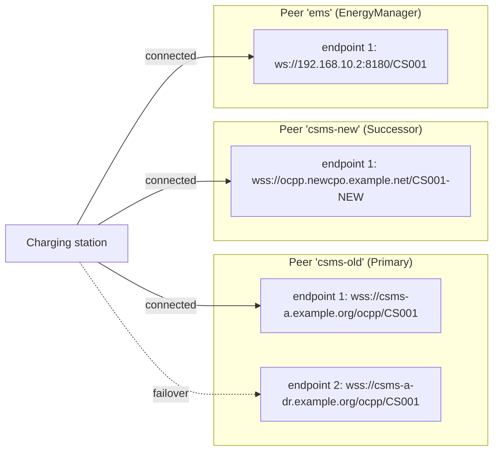

# Multi-Homed OCPP: Parallel Connections to Several Back Ends

**Version 0.1, Draft**, 2026-11-09
[CC-BY-SA 4.0](https://creativecommons.org/licenses/by-sa/4.0/) · [OpenChargingTechnology/Whitepapers](https://github.com/OpenChargingTechnology/Whitepapers) · reference implementations: [OpenChargingCloud/ChargingStation](https://github.com/OpenChargingCloud/ChargingStation) (station), [OpenChargingCloud/WWCP_Core](https://github.com/OpenChargingCloud/WWCP_Core) and [OpenChargingCloud/WWCP_OCPP](https://github.com/OpenChargingCloud/WWCP_OCPP) (networking nodes), [Vanaheimr/Hermod](https://github.com/Vanaheimr/Hermod) (transport)

An OCPP charging station talks to exactly one back end at a time. OCPP 2.x lets a CSMS store
several *network connection profiles* in numbered slots, but the slots are a failover list: the
station uses the first one that works and switches to the next only when that one fails. There is
no way to keep a second CSMS connected while the first one is still in charge, which is what a CSMS
migration, a hot standby, an energy manager or a monitoring back end need.

This paper proposes a model in which a charging station keeps connections to **several peers in
parallel** (CSMS, Local Controller, gateway, energy manager, service back end), each with a
**role** that says what it receives and what it may do. It covers the station (chapters 3 to 5),
the transport of a single connection (chapter 6), the server side, which today replaces an older
connection with every newer one of the same identity (chapter 7), and the configuration via the
web interface and via OCPP (chapters 8 and 9).

It complements two existing documents:
[Resilient, high-available and pooled parallel Connections](../AdvancedConnections/README.md) (the
outline) and
[EVQI Transport: Multi-Channel Communication between Charging Stations and CSMS](../EVQITransport/README.md),
which splits the traffic to **one** CSMS into several channels. This paper is about **several
CSMS**; where a peer is reached over several channels, it refers to EVQI instead of repeating it.

---

## Contents

0. [Summary](#0-summary)
1. [Starting point](#1-starting-point)
2. [Use cases and requirements](#2-use-cases-and-requirements)
3. [Model: peers, endpoints, roles](#3-model-peers-endpoints-roles)
4. [Behaviour of a multi-homed station](#4-behaviour-of-a-multi-homed-station)
5. [Routing in the networking node](#5-routing-in-the-networking-node)
6. [Transport options per connection](#6-transport-options-per-connection)
7. [Server side: parallel and duplicate connections](#7-server-side-parallel-and-duplicate-connections)
8. [Configuration and mapping to OCPP](#8-configuration-and-mapping-to-ocpp)
9. [Web interface](#9-web-interface)
10. [Implementation plan](#10-implementation-plan)
11. [Open questions and decisions](#11-open-questions-and-decisions)
12. [References](#12-references)

---

## 0. Summary

**The problem.** A station that is connected to two back ends at the same time has to answer
questions OCPP never asks: which one registers it, which one may stop a transaction, which one
answers an `Authorize`, where the response to a request goes, and what happens to the messages one
of them missed while it was offline. The reference implementation already dials every configured
connection in parallel, but it gives every one of them the same name, `CSMS`. The networking node
then routes to whichever connection came up last, including the responses to requests that came
in over a different connection (section 1.3).

**The proposal in brief:**

1. **Peers, not URLs.** The unit of configuration is a *peer*: a back end with an identity of its
   own, one or more *endpoints* (URLs tried in order, which is what OCPP's slots are) and a
   *role*. A backup URL of the same CSMS is an endpoint, not a second peer.
2. **Exactly one primary.** One peer is the *primary*: it registers the station, owns new
   transactions and may control everything its connection's role allows. Every other peer is a
   *secondary* with an explicit rights profile: what it receives and which requests it may send.
   Four presets cover the usual cases: `Successor`, `Observer`, `EnergyManager`, `Service`.
3. **Everything per peer.** Each peer has its own registration (BootNotification), heartbeat,
   offline queue, credentials, client certificate and, where it differs, its own identity
   (OCPP 2.1 `NetworkConnectionProfile.identity`).
4. **Responses follow the connection.** A request is answered on the connection it came over,
   never via a routing lookup by name. The alias `CSMS` (`CentralSystem` in OCPP 1.6) resolves to
   the primary only for what the station sends by itself.
5. **Switchover is an explicit act.** A secondary becomes primary by a local operator action, a
   request of the current primary, or a scheduled time. Running transactions stay with the peer
   that started them. Automatic promotion on failure is off by default (split brain).
6. **Transport per endpoint.** An endpoint may pin its HTTP binding (`http/1.1`, `h2`, `h3`) or
   leave it to automatic selection with fallback. Several channels to the same peer are EVQI
   channel sessions. Two peers never share a transport connection.
7. **The server stops trusting "newest wins".** A server that receives a second connection for an
   identity that is still connected checks first whether the old connection is alive (a
   WebSocket ping with a short timeout), unless the newcomer proves that it is the same client
   instance (a *continuity token*). A live connection is not taken over by a newcomer that merely
   holds the same credentials, takeovers are rate-limited per identity, and every refused or forced
   takeover is an alarm.

OCPP's slots stay valid: they become the endpoint list of the primary peer
(`NetworkConfigurationPriority` is its order), and use case B10 *Migrate to new CSMS* keeps
working as a sequential migration. Parallel peers are an extension next to them.

---

## 1. Starting point

### 1.1 What OCPP offers

| Topic | OCPP 1.6 (+ Security Whitepaper Ed. 3) | OCPP 2.0.1 / 2.1 |
|---|---|---|
| Where the CSMS is | outside the protocol (vendor configuration) | `NetworkConnectionProfile` in numbered slots, set by `SetNetworkProfile` (B09) |
| Several back ends | no | several **slots**, one active connection |
| Order and failover | – | `OCPPCommCtrlr.NetworkConfigurationPriority` (comma separated slot list), `NetworkProfileConnectionAttempts` (attempts before the next slot) |
| Migration | – | B10 *Migrate to new CSMS*: new profile in a slot, new priority, reset; fallback to the old slot if the new one fails |
| Identity per back end | one | 2.1: optional `identity` and `basicAuthPassword` per profile (security profiles 1 and 2) |
| Local Controller | – | Part 4 §6: the LC opens one connection to the CSMS per station behind it |
| Several connections of one identity | – | Part 4 §4.1.4: message IDs unique across all WebSocket connections of the same identity, so the specification already allows for more than one |

The slot mechanism is a **failover list**. At any time exactly one slot is in use; nothing in
OCPP describes two CSMS that are connected at the same time, nor how a station would divide its
messages and its obedience between them.

### 1.2 What the reference implementation does today

As of ChargingStation `0ba7c99`, WWCP_Core `4920c0b`, WWCP_OCPP `a06dc241`.

The charging station has its own list of connections (`OCPP/ConnectionStore.cs`, stored as
`ocpp-connections/connections.json` with the credentials in a separate, owner-readable
`authentications.json`):

| Field | Meaning |
|---|---|
| `url` | `ws://`, `wss://`, `http(s)://` (taken as the same endpoint) or `ssh://` (OCPP over the SSH subsystem `ocpp@open.charging.cloud`) |
| `ocppVersion` | `OCPP1.6` or `OCPP2.1`; selects which of the station's two OCPP nodes dials |
| `connectionType` | `CSMS`, `CSMSBackup`, `LocalController`; deliberately **only a label** that nothing reads |
| `autoConnect` | whether the station dials it at start and keeps coming back; off by default |
| `authenticationId`, `certificateId` | references to HTTP Basic/TOTP credentials and to a TLS client certificate |
| `sshHostKey` | the pinned host key of an `ssh://` connection; empty means trust on first use, written back |

At start, every connection with `autoConnect` is dialled, oldest first, each on its own and
unaffected by how the others went (`ChargingStation.Connections.cs`, `DialConfiguredConnections`).
Each one reconnects by itself. A connection test on the web page dials a throw-away client and
leaves nothing behind.

`SetNetworkProfile` is answered `Accepted` and stores nothing. The OCPP 2.1 node carries an
`OCPPCommCtrlr` with fixed values (`NetworkConfigurationPriority` = `1`,
`NetworkProfileConnectionAttempts` = `3`), but nothing reads them: the station's connections are
not slots, and changing the variables changes nothing about what is dialled.

### 1.3 What goes wrong with two connections of the same OCPP version

Both connections are opened and kept, but:

1. **The last one up wins the name.** Every connection is registered in the node's routing table
   under the same next hop, `CSMS` (2.1) or `CentralSystem` (1.6). `Routing.AddOrUpdateStaticRouting`
   replaces the entry of equal priority (WWCP_Core `Routing.cs`), and it is called again on every
   reconnect (`ANetworkingNode.ConnectWebSocketClient`, `OnWebSocketConnectionAccepted`). The
   route therefore flips to whichever connection reconnected last. It is never removed when a
   connection closes: `RemoveStaticRouting` has no caller.
2. **Everything the station says by itself goes to that one connection**: BootNotification,
   heartbeats, status and transaction events, security events, the offline queue.
3. **Responses can take the wrong connection.** In standard networking mode an incoming request
   gets the connection's next-hop name as its source (`OCPPWebSocketAdapterIN.ProcessJSONMessage`),
   so a request from CSMS A has the source `CSMS`. Its response is addressed to `CSMS` and sent
   via a routing lookup (`OCPPAdapter.SendJSONResponse`). If CSMS B connected last, the response
   to A's request goes to B. (Found by reading the code; not reproduced in a test yet.)
4. **Registration is per OCPP node, not per connection** (`ChargingStation.Registration.cs`).
   Once one CSMS has accepted the node, a second connection coming up only flushes the queue,
   towards the routing winner. The second CSMS never receives a BootNotification.

One 1.6 connection and one 2.1 connection at the same time work, because they belong to two
different nodes with separate routing tables, registrations and queues.

### 1.4 And on the server side

Every OCPP server of the reference implementation (CSMS, Local Controller, gateway, and the
station's own commissioning listener over SSH) lets the **newest connection of an identity win,
unconditionally**. The older one is closed with `1000` *"Newer connection detected!"*, whether it
was alive or not, and without any limit on how often that may happen. An attacker with a
station's password can knock the station off its CSMS as often as it likes, at the cost of one
handshake each time. The station reconnects within seconds and knocks the attacker off in turn,
so neither stays connected for long. Two stations configured with the same identity do the same
to each other in a loop.
Section 7.1 has the details.

---

## 2. Use cases and requirements

### 2.1 Use cases

| ID | Use case | Peers | What the second peer needs |
|---|---|---|---|
| U1 | **CSMS migration** (new operator, new platform, or OCPP 1.6 → 2.1) | old CSMS, new CSMS | registration, a full copy of what the station reports, its own credentials and client certificate issued by its own PKI before the cut-over; no control until the cut-over; a way back |
| U2 | **Hot standby of the same CSMS** | one CSMS, several URLs | nothing new: this is failover between endpoints of **one** peer (OCPP's slots) |
| U3 | **Local Controller plus direct path** | LC (primary), CSMS (service) | diagnostics, firmware or certificate operations that should not pass through the LC (cf. EVQI section 6.6) |
| U4 | **Energy manager / grid operator** | CSMS, EMS or grid gateway | to set external limits (`ChargingStationExternalConstraints` in 2.x) and read measurements; nothing else |
| U5 | **Observer** | CSMS, data platform, OEM service, Eichrecht transparency back end | status, meter values and transaction events, read-only |
| U6 | **Service / commissioning** | CSMS, manufacturer service back end | temporary, on demand, diagnostics and configuration under a role of its own |
| U7 | **Shared station** (optional) | two CSMS | each owns some EVSEs (e.g. a semi-public site); see section 4.2 |

### 2.2 Requirements

| ID | Requirement |
|---|---|
| R1 | Several peers connected at the same time, independent of their OCPP versions |
| R2 | Exactly one peer controls the station at any time; every other peer's rights are explicit and enforced |
| R3 | Every response leaves on the connection its request came over |
| R4 | Registration, heartbeat, offline queue and ordering guarantees per peer |
| R5 | A switchover of the primary without losing or duplicating a transaction, and a way back |
| R6 | Credentials, client certificate, trust anchors and identity per peer |
| R7 | Backward compatible: a peer that knows nothing of this paper sees an ordinary OCPP station |
| R8 | OCPP's slots and B10 keep working, mapped onto the new model |
| R9 | Transport options per endpoint: HTTP binding, channels (EVQI) |
| R10 | Servers handle duplicate connections of one identity safely: no takeover of a live connection by stolen credentials, fast recovery from half-open connections, visible alarms |
| R11 | Configurable locally (web interface, CLI, file) and remotely via OCPP, with the same rules |

### 2.3 Non-goals

- No consensus protocol between back ends. The station does not ask peers to agree; it follows
  its own configuration.
- No new message types are required for the basic model. Extensions for remote configuration are
  additive (chapter 8).
- No server-initiated connections to the station (NAT, cellular), as in EVQI.

---

## 3. Model: peers, endpoints, roles

### 3.1 Terms

| Term | Meaning |
|---|---|
| **Peer** | a back end the station talks to: a CSMS, a Local Controller, a gateway, an EMS, a service back end. Has an id (local, stable), a kind (label), an OCPP version, a role and one or more endpoints. |
| **Endpoint** | one way to reach a peer: URL, credentials, client certificate, transport options. A peer's endpoints are tried in order; at most one of them is connected at a time (failover, like OCPP's slots). |
| **Connection** | the live transport to one endpoint; with EVQI possibly several channels (chapter 6). |
| **Primary** | the one peer that controls the station. |
| **Secondary** | every other peer, with a rights profile. |
| **Rights profile** | two allow-lists: what the station sends to the peer (*outbound*) and which requests the station accepts from it (*inbound*). |
| **Owner** | the peer a transaction belongs to: the primary at the moment the transaction started. |
| **Peer identity** | the identity the station uses towards a peer (last URL path segment, Basic Auth login); the station's own identity unless set per peer. |

### 3.2 Peers and endpoints



- Endpoints of one peer are alternatives: same peer, same registration, same queue, same owner of
  transactions. Failover between them follows `NetworkProfileConnectionAttempts` and the OCPP
  back-off (EVQI section 8).
- Peers are parallel. Each has its own state, and none of them waits for another.
- Today's `connectionType` `CSMSBackup` becomes an endpoint of the CSMS it backs up; `CSMS` and
  `LocalController` become the peer's kind, which stays a label.

### 3.3 Roles and rights

| Role / preset | Dialled | BootNotification, heartbeat | Outbound (station → peer) | Inbound (peer → station) | Authoritative for |
|---|---|---|---|---|---|
| **Primary** | always | yes | everything | everything its connection role allows (EVQI section 7.4) | authorization, transaction responses, configuration, firmware, certificates, network profiles |
| **Successor** | always | yes | everything the station reports, as copies; no `Authorize` (section 4.3); `SignCertificate` for its own client certificate | read-only: `Get*`, `TriggerMessage` (answered to itself), `GetLog`; `CertificateSigned` **for its own client certificate** | nothing until it is promoted |
| **Observer** | always | yes | a configurable subset: status, meter values, transaction events, security events | none, or `Get*` only | nothing |
| **EnergyManager** | always | yes | meter values and status of the EVSEs it limits | `SetChargingProfile` / `ClearChargingProfile` of its own external-constraint profiles, `GetCompositeSchedule` | the limits it set |
| **Service** | on demand | yes | none, apart from the responses to its requests | diagnostics (`GetLog`, `GetBaseReport`, `GetVariables`), under a role of its own; firmware only as an EVQI privileged channel | nothing |

The presets are defaults. A rights profile is two explicit lists, so a site can narrow or widen a
preset without inventing a new role. A request outside the inbound list is answered with
`CALLERROR` `SecurityError`, as EVQI does for a violation of the connection role. The effective
right is the intersection of the peer's rights profile, the connection role (EVQI section 6) and,
for signed messages, the signer's role (EVQI section 7.4).

A secondary never controls anything the primary controls: availability, reset, firmware, network
profiles, the security profile, trust anchors and the configuration of other peers belong to the
primary or to the local operator.

### 3.4 Identity, credentials and certificates per peer

- **Identity.** By default the station's own identity. A peer may know the station under another
  one (OCPP 2.1 `NetworkConnectionProfile.identity`), which is common in a migration where the
  new operator has its own naming scheme.
- **Credentials.** Per endpoint, by reference, as today (`authenticationId`). Rotating a password
  of one peer never touches another.
- **Client certificate.** Per endpoint (`certificateId`). A successor typically issues its own
  station certificate under its own PKI before the cut-over: `SignCertificate` /
  `CertificateSigned` are therefore allowed for a successor, and the resulting certificate is
  bound to that peer's endpoints only.
- **Trust anchors.** Which root CAs a peer's server certificate must chain to is set per endpoint.
  Installing the new operator's CSMS root CA is a trust decision of the primary or of the local
  operator, never of the successor itself.

---

## 4. Behaviour of a multi-homed station

### 4.1 Registration, heartbeat and offline queue per peer

- Every peer gets its own BootNotification and keeps its own registration state (`Accepted`,
  `Pending`, `Rejected`), heartbeat interval and retry timer. Until a peer has accepted the
  station, nothing but the BootNotification is sent to it, as OCPP requires.
- Every peer has its own **offline queue**. A secondary that is offline for a day does not hold
  up the primary, and the primary's queue is never flushed towards a secondary.
- Secondary queues are bounded (count and age). When a bound is reached the oldest entries are
  dropped first, transaction messages last, and the peer is told at reconnect with a security
  event (`QueueOverflow`, with the number of dropped messages).
- **Ordering** holds per peer: messages to one peer leave in the order they were produced. There
  is no ordering across peers.

### 4.2 Transactions and ownership

- A transaction is **owned** by the peer that was primary when it started. Its owner receives all
  of its messages and answers for it: authorization (`Authorize`, `idTokenInfo` in the 2.x
  `TransactionEventResponse`, 1.6 `StartTransaction.conf`), remote stop, limits of
  `TxProfile` charging profiles.
- Secondaries whose outbound list contains transaction messages receive copies. Their answers are
  recorded for comparison (section 4.6) and otherwise ignored.
- **OCPP 2.x:** the station assigns `transactionId`, so all peers see the same id. `seqNo` is
  counted **per peer**, so that every peer sees a gap-free sequence of what it actually received.
- **OCPP 1.6:** the CSMS assigns `transactionId` in `StartTransaction.conf`. The station keeps a
  mapping per peer from its internal transaction to that peer's id and uses it in `MeterValues`
  and `StopTransaction` to that peer.
- **Per EVSE (U7, optional).** A site may assign EVSEs to peers. Each peer is then primary for its
  EVSEs and observer, or nothing, for the others. Station-wide operations (reset, firmware,
  network) stay with one designated peer. This variant is optional and not needed for the other
  use cases.

### 4.3 Requests the station sends that expect an answer

| Request | To the primary | To secondaries |
|---|---|---|
| BootNotification, Heartbeat | yes | yes, each its own |
| StatusNotification, MeterValues, NotifyEvent, SecurityEventNotification | yes | per outbound list |
| TransactionEvent (2.x), Start/StopTransaction (1.6) | the owner | per outbound list, answers ignored |
| Authorize | the owner (the primary) | no; optional `AuthorizeFallback` (section 4.6) |
| SignCertificate, Get15118EVCertificate, GetCertificateStatus | the primary | `SignCertificate` for the peer's own client certificate only |
| DataTransfer | by `vendorId`: to the peers whose outbound list names that vendor id | – |
| FirmwareStatusNotification, LogStatusNotification, NotifyReport | the peer that asked | – |

### 4.4 Requests the station receives

- From the primary: everything its connection role allows.
- From a secondary: what its inbound list allows; `CALLERROR` `SecurityError` otherwise.
- **Conflicts** are resolved by kind, not by "last writer wins":
  - Charging profiles combine as OCPP already defines it: the primary sets `TxDefaultProfile`,
    `TxProfile` and `ChargingStationMaxProfile`; an energy manager sets
    `ChargingStationExternalConstraints`. The composite schedule is the minimum. The station
    reports external limits to the primary with `NotifyChargingLimit`, so the primary is not
    surprised.
  - `ChangeAvailability`, `Reset`, `UpdateFirmware`, `SetNetworkProfile`, `InstallCertificate` and
    security-relevant `SetVariables`: primary only.
  - A `TriggerMessage` of a secondary triggers the message towards that secondary only.

### 4.5 Switchover of the primary

```mermaid
sequenceDiagram
    participant Old as Peer csms-old (Primary)
    participant CS as Charging station
    participant New as Peer csms-new (Successor)
    Note over CS,New: New is connected, Accepted, has its own client certificate
    Old->>CS: SetVariables OCPPPeerController[csms-new].Role = Primary (or local operator, or PromoteAt)
    CS->>CS: new transactions → csms-new; running ones stay with csms-old
    CS->>New: SecurityEventNotification PrimaryChanged
    CS->>Old: SecurityEventNotification PrimaryChanged
    Note over CS,Old: csms-old becomes Observer for KeepPreviousFor, then is dialled no more
    CS-->>Old: messages of transactions csms-old still owns
```

- **Triggers:** a local operator (web interface, CLI), a request of the current primary
  (section 8.2), or a scheduled `PromoteAt`. A successor cannot promote itself.
- **Running transactions** stay with their owner until they end. A site that wants a hard cut
  instead can set `TransferOpenTransactions`: the new primary then receives the remaining
  messages of the running transactions as well, and becomes their owner.
- **The previous primary** becomes an observer for `KeepPreviousFor` (default 7 days), so that it
  receives the end of its transactions and the migration can be rolled back by the same
  operation in reverse.
- **Automatic promotion** when the primary is unreachable is possible (`PromoteAfterOffline`),
  but **off by default**: two back ends that each believe they are in charge are worse than a
  station that waits. Failover to another *endpoint* of the same primary is the normal answer to
  an unreachable back end.

### 4.6 Comparison and authorization fallback during a migration

- **Shadow comparison.** The station records where a successor's answers differ from the
  primary's (e.g. an `idTokenInfo` status, a heartbeat interval) and shows the differences in the
  web interface. This is the cheapest test of a migration: it runs on real traffic and changes
  nothing.
- **`AuthorizeFallback`** (off by default): when the primary answers `Unknown` or `Invalid`, the
  station asks the successor. This helps while token lists are migrated, but it widens what is
  accepted, so it is a deliberate, time-limited decision of the operator and every fallback
  acceptance is logged.

---

## 5. Routing in the networking node

### 5.1 One networking node id per peer

Each peer is registered in the routing table under **its own** `NetworkingNode_Id` (the peer id,
or the id the peer signs with in overlay networking). The well-known names `CSMS` (2.x) and
`CentralSystem` (1.6) become **aliases** that resolve to the current primary. The routing table
already has priorities and weights (`Reachability.Priority`, `Weight`); the alias uses them:

| Destination | Entry | Priority |
|---|---|---|
| `csms-old` | connection to csms-old | 0 |
| `csms-new` | connection to csms-new | 0 |
| `ems` | connection to ems | 0 |
| `CSMS` (alias) | → `csms-old` while it is primary | 0 |

A switchover changes the alias, nothing else. A message the station sends by itself is addressed
to the alias, or, where the rights profile says so, to each secondary's own id.

### 5.2 Responses follow the connection

A response, a `CALLERROR` and a `CALLRESULTERROR` leave on the connection the request came over.
The adapter knows that connection when it processes the request; it hands it to the response
instead of looking up the source name in the routing table. A routing lookup is only needed in
overlay networking, where a request may have travelled over several hops; there the source is a
real node id and not an alias.

### 5.3 Route lifecycle

- A route is added when a connection is accepted and **removed** when it closes, so that a message
  for a peer that is offline goes to that peer's queue instead of to a dead socket.
- The alias `CSMS` is never removed; while the primary is offline, messages for it go to the
  primary's queue.
- `LearnRouteBack` (learning the way back from an incoming request) stays, but never overrides a
  peer's own route and never sets the alias.

### 5.4 Local Controller

For a station behind a Local Controller, the LC is simply a peer of kind `LocalController`,
usually the primary. A direct connection of the same station to the CSMS (U3) is a second peer
with the `Service` role. The CSMS then sees the same identity twice, once via the LC and once
directly. That is exactly the case of chapter 7: the CSMS must keep both, which works if the
direct connection uses a path of its own (as EVQI section 4.6 proposes for extra channels) or if
its duplicate policy is `Parallel` for that identity.

---

## 6. Transport options per connection

This chapter is about one peer: which HTTP version carries its WebSocket, and how several
connections or streams to the same peer are used. The bindings themselves are analysed in EVQI
chapter 2 and are not repeated here.

### 6.1 Today

As of Hermod `f7b00ef2`.

- **The station, WWCP and OCPP speak WebSockets over HTTP/1.1 only.** `OCPPWebSocketClient` and
  `WWCPWebSocketClient` derive from Hermod's HTTP/1.1 `WebSocketClient`, whose upgrade request is
  always an HTTP/1.1 GET. The only related setting, `ApplicationProtocols`, is handed to TLS as
  the ALPN list and changes nothing about what is spoken afterwards.
- **Hermod has the other two bindings, but nothing above Hermod uses them:**

  | | HTTP/2 (RFC 8441) | HTTP/3 (RFC 9220) |
  |---|---|---|
  | Client | `HTTP2ClientConnection.OpenWebSocketAsync`; several WebSockets on one connection, with RFC 9218 priorities in both directions | `Http3ClientConnection.SendExtendedConnect`, low-level only; one QUIC stream per WebSocket |
  | Server | `HTTP2Server` with a connect handler | `Http3ServerConnection` with a connect handler |
  | ALPN | `h2` only; fails if the server picks anything else | `h3` only |
  | Sub-protocol (`ocpp2.1`) | no parameter; only via extra headers | the same |
  | Ping API, keep-alive | none for the WebSocket; HTTP/2 keep-alive off by default, while the server closes after 120 s without frames | none; QUIC keep-alive off by default |
  | Client certificate | one fixed certificate per connection, no selection callback | public API only for self-signed ECDSA P-256 certificates: a CA-issued station certificate cannot be presented |
  | Server sees the client certificate in the connect handler | no | on the connection object, not on the request |
  | A refusal's headers (`Retry-After`) | lost | available |
  | Maturity, by its own README | reference implementation, not for production | reference implementation, not for production |

- **No fallback and no discovery.** Nothing tries `h3`, then `h2`, then `http/1.1`. `Alt-Svc` is
  parsed and not acted on. HTTPS records (RFC 9460) can be queried but are not used to choose a
  connection.
- **TLS-bound TOTP** needs a TLS exporter. .NET's `SslStream`, which the HTTP/1.1 and HTTP/2 stacks
  use, has none, so the binding can be computed neither by the client nor by the server there;
  QUIC (Hermod's own TLS) exports keying material.

### 6.2 Pinning the binding per endpoint

Each endpoint gets an option `binding`:

| Value | Meaning | URL schemes |
|---|---|---|
| `http/1.1` | RFC 6455 upgrade. With `wss`, ALPN offers `http/1.1` only. Today's behaviour, what every OCPP-J peer supports, and the **default** until `h2` and `h3` are ready for production (section 6.4). | `ws`, `wss` |
| `auto` | the station chooses and falls back (below); meant to become the default later | `ws`, `wss` |
| `h2` | RFC 8441 Extended CONNECT. With `wss`, ALPN offers `h2` only; refused if the server picks something else or does not announce `SETTINGS_ENABLE_CONNECT_PROTOCOL`. With `ws`, HTTP/2 with prior knowledge (h2c), since RFC 9113 removed `Upgrade: h2c`; for test benches only. | `wss` (`ws` for tests) |
| `h3` | RFC 9220 over QUIC, on the URL's port over UDP. | `wss` only: QUIC is always TLS |

**Pinned means strict.** A pinned binding never falls back; failing to get it is reported as
such ("pinned to h3, no answer over UDP"). That is what pinning is for:
- conformance and interoperability tests;
- sites whose middleboxes are known, e.g. a reverse proxy that terminates HTTP/2 and does not pass
  RFC 8441 through to its back end, which `http/1.1` avoids;
- making sure that a channel session (6.3) really runs over one multiplexed connection.

**`auto`** follows the order of EVQI section 4.5, item 7, `h3` → `h2` → `http/1.1`, and keeps it
cheap:
- `h3` is tried only where it is known to be offered: the `alpn` of an HTTPS record, `Alt-Svc`
  from an earlier connection, or a remembered success.
- Otherwise one TLS handshake offers `h2` and `http/1.1` together, and the server chooses.
- If the server chooses `h2` but does not announce Extended CONNECT, the station reconnects once
  with `http/1.1` and remembers that.
- The choice is remembered per endpoint and network and checked again from time to time, with
  jitter, so that nothing oscillates.

**What a binding does not change.** The security profile, the client certificate, the
credentials and the sub-protocol are the same on every binding. A binding never weakens TLS:
`h2c` exists only below `ws://`, which is security profile 1 anyway. Each endpoint keeps its own
TLS identity. HTTP/2 and HTTP/3 forbid a second client authentication on an existing connection
(RFC 8740, RFC 9001 §4.4).

### 6.3 Several connections or streams to the same peer

**Why at all.** OCPP-J allows one outstanding CALL per sender **per connection** (Part 4
§4.1.1), and everything on one connection is delivered in order. Parallelism, and freedom from
head-of-line blocking, therefore need more than one connection or stream. EVQI defines how: a
*channel session* per peer, with channel classes (`Control`, `Realtime`, `Bulk`, `Privileged`), a
capability negotiation and a session token. This paper adds only what follows from having
several peers.

**Ways of using several channels, and when each makes sense:**

| Strategy | Example | Ordering | Assessment |
|---|---|---|---|
| **By class** (EVQI) | transactions on `Control`, live power on `Realtime`, logs on `Bulk` | kept, because messages that depend on each other stay on one channel | the default |
| **By latency** | a dedicated channel for `Authorize`, `RequestStartTransaction` and `RemoteStartTransaction`, so that a large report never delays a driver at the plug | as above; the channel carries only independent requests | worth it at sites with heavy reporting; an EVQI class `Interactive`, or `Realtime` widened, rather than a new mechanism |
| **By affinity** | a Local Controller or gateway with one stream per station behind it (EVQI section 10.4) | per station | the main gain of HTTP/2 for a Local Controller: 21 connections become one |
| **Round-robin pool** | N identical control channels | **lost** across channels; acceptable only for independent requests (`Get*`, queries) | not for a station's own traffic; a transaction's messages must stay on one channel |

**Per binding:** with `http/1.1` every channel is a TCP and TLS connection of its own, which also
allows a different client certificate per channel. With `h2` and `h3` the channels are streams of
one connection per certificate domain (EVQI section 4.1).

**Rules that follow from having several peers:**

1. **Two peers never share a transport connection**, even where HTTP/2 connection reuse
   (RFC 9113 §9.1.1) would allow it because one certificate covers both hosts. Peers differ in
   identity, credentials and trust anchors.
2. **No extra channel without negotiation.** A server with today's "newest wins" (section 7.1)
   would answer a second connection of the same identity by closing the first. That would close
   the control channel.
3. **Channels per peer, limits per peer.** EVQI's station limits (EVQI section 9.2) apply to each
   peer separately, plus a limit on the sum.

### 6.4 What is needed in the code

| Layer | Needed for `h2` / `h3` |
|---|---|
| Hermod | an adapter that makes the HTTP/2 and HTTP/3 `WebSocketConnection` an `IMessageConnection` (pull-based today; WWCP is event-based); sub-protocol and `sec-websocket-version`; a ping API; the refusal's headers; keep-alive on by default for WebSockets; an asynchronous WebSocket open for HTTP/3; client certificates from a CA for QUIC; a dialer that pins or falls back. `HTTP2ClientConnection` can already run over a caller's own TLS stream, which is the way to one handshake offering `h2` and `http/1.1`. |
| WWCP_Core | a client class next to `WWCPWebSocketClient` (`WWCPSshClient` is the model of a second transport, behind `IWWCPClient`); `ConnectWebSocketClient` takes the concrete HTTP/1.1 type today; a server built on the HTTP/2 and HTTP/3 connect handlers, whose handler must see the client certificate |
| WWCP_OCPP | an OCPP client class implementing `IOCPPMessageTransport`; a `Binding` parameter on `ConnectOCPPClient` |
| Station | `binding` on the endpoint, the negotiated binding in the connection's state (section 9.2) |

Until Hermod's own assessment changes (EVQI phases A and C), `http/1.1` stays the production
binding. `h2` and `h3` are for test benches.

---

## 7. Server side: parallel and duplicate connections

A server that accepts OCPP connections (a CSMS, a Local Controller towards its stations, a
gateway, a station serving commissioning tools) has to decide what a second connection of an
identity that is still connected means. "Newest wins" is the common answer and the right one for a
dead connection the server has not noticed yet. For a live one it is the wrong answer, and with
several peers, channels (EVQI) and direct paths past a Local Controller (section 5.4) it becomes
the common case rather than an exception.

### 7.1 Today

As of WWCP_Core `4920c0b`, WWCP_OCPP `a06dc241`, Hermod `f7b00ef2`.

**Who is connecting.** The WebSocket server (`WWCPWebSocketServer`, under the OCPP 1.6 and 2.x
nodes' `OCPPWebSocketServer`) takes the identity from the last path segment, else from the
credentials: the TLS client certificate's CN, the HTTP Basic login or the TOTP login. Where both
are present and the server can check the credentials, they must name the same node or one allowed
to act for it (`AllowToActFor`, for a Local Controller); otherwise `403` before the `101`. Over
SSH (`WWCPSshServer`) the identity is the SSH login, and the HELLO may name another node only
under the same rule.

**What a second connection does:**

| | WebSocket (HTTP/1.1) | SSH subsystem |
|---|---|---|
| Decision | `WWCPWebSocketServer.Supersedes` returns `true`: newest wins, always | `Register` keeps only the newest |
| When | before the new connection's `101`; the close of the old one is awaited (up to 5 s) | after the new connection's WELCOME; the close is not awaited |
| Old connection gets | close `1000` *"Newer connection detected!"*, then TLS and TCP are closed | CLOSE `1000` *"Newer connection detected!"* on the channel |
| Liveness of the old one checked | no (`IsAlive` is never set to `false`; `LastReceivedTimestamp` is not consulted) | no |
| Setting to change it | none | none |
| Logged | `DebugX.Log`, which reaches the event log in debug builds only | the same; the station's commissioning page logs a tool going away |

**What else follows from it:**

- **The server's own liveness check** is the WebSocket ping: every 30 s of silence, and the
  connection is dropped after three unanswered ones, i.e. after about 90 s. SSH relies on the
  transport's `keepalive@openssh.com` (60 s × 3 in WWCP_Node); the message layer sends no pings
  by default and does not evaluate PONGs.
- **No limits per identity**: no budget for takeovers, no rate limit on WebSocket upgrades or on
  failed authentications, no `429`. `MaxConnectionsPerIP` exists in Hermod and is off.
- **Routes** point to the server object and are never removed; a message for a node whose
  connection has ended returns `UnknownClient`. **Pending requests** are matched by request id
  alone and are not tied to the connection they were sent on, so a request sent over a connection
  that is then replaced waits for its full timeout.
- **The client reconnects at once.** Hermod's WebSocket client treats a close by the server as a
  loss, reconnects with its policy (1 s initial delay) and resets the back-off after every
  successful connect. Two clients of one identity therefore replace each other every one or two
  seconds, indefinitely.
- **Without authentication** (`RequireAuthentication = false`) the path alone names the identity,
  so any client can take over any station's live connection by naming it.
- **Found on the way, outside this paper, and fixed since** (2026-11-09: WWCP_Core 232bd69d and
  d325bb34, WWCP_OCPP cc593c5f, ChargingStation f4a90c9; Hermod in PR Vanaheimr/Hermod#240):
  - **Security profile 3 on one port with profile 2.** Profile 3 worked on a port of its own:
    authentication off, a client certificate required. A port that required authentication took
    HTTP Basic and TOTP only, and answered a station with nothing but its certificate `401`. Now
    a client certificate the TLS handshake took counts as authentication there too.
    `RequireACertificateOf` says per networking node that a password alone opens nothing. That is
    the rule "weaker never displaces stronger" of section 7.3, applied at the door.
  - **TOTP was never sent.** Hermod's HTTP/1.1 `WebSocketClient` kept a `TOTPConfig` and never
    turned it into a header, so a station connection with HTTP TOTP credentials sent no
    `Authorization` header at all. Now a TOTP login goes from the station through WWCP_OCPP and
    WWCP_Core to Hermod, and the password goes in `Authorization: TOTP`, made anew for every
    attempt. A configuration that asks for TLS channel binding is refused clearly, because
    `SslStream` exports no keying material (section 6.1).
- **HTTP/2 and HTTP/3:** Hermod has WebSocket servers for both (RFC 8441, RFC 9220), but no OCPP
  or WWCP server uses them, and they have no identity registry.

### 7.2 Threats and legitimate cases

| ID | Case | What "newest wins" does | What should happen |
|---|---|---|---|
| T1 | Stolen password, station online | every attacker connection knocks the station off; the station knocks the attacker off; repeat | the attacker is refused while the station's connection is alive, and an alarm is raised |
| T2 | Two stations with the same identity (cloned SD card, copied configuration) | the same loop, hard to diagnose | the second one is refused and both the server and the refused station say so |
| T3 | Stolen password, station offline | the attacker connects; when the station comes back it knocks the attacker off, and the loop starts | the station can come back; the takeover is an alarm either way |
| L1 | Half-open connection: the station lost its path (NAT timeout, cellular handover, power cut), the server still holds the old socket for up to 90 s | the station's reconnect replaces it at once (good) | the same, within seconds |
| L2 | The station's software reconnects without closing its old connection (watchdog, restart of the OCPP client) | replaced at once (good) | the same, even if the old socket still answers pings |
| L3 | Legitimate parallel connections: EVQI channels, a station both behind an LC and direct (section 5.4) | each new one kills the others | kept side by side |

L1 and L2 are why "oldest wins" is no answer either: a server that simply refuses newcomers locks
a station out for as long as it takes to notice a dead connection.

### 7.3 Policies

The policy is a setting of the server, with overrides per identity or per login group:

| Policy | A newcomer while the identity is connected | Use |
|---|---|---|
| `Replace` | the old connection is closed (`4000`), the newcomer accepted | today's behaviour; compatibility |
| `Probe` | the old connection is probed (section 7.4). Alive: the newcomer is refused with `409` and `Retry-After`. Dead: the old one is closed (`4001`) and the newcomer accepted. | **proposed default** |
| `KeepExisting` | the newcomer is refused with `409` while the old connection is registered; the server's own pings remove a dead one | strict sites that accept up to 90 s of lock-out after a path change |
| `Parallel` | both are kept, up to `MaxPerIdentity`, as long as they differ in path or channel (EVQI session token, section 5.4) | channels, Local Controller plus direct path |

Three rules apply under every policy except `Replace`:

1. **Proof of continuity replaces at once.** A newcomer that presents the continuity token of the
   existing connection (section 7.5), or the same TLS client key as the existing connection,
   replaces it immediately without a probe: that is L2.
2. **Weaker never displaces stronger.** A newcomer authenticated with a static password never
   displaces a live connection authenticated with a client certificate or with a TLS-bound TOTP.
3. **A takeover budget.** At most `TakeoverBudget` takeovers per identity and window (proposed: 3
   per 10 minutes). Beyond that, newcomers without proof of continuity are refused for a
   cool-down period, and an alarm is raised.

### 7.4 The probe

- **Only after authentication.** An unauthenticated or wrongly authenticated newcomer is refused
  before anything touches the old connection. Probing costs the server one frame.
- **One at a time.** While a probe of an identity is running, further newcomers of that identity
  are refused with `409` at once.
- **HTTP/1.1 WebSocket:** a Ping frame with 16 random bytes on the old connection. Alive means a
  Pong with the same payload, or any other frame, within `ProbeTimeout` (proposed 3 s: well below
  the server's handshake timeout of 10 s and below what clients wait for a `101`).
- **HTTP/2 and HTTP/3:** a `PING` of the transport connection (RFC 9113 §6.7, QUIC PING) and the
  WebSocket ping on the stream.
- **SSH:** `keepalive@openssh.com` on the transport, or a PING of the message layer, whose PONG
  then has to be evaluated (it is not today).
- The newcomer's handshake waits for the probe; its `101` or `409` comes afterwards.

### 7.5 Continuity token

A probe cannot tell L2 (the same client, reconnecting while its old socket is still alive) from T1
(another client with the same password). A token can:

- With the `101`, the server sends a fresh random token (128 bit) in a response header, e.g.
  `OCPP-Connection-Token`. It is bound to the identity and to this connection.
- The client keeps it (per endpoint, on disk, so that it survives a restart) and presents it on
  its next connection, e.g. as `OCPP-Previous-Connection`.
- If the token names the identity's current connection, the newcomer replaces it at once. Each
  connection gets a new token, so a token works once.
- The token is not a credential: the newcomer authenticates as usual. It is only sent over TLS,
  and an attacker who has the password but never saw this TLS session does not have it.
- **T3:** the server remembers the token of a connection for a while after it ended
  (`TokenGrace`, proposed 24 h). A newcomer presenting such a token while *another* client holds
  the identity is the previous holder coming back. It is refused, as anyone would be, but with a
  **high-severity alarm** ("the identity changed hands while its holder was away"). A site can
  choose `PreferPreviousHolder` to let it displace the current one instead.

A client that knows nothing of tokens sends none and is handled by the probe, so the mechanism is
backward compatible.

### 7.6 Close codes, refusals and the client's reaction

| Signal | Meaning | Client reaction |
|---|---|---|
| close `4000` *Superseded* | replaced by a newer connection of the same identity that proved continuity, or under `Replace` | if the client has a newer connection of its own to that endpoint: nothing. Otherwise **no immediate reconnect**: wait `SupersededBackOff` (proposed 5 min plus jitter), then report a security event `ConnectionSuperseded` |
| close `4001` *Unresponsive* | did not answer a probe and was replaced | reconnect normally; it was a network problem |
| `409 Conflict` + `Retry-After` on the upgrade | another connection of this identity is alive | honour `Retry-After` (the server randomizes it); after three in a row, a security event `DuplicateIdentity` once connected, and a visible warning on the station's web page |

The codes come from the private range 4000–4999 of RFC 6455 §7.4.2 (Q11). Together with the
back-off on `4000` and `409` they end the loop of T1 and T2: today's client resets its back-off
after every successful connect, which is exactly what keeps the loop going.

### 7.7 Alarms and logging

- Every takeover, every refused newcomer and every probe result is an event in the node's log in
  release builds as well, with the identity, both remote addresses, the authentication method, the
  TLS client key fingerprint and whether a token was presented. Today it is a debug-only line.
- Counters per identity; crossing a threshold (e.g. three refusals in an hour) is an operator alarm.
- A station learns of a refusal through `409` and `4000`, and reports it to its peer at the next
  opportunity with `SecurityEventNotification`, as in section 7.6.

### 7.8 Configuration

```json
"duplicateConnections": {
  "policy":               "Probe",
  "probeTimeout":         "PT3S",
  "continuityTokens":     true,
  "tokenGrace":           "PT24H",
  "preferPreviousHolder": false,
  "takeoverBudget":       { "count": 3, "per": "PT10M", "coolDown": "PT30M" },
  "overrides": [
    { "identities": [ "LC01" ], "policy": "Parallel", "maxPerIdentity": 21 }
  ]
}
```

One section for the WebSocket and the SSH servers of a node. The decision itself stays in one
place per server, as today (`Supersedes`), and becomes a function of the policy, the probe and the
two connections instead of a constant.

### 7.9 Credentials remain the first line

A duplicate policy limits what stolen credentials can do; it does not make them harmless. The
stronger measures are those of the other papers: client certificates whose keys live in a secure
element (security profile 3), and
[TOTP with TLS channel binding](../OCPP/OCPPwithHTTPBasicAuthPlusTOTP.md), with which a captured
password is worthless after its validity period and outside its TLS session.

---

## 8. Configuration and mapping to OCPP

### 8.1 The station's own configuration

The connection list becomes a peer list. The file keeps the separation of today: credentials stay
in `authentications.json`, which only its owner may read, and are referred to by id.

```json
{
  "peers": [
    {
      "id":           "csms-old",
      "description":  "CSMS of the current operator",
      "kind":         "CSMS",
      "role":         "Primary",
      "ocppVersion":  "OCPP1.6",
      "endpoints": [
        { "url": "wss://csms-a.example.org/ocpp/CS001",     "authenticationId": "basic-a", "binding": "http/1.1" },
        { "url": "wss://csms-a-dr.example.org/ocpp/CS001",  "authenticationId": "basic-a", "binding": "http/1.1" }
      ]
    },
    {
      "id":           "csms-new",
      "description":  "CSMS of the new operator, in a parallel run",
      "kind":         "CSMS",
      "role":         "Successor",
      "ocppVersion":  "OCPP2.1",
      "identity":     "DE*NEW*E000123",
      "promoteAt":    "2026-12-01T03:00:00Z",
      "endpoints": [
        { "url": "wss://ocpp.newcpo.example.net/", "certificateId": "newcpo-station", "binding": "auto" }
      ]
    },
    {
      "id":           "ems",
      "description":  "Building energy manager",
      "kind":         "EnergyManager",
      "role":         "EnergyManager",
      "ocppVersion":  "OCPP2.1",
      "rights": {
        "outbound": [ "MeterValues", "StatusNotification" ],
        "inbound":  [ "SetChargingProfile:ChargingStationExternalConstraints", "ClearChargingProfile", "GetCompositeSchedule" ]
      },
      "endpoints": [
        { "url": "ws://192.168.10.2:8180/", "authenticationId": "ems-totp" }
      ]
    }
  ],
  "switchover": {
    "keepPreviousFor":           "P7D",
    "transferOpenTransactions":  false,
    "promoteAfterOffline":       null,
    "authorizeFallback":         false
  }
}
```

Rules that the store enforces, as today in one place for the web interface and for OCPP:

- exactly one `Primary`; a peer without endpoints, or with endpoints of different OCPP versions,
  is refused;
- `rights` are only allowed for secondaries; a preset without `rights` uses its defaults;
- a change of `role` is a switchover (section 4.5) and is logged as one;
- changes apply **live**: a new peer is dialled, a removed one hung up, a changed endpoint
  reconnected. Today a change only takes effect at the next start.

**Migration of today's file:** every connection becomes a peer with one endpoint; `CSMSBackup`
connections are attached as endpoints to the `CSMS` connection of the same OCPP version, or stay
separate peers with the `Observer` role where that is ambiguous. The oldest `autoConnect`
connection becomes the primary, since the station dials it first today. A file with
`autoConnect` connections of **both** OCPP versions has two back ends in charge today, one per
OCPP node. The model has one, so the migration makes the other version's connection a
`Successor`. That changes what it may do, so the page says so (Q1). The migration is written to
the log and shown once on the web page.

### 8.2 OCPP 2.x

**Slots stay what they are.** The network profile slots are where every endpoint is stored, and
`SetNetworkProfile` remains the one way to write a URL and its credentials via OCPP.
`NetworkConfigurationPriority` lists the **primary's** slots in order, as OCPP has it; each
secondary lists its own slots in `OCPPPeerController.Endpoints` (below); a slot named nowhere is
unused. B10 *Migrate to new CSMS* therefore still works: it writes a slot, changes
`NetworkConfigurationPriority` and resets. A CSMS that knows nothing of this paper touches only
the primary and sees an ordinary station.

**Parallel peers** need two components, named as in the
[Secure Name Resolution](../SecureDNS/README.md) paper (`…Controller`, instances created through a
list variable, changes as `ACID` or `BASE` of
[Safe & Secure Device Model Updates](../SafeAndSecureDeviceModelUpdates/README.md)):

`OCPPPeersController` (no instance):

| Variable | Mutability | Type | Description |
|---|---|---|---|
| `Peers` | rw | string | comma separated peer ids; a new id adds a peer (needs its `Role`, `OCPPVersion` and one endpoint in the same `ACID`/`BASE` change), an id taken out removes it |
| `Primary` | rw | string | the id of the primary; writing it is a switchover |
| `MaxPeers` | ro | integer | how many peers the station takes |
| `KeepPreviousFor` | rw | integer (s) | section 4.5 |
| `TransferOpenTransactions` | rw | boolean | section 4.5 |
| `AuthorizeFallback` | rw | boolean | section 4.6 |

`OCPPPeerController` (instance = peer id):

| Variable | Mutability | Type | Description |
|---|---|---|---|
| `Role` | rw | OptionList | `Primary`, `Successor`, `Observer`, `EnergyManager`, `Service`, `Custom` |
| `Kind` | rw | OptionList | `CSMS`, `LocalController`, `Gateway`, `EnergyManager`, `Service` (label) |
| `OCPPVersion` | rw | OptionList | `OCPP16`, `OCPP201`, `OCPP21` |
| `Identity` | rw | string | the identity towards this peer |
| `Endpoints` | rw | string | comma separated network profile slot numbers, in order; for the primary the same list as `NetworkConfigurationPriority` |
| `PromoteAt` | rw | dateTime | scheduled switchover |
| `Outbound`, `Inbound` | rw | string | the rights profile, as comma separated message names |
| `Connected` | ro | boolean | monitorable |
| `RegistrationStatus` | ro | OptionList | `NotAsked`, `Pending`, `Accepted`, `Rejected` |
| `QueueLength` | ro | integer | messages waiting for this peer |

Only the primary may write these components, and only over a connection with the
`security-admin` role where EVQI roles are in use. A secondary may read its own instance.

### 8.3 OCPP 1.6

1.6 has no network profiles. The station offers configuration keys with a common prefix,
mirroring the 2.x variables: `MultiHoming.Peers`, `MultiHoming.Primary`,
`MultiHoming.<peer>.Role`, `MultiHoming.<peer>.Url`, … as the Secure Time Synchronization and
Secure Name Resolution papers do for their settings. Credentials keep using the 1.6 Security
Whitepaper mechanisms; a password per peer is written through `MultiHoming.<peer>.AuthorizationKey`
(write-only, like `AuthorizationKey`).

---

## 9. Web interface

### 9.1 Today

The station's web interface has three pages for its outgoing connections and two for what it
serves. All three connection pages need `connections:read` to look and `connections:edit` to
change anything; testing needs `connections:run`. The roles `cpo` and `installer` have all three.

| Page | Shows | Can change |
|---|---|---|
| **Connections** | per connection: description, type (raw enum), OCPP version, transport (SSH / TLS / no TLS), whether it connects by itself, URL, what it proves itself with, the pinned SSH host key, when it was written, warnings (e.g. Basic Auth without TLS, a certificate that is gone); the live state (connected, lost, not reached, refused, not dialled, failed), since when, the next attempt, and the last sentence said about it; the station's SSH public key | add, change, remove a connection; "Test it" dials the fields on screen once (DNS, TCP, handshake, two seconds connected, close) and shows every step |
| **Authentication** | credentials (HTTP Basic or HTTP TOTP), login, which connections use them | add, change (the secret is write-only), remove (refused while in use); TOTP: validity, length, hash, alphabet, TLS channel binding |
| **Client keys** | client certificates with validity, issuer, fingerprint, warnings, the CSR | make a key and a CSR, import a certificate, remove |
| **Nameplate** | the registration of the OCPP 1.6 and the OCPP 2.1 node: state and since when | (the nameplate itself; saving it hangs up, redials and registers again) |
| **Commissioning** | whether OCPP commissioning over SSH is served, the URL, the tools connected now | on/off, live |

What the pages do not offer:

- **Changes are dialled at the next start.** The page says so ("What is written here now is
  dialled at the next start"). Only saving the nameplate or changing the EVSEs redials earlier.
- **No live control**: no "connect now", no hang-up, no order or priority. The list shows newest
  first, the station dials oldest first.
- **Which connection carries the route to the CSMS is not shown**, and registration appears per
  OCPP node on the Nameplate page and only indirectly, in the sentence of the connection that came
  up last, on the Connections page.
- **Nothing about the transport actually negotiated** (HTTP version, sub-protocol, server
  certificate) for a live connection; only the test dialog shows the sub-protocol.

### 9.2 Proposed

- **A Peers page** instead of the Connections page. Per peer: role (with the primary marked),
  kind, OCPP version, identity, endpoints in order with the one in use, registration state with
  next try, heartbeat interval, queue length, last message in each direction, the transport in
  use (binding, sub-protocol, TLS version, server certificate), and the rights profile.
- **Live control** (`connections:run`): connect now, hang up, try the next endpoint. Changes are
  applied live (section 8.1); the "next start" notes disappear.
- **Switchover** (`connections:edit`, with a confirmation that names what happens to running
  transactions): make primary, schedule `PromoteAt`, roll back. Every switchover in a history list.
- **Migration view** for a successor: the differences of the shadow comparison (section 4.6).
- **Duplicate-connection events** of chapter 7 as seen from the station: "refused because another
  connection of this identity is alive at the peer", with time and peer. These are the visible
  traces of cloned identities and stolen credentials.
- Small fixes found on the way: a confirmation before removing anything; the client certificate
  page lists the connections that use a certificate and refuses to remove one in use, as the
  Authentication page already does.

---

## 10. Implementation plan

Sizes as in EVQI: **S** ≈ days, **M** ≈ 1–3 weeks, **L** ≈ 1–2 months. Every step comes with a
test that is red on the code before it.

### Phase 1: correct with several connections (no protocol change)

| WP | Content | Where | Size | Acceptance |
|---|---|---|---|---|
| 1.1 | Responses, `CALLERROR` and `CALLRESULTERROR` leave on the connection of their request (section 5.2), OCPP 1.6 and 2.x | WWCP_OCPP `OCPPAdapter`, `OCPPWebSocketAdapterIN` | S | two CSMS connected, B last; a request from A is answered to A |
| 1.2 | A route is removed when its connection closes (section 5.3) | WWCP_Core `ANetworkingNode`, `Routing` | S | after a drop, the station's next message waits in the queue instead of being written to a closed socket |
| 1.3 | Each configured connection gets its own next-hop id; `CSMS`/`CentralSystem` is an alias of the primary (section 5.1) | ChargingStation `Dial`, `DialOverSSH`; WWCP_Core `Routing` (alias entry) | S | the route of the alias does not change when a secondary reconnects |
| 1.4 | Registration and heartbeat per connection (per peer from phase 2 on) instead of per OCPP node | ChargingStation `Registration.cs` | M | two CSMS of one version each receive a BootNotification |
| 1.5 | Offline queue per peer | WWCP_OCPP (queue per destination instead of per node) | M | a secondary offline for hours neither blocks nor receives the primary's queue |

### Phase 2: the peer model in the station

| WP | Content | Size | Acceptance |
|---|---|---|---|
| 2.1 | `ConnectionStore` becomes a peer store (peers, endpoints, roles, rights), with migration of today's file (section 8.1) | M | every existing `connections.json` loads, and nothing is dialled differently than before |
| 2.2 | Changes applied live: dial, hang up, reconnect a changed endpoint | S | no "next start" left on the page |
| 2.3 | Failover between the endpoints of a peer, OCPP back-off (EVQI section 8) | S | the second endpoint is used after `NetworkProfileConnectionAttempts` failures of the first |
| 2.4 | Rights profiles: inbound filter (`SecurityError`), outbound fan-out | M | table-driven tests per preset |

### Phase 3: ownership and switchover

| WP | Content | Size | Acceptance |
|---|---|---|---|
| 3.1 | Transaction owner; `seqNo` per peer (2.x); `transactionId` mapping per peer (1.6) | M | a transaction started before a switchover ends at its owner, with a gap-free sequence at every peer |
| 3.2 | Switchover by the local operator, by the primary, by `PromoteAt`; `KeepPreviousFor`; security events | M | switchover and rollback during running transactions |
| 3.3 | Shadow comparison, `AuthorizeFallback` | S | differences shown; every fallback acceptance in the log |

### Phase 4: servers

| WP | Content | Where | Size | Acceptance |
|---|---|---|---|---|
| 4.1 | Replacements, refusals and probes logged in release builds, with counters per identity (section 7.7) | WWCP_Core `WWCPWebSocketServer`, `WWCPSshServer` | S | a takeover appears in the node's log of a release build |
| 4.2 | Policies `Replace`, `Probe`, `KeepExisting`; the probe; `409` with `Retry-After`; close codes `4000`/`4001` | WWCP_Core `Supersedes` and `RegisterNewWebSocketConnection`; Hermod for the ping with an awaited pong | M | T1 and T2 of section 7.2 end in a refusal and an alarm; L1 recovers within the probe timeout |
| 4.3 | The client's reaction to `4000` and `409` (section 7.6): no back-off reset, `Retry-After`, security events | Hermod `WebSocketClient`, its reconnect policy; WWCP_OCPP | S | two clients of one identity no longer alternate |
| 4.4 | Continuity tokens, `TokenGrace`, `PreferPreviousHolder` | WWCP_Core server, Hermod client, ChargingStation (keeps the token per endpoint) | M | L2 replaces at once; T3 raises the high-severity alarm |
| 4.5 | Takeover budget and cool-down | WWCP_Core | S | the fourth takeover in ten minutes is refused |
| 4.6 | `Parallel` per path or channel, `MaxPerIdentity` | WWCP_Core, together with EVQI's "newest wins per channel" (EVQI E1) | S | a station behind an LC and its direct service connection coexist |
| 4.7 | The same for SSH: PONGs of the message layer evaluated, probe, policies | WWCP_Core `WWCPSshServer`, Hermod `SshMessageServer` | S | the commissioning listener refuses a second tool session of a live login |
| 4.8 | Pending requests bound to their connection: failed at once when it closes or is replaced | WWCP_OCPP `OCPPAdapter` | S | a request over a replaced connection fails at once instead of after its timeout |

Found on the way and fixed apart from this plan (section 7.1): profile 2 and 3 on one port, with
a certificate made mandatory per networking node, and the one-time password the WebSocket client
never sent.

### Phase 5: remote configuration

| WP | Content | Size | Acceptance |
|---|---|---|---|
| 5.1 | `SetNetworkProfile` stores endpoints in slots; `OCPPCommCtrlr.NetworkConfigurationPriority` and `NetworkProfileConnectionAttempts` are read and written for real instead of being fixed values | M | B09 and B10 against a test CSMS |
| 5.2 | `OCPPPeersController`, `OCPPPeerController` (2.x), `MultiHoming.*` keys (1.6), with `ACID`/`BASE` | M | a successor added, promoted and rolled back via OCPP alone |

### Phase 6: transport options

| WP | Content | Size | Acceptance |
|---|---|---|---|
| 6.1 | `binding` on the endpoint; `http/1.1` pinned is today's behaviour with ALPN `http/1.1` | S | a pinned endpoint never speaks anything else |
| 6.2 | `h2` through the gaps of section 6.4 (Hermod, WWCP_Core, WWCP_OCPP); together with EVQI phase A3 | M | an OCPP 2.1 station talks to a CSMS over RFC 8441, sub-protocol negotiated, pings working |
| 6.3 | `auto`: one handshake with `h2` and `http/1.1`, fallback, remembered choice | S | tests with a proxy without RFC 8441 |
| 6.4 | `h3`; with EVQI phase A4 | M | as 6.2 over QUIC, with a CA-issued station certificate |
| 6.5 | Channels per peer: EVQI milestone M1, per peer | – | EVQI's acceptance criteria, with two peers at once |

### Phase 7: web interface

The Peers page and the rest of section 9.2; size **M**, alongside phases 2 and 3.

**Order.** Phase 1 removes what is wrong today and is worth doing on its own. Phases 2 and 3
deliver the migration case U1. Phase 4 is independent of the others and can run in parallel.

---

## 11. Open questions and decisions

Each question has a proposal; none is decided yet.

| No. | Question | Proposal |
|---|---|---|
| Q1 | One primary per station, or one per OCPP version? | Per station. A 1.6 primary and a 2.1 successor is exactly the migration case U1. It changes today's behaviour where connections of both versions dial by themselves (section 8.1). |
| Q2 | Are `Successor`, `Observer`, `EnergyManager`, `Service` the right presets? | Yes, plus `Custom` with explicit lists. |
| Q3 | May a successor obtain its own client certificate (`SignCertificate`) before the cut-over? | Yes, bound to its own endpoints. Installing its root CA stays with the primary or the local operator. |
| Q4 | Running transactions at a switchover: stay with their owner, or move? | Stay; `TransferOpenTransactions` for a hard cut. |
| Q5 | Automatic promotion when the primary is unreachable? | Offered, off by default (split brain). |
| Q6 | `AuthorizeFallback` to the successor? | Offered, off by default, every acceptance logged. |
| Q7 | Bounds and drop order of secondary queues? | 10,000 messages or 7 days; oldest first, transaction messages last; `QueueOverflow` event. |
| Q8 | Ownership per EVSE (U7) now or later? | Later; the model leaves room for it. |
| Q9 | Default duplicate policy of the servers (chapter 7)? | `Probe`; `Replace` only as a compatibility setting. |
| Q10 | Continuity token: header names, lifetime, kept across a reboot of the station? | See chapter 7; kept on disk like the SSH host key pins. |
| Q11 | Close codes for a superseded connection: private range 4000–4999, or registered in 3000–3999? | Private now, registration later together with EVQI's headers. |
| Q12 | Answer to a refused duplicate: 409, 429 or 403? | 409 `Conflict` with `Retry-After`. |
| Q13 | Device model names `OCPPPeersController` / `OCPPPeerController`, and 1.6 keys `MultiHoming.*`? | As proposed, in line with the other papers' `…Controller` names. |
| Q14 | A pinned binding: strict (no fallback) or only preferred? | Strict; `auto` is the preferring mode. |
| Q15 | Where does the paper live? | Its own folder, listed under *Resilient, high-available and pooled parallel Connections*, as EVQI is. |

---

## 12. References

**OCPP** (Open Charge Alliance):

- OCPP 2.1 Edition 2, Part 2 (Specification: B09 *Setting a new NetworkConnectionProfile*, B10
  *Migrate to new CSMS*, `OCPPCommCtrlr`) and Part 4 (JSON over WebSockets: §4.1.4 message IDs,
  §6 Local Controller)
- OCPP-J 1.6 Specification; OCPP 1.6 Security Whitepaper Edition 3

**IETF:**

- RFC 6455 The WebSocket Protocol (§5.5.2 Ping, §5.5.3 Pong, §7.4.2 close codes 4000–4999)
- RFC 8441 Bootstrapping WebSockets with HTTP/2 · RFC 9220 Bootstrapping WebSockets with HTTP/3
- RFC 9113 HTTP/2 (§6.7 PING, §9.1.1 connection reuse) · RFC 9114 HTTP/3 · RFC 9000 QUIC ·
  RFC 9001 QUIC-TLS (§4.4: no post-handshake client authentication) · RFC 8740 TLS 1.3 with HTTP/2 ·
  RFC 9218 Extensible Prioritization
- RFC 7301 TLS ALPN · RFC 7838 HTTP Alternative Services · RFC 9460 SVCB and HTTPS RRs
- RFC 9110 HTTP Semantics (409 Conflict, 429 Too Many Requests, `Retry-After`)

**Related white papers in this repository:**

- [Resilient, high-available and pooled parallel Connections](../AdvancedConnections/README.md)
- [EVQI Transport: Multi-Channel Communication between Charging Stations and CSMS](../EVQITransport/README.md)
- [TLS Client/Server Configuration for OCPP v2.x](../TLSConfiguration/README.md)
- [HTTP Basic Authentication with Time-Based One-Time Passwords](../OCPP/OCPPwithHTTPBasicAuthPlusTOTP.md)
  and [Time-Based One-Time Passwords for M2M Authentication](../TimeBasedOneTimePasswords/README.md)
- [Secure Name Resolution for OCPP](../SecureDNS/README.md)
- [Safe & Secure OCPP v2.x Device Model Updates](../SafeAndSecureDeviceModelUpdates/README.md)

---

## License

© 2026 GraphDefined GmbH

This document is published under the
[Creative Commons Attribution Share Alike 4.0 International (CC-BY-SA 4.0)](https://creativecommons.org/licenses/by-sa/4.0/).
You are free to share, adapt, and build upon it, even for commercial purposes, as long as you give
appropriate credit and distribute your work and contributions under the same license.

Verbatim quotations from the OCPP specifications remain © Open Charge Alliance and are subject to
their license (CC BY-ND 4.0).
