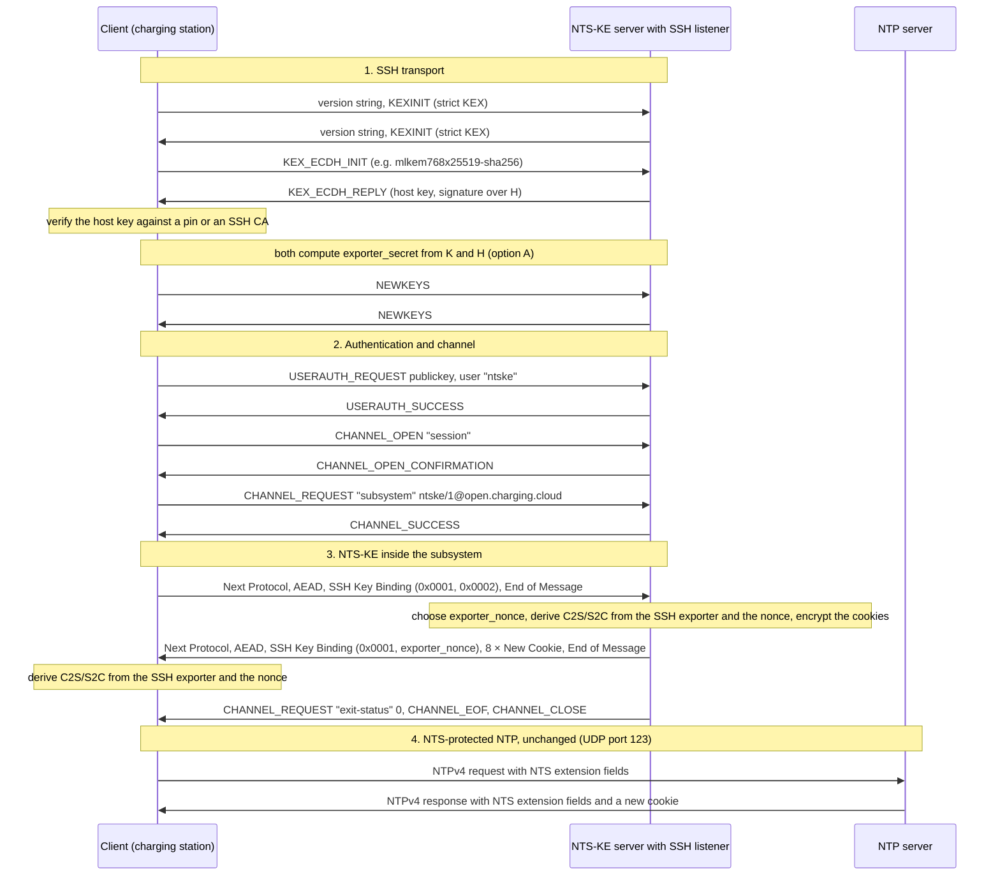

White Paper

# NTS Key Establishment over SSH

This white paper proposes to run the [Network Time Security Key Establishment (NTS-KE)](https://datatracker.ietf.org/doc/html/rfc8915) protocol as a [Secure Shell (SSH)](https://datatracker.ietf.org/doc/html/rfc4251) subsystem. It addresses the managed networks of Charge Point Operators (CPOs), laboratories, test sites and other private infrastructures that want authenticated time, but run no X.509 PKI of their own. The paper describes:

- **An SSH transport for NTS-KE**: the subsystem `ntske/1@open.charging.cloud` carries the unchanged NTS-KE records of RFC 8915. The NTS-protected NTP that follows is not changed at all.
- **A special-purpose SSH listener in the NTS-KE server**: it serves the subsystem to time clients and a command line to administrators, and nothing else. A local controller or a CSMS that already accepts OCPP over SSH offers the subsystem on its existing listener instead, to the same station keys.
- **Key binding without TLS**: why the SSH session identifier must not be used as key material, an SSH keying material exporter, and a simpler in-band key transport that also works behind an unmodified OpenSSH server.
- **Trust anchors without X.509**: pinned host keys, SSH certificate authorities and SSHFP records, and client authorization through SSH public keys. Pinned host keys need no correct clock at all.
- **A mapping onto the OCPP v2.x Device Model** as an extension of the *NTP Client Controller* of the [Secure Time Synchronization](../SecureTimeSync/README.md) white paper.

*Status*: this is a draft for discussion. The NTS-KE server and client of [Vanaheimr Norn](https://github.com/Vanaheimr/Norn) implement both options of key binding, on the SSH stack of [Vanaheimr Hermod](https://github.com/Vanaheimr/Hermod); section 8.1 says what is implemented so far. The subsystem name, the record type and the device model variables are provisional. The record of section 5 is specified on its own in [nts-ke-ssh-key-binding.md](nts-ke-ssh-key-binding.md), for the registration of its record type with IANA ([IANA-registration.md](IANA-registration.md)).
<!--  -->
<!--  -->


## 1. Motivation

In private networks NTS rarely fails because of its cryptography, but often because of the PKI it needs. RFC 8915 requires NTS-KE to run over TLS 1.3 with a server certificate the client can validate, and this has three practical consequences:

- **No internal CA**: many operators of OT networks, private APNs, laboratories and test sites run no X.509 certificate authority of their own, and public certificates do not fit internal names and addresses.
- **The bootstrapping problem**: certificates carry a *notBefore* and a *notAfter* date. A device without a battery-backed real-time clock cannot check them after a reboot, although this is exactly the moment it needs NTS. Implementations work around this with exceptions, e.g. by skipping the time checks for the first synchronization ([RFC 8915, section 8.5](https://www.rfc-editor.org/rfc/rfc8915.html#section-8.5); `NoCertTimeCheckAfterReboot` in section 3.2.4 of the [Secure Time Synchronization](../SecureTimeSync/README.md) white paper).
- **Anonymous clients**: NTS-KE over TLS hands out cookies to anybody who asks. In managed networks operators often want to know, and to limit, which devices use their time servers.

SSH, on the other hand, is present on almost every networked device and in every operator's toolbox. An SSH host key is a bare public key without a validity period: it is pinned, signed by a lightweight SSH certificate authority, or published in the DNS. Client authentication with public keys is the normal case, not the exception.

The goal is a second transport for the same NTS-KE logic, not a replacement of RFC 8915 on the public Internet (section 4.1 of [Critical Legal Time Services](../CriticalLegalTimeServices/README.md)). It is meant for the managed networks with trust zones of section 4.2 of that paper.


## 2. Background: NTS-KE according to RFC 8915

Section 2.1 of the [Secure Time Synchronization](../SecureTimeSync/README.md) white paper describes the NTS-KE phase in detail. Five of its properties matter here:

1. **Transport**: TCP port 4460, TLS 1.3, ALPN `ntske/1`. Exactly one request and one response per TLS connection; afterwards the server closes the connection and discards all state.
2. **Records**: a 16-bit type with a *critical* bit, a 16-bit body length, and the body. Records delimit themselves and can therefore be carried over any reliable byte stream.
3. **Keys**: the client-to-server (C2S) and server-to-client (S2C) keys are taken from the TLS exporter ([RFC 9846, section 7.5](https://www.rfc-editor.org/rfc/rfc9846.html#section-7.5), formerly RFC 8446) with the label `EXPORTER-network-time-security` and a context of five octets: the protocol id `0x0000` of NTPv4, the id of the negotiated AEAD algorithm, and `0x00` for C2S or `0x01` for S2C.
4. **Cookies**: the server encrypts C2S, S2C and the AEAD algorithm id with a master key into opaque cookies. The NTP server needs this master key, but no TLS state.
5. **Decoupling**: the NTS extension fields of NTPv4 depend on cookies and keys only. Where the keys came from does not matter to the NTP server.

Property 5 is the foundation of this paper: only the channel of property 1 and the source of the keys of property 3 are replaced.


## 3. Protocol Overview

### 3.1 Subsystem Name and Versioning

The subsystem name is **`ntske/1@open.charging.cloud`**. It mirrors the ALPN token `ntske/1` and carries the version in its local part.

- **Naming rules**: according to [RFC 4251, section 6](https://datatracker.ietf.org/doc/html/rfc4251#section-6) and [RFC 4250, section 4.6.1](https://datatracker.ietf.org/doc/html/rfc4250#section-4.6.1), names without an `@` are reserved for assignment through IANA. Private extensions use the form `name@domain`, where the domain must be controlled by whoever defines the name. Names are printable US-ASCII without commas or whitespace, case-sensitive, and at most 64 characters long; a `/` is allowed, so the name keeps the ALPN token of RFC 8915 unchanged.
- **Versioning**: an incompatible successor uses `ntske/2@open.charging.cloud`. A client can request several subsystems one after another without any change on the record level.
- **Registration**: once the mechanism is to be used beyond Open Charging Cloud, the domain part is dropped, and `ntske/1` is registered in the IANA registry *Connection Protocol Subsystem Names* ([RFC 4250, section 4.9.5](https://datatracker.ietf.org/doc/html/rfc4250#section-4.9.5)), whose policy is *Expert Review* since [RFC 9519](https://datatracker.ietf.org/doc/html/rfc9519). This needs no RFC.
- **User name**: SSH requires a user name for authentication. The convention is `ntske`. On the shared listener of a charging infrastructure node the client logs in under its own identity instead (section 8.3).

Rejected alternatives:

- **A dedicated channel type** instead of a `session` channel with a `subsystem` request would be cleaner, as no terminal, environment or shell semantics apply. Generic SSH clients and libraries, however, can request subsystems but rarely open custom channel types, and OpenSSH cannot hand custom channel types to external programs (section 8.4).
- **An `exec` request with a fixed command** works, but mixes the protocol name with a path on the server and is harder to filter.
- **Tunneling NTS-KE over TLS through SSH** (`direct-tcpip`) solves nothing: inside the tunnel a verifiable certificate is still required.


### 3.2 Message Flow

One NTS-KE exchange over SSH runs through four phases. Only phase 3 carries NTS-KE, and within it only the *SSH Key Binding* record (section 5) is new. The flow shows the primary profile of section 8.1, an NTS-KE server with an SSH listener of its own, with option A of section 4.



- **Framing**: the records travel as `SSH_MSG_CHANNEL_DATA` in the byte stream of the channel. Their length fields delimit them just as over TLS; no additional framing is needed.
- **Closing**: after the *End of Message* record the server sends the channel request `exit-status` ([RFC 4254, section 6.10](https://datatracker.ietf.org/doc/html/rfc4254#section-6.10)), `SSH_MSG_CHANNEL_EOF` and `SSH_MSG_CHANNEL_CLOSE`, as an SSH server does when the program behind a subsystem exits. The exit status is 0 when the response carries cookies and 1 when it carries an *Error* record. OpenSSH reports a missing exit status as a failure (exit code 255), although every record arrived. The client then disconnects, or keeps the connection for its other channels (section 8.3).
- **Errors**: when the server refuses the subsystem (`SSH_MSG_CHANNEL_FAILURE`), the client gives up. It never falls back silently to another transport.
- **Option B**: the server answers with method `0x0002` and a fresh `nts_ke_secret`, from which both peers derive the keys instead. Behind an unmodified OpenSSH server (section 8.4), and for clients whose SSH library does not expose K and H, this is the only option.
- **Latency**: roughly 7 to 9 round trips instead of about 3 for TCP, TLS 1.3 and NTS-KE, and about 3 as a further channel of an existing connection (section 8.3). NTS-KE runs only after a start, when cookies run out, and about once a day (`MinRefresh` and `MaxRefresh` in the Secure Time Synchronization white paper), so the additional cost is negligible.


## 4. Key Binding

An SSH keying material exporter can be defined cleanly, but the security of NTS-KE over SSH does not depend on it. Both options below end in the same key derivation function; only its pseudorandom key differs.


### 4.1 Why RFC 8915 Uses an Exporter

The TLS exporter yields C2S and S2C without sending any key over the wire. Both peers contribute to the result through the (EC)DH exchange, and the keys are bound to exactly this TLS connection.

Channel binding in the strict sense protects against a relaying attacker when authentication and the channel live in different layers. With NTS-KE both live in TLS. There the exporter is an elegant design, but not the only line of defence.


### 4.2 Why the SSH Session Identifier Is Not Key Material

SSH offers a natural candidate: the session identifier, i.e. the exchange hash H of the first key exchange. It is signed in public key user authentication, it is used by the `session-bind@openssh.com` extension of the OpenSSH agent protocol, and an expired draft from 2007 proposed it as *the* channel binding of SSH ([draft-williams-sshv2-channel-bindings](https://datatracker.ietf.org/doc/html/draft-williams-sshv2-channel-bindings-00)).

A channel binding value, however, is not a secret. The session identifier is handed to the SSH agent, possibly via agent forwarding to other hosts, and it shows up in debug output. A key derived from it alone would be only as secret as its least careful holder. **The session identifier must never be the only input of key material.**


### 4.3 Option A: SSH Keying Material Exporter

The secret known only to both endpoints is the shared secret K of the key exchange. An exporter must therefore depend on K, just like the key derivation of [RFC 4253, section 7.2](https://datatracker.ietf.org/doc/html/rfc4253#section-7.2). A nonce, which the server sends with every exchange, keeps the keys of one exchange apart from those of the next on the same connection:

```text
exporter_secret = HASH( K || H || string("ssh-exporter@open.charging.cloud") || session_id )

PRK = HKDF-Extract( salt = exporter_nonce,
                    IKM  = exporter_secret )   # HMAC with HASH

SSH-Exporter(label, context, L) =
    HKDF-Expand( PRK  = PRK,
                 info = string(label) || string(context),
                 L    = L )                    # HMAC with HASH
```

- **Encoding**: K and H exactly as encoded by the key derivation of the negotiated key exchange method: `mpint` for the classical methods, e.g. `curve25519-sha256` ([RFC 8731](https://datatracker.ietf.org/doc/html/rfc8731)), and `string` for the hybrid post-quantum ones, e.g. `mlkem768x25519-sha256` ([RFC 10042](https://datatracker.ietf.org/doc/html/rfc10042)). HASH is the hash function of the key exchange method, `string()` the SSH encoding with a 32-bit length prefix, and HKDF-Extract and HKDF-Expand those of [RFC 5869](https://datatracker.ietf.org/doc/html/rfc5869).
- **Time of computation**: `exporter_secret` once, during the first key exchange, together with the keys "A" to "F" of RFC 4253. K may be erased afterwards as usual. Re-keying does not change `exporter_secret`, just as `KeyUpdate` does not change the exporter of TLS 1.3, so both peers agree on it however re-keys and NTS-KE exchanges interleave.
- **A string label instead of a letter**: keeps the letters after "F" free for future use and separates the domains unambiguously.
- **A nonce for every exchange**: `exporter_secret` is constant for an SSH connection. Without a nonce, two NTS-KE exchanges over the same connection, e.g. through the connection multiplexing of OpenSSH (`ControlMaster`) or a station that refreshes its keys on a connection carrying OCPP for weeks (section 8.3), would derive identical keys. A key refresh would change nothing, a key that leaked would stay valid for as long as the connection lives, and associations with different NTP servers would share their keys. The server therefore generates a fresh `exporter_nonce` of 32 bytes for every exchange and sends it in the *SSH Key Binding* record (section 5). The nonce need not be secret. That the server alone chooses it is enough: it learns both keys under either option anyway, as it seals them into the cookies (section 4.4), and the nonce only has to keep the exchanges apart. Option A thus serves any number of exchanges per connection, as option B does.
- **Use for NTS**: C2S = `SSH-Exporter("EXPORTER-network-time-security", 0x0000 || AEAD id || 0x00, key length)`, and S2C likewise with `0x01`. Always with the context of RFC 8915, section 5.1: record type 1024 (*Compliant AES-128-GCM-SIV Exporter Context*), which works around a deployed deviation in TLS-based implementations, has no meaning over SSH.
- **Cost**: the SSH implementation must hand the value to the application. An NTS-KE server with an SSH listener of its own (section 8.1), like a node with a shared listener (section 8.3), holds K and H anyway, so the exporter is a small addition to its key exchange. OpenSSH would need a patch that passes the value from the SSH session process to the subsystem process.


### 4.4 Option B: In-Band Key Transport

For every exchange the server generates a fresh 32-byte secret `nts_ke_secret` and sends it in the *SSH Key Binding* record of section 5. Both peers derive the keys from it with the same function:

```text
NTS-Exporter(label, context, L) =
    HKDF-Expand-SHA256( PRK  = nts_ke_secret,
                        info = string(label) || string(context),
                        L    = L )
```

Label and context are those of RFC 8915. Option B thus differs from option A only in its PRK, which the server sends instead of both peers extracting it from the connection, and an implementation needs a single function `Exporter(label, context, L)` with three interchangeable sources: TLS, the SSH exporter, and the transported secret. Appendix A gives test vectors.

**Security argument**: the secret travels in the same SSH channel whose endpoint the client has authenticated through its host key. Whoever can read the secret can also read and forge the records and cookies, and has therefore broken SSH itself. Then option A fails as well. The gap between layers that channel binding protects against does not exist here.

**Drawbacks**: the secret is visible in plain text on the local pipe between the SSH server and the subsystem process, i.e. within the same trust domain. The keys depend on the random number generator of the server only, which generates the cookies anyway and loses nothing.


### 4.5 Comparison and Recommendation

| Criterion                              | A: SSH exporter               | B: In-band transport              |
|----------------------------------------|-------------------------------|-----------------------------------|
| Keys on the wire                       | never                         | encrypted inside the SSH channel  |
| Contribution of both peers             | yes, through K                | no, server randomness only        |
| Binding to the SSH connection          | cryptographic                 | implicit, through the channel     |
| NTS-KE server with SSH listener        | small addition to the KEX     | no change                         |
| Unmodified OpenSSH server              | no, needs a patch             | yes                               |
| Off-the-shelf SSH client library       | rarely exposes K and H        | yes                               |
| Several exchanges per connection       | allowed, with a nonce each    | allowed, with a secret each       |
| Key binding record in the response     | 38 bytes, with the nonce      | 38 bytes, with the secret         |
| New specifications                     | SSH exporter and record       | record only                       |

**Recommendation**: option A is preferred wherever both ends terminate SSH themselves, as the NTS-KE server with an SSH listener of section 8.1 and a client on the same SSH stack do. Option B is mandatory to implement nevertheless: it is the common ground for clients with off-the-shelf SSH libraries and for servers behind an unmodified OpenSSH server. The record of section 5 negotiates between both. The SSH exporter itself should be specified independently of NTS, as it would be useful for other protocols over SSH as well.


## 5. The SSH Key Binding Record

A single new NTS-KE record negotiates the source of the keys and carries the nonce of option A or the secret of option B. All other records remain as defined by RFC 8915. The record is specified on its own as well, for the registration of its record type with IANA: [nts-ke-ssh-key-binding.md](nts-ke-ssh-key-binding.md).

| Field                | Value |
|----------------------|-------|
| Name                 | SSH Key Binding |
| Record type          | 16386 (provisional), from the *Private or Experimental Use* range 16384 … 32767 of the [NTS-KE record type registry](https://www.rfc-editor.org/rfc/rfc8915.html#section-7.6) |
| Critical bit         | set; the subsystem name implies that the server knows the record |
| Body of the request  | one entry per method offered, in order of preference: a 16-bit method id, a 16-bit data length and that many bytes of data for the method |
| Body of the response | one 16-bit method id, followed by method-specific data |
| Method `0x0001`      | Exporter (option A), 32 bytes `exporter_nonce` |
| Method `0x0002`      | Transport (option B), 32 bytes `nts_ke_secret` |

- The client sends exactly one such record and must offer `0x0002` (mandatory to implement). Methods `0x0001` and `0x0002` take no data from the client: their entries have the data length 0. The data length lets a later method take data from the client, e.g. a contribution to the keying material, without an older server reading it as method ids.
- The server answers with exactly one such record and selects the first entry whose method it supports; it skips an entry of a method it does not know by its data length. It generates the data of the selected method anew for every exchange: the nonce of the exporter or the secret of the transport. When the record is missing, its entries do not fill its body exactly, an entry of `0x0001` or `0x0002` carries data, or no method fits, the server answers with the *Error* record *Bad Request*.
- The client aborts the exchange when the response selects a method it did not offer, or carries data of another length than the method defines.
- Over TLS on port 4460 the record does not occur. A server according to RFC 8915 refuses it, as it is critical, with *Unrecognized Critical Record*.
- Values of the private range are not coordinated; 16384 and 16385 are already in experimental use elsewhere. A coordinated value is a type from the *Specification Required* range 1024 … 16383. It needs a stable, public specification and the approval of the designated experts, but no RFC.

Example: the client could use the exporter, but the server runs behind an unmodified OpenSSH server and selects the transport.

```text
Client → Server
  NTS Next Protocol Negotiation  [C]  0x0000 (NTPv4)
  AEAD Algorithm Negotiation          15, 30
  SSH Key Binding                [C]  0x0001 (no data), 0x0002 (no data)
  End of Message                 [C]

Server → Client
  NTS Next Protocol Negotiation  [C]  0x0000
  AEAD Algorithm Negotiation          15
  SSH Key Binding                [C]  0x0002 || nts_ke_secret (32 bytes)
  New Cookie for NTPv4                × 8
  End of Message                 [C]
```


## 6. Authentication and Trust Anchors

The security of the whole mechanism stands and falls with the verification of the server's host key. A client must never accept an unknown host key silently.


### 6.1 Server Authentication

| Mechanism               | Trust anchor | Needs a correct clock | Suitable for |
|-------------------------|--------------|-----------------------|--------------|
| Pinned host key         | fingerprint in the client configuration, e.g. `SSHHostKeyPins` (section 7) | no | few servers, devices without a real-time clock |
| SSH host certificate    | one CA key (`@cert-authority`), signed with `ssh-keygen -s` | only with a limited validity; `-V always:forever` is possible | many servers, key rotation without touching the clients |
| SSHFP record in the DNS | DNSSEC ([RFC 4255](https://datatracker.ietf.org/doc/html/rfc4255), [RFC 6594](https://datatracker.ietf.org/doc/html/rfc6594), [RFC 7479](https://datatracker.ietf.org/doc/html/rfc7479)) | yes, for the validity of the RRSIG records | networks with a DNSSEC infrastructure |
| Trust on first use      | the first contact | no | laboratories only, never in operation |

For devices without a battery-backed real-time clock, the pinned host key and the host certificate without an expiry date are the only mechanisms without a bootstrapping problem. SSH certificates with a limited validity raise the same question as X.509 certificates.


### 6.2 Client Authentication and Authorization

- **`none`** ([RFC 4252, section 5.2](https://datatracker.ietf.org/doc/html/rfc4252#section-5.2)): for a public service on the SSH listener of section 8.1. This corresponds to anonymous NTS-KE over TLS; OpenSSH offers no clean way to configure it.
- **`publickey`**: the normal case in managed networks. Every client has a key pair of its own, and the server lists the public keys in the `authorized_keys` file of the account `ntske`. Access is withdrawn by deleting one line.
- **The OCPP key of a charging station**: on the shared listener of a charging infrastructure node (section 8.3) the key a station already uses for OCPP over SSH authorizes NTS-KE as well, once the subsystem is granted to the station.
- **SSH user certificates**: one CA line instead of many keys for large fleets, with revocation through a key revocation list (KRL).

What the client identity brings:

- Cookies are only handed out after a successful authentication. The cookies themselves remain anonymous, and the NTP server notices no difference.
- The NTS-KE server may name different NTP servers in the *NTPv4 Server Negotiation* record per client or group of clients. Over TLS it knows little more than the source address, which says little behind NAT or a private APN; over SSH it knows the identity. This serves:
  - **Reachability**: a charging station behind a local controller often reaches only the NTP server of that controller (section 8.3), a backend system the central one.
  - **Classes of time sources**: devices whose clock matters under legal metrology get the traceable servers of the legal time ([Critical Legal Time Services](../CriticalLegalTimeServices/README.md)), all others a general pool, which spares the scarce servers.
  - **Separation of tenants**: an operator serving several CPOs gives each of them NTP servers of its own with a cookie master key of its own, and the NTS-KE server keeps one master key per group. A compromised NTP server can then read the cookies of its own group only.
  - **Gradual migration**: one group of devices moves to a new NTP server first, the others later.
- Towards passive observers the unlinkability of cookies of RFC 8915 is preserved. The operator itself can now attribute the cookies it hands out to an identity instead of an IP address only, which is usually intended in managed networks.


## 7. Mapping onto the OCPP v2.x Device Model (Proposal)

The NTP Client Controller of section 3.2.4 of the [Secure Time Synchronization](../SecureTimeSync/README.md) white paper gets a fourth value of its variable `Mode`: `NTSv4SSH`. In this mode `ServerURL` names the SSH server that offers the NTS-KE subsystem. `NTSKEServerPort`, `RootCAs`, `CertificatePins`, `RootPins`, `NoCertTimeCheckAfterReboot` and `CertificateFingerprint` do not apply, and the following variables are added:

| Variable Name         | req/opt  | Mutability | Data Type | Default Value | Values List / Limits  | Description |
|-----------------------|----------|------------|-----------|---------------|-----------------------|-------------|
| SSHPort               | optional | rw         | integer   | 22            | 1 … 65535             | The SSH port of the NTS-KE server in mode *NTSv4SSH*. |
| SSHUserName           | optional | rw         | string    | `ntske`       | ≤ 32 characters       | The user name of the SSH user authentication. |
| SSHHostKeyPins        | optional | rw         | string    | ""            | comma separated, ≤ 16 | SHA-256 fingerprints of the host keys the server may show, in the notation `SHA256:<base64>` of `ssh-keygen -l`. |
| SSHHostCAs            | optional | rw         | string    | ""            | comma separated, ≤ 4  | SHA-256 fingerprints of the SSH CA keys that may sign the host certificate of the server. |
| SSHUseOCPPConnection  | optional | rw         | boolean   | false         | -                     | Open the subsystem as a channel of the SSH connection of OCPP (section 8.3). `SSHPort`, `SSHUserName`, `SSHHostKeyPins` and `SSHHostCAs` then do not apply, and `ServerURL` names the peer of that connection. Option A is offered before option B where the SSH stack of the station hands out the exporter of its connection. |
| SSHClientPublicKey    | optional | ro         | string    | ""            | -                     | The public key the charging station authenticates with, in the `authorized_keys` format of OpenSSH. |
| SSHHostKeyFingerprint | optional | ro         | string    | ""            | -                     | The SHA-256 fingerprint of the host key the server showed at its last NTS-KE handshake. |

- **Client keys**: the charging station generates its Ed25519 key pair itself, and the private key never leaves the device. The CSMS reads `SSHClientPublicKey` and enters it into the `authorized_keys` of the NTS-KE server, or has it signed by the operator's SSH user CA.
- **Pins**: `OnPinMismatch` applies to `SSHHostKeyPins` and `SSHHostCAs` as it does to certificate pins. Whether `TrustOnFirstUse` needs a value `HostKey` of its own is open.
- **Fingerprints**: unlike the certificate pins of the Secure Time Synchronization white paper, which hash the whole certificate, an SSH fingerprint is the SHA-256 hash of the public key alone.
- **OCPP over SSH**: with `SSHUseOCPPConnection` the charging station needs no key pair, pin or account of its own for time. It uses those of its OCPP connection, and `SSHClientPublicKey` is its OCPP key. While that connection does not run over SSH, or is down, the client cannot reach its NTS-KE server and handles this like any unreachable server. The cookies it holds keep NTP running in the meantime.

*Implemented* in the nodes of Open Charging Cloud, with Norn as the client: the time servers of a [WWCP_Node](https://github.com/OpenChargingCloud/WWCP_Node) make their key exchange over SSH where their entry says so, and the Device Model bridge of [WWCP_OCPP](https://github.com/OpenChargingCloud/WWCP_OCPP) maps `Mode` `NTSv4SSH` and the variables above onto it. The station makes its key pair at the first read of `SSHClientPublicKey` and keeps it. A host key is believed by `SSHHostKeyPins`, or by a host certificate for the server's name of one of the `SSHHostCAs`; `OnPinMismatch` applies to both, and nothing is learned on first use (`TrustOnFirstUse` stays `None`). The key exchange offers option A before option B, and the cookies are renewed by the next key exchange over SSH, never over TLS. A test sets `Mode`, `SSHPort` and `SSHHostKeyPins` in one SetVariables request and the station's next check of the time makes its key exchange over SSH against an NTS server of Norn, `SSHHostKeyFingerprint` and `Cookies` then readable.

With `SSHUseOCPPConnection` the key exchange is one more channel of the SSH connection the charging station dialled for OCPP to the host `ServerURL` names: the SSH client of OCPP, `SshMessageClient` of [Hermod](https://github.com/Vanaheimr/Hermod/tree/master/Hermod/SSH), hands out its connection while the messages go over it, and the key exchange closes its own channel, never the connection. `SSHClientPublicKey` then reads the station's OCPP key, and no key pair of its own is made. Switched to it, a server loses `SSHPort`, `SSHUserName`, `SSHHostKeyPins`, `SSHHostCAs` and `OnPinMismatch`, which are rejected while it is set; in a request it is applied after `Mode` and before the other variables. A test has a CSMS serve the subsystem beside OCPP on one SSH listener: the station's key exchange makes no second login, its cookies work for NTP, and the OCPP connection goes on after it. Before that connection there is no key exchange, and no other way is tried.


### 7.1 OCPP v1.6+SE Configuration Keys

The configuration keys of section 3.3 of the [Secure Time Synchronization](../SecureTimeSync/README.md) white paper get the same. `ntp.<group>.mode` becomes a list per server that takes `NTSv4SSH`, and the following keys are added, shown for the legal group; the local group and further groups have them under their own id:

| Key Name      | req/opt  | Accessibility | Type       | Default Value | Example        | Description |
|---------------|----------|---------------|------------|---------------|----------------|-------------|
| ntp.legal.mode | required | rw         | CSL String | "NTSv4"       | "NTSv4, NTSv4SSH" | Per server: `NTSv4` or `NTSv4SSH`. One value is every server's, as before, and a charging station reads one value where every server has the same mode. See `NTPClientController.Mode`. |
| ntske.legal.sshPorts | optional | rw   | CSL String | "22"          | "22, 2222"     | Per server. See `SSHPort`. |
| ntske.legal.sshUserNames | optional | rw | CSL String | "ntske"      | "ntske, time"  | Per server. See `SSHUserName`. |
| ntske.legal.sshUseOCPPConnection | optional | rw | CSL String | "false" | "true, false" | Per server, `true` or `false`. See `SSHUseOCPPConnection`. |
| ntske.legal.sshHostKeyPins.*n* | optional | rw | CSL String | ""    | "SHA256:…"     | The host key pins of the *n*-th server, numbered as `ntske.legal.certificatePins.n`. See `SSHHostKeyPins`. |
| ntske.legal.sshHostCAs.*n* | optional | rw | CSL String | ""        | "SHA256:…"     | The SSH CAs of the *n*-th server. See `SSHHostCAs`. |
| ntske.sshClientPublicKey | optional | ro | String     | ""            | "ssh-ed25519 AAAA… cs001" | Common to every group: the key the charging station signs in with. See `SSHClientPublicKey`. A server on the connection of OCPP signs in with the station's OCPP key instead, which the CSMS knows by its login. |

- **Which servers a list is for**: a list is per server, as every list of section 3.3, but written, it changes only the servers it applies to in their mode. A key of SSH leaves the entries of servers over TLS alone, whatever they say; a key of TLS (`ntske.legal.ports`, `ntske.legal.servers`, `ntp.legal.rootCAs`, `ntske.legal.trustOnFirstUse`) those of servers over SSH; and `sshPorts`, `sshUserNames` and `ntske.legal.onPinMismatch` those of servers on the connection of OCPP. A list that applies to none of the group's servers is `Rejected`. The *n*-th server's pins of the other mode are `Rejected` as well, unless they are emptied, which changes nothing.
- **Order**: *ChangeConfiguration.req* changes one key at a time, so a CSMS sets `mode` first and then the keys of SSH, as section 3.3 asks for an admissible order. A server switched to `NTSv4SSH` leaves behind what only TLS has, and a server switched back what only SSH has; with `sshUseOCPPConnection` a server loses its port, user name, host key pins and CAs of its own.
- **Pins**: `ntske.legal.onPinMismatch` applies to the host key pins and CAs of a server over SSH. `ntske.legal.trustOnFirstUse` stays `None` for it. An SSH fingerprint has 50 characters, so at most 9 fit into one pin key of 500 characters.
- **New servers** in `ntp.legal.servers` go as the last server goes: in its mode, at its SSH port, under its user name, on the connection of OCPP where it is, and believing its CAs, but pinned to none of its host keys.
- `SSHHostKeyFingerprint` has no key, as `CertificateFingerprint` has none in section 3.3.

```
ntp.legal.mode                = "NTSv4SSH"
ntske.legal.sshPorts          = "22"
ntske.legal.sshHostKeyPins.1  = "SHA256:…"
ntske.legal.sshHostKeyPins.2  = "SHA256:…"
```

*Implemented* in the Device Model bridge of [WWCP_OCPP](https://github.com/OpenChargingCloud/WWCP_OCPP), as the other keys of section 3.3: a key is turned into the SetVariables entries of the variables it stands for, and set with their checks. A test reads `ntske.sshClientPublicKey`, has it entered at an NTS server of Norn, is refused an SSH port before the mode, sets `ntp.local.mode`, `ntske.local.sshPorts` and `ntske.local.sshHostKeyPins.1` one at a time, and the station's next check of the time makes its key exchange over SSH.


## 8. Deployment Profiles

The primary profile is an NTS-KE server with an SSH listener of its own, which serves time clients and administrators alike. A charging infrastructure node that already runs an SSH listener, e.g. for OCPP over SSH, offers the subsystem next to its other ones. An unmodified OpenSSH server with a small helper program remains possible as an alternative.


### 8.1 NTS-KE Server with an SSH Listener of Its Own

The existing NTS-KE server gets a second listener next to TLS on port 4460. It is a special-purpose SSH server, not a general-purpose one, and offers exactly two things:

- the subsystem `ntske/1@open.charging.cloud` to time clients, and
- a command line to administrators (section 8.2).

Everything else a general-purpose SSH server offers is refused: no operating system shell, no `exec` requests, no SFTP, no port, agent or X11 forwarding.

- **Both options of section 4**: the SSH stack holds K and H anyway, so the SSH exporter of option A is a small addition to its key exchange. Option B works as well.
- **One configuration, one process**: the TLS and the SSH front end share the NTS-KE core, the cookie master key and the list of NTP servers to announce. There are no system accounts, no `sshd_config` and no helper program to maintain.
- **Key management of its own**: the server keeps the authorized client keys and the SSH CAs itself, and may receive them from the CSMS, e.g. the `SSHClientPublicKey` of section 7.
- **Public services**: the authentication method `none` can be offered where anonymous NTS-KE is intended.
- **Attack surface**: the SSH stack runs in the same process as the cookie master key, so a flaw in the SSH implementation can expose the master key. This calls for a mature SSH implementation that is tested against independent implementations and fuzzed, and for the usual rotation of the master key.

*Reference implementation*: the NTS server of [Vanaheimr Norn](https://github.com/Vanaheimr/Norn), which serves NTS-KE over TLS and NTP, and the SSH stack of [Vanaheimr Hermod](https://github.com/Vanaheimr/Hermod/tree/master/Hermod/SSH), which implements client and server once for both roles, including hybrid post-quantum key exchange, OpenSSH certificates and SSHFP. Its interoperability with independent SSH implementations is tested by the [SSH Conformance Tests](https://github.com/Vanaheimr/SSHConformanceTests). The work proceeds in this order, and all six steps are done:

1. *(done)* Norn derives C2S and S2C through the single function `Exporter(label, context, L)` of section 4.4, with the three sources TLS, SSH exporter and transported secret.
2. *(done)* Norn parses and writes the *SSH Key Binding* record of section 5.
3. *(done)* The NTS server of Norn gets the SSH listener of this section with the subsystem `ntske/1@open.charging.cloud`, with option B only at first.
4. *(done)* Hermod adds the SSH exporter of section 4.3 to its key exchange, which enables option A.
5. *(done)* The command line of section 8.2 joins the same listener, with separate accounts for time clients and administrators. [NTSServerCLI](https://github.com/OpenChargingCloud/NTSServerCLI) runs the NTS server of Norn as a node of Open Charging Cloud, whose SSH server carries both the subsystem and the command line.
6. *(done)* The nodes of Open Charging Cloud offer the subsystem on their shared listener (section 8.3). [WWCP_Node](https://github.com/OpenChargingCloud/WWCP_Node) adds subsystems to that listener at run time and tells their handlers the authenticated identity of the client and, through Hermod, the exporter of the connection: all that both options need.

What is implemented so far:

- **Server**: the subsystem handler has the shape the shared listener of section 8.3 expects, so step 6 reuses it unchanged. The server knows the *SSH Key Binding* record over SSH only; over TLS it refuses the record with *Unrecognized Critical Record*, as section 5 requires. It selects the first method of the client's list it can use: the exporter where the SSH stack hands it out, with a fresh nonce for every exchange, and the transport with a fresh secret. It uses the context of RFC 8915 for every algorithm, and neither expects nor echoes record type 1024. Several exchanges on one connection are served, each with keys of its own and without state per connection.
- **Client**: it opens the subsystem on an SSH connection it is handed, so that it can share the connection of OCPP (section 8.3) as well as use one of its own. It offers the exporter before the transport, takes the nonce or the secret from the response, and refuses a response that selects a method it did not offer or carries data of another length. A refused subsystem is reported as an error of its own; the client does not fall back to TLS silently.
- **SSH exporter (step 4)**: Hermod computes `exporter_secret` once, in the first key exchange of a connection, for every key exchange method it supports, with K as an `mpint` or a `string` as the method encodes it. A rekey leaves it alone, and the end of the connection wipes it. Every export takes a nonce, and refuses an empty one. A server hands the exporter to subsystem handlers with the session, a client with the connection. Tests cover the test vectors of Appendix A.3, both ends agreeing for each of the eight key exchange methods, another nonce, a rekey, another connection, and the way to a subsystem handler.
- **Tests**: key exchanges over SSH with either option followed by NTP requests with the cookies obtained, with AEAD_AES_SIV_CMAC_256 and with AEAD_AES_128_GCM_SIV; three exchanges on one connection, each with the exporter and keys of its own; four simultaneous requests for the exporter on one connection, each with a nonce of its own; and the refusals of an unknown client key, of another subsystem name, of requests without the record, and of requests with no method the server can use. The test vectors of Appendix A are part of them.
- **OpenSSH as the client**: `ssh -s ntske/1@open.charging.cloud` of OpenSSH 9.5 for Windows and of OpenSSH 10.5 carries the records, with a fresh key from `ssh-keygen` and the host key pinned in a `known_hosts` file, and the cookies obtained work for NTP. This test found the missing exit status of section 3.2.
- **Command line (step 5)**: an administrator signs in to the SSH server of NTSServerCLI with an account of the node and gets its command line; a time client signs in under its own name and gets the subsystem alone, never the command line. The commands of section 8.2 that are there:
  - **Status**: `timeServer` shows the listeners, the SSH host key for pinning, the time source, the current master key and the counters. `ntsClients` shows for each client when it was last served, from where, with which option and how many cookies, and when it was last turned away and why; the same is said for every account that made a key exchange, and the log says each exchange.
  - **Client keys**: `ntsClients add`, `remove`, `enable` and `disable`, with `authorized_keys` lines whose `from=` and `expiry-time=` hold. A `cert-authority` line lets a client in by the user certificates of an SSH CA, for its name or for the names `principals="..."` gives, with the restrictions of the certificate.
  - **Keys of the server**: `masterKeys rotate` seals the cookies with a new master key at once, while the earlier keys still open theirs until their grace period ends; `masterKeys rotate forget` forgets them at once, for a key that may have been read.
  - **Evidence**: every change is logged with the account that made it and where it came from.

  Not yet there: the announcements per client or group, rotating the host key from the command line, and a second factor for administrators. Tests cover the last key exchange of each client, a client let in by a certificate of its CA for its name and for a name of `principals=`, and turned away with a certificate for another name, of another CA, run out, or with the CA's own key, and a rotation that keeps and one that forgets the earlier master keys, with the cookies a client holds.
- **Shared listener (step 6)**: a node serves the subsystem with the handler of an NTS server of Norn, which holds the cookie master key and needs no SSH listener of its own. Who may open it is decided by the node's rules for subsystems: the logins of a kind, e.g. charging stations, where they name the subsystem, and an account only with a permission the node is given for it. Tests cover a station with the key of its OCPP login, a connection that carries a further subsystem in place of OCPP and three key exchanges beside it, each with option A and keys of its own, an account with and without that permission, and a station without the subsystem.


### 8.2 Administration over the Same Listener

An administrator who opens a secure shell to the NTS-KE server gets the server's own command line instead of an operating system shell, in the same way as other command line programs of Open Charging Cloud already offer theirs over SSH. Typical commands:

- **Status**: the clients served, the cookies handed out, the last handshakes, and the state of the NTP servers announced.
- **Client keys**: list, add and revoke authorized client keys, and the SSH CAs for client certificates.
- **Keys of the server**: rotate the cookie master key and the host key, and show the host key fingerprint for pinning.
- **Announcements**: which NTP servers and ports are named to which clients or groups of clients.

Access rules:

- **Separation by account**: client accounts get the subsystem only, administrator accounts the command line only. A client key never opens the command line.
- **Restricted reachability**: the command line is offered only on a management network, or on a port of its own that is filtered accordingly.
- **Strong authentication**: public keys, preferably hardware-backed, and optionally a second factor such as [time-based one-time passwords](../TimeBasedOneTimePasswords/README.md).
- **Evidence**: every change of the time configuration is logged together with the administrator who made it, in the same spirit as section 4.2 of [Critical Legal Time Services](../CriticalLegalTimeServices/README.md) records every change of the legal time configuration of a charging station.


### 8.3 Subsystem on the Shared SSH Listener of a Charging Infrastructure Node

A local controller or a CSMS often runs an SSH listener anyway: for its command line, for SFTP, and for OCPP itself when charging stations connect to `ssh://` instead of `wss://`. Each station then pins the host key of the node, and the node knows the public key of each station. This removes certificates from the station network for OCPP in the same way as this paper does for time. Open Charging Cloud carries OCPP and its own node protocol WWCP over SSH as the subsystems `ocpp@open.charging.cloud` and `wwcp@open.charging.cloud`. Such a node offers NTS-KE as one more subsystem of the same listener:

```text
SSH listener of a local controller (one port, one host key)
 ├─ shell                        administrators: the command line of the node
 ├─ sftp                         administrators
 ├─ ocpp@open.charging.cloud     charging stations
 ├─ wwcp@open.charging.cloud     neighbouring nodes
 └─ ntske/1@open.charging.cloud  charging stations and other time clients
```

- **One identity, one trust anchor**: the station authenticates with the key pair it already uses for OCPP, under its own login name, and verifies the host key it already pins for OCPP. There is no second key pair, no second pin and no account `ntske`.
- **Authorization per subsystem**: the login of a station is restricted to the subsystems it may use, e.g. `ocpp@…` and `ntske/1@…`, without shell, `exec`, SFTP or forwarding. NTS-KE is granted explicitly like any other subsystem, so that a key admitted for OCPP does not obtain cookies by itself, and vice versa. Rules by source network, or by the local address a connection arrived at, apply to NTS-KE as to the other subsystems.
- **A channel of the existing connection**: a station connected for OCPP opens NTS-KE as a further channel of the same connection. Key exchange and authentication are skipped, and an exchange costs the channel request, the subsystem request and the records, i.e. about 3 round trips instead of 7 to 9 (section 3.2). A short connection of its own with the same key remains possible.
- **Option A and long-lived connections**: an OCPP connection over SSH lasts days or weeks, while `exporter_secret` is constant per connection (section 4.3). Every exchange on it, e.g. when the cookies run out, still gets keys of its own from the nonce the server sends with it, so a station uses option A for as long as the connection lasts.
- **Time server of the station network**: a local controller between the station network and its uplink is a natural time server for its stations. It synchronizes upstream itself, e.g. with NTS over TLS (section 4.1 of [Critical Legal Time Services](../CriticalLegalTimeServices/README.md)), runs the NTP server of the station network, and names itself in the *NTPv4 Server Negotiation* record. The stations then need neither a route to an external time server nor a certificate.
- **Administration**: the commands of section 8.2 become part of the command line of the node, under its existing accounts and permissions.
- **Attack surface**: the cookie master key now shares a process with OCPP, the command line, SFTP and the logins of all stations, which is more than in section 8.1. Where this is not acceptable, the node relays the records over a local socket to a separate NTS-KE server, as the helper program of section 8.4 does, and the master key stays there. Option A is then only possible if the node passes the exporter secret of the connection along with the records.
- **Limits**: NTS-KE on an existing connection adds no handshake load. Connection limits of the listener are kept separately for stations and administrators, so that a station network cannot lock out its administrators (section 9).

A subsystem handler for NTS-KE needs two things from the SSH stack of the node: the authenticated identity of the client, and the SSH exporter of the connection for option A. It keeps no state per connection, as the nonce keeps the exchanges apart.


### 8.4 OpenSSH Subsystem (Alternative)

Operators who prefer to keep an unmodified OpenSSH server can run NTS-KE as an external subsystem. The SSH server takes care of the transport, the host key and the client authentication. A small helper program reads records from stdin, writes records to stdout, and relays both over a local socket to the NTS-KE server. The NTS-KE server generates `nts_ke_secret` and the cookies there; the master key never leaves it. Only option B is possible.

```text
# /etc/ssh/sshd_config (sketch)
Subsystem ntske/1@open.charging.cloud /usr/lib/ntske/ntske-ssh-helper

Match User ntske
    AuthenticationMethods       publickey
    ForceCommand                /usr/lib/ntske/ntske-ssh-helper
    PermitTTY                   no
    AllowTcpForwarding          no
    AllowStreamLocalForwarding  no
    X11Forwarding               no
    AllowAgentForwarding        no
    PermitUserRC                no
```

- **The account `ntske`**: OpenSSH starts external subsystems through the login shell of the account. The shell must therefore not be `nologin`; `ForceCommand` still prevents any use of the shell.
- **`ForceCommand` and subsystems**: `ForceCommand` applies to subsystem requests as well, but only to names defined by a `Subsystem` line; other names fail before. `SSH_ORIGINAL_COMMAND` then holds the command configured for the subsystem, not the subsystem name. A shell request leaves it unset, so the helper can at least refuse those.
- **`authorized_keys`**: additionally with the option `restrict` for every key, or a `@cert-authority` line for user certificates.
- **Exit status**: the helper program exits with 0 when the response carries cookies and with 1 otherwise, and the SSH server passes this on as the exit status of section 3.2.
- **Port**: port 22 can be shared with administrative access to the host. A separate SSH server instance with a port and a host key of its own is cleaner, and keeps the load of NTS-KE away from administration.
- **Limit**: option A is not possible here, as the SSH server hands no exporter secret to subsystems.


### 8.5 Clients

A client needs an SSH library with support for subsystems and host key pinning, and for option A access to K and H. A client on the same SSH stack as the server of section 8.1 has both. Clients with off-the-shelf SSH libraries use option B. A charging station that already runs OCPP over SSH (section 8.3) has subsystems and pinning in place, and needs only the NTS-KE records and option B, and for option A the exporter of its SSH stack. For tests, `ssh -s` is sufficient to request the subsystem and to pass binary records through.


## 9. Security Considerations

The SSH profile is as secure as the verification of the host key and the negotiated SSH algorithms.

- **Host key verification**: mandatory, against a configured trust anchor: a pin, an SSH CA, or SSHFP with DNSSEC. No trust on first use in operation, and no fallback to an unauthenticated connection.
- **Terrapin ([CVE-2023-48795](https://terrapin-attack.com))**: the prefix truncation attack on `chacha20-poly1305@openssh.com` and on CBC ciphers with Encrypt-then-MAC is prevented by *strict KEX* (`kex-strict-c-v00@openssh.com` and `kex-strict-s-v00@openssh.com`, [draft-ietf-sshm-strict-kex](https://datatracker.ietf.org/doc/draft-ietf-sshm-strict-kex/), OpenSSH 9.6 and later). The profile requires strict KEX; when the server does not signal it, the client aborts.
- **Algorithms**: the key exchange prefers `mlkem768x25519-sha256` (the default of OpenSSH since 10.0) or `sntrup761x25519-sha512`, otherwise `curve25519-sha256`. Host keys are `ssh-ed25519` or `ecdsa-sha2-nistp256`. No `ssh-rsa` with SHA-1 and no SHA-1 based key exchange. Further requirements belong in the upcoming [Secure SSH Configuration](../SecureSSHConfiguration/README.md) white paper.
- **Post-quantum**: a hybrid key exchange only protects the confidentiality of old C2S and S2C keys. A recording decrypted years later allows no retroactive attack on a time synchronization long past. It is desirable, but not critical.
- **Uniqueness**: every NTS-KE exchange gets keys of its own, also on one SSH connection: the server generates a fresh `exporter_nonce` for option A and a fresh `nts_ke_secret` for option B. Without the nonce, the exchanges of option A on one connection would derive identical keys (section 4.3). Both values must come from a cryptographically secure random number generator and must not serve more than one exchange.
- **Downgrade**: the SSH transport is configured explicitly per server, not negotiated automatically between TLS and SSH. The choice of method in the *SSH Key Binding* record is protected by the integrity of the channel, and even the weaker choice B remains secure.
- **Process isolation**: with the SSH listener of section 8.1 the SSH stack and the cookie master key share a process, and the master key is only as safe as the SSH implementation. In the OpenSSH profile of section 8.4 the helper program runs as the unprivileged user `ntske` and only relays records; whoever takes it over obtains cookies for sessions of their own, but not the master key. On the shared listener of section 8.3 the master key additionally shares its process with OCPP, the command line and the logins of all stations, unless the node relays the records to a separate NTS-KE server.
- **Administrative access**: an administrator key can change the time configuration of a whole network and is the most valuable key of the system. Separation by account, restricted reachability, strong authentication and logging (section 8.2) are therefore mandatory, not optional.
- **Authorization per subsystem**: on a shared listener (section 8.3) a key admitted for one subsystem must not reach another. NTS-KE is granted to each station explicitly, like OCPP, and a station login never opens a shell, `exec`, SFTP or forwarding.
- **Denial of service**: an SSH handshake costs the server about as much as a TLS handshake. OpenSSH limits it with `MaxStartups`, `LoginGraceTime` and `PerSourcePenalties` (since 9.8); the SSH listeners of sections 8.1 and 8.3 need equivalent limits, separately for time clients and administrators.
- **Forwarding**: the SSH listener of section 8.1 offers no agent, port or X11 forwarding at all, and a station login on the shared listener of section 8.3 gets none either; in the OpenSSH profile they are disabled for the account `ntske`. The session identifier thus reaches no foreign agent.


## 10. Alternatives without SSH

The problem of a missing internal PKI can partly be solved within TLS as well, and interoperably. The SSH transport must be measured against this.

| Approach                                    | Without CA | Without correct clock    | Client authentication usual | Interoperable today | Remarks |
|---------------------------------------------|------------|--------------------------|-----------------------------|---------------------|---------|
| NTS-KE over SSH (this paper)                | yes        | yes                      | yes                         | no                  | uses existing SSH tooling |
| TLS with a pinned self-signed certificate   | yes        | only with an exception   | no                          | yes                 | `CertificatePins`, `TrustOnFirstUse`, `NoCertTimeCheckAfterReboot` of Secure Time Synchronization; chrony: `ntstrustedcerts`, `nocerttimecheck` |
| TLS 1.3 with raw public keys ([RFC 7250](https://datatracker.ietf.org/doc/html/rfc7250)) | yes | yes        | possible                    | hardly              | hardly supported by NTS implementations |
| TLS with DANE-EE ([RFC 6698](https://datatracker.ietf.org/doc/html/rfc6698)) | yes | no, RRSIG validity | no                       | hardly              | requires DNSSEC |
| TLS 1.3 with an external pre-shared key     | yes        | yes                      | implicit                    | no                  | symmetric keys, scales poorly |

- Whoever only needs **interoperable NTS without a CA** gets there fastest with a pinned self-signed certificate, as already described by the Secure Time Synchronization white paper.
- **NTS-KE over SSH** pays off where SSH key management already exists, where client authorization is wanted, and where devices without a real-time clock must start cleanly.
- Both approaches do not exclude each other. They share the same NTS-KE core and differ in the front end only.


## 11. Relation to Other White Papers

- [Secure Time Synchronization for OCPP](../SecureTimeSync/README.md): defines the NTS-KE and NTP phases used here (section 2), and the NTP Client Controller that section 7 extends by the mode `NTSv4SSH`, and the configuration keys of OCPP v1.6+SE that section 7.1 extends.
- [OCPP over SSH](../OCPP-over-SSH/README.md): the SSH connection of OCPP that section 8.3 and `SSHUseOCPPConnection` open the subsystem on.
- [Critical Legal Time Services](../CriticalLegalTimeServices/README.md): the managed networks with trust zones of its section 4.2 are the environment this paper is written for.
- [Secure Name Resolution for OCPP](../SecureDNS/README.md): pins, `OnPinMismatch` and trust on first use mean the same here. SSHFP records are only as trustworthy as the DNSSEC validation of the name resolution.
- [Secure SSH Configuration](../SecureSSHConfiguration/README.md) (upcoming): the hardening of the SSH servers and clients of this paper.


## References

- [RFC 8915: Network Time Security for the Network Time Protocol](https://datatracker.ietf.org/doc/html/rfc8915)
- [RFC 4251: The Secure Shell (SSH) Protocol Architecture](https://datatracker.ietf.org/doc/html/rfc4251)
- [RFC 4252: The Secure Shell (SSH) Authentication Protocol](https://datatracker.ietf.org/doc/html/rfc4252)
- [RFC 4253: The Secure Shell (SSH) Transport Layer Protocol](https://datatracker.ietf.org/doc/html/rfc4253)
- [RFC 4254: The Secure Shell (SSH) Connection Protocol](https://datatracker.ietf.org/doc/html/rfc4254)
- [RFC 4250: The Secure Shell (SSH) Protocol Assigned Numbers](https://datatracker.ietf.org/doc/html/rfc4250)
- [RFC 9519: Update to the IANA SSH Protocol Parameters Registry Requirements](https://datatracker.ietf.org/doc/html/rfc9519)
- [RFC 8731: Secure Shell (SSH) Key Exchange Method Using Curve25519 and Curve448](https://datatracker.ietf.org/doc/html/rfc8731)
- [RFC 7748: Elliptic Curves for Security](https://datatracker.ietf.org/doc/html/rfc7748)
- [RFC 10042: Post-Quantum/Traditional Hybrid Key Exchange with the Module-Lattice-Based Key-Encapsulation Mechanism for Use in SSH](https://datatracker.ietf.org/doc/html/rfc10042)
- [RFC 5869: HMAC-based Extract-and-Expand Key Derivation Function (HKDF)](https://datatracker.ietf.org/doc/html/rfc5869)
- [RFC 9846: The Transport Layer Security (TLS) Protocol Version 1.3](https://datatracker.ietf.org/doc/html/rfc9846) (obsoletes RFC 8446)
- [draft-williams-sshv2-channel-bindings-00: Channel Binding Identifiers for Secure Shell Channel](https://datatracker.ietf.org/doc/html/draft-williams-sshv2-channel-bindings-00) (expired)
- [draft-ietf-sshm-strict-kex](https://datatracker.ietf.org/doc/draft-ietf-sshm-strict-kex/) (strict KEX, work in progress)
- [Terrapin Attack: Breaking SSH Channel Integrity By Sequence Number Manipulation](https://terrapin-attack.com)
- [RFC 8452: AES-GCM-SIV: Nonce Misuse-Resistant Authenticated Encryption](https://datatracker.ietf.org/doc/html/rfc8452)


## Appendix A: Test Vectors

The test vectors cover option B (section 4.4), the record of section 5 and option A (section 4.3). They were computed independently of the reference implementation, with the `hmac` and `hashlib` modules of Python, and the [tests of Norn](https://github.com/Vanaheimr/Norn/blob/master/NornTests/NTS/NTSKE_SSH_Tests.cs) check against them.


### A.1 Key Derivation of Option B

```text
nts_ke_secret = 000102030405060708090a0b0c0d0e0f101112131415161718191a1b1c1d1e1f
label         = "EXPORTER-network-time-security"
context       = 0x0000 || AEAD id (16 bits) || 0x00 for C2S, 0x01 for S2C
```

The `info` of HKDF-Expand for AEAD_AES_SIV_CMAC_256 and C2S, i.e. `string(label) || string(context)`:

```text
0000001e                                                        length of the label, 30
4558504f525445522d6e6574776f726b2d74696d652d7365637572697479    "EXPORTER-network-time-security"
00000005                                                        length of the context, 5
0000000f00                                                      0x0000, AEAD id 15, C2S
```

The keys, with L the key length of the algorithm:

```text
AEAD_AES_SIV_CMAC_256 (15), L = 32
  C2S  8a9424e3fd81e14cbc9731adff3ae5b6d2fe66349b4ad384f59a1f5bd7d552ec
  S2C  2abf8475eda5bb1798b5d3d0f2fc413d62461c0bce93707fed97366193422713

AEAD_AES_128_GCM_SIV (30), L = 16
  C2S  e7961cb8c44fcc3d44d091c8574ad0f2
  S2C  964988be02f188bbc3c96bd86bba825d

AEAD_AES_256_GCM_SIV (31), L = 32
  C2S  5f32ede85ca7a7607baa1c2bf14057c9afb7458114e476f6a187f2f96da0aa2e
  S2C  0b6576d8ee6e31e992f4821dac89ec44d1e575a0f1b69a4f64225dc6051ec128
```

For AEAD_AES_128_GCM_SIV the context carries the id 30, as section 4.3 requires over SSH. An implementation that reuses its TLS code, where the context falls back to the id 15 unless record type 1024 was exchanged, derives other keys over SSH; the second vector catches this.


### A.2 The SSH Key Binding Record

The request of the example of section 5, offering the exporter and the transport:

```text
c002 0008 0001 0000 0002 0000
│    │    │    │    │    └─ no data
│    │    │    │    └─ method 0x0002
│    │    │    └─ no data
│    │    └─ method 0x0001
│    └─ length of the body, 8
└─ critical bit and record type 16386
```

A server skips an entry of a method it does not know by its length, here one of the private range with two bytes of data before the transport:

```text
c002 000a 8001 0002 abcd 0002 0000
```

The response selecting the transport, with the `nts_ke_secret` of A.1:

```text
c002 0022 0002 000102030405060708090a0b0c0d0e0f101112131415161718191a1b1c1d1e1f
│    │    │    └─ nts_ke_secret, 32 bytes
│    │    └─ method 0x0002
│    └─ length of the body, 34
└─ critical bit and record type 16386
```

The response selecting the exporter, with the `exporter_nonce` of A.3:

```text
c002 0022 0001 1f1e1d1c1b1a191817161514131211100f0e0d0c0b0a09080706050403020100
│    │    │    └─ exporter_nonce, 32 bytes
│    │    └─ method 0x0001
│    └─ length of the body, 34
└─ critical bit and record type 16386
```


### A.3 Key Derivation of Option A

The inputs are those of the first key exchange of a connection, so `session_id` equals H. K is encoded as the key exchange method encodes it for its own key derivation (section 4.3). The first vector takes the shared secret of [RFC 7748, section 6.1](https://www.rfc-editor.org/rfc/rfc7748.html#section-6.1) as K of `curve25519-sha256`. The second takes the output of RFC 7748, section 5.2, whose first octet `0xc3` gives the `mpint` a leading zero octet. H counts upwards, as the exporter treats it as opaque octets.

```text
exporter_secret = HASH(K || H || string("ssh-exporter@open.charging.cloud") || session_id)

string("ssh-exporter@open.charging.cloud")
  00000020 7373682d6578706f72746572406f70656e2e6368617267696e672e636c6f7564
```

Every vector uses the same nonce. HKDF-Extract and HKDF-Expand take their HMAC from HASH, and the label, the contexts and thus the `info` of HKDF-Expand are those of A.1.

```text
exporter_nonce = 1f1e1d1c1b1a191817161514131211100f0e0d0c0b0a09080706050403020100
PRK            = HKDF-Extract(salt = exporter_nonce, IKM = exporter_secret)
```

```text
curve25519-sha256, HASH = SHA-256, K as an mpint
  K                000000204a5d9d5ba4ce2de1728e3bf480350f25e07e21c947d19e3376f09b3c1e161742
  H = session_id   202122232425262728292a2b2c2d2e2f303132333435363738393a3b3c3d3e3f
  exporter_secret  ab559ef9a78c59a68f7be3063df264e2a7ccbe83a49f76ed2aed1327cf89776e
  PRK              a2d98772f94b8fb96dd30707c7c9ad0d278d0ff90a411ad709ce7069b1e4781f
  AEAD 15, L = 32
    C2S  ea9163026944be623b625a50b8f59aa1daf843949e0f98634f178af6e248330a
    S2C  d9376278448d5de12b0d3ebc3c06bf26c0ccc0c85ac869b6a23d10213b7fc402
  AEAD 30, L = 16
    C2S  339eabe19ea8469bbf993ac405a89417
    S2C  26823c8acd419d57fd901749dc6d5d76

curve25519-sha256, HASH = SHA-256, K as an mpint with a leading zero octet
  K                0000002100c3da55379de9c6908e94ea4df28d084f32eccf03491c71f754b4075577a28552
  H = session_id   a0a1a2a3a4a5a6a7a8a9aaabacadaeafb0b1b2b3b4b5b6b7b8b9babbbcbdbebf
  exporter_secret  8cd543f0ab53001f308b027ad13bd42ff218559a5d26d025a410a806ef7b9c77
  PRK              24e54cd9033daa7bb1e5047b90a6a0f53f24e62ad9b9e743a3dfb17a159e4ffb
  AEAD 15, L = 32
    C2S  6d38e2ff8aaaab4842eb4cb3d66712d93d8675efc0cea721f3828f8de3fce947
    S2C  3a177a3612e473add6c214cbdf858b59e7012e0e68676f57692998fb5192a208

mlkem768x25519-sha256, HASH = SHA-256, K as a string
  K                00000020404142434445464748494a4b4c4d4e4f505152535455565758595a5b5c5d5e5f
  H = session_id   606162636465666768696a6b6c6d6e6f707172737475767778797a7b7c7d7e7f
  exporter_secret  2d7dce6143d5be80605b07662a01e4735b32202106be64c66f8392dc51d887f6
  PRK              d4a0a37898cd1bf17500c5c0a6c9285d66087742df355873f912dd058fc94027
  AEAD 15, L = 32
    C2S  10f3f639e505ca255ac1a51d235bac0d0ba15b078774e0c13f7f97a15b93df05
    S2C  8a1e71fceb65e99f0d171f6472e8c9bd7f92f20ad8a5085d3bf9b1d7fec9c28f

sntrup761x25519-sha512, HASH = SHA-512, K as a string
  K                00000040
                   808182838485868788898a8b8c8d8e8f909192939495969798999a9b9c9d9e9f
                   a0a1a2a3a4a5a6a7a8a9aaabacadaeafb0b1b2b3b4b5b6b7b8b9babbbcbdbebf
  H = session_id   c0c1c2c3c4c5c6c7c8c9cacbcccdcecfd0d1d2d3d4d5d6d7d8d9dadbdcdddedf
                   e0e1e2e3e4e5e6e7e8e9eaebecedeeeff0f1f2f3f4f5f6f7f8f9fafbfcfdfeff
  exporter_secret  2d3d49427d4a01a90e66867b65064c5ae726c4ceb833aa06cf03a8a54e1f667c
                   36289f14bfd84e15d4a6793e1bbc7532f3ab4bdc68bab34b0aa471a5068ff4dd
  PRK              ac0a32957f57e5f41866387c4d8313183a6d93b8995d2c84acfe5070af261894
                   80d5dd64e36838e2ac5af9ea77c5c5d8a6d8c207f556880fe5e6e251dbc31615
  AEAD 15, L = 32
    C2S  d8df38f63a6c606738f00b416ee530c2c5b8d54881a72a73e983eac1968bf5b5
    S2C  b611446e12a524681f9fd023eee1a57468a624a3f73b0dd7c6a6d45dd2297414
  AEAD 30, L = 16
    C2S  891071d4dcddf3ec6a2074d58ebe5059
    S2C  423acfe0d50b1c0e571835f70cb4fef0
```

From `exporter_secret` on, for an implementation that is handed the secret: with the 32 bytes of the `nts_ke_secret` of A.1 as `exporter_secret`, the nonce `202122…3f` and SHA-256, the nonce is what makes the keys differ from those of option B:

```text
exporter_secret  000102030405060708090a0b0c0d0e0f101112131415161718191a1b1c1d1e1f
exporter_nonce   202122232425262728292a2b2c2d2e2f303132333435363738393a3b3c3d3e3f
PRK              a27b86e7a70a029cba778d6f738d952696d6d8361b95103dd84ae9df6af063af
AEAD 15, L = 32
  C2S  dcf81015c16cb4b955624949e824e89f45cac437995a873e938ec3c7adc0218b
  S2C  6b91d1a3ad1eb448fa5010e20dd79b280f7c303aec2252b464a4642fb70ea12d
AEAD 30, L = 16
  C2S  fd8733d215d9d3a79f0d95b86884ed28
  S2C  f7fe123370cdd2ed478906c34bd6d7b8
AEAD 31, L = 32
  C2S  05d23579f0905080af0243173053808adad6d276ed0560a9fe64ef714b690554
  S2C  d72234762b25d744d00016818b8f23ad65d1ac5c85009d1ada6215046c73ebcc
```

The [tests of Hermod](https://github.com/Vanaheimr/Hermod/blob/master/HermodTests/SSH/Transport/SshExporterTests.cs) check the exporter against these vectors, and the tests of Norn check the keys it derives through the exporter.


## ToDo's

- The commands of section 8.2 that are not there yet (section 8.1, step 5): rotating the SSH host key from the command line, announced to the clients with OpenSSH's `hostkeys-00@openssh.com` before the old key goes, and a second factor for administrators.
- Whether the SSH stack and the cookie master key of section 8.1 should run in separate processes, as OpenSSH separates privileges.
- Test the OpenSSH profile of section 8.4 end to end, which needs the helper program first.
- How a node is configured to host the NTS server of section 8.3: its NTP port, the master key, and the NTP server it names to its stations.
- Key rotation for `SSHClientPublicKey`, and security events for host key mismatches.
- Specify the SSH exporter of section 4.3 as an Internet-Draft of its own in the SSHM working group, independent of NTS. It is useful beyond NTS, and as cryptography of its own it needs an outside review most.
- Discovery: whether a client may learn from the DNS that a server offers NTS-KE over SSH, and on which port.
- Relation to the upcoming [NTS-over-OCPP](../NTS-over-OCPP/README.md) white paper.
- Whether any scenario justifies a contribution of the client to the nonce of option A or the secret of option B, which adds nothing against outsiders as long as the server learns both keys anyway (sections 4.3 and 4.4). A method that takes one would carry it in the data of its entry in the request (section 5).
- How the policies per client of section 6.2 are configured: groups of SSH identities, the NTP servers and cookie master keys of each group, and the commands of section 8.2 for them.
- The path to standardization of the subsystem and the record: an Internet-Draft in the NTP working group; a specification of our own with IANA registrations only, i.e. the subsystem name through *Expert Review* (section 3.1) and the record type through *Specification Required* (section 5), neither of which needs an RFC; or the private name and record type alone. Proposed: a specification of our own first, with an early registration of the record type; its draft is [nts-ke-ssh-key-binding.md](nts-ke-ssh-key-binding.md).
