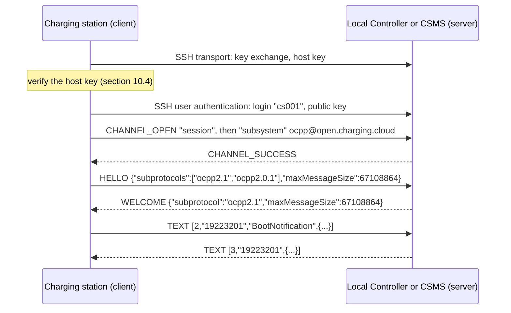

# OCPP over SSH

**Version 0.2, Draft**, 2026-11-10
[CC-BY-SA 4.0](https://creativecommons.org/licenses/by-sa/4.0/) · [OpenChargingTechnology/Whitepapers](https://github.com/OpenChargingTechnology/Whitepapers) · reference implementations: [Vanaheimr/Hermod](https://github.com/Vanaheimr/Hermod) (SSH stack, message protocol), [OpenChargingCloud/WWCP_Core](https://github.com/OpenChargingCloud/WWCP_Core) (transport of networking nodes), [OpenChargingCloud/WWCP_OCPP](https://github.com/OpenChargingCloud/WWCP_OCPP) (OCPP 1.6 and 2.x over SSH), [OpenChargingCloud/WWCP_Node](https://github.com/OpenChargingCloud/WWCP_Node) (shared SSH listener, access rules), [OpenChargingCloud/ChargingStation](https://github.com/OpenChargingCloud/ChargingStation), [OpenChargingCloud/LocalController](https://github.com/OpenChargingCloud/LocalController), [OpenChargingCloud/CSMS](https://github.com/OpenChargingCloud/CSMS)

OCPP-J runs over WebSockets, and its security profiles over TLS. Profiles 2 and 3 need a server
certificate the charging station can validate, and profile 3 a client certificate for every
station: a certificate authority, names the certificates are issued for, and a clock the station
can trust. A CSMS on the public Internet has all three. A Local Controller in a car park, a test
bench in a laboratory, a commissioning laptop on site and a CSMS behind a private APN usually have
none of them.

SSH solves the same problem with less: a host key the station pins, a key pair per station, and no
clock at all. It is already present on almost every station, Local Controller and CSMS, for the
command line and for file transfer. This paper specifies how OCPP-J messages are carried over SSH,
unchanged:

- **A subsystem**, `ocpp@open.charging.cloud`, on an ordinary SSH `session` channel, next to the
  shell and SFTP of the same server.
- **A small framing protocol** in that channel that carries whole messages, text or binary, in both
  directions - what a WebSocket carries over HTTP - with a handshake that negotiates the OCPP
  version as `Sec-WebSocket-Protocol` does.
- **Identity by the SSH login**: the station's networking node id is its login name, authenticated
  by its key; the server is authenticated by its pinned host key.
- **Confinement**: a station's login opens its OCPP subsystem and nothing else: no shell, no
  `exec`, no SFTP, no forwarding.
- **A mapping onto the configuration** of the station and onto the OCPP 2.x Device Model, and the
  key management around it.

*Status*: this is a draft for discussion. The protocol is implemented in the reference
implementations named above, between charging stations and their Local Controllers or CSMS, in
OCPP 1.6 and 2.x, with end-to-end tests in OCPP 2.1 (chapter 12). The questions of version 0.1
were decided on 2026-11-10 (chapter 13), and most of what they decided is built in the reference
implementations (section 12.1); section 12.3 says what still differs. The subsystem name stays
private for now, and the device model, the messages and the security events are proposals for
OCPP.

## Contents

1. [Motivation](#1-motivation)
2. [Design](#2-design)
3. [The protocol](#3-the-protocol)
4. [Identity and authentication](#4-identity-and-authentication)
5. [Authorization on the server](#5-authorization-on-the-server)
6. [Connections, liveness and duplicates](#6-connections-liveness-and-duplicates)
7. [Sharing the SSH connection](#7-sharing-the-ssh-connection)
8. [Commissioning over SSH](#8-commissioning-over-ssh)
9. [Configuration and the OCPP Device Model](#9-configuration-and-the-ocpp-device-model)
10. [Key management](#10-key-management)
11. [Security considerations](#11-security-considerations)
12. [Implementation status](#12-implementation-status)
13. [Decisions](#13-decisions)
14. [Relation to other white papers](#14-relation-to-other-white-papers)
- [References](#references)
- [Appendix A: Test vectors](#appendix-a-test-vectors)
- [Appendix B: Talking to the subsystem with OpenSSH](#appendix-b-talking-to-the-subsystem-with-openssh)

---

## 1. Motivation

### 1.1 What the security profiles of OCPP need

| | Profile 1 | Profile 2 | Profile 3 |
|---|---|---|---|
| Transport | `ws://` | `wss://` | `wss://` |
| Station authenticated by | HTTP Basic password | HTTP Basic password | TLS client certificate |
| Server authenticated by | nothing | server certificate | server certificate |
| Certificate authority needed | no | for the server | for the server and every station |
| Correct clock needed | no | yes | yes |
| Name the certificate is issued for | - | the server's | the server's and the station's |

In a private network all three columns of the last three rows are a problem:

- **No CA, no name.** No public CA issues a certificate for `lc.local` or `10.10.0.1`. An internal
  CA has to be run, its root installed on every station, and every certificate renewed in time. A
  stolen key of a Local Controller is valid against every station that trusts the same CA and dials
  the same name - and local names repeat from site to site ([Key Pins and Raw Public Keys](../EVQITransport/RawPublicKeys.md),
  sections 1.2 and 4).
- **No clock.** A station without a battery-backed real-time clock cannot check *notBefore* and
  *notAfter* after a reboot, which is exactly when it connects first. Its time usually comes from
  its CSMS or Local Controller, i.e. over the very connection it cannot yet authenticate.
- **Passwords.** Profiles 1 and 2 send a long-lived password in every handshake. Whoever reads one
  off a station, a log or a proxy can connect as that station from anywhere.

### 1.2 What SSH brings

- **Bare public keys.** A host key has no validity period and no name. It is pinned by its SHA-256
  fingerprint, which a station can be given on a label, by a commissioning tool or by its CSMS.
- **Client keys as the normal case.** Every SSH client authenticates with a key pair. The private
  key is made on the station and never leaves it; the server holds one `authorized_keys` line per
  station, and withdrawing access means deleting that line.
- **No clock.** Neither a pinned host key nor a client key needs one.
- **Confinement per service.** A key can be restricted to the subsystems it needs, as OpenSSH's
  `restrict` and `ForceCommand` do. A station's key opens OCPP and nothing else.
- **One listener.** A Local Controller or CSMS already runs an SSH server for its command line and
  for SFTP. OCPP becomes one more subsystem on it, and so does the NTS key exchange of
  [NTS-over-SSH](../NTS-over-SSH/README.md) (its section 8.3; chapter 7 here).
- **Tooling.** `ssh-keygen`, `known_hosts`, `authorized_keys` and SSH certificates are part of every
  operator's toolbox; nothing in this paper needs tools of its own to provision.
- **The identity is not on the wire.** The login name and the key are exchanged inside the
  encrypted SSH transport, unlike a TLS 1.2 client certificate.

### 1.3 Where it is meant for

| Scenario | Who dials whom |
|---|---|
| **Local Controller** in a private network | stations dial `ssh://` the Local Controller; the Local Controller dials its CSMS over WebSocket today, over SSH later (section 12.3) |
| **CSMS behind a private APN** or a VPN | stations dial the CSMS directly |
| **Commissioning** on site | a tool dials the station's own SSH server and speaks OCPP to it (chapter 8) |
| **Laboratories, test benches, gateways** | any node dials any other without a PKI |

### 1.4 Non-goals

- **No replacement of the security profiles** towards a CSMS on the public Internet. Where a CA,
  names and clocks are available, `wss://` with profile 2 or 3 remains the interoperable choice.
- **No change of OCPP-J.** Every message is the same JSON array (or binary message) as over a
  WebSocket; only the transport underneath differs. A node's message processing does not know
  which transport a message came over.
- **No WebSocket inside SSH.** Section 2.2 explains why.
- **No new cryptography.** Everything cryptographic is SSH's own ([RFC 4251](https://datatracker.ietf.org/doc/html/rfc4251)
  to [RFC 4254](https://datatracker.ietf.org/doc/html/rfc4254)).

---

## 2. Design

### 2.1 Layers

```
OCPP-J message  [2,"19223201","BootNotification",{...}]
     │
TEXT frame      uint32 length · 0x10 · UTF-8 text                (chapter 3)
     │
subsystem       "ocpp@open.charging.cloud" on a "session" channel (RFC 4254, section 6.5)
     │
SSH connection protocol  channels, flow control                  (RFC 4254)
SSH user authentication  login = networking node id, public key  (RFC 4252)
SSH transport            host key, key exchange, encryption       (RFC 4253)
     │
TCP
```

### 2.2 Decisions and rejected alternatives

| Alternative | Decision | Why |
|---|---|---|
| **WebSocket inside the SSH channel**: the station speaks HTTP/1.1 with an Upgrade to a WebSocket over the channel | rejected | It keeps HTTP, the upgrade, masking and the frame header for nothing: SSH already provides a reliable, encrypted, authenticated byte stream per channel. The identity would have to be stated twice, in the SSH login and in the URL path, and checked against each other. |
| **Port forwarding** (`direct-tcpip`) to a `ws://` endpoint of the server | rejected | The OCPP server behind the tunnel sees a connection from `localhost` and no identity; a station login that may forward may forward anywhere. |
| **`exec`** of a fixed command | rejected | It mixes the protocol name with a command line of the server and is harder to filter than a subsystem. |
| **A channel type of its own** instead of `session` plus `subsystem` | rejected | Cleaner in theory, as no terminal, environment or shell semantics apply. But generic SSH clients and libraries can request subsystems and rarely open custom channel types, and OpenSSH cannot hand custom channel types to an external program (appendix B). |
| **A native message protocol** in a subsystem channel | **chosen** | Whole messages, text or binary, in both directions, with a handshake that negotiates the version. The SSH login is the identity. |

The same framing carries WWCP messages between networking nodes as `wwcp@open.charging.cloud`. This
paper is about OCPP; where WWCP differs, it says so.

---

## 3. The protocol

The framing protocol is not specific to OCPP. It is specified on its own in
[Messages over an SSH subsystem](https://github.com/Vanaheimr/Hermod/blob/master/Hermod/SSH/Messaging/README.md)
in Hermod. This chapter restates it as far as OCPP needs it and adds what OCPP puts into it. Where
the two differ, Hermod's specification of the frames is authoritative, and this paper's
specification of the OCPP binding.

### 3.1 The subsystem

- **Name.** `ocpp@open.charging.cloud`. Names without an `@` are reserved for assignment through
  IANA; private extensions use `name@domain`, where the domain is controlled by whoever defines the
  name ([RFC 4251, section 6](https://datatracker.ietf.org/doc/html/rfc4251#section-6);
  [RFC 4250, section 4.6.1](https://datatracker.ietf.org/doc/html/rfc4250#section-4.6.1)).
- **No version in the name.** Unlike `ntske/1@open.charging.cloud`, the name carries no version:
  one server speaks several OCPP versions on one subsystem, and the handshake chooses one, as
  `Sec-WebSocket-Protocol` does (section 3.3). An incompatible change of the framing itself would
  get a new name.
- **Registration.** The name stays private until a second, independent implementation exists. Then
  `ocpp` is registered in the IANA registry *Connection Protocol Subsystem Names*, which needs an
  *Expert Review* since [RFC 9519](https://datatracker.ietf.org/doc/html/rfc9519) and no RFC
  (decision 1). A server then offers both names.
- **Opening it.** The client opens a `session` channel and sends a `subsystem` request with the name
  ([RFC 4254, section 6.5](https://datatracker.ietf.org/doc/html/rfc4254#section-6.5)), with
  *want reply* set. A server that does not offer the subsystem to this login answers
  `SSH_MSG_CHANNEL_FAILURE`.
- **One OCPP connection per channel.** A client that wants a second OCPP connection, e.g. for
  another identity, opens a second channel; nothing in the framing multiplexes.

### 3.2 Frames

Every frame is

```
uint32  length    big-endian: the kind and the payload, so at least 1
byte    kind
byte[]  payload   length - 1 bytes
```

| Kind | Name | Direction | Payload |
|---|---|---|---|
| `0x01` | HELLO | client → server | JSON object (section 3.3) |
| `0x02` | WELCOME | server → client | JSON object (section 3.3) |
| `0x03` | REFUSED | server → client | JSON object `{"code": "...", "description": "..."}`, and `retryAfter` where the code has one (section 3.3) |
| `0x10` | TEXT | both | UTF-8 text: one OCPP-J message |
| `0x11` | BINARY | both | bytes: one binary message |
| `0x20` | PING | both | any bytes |
| `0x21` | PONG | both | the PING's bytes |
| `0x30` | CLOSE | both | `uint16` close code (big-endian), then a UTF-8 reason; may be empty |

- **Lengths are checked before anything is allocated.** TEXT and BINARY may be as long as the
  receiver's limit (`maxMessageSize`, section 3.3); every other kind may have at most 64 KiB of
  payload. A longer frame ends the connection: CLOSE `1009` for TEXT and BINARY, `1002` otherwise.
  A frame of length 0 has no kind and is a protocol error. Before WELCOME the server answers such
  frames with a REFUSED instead (section 3.3).
- **TEXT must be valid UTF-8**, otherwise CLOSE `1007`.
- **Unknown kinds.** A frame of an unknown kind from `0x80` on is skipped; that range is kept for
  extensions. Any other unknown kind ends the connection with CLOSE `1002`.
- **One message per frame.** There is no fragmentation and no continuation frame. A message is as
  long as its frame says.
- **Close codes** are those of [RFC 6455, section 7.4.1](https://datatracker.ietf.org/doc/html/rfc6455#section-7.4.1).
- **One writer at a time.** The SSH channel does not keep two writers apart: a frame larger than one
  SSH packet, written by two tasks at once, would interleave. A side writes one frame at a time,
  whole; once a frame is begun, it is written to its end or the connection ends.

### 3.3 The handshake



1. **HELLO** is the client's first frame. Its properties:

   | Property | Required | Meaning | WebSocket equivalent |
   |---|---|---|---|
   | `subprotocols` | no | the OCPP versions the client speaks, by preference: `ocpp1.6`, `ocpp2.0.1`, `ocpp2.1`; at most 32 strings of 1 to 256 characters | `Sec-WebSocket-Protocol` |
   | `maxMessageSize` | no | the largest TEXT or BINARY payload the client takes, a positive integer | - |
   | `networkingNodeId` | no | the networking node the client connects as, where it is not its login (section 4.1) | the last segment of the URL path |
   | `networkingMode` | no | `Standard` or `OverlayNetwork` (or `Unknown`), by name; never a number | `X-OCPP-NetworkingMode` |
   | `previousConnection` | no | the `connectionToken` of the client's last connection to this server (section 6.3) | `OCPP-Previous-Connection` |

   - Any other property is ignored by a server that does not know it.
   - **Message size.** A side takes 64 MiB by default, over SSH as over a WebSocket (decision 2).
     No OCPP message needs that much, and files go by SFTP or HTTP; the limit is there to bound
     what a peer can make the receiver hold.
   - A client of the reference implementation sends `networkingNodeId` where its `ssh://` URL has a
     path, as the path's last segment, which is needed only where it connects as another node than
     its login; and `networkingMode` only for an overlay network, as the WebSocket transport sends
     its header only then.
   - The server waits 10 s for the HELLO and closes the channel otherwise, without a REFUSED.
   - The server reads the first frame as a HELLO, with no room for a message: a TEXT or BINARY
     frame with a payload, a control frame over 64 KiB or a frame of length 0 is answered with
     REFUSED `invalid-hello`; any other frame that is not a HELLO with REFUSED `hello-expected`.

2. **WELCOME** accepts the connection:

   | Property | Meaning |
   |---|---|
   | `subprotocol` | the client's first choice that the server speaks; left out where the client offered none |
   | `maxMessageSize` | the largest TEXT or BINARY payload the server takes |
   | `connectionToken` | a fresh token for this connection, which the client presents as `previousConnection` next time (section 6.3); the analogue of `OCPP-Connection-Token` |

   - A client checks that the subprotocol chosen is one it offered, and waits 10 s for the answer.
   - A HELLO without `subprotocols` is welcomed without one, by the framing and, today, by the
     OCPP servers of the reference implementation: the client then has to speak whatever the
     server's node speaks. An OCPP client always offers its versions, and an OCPP server should
     refuse a HELLO without them with `unsupported-subprotocol`, as OCPP-J has a server close a
     WebSocket whose handshake agreed on no subprotocol. Likewise, a client that offered versions
     and receives a WELCOME without `subprotocol` should end the connection with CLOSE `1002`; the
     reference client accepts it today (section 12.3).

3. **REFUSED** declines it, and the server closes the channel after it:

   | Code | Sent by | When |
   |---|---|---|
   | `hello-expected` | framing | the first frame was a well-formed frame of another kind |
   | `invalid-hello` | framing, OCPP binding | the first frame was a TEXT or BINARY frame with a payload, an oversized control frame or a frame of length 0; or the HELLO is not a JSON object, its subprotocols or size are malformed, `networkingNodeId` is not a valid id, or `networkingMode` is not one of the names |
   | `unsupported-subprotocol` | framing | the client offered versions, none of which the server speaks; the description names those it speaks |
   | `not-permitted` | OCPP binding | the login names no networking node, or the HELLO names a node the login may not act for (section 4.1) |
   | `connection-exists` | OCPP binding | the identity has a live connection this one may not take over (section 6.3); `retryAfter` says after how many seconds to try again, the analogue of `409` with `Retry-After` |
   | `refused` | framing | anything else, or a REFUSED without a code |

   A REFUSED is final: a client does not try that connection again by itself (section 6.2). The
   one exception is `connection-exists`, after which the client tries again once `retryAfter`
   seconds have passed.

4. **After WELCOME** both sides send TEXT, BINARY, PING and PONG in any order, and neither sends a
   message larger than the other side's `maxMessageSize`. A message that is too large for the peer
   is not sent, and the sender learns so locally. A HELLO, WELCOME or REFUSED from then on is a
   protocol error, CLOSE `1002`.

### 3.4 Messages

- **TEXT** carries exactly one OCPP-J message, as a WebSocket text frame does: a JSON array
  `[2, …]` CALL, `[3, …]` CALLRESULT, `[4, …]` CALLERROR, and in OCPP 2.1 also `[5, …]`
  CALLRESULTERROR and `[6, …]` SEND (OCPP 2.1 Part 4).
- **BINARY** carries exactly one binary message, as a WebSocket binary frame does.
- **Nothing else changes.** Message ids, timeouts, the one outstanding CALL per direction of OCPP
  1.6 and 2.0.1, error codes and the routing of OCPP 2.1's networking nodes are those of OCPP-J.

### 3.5 Mapping from the WebSocket binding

| OCPP-J over WebSocket | OCPP over SSH |
|---|---|
| `wss://lc.example.org/ocpp/cs001` | `ssh://cs001@lc.example.org:22` |
| identity in the last segment of the URL path | the SSH login; a HELLO `networkingNodeId` only to connect as another node |
| HTTP Basic password (profiles 1, 2) | SSH public key; a password only where a server asks for one (section 4.2) |
| TLS client certificate (profile 3) | SSH public key, or an SSH user certificate (section 10.5) |
| server certificate and its chain | pinned host key, or a host certificate (section 10.4) |
| `Sec-WebSocket-Protocol: ocpp2.1, ocpp2.0.1` | HELLO `subprotocols`, WELCOME `subprotocol` |
| `X-OCPP-NetworkingMode` | HELLO `networkingMode` |
| `101 Switching Protocols` | WELCOME |
| `401` (credentials) | SSH user authentication fails |
| `403`, `404` (identity, path) | REFUSED `not-permitted`, or the subsystem request fails |
| text and binary frames | TEXT and BINARY frames |
| WebSocket ping and pong | PING and PONG, and the SSH transport's `keepalive@openssh.com` (section 6.1) |
| close frame with a code | CLOSE with a code |
| connection lost: `1006`, never sent | channel ended without CLOSE: read as `1006`, never sent |

### 3.6 The end

- A side that ends the connection sends **CLOSE** and closes the channel. Nothing follows a CLOSE.
- A side that receives a CLOSE answers with its own CLOSE carrying the same code, where it has sent
  none yet, and closes the channel.
- A CLOSE without a payload means `1000`.
- A channel that ends without a CLOSE ended abnormally, as RFC 6455's `1006` would say.

| Code | Used for |
|---|---|
| `1000` | a normal end; today also a connection replaced by a newer one of the same identity, reason `Newer connection detected!`, which EVQI replaces by `4000` and `4001` (section 6.3) |
| `1001` | the server or client is going away, e.g. stopping |
| `1002` | a protocol error: a malformed frame, an unknown kind below `0x80`, a handshake frame after the handshake, a control frame over 64 KiB |
| `1007` | TEXT that is not valid UTF-8 |
| `1009` | a TEXT or BINARY frame over the receiver's limit |

---

## 4. Identity and authentication

### 4.1 Who is connecting

- **The login is the identity.** A station signs in under its networking node id, e.g. `cs001`, and
  that is who it is to the server. The login must be a valid networking node id; otherwise REFUSED
  `not-permitted`.
- **The URL says the login**: `ssh://cs001@lc.example.org:22`. A station of the reference
  implementation takes its login from the URL's user, else from the login of the credentials the
  connection names, else from the id of its own OCPP node. Where the URL's user and the credentials'
  login differ, the connection is not dialled.
- **Connecting as another node.** A node that relays for others, e.g. a Local Controller connecting
  upwards on behalf of a station, names that station in the last segment of the URL path:
  `ssh://lc01@csms.example.org/cs001` signs in as `lc01` and connects as `cs001`, and the HELLO
  carries `"networkingNodeId": "cs001"`. The server accepts this only where the login may act for
  that node (`AllowToActFor` in WWCP_Core), and refuses it with `not-permitted` otherwise. This is
  the rule of the WebSocket binding, where a path that differs from the credentials' login needs the
  same permission.
- **Speaking for another node.** Whom a connection connects as is not whom its frames may name.
  In an overlay network (`networkingMode`, section 3.3) every frame names its sender and its path
  itself, and any login can dial that way. The CSMS of the reference implementation takes such a
  frame only where the last hop of its path is the node the connection connected as, and where it
  names another sender only from a login the operator marked as a Local Controller's; what it does
  not take is dropped without an answer, which would go to the node the frame names
  ([Key Pins and TLS 1.3 Raw Public Keys for Local Controllers](../EVQITransport/RawPublicKeys.md),
  section 5.7). The rule is asked where the messages of both transports arrive, so it holds over
  SSH as over a WebSocket.
- **No identity in the clear.** Login and key are exchanged inside the encrypted SSH transport; a
  passive observer sees neither.

### 4.2 How the station proves it

- **Public key**, the normal case. The station's own Ed25519 key (chapter 10). The server finds the
  key among those it holds for the login, and only there.
- **Password**, where a server asks for one. A station sends the password of the credentials its
  connection names, and only after it has verified the host key, so that a password never reaches
  a server it does not believe. The nodes of the reference implementation never let a station in
  with a password: a station login is a key.
- **SSH user certificates**: possible in the SSH stack, not used for stations yet (section 10.5).

### 4.3 How the server proves it

By its host key, against a pin or an SSH CA, or on first use where that is configured, and then
only on probation (section 10.4). A station accepts an unknown host key only where its
configuration says so, never silently, and never falls back to another transport because a host
key was refused.

### 4.4 What is not offered over SSH

- **TLS client certificates.** There is no TLS handshake to show one in. A connection that names
  one is not dialled over SSH.
- **TOTP passwords** ([TOTP for M2M Authentication](../TimeBasedOneTimePasswords/README.md)). A
  one-time password is answered over HTTP, and a key already proves what it would add: that the
  station holds a secret that never crossed the wire. A connection that names TOTP credentials is
  not dialled over SSH.

### 4.5 Relation to the security profiles

SSH with a public key gives mutual authentication without a CA, comparable in strength to profile
3; SSH with a password and a pinned host key is comparable to profile 2. OCPP has no profile for
it, and `securityProfile` in a network connection profile is defined for TLS. An `ssh://` profile
therefore carries `3` where the station authenticates with its key and `2` where with a password
(decision 6, section 9.1), so that a CSMS policy like "at least profile 2" keeps meaning something
and nothing outside the profile changes.

---

## 5. Authorization on the server

### 5.1 Confinement of a station's login

A station's login opens the OCPP subsystem and nothing else:

- no shell, no `exec`, no SFTP, no pseudo-terminal;
- no port forwarding, local or remote, no agent forwarding;
- the subsystems permitted to it, and only those: today `ocpp@open.charging.cloud`; later also
  e.g. `ntske/1@open.charging.cloud` where it may use the server's time service (section 7.1).

On a node of the reference implementation these restrictions are not configurable for station
logins: a station login is always restricted, and the restrictions of its key line can only narrow
them further.

### 5.2 Station logins and their keys

- **A station is a login only while it has a key.** Its key lines are kept with the station in the
  server's store: OpenSSH `authorized_keys` lines, with their `from="…"` and `expiry-time="…"`
  options honoured. In the reference implementation at most 8 keys per station.
- **A key belongs to one station.** Adding a key already held by another station is refused, also
  in a hand-written file. A `cert-authority` line is refused as a station key: it would let in
  anybody the CA signs, not this station.
- **Station and account never share a name.** A name that is both an account and a station is let in
  as neither, and a warning says so.
- **The station must be enabled**, and its login group must be enabled and allow SSH keys. A station
  is only let in while the server serves OCPP over SSH at all.
- **Accounts do not get the subsystem** unless the subsystem grants it to a permission of theirs,
  as the station's commissioning listener does (chapter 8). On a Local Controller or CSMS no
  account gets it.

### 5.3 Revocation

Removing a key, disabling a station or its group, or switching OCPP over SSH off ends the sessions
it no longer admits: at once where the store reports the change, otherwise at the next recheck
(every 5 s in the reference implementation). A station that comes back is refused at its SSH login.

### 5.4 Access rules

A shared listener serves accounts and stations, shells and subsystems, often on several network
interfaces. Access rules restrict who may use what from where; they can only restrict, never
grant more than the built-in policy:

| Dimension | Values |
|---|---|
| `principal` | `account:<name>`, `station:<id>`, `group:<name>`; `*` and `?` as wildcards |
| `service` | `shell`, `sftp`, `subsystem:<name>` |
| `source` | CIDR ranges of the peer |
| `localAddress` | the server's own address the connection arrived at |
| `authMethod` | `publickey`, `password`, `keyboard-interactive` |

The first rule that matches decides; `deny` refuses, `allow` hands over to the built-in policy, and
where no rule matches the built-in policy applies. Rules without a service are checked at login,
so that a refused login gets no session at all; rules with a service at the subsystem request. An
example for a Local Controller with an uplink at 192.0.2.10 and a station network 10.10.0.0/16 at
10.10.0.1:

```json
"ssh": {
  "accessRules": [
    { "action": "deny",  "service":   "subsystem:ocpp@open.charging.cloud", "localAddress": "192.0.2.10" },
    { "action": "deny",  "principal": "account:*", "localAddress": "10.10.0.1" },
    { "action": "allow", "principal": "station:*", "source": [ "10.10.0.0/16" ] },
    { "action": "deny",  "principal": "station:*" }
  ]
}
```

### 5.5 Limits

- **Connections per kind of login.** A shared listener counts accounts and stations apart, so that
  stations cannot lock the administrators out: in the reference implementation 20 for accounts and
  100 for stations by default, 1 to 10,000, and the server's overall limit is their sum plus 10
  connections that have not authenticated yet.
- **Channels per connection**: at most 4 sessions per SSH connection (fixed in WWCP_Node), enough
  for OCPP, NTS-KE and SFTP side by side (chapter 7).
- **Login grace time**: 30 s from TCP connect to a successful authentication.
- **HELLO**: 10 s from the subsystem request.

---

## 6. Connections, liveness and duplicates

### 6.1 Liveness

Three mechanisms, at three layers:

| Layer | Mechanism | Reference implementation |
|---|---|---|
| SSH transport | `keepalive@openssh.com` global requests | server: every 60 s, the connection ends after 3 unanswered; station: every 30 s, 3 misses |
| framing | PING and PONG | both sides send PINGs and evaluate the PONGs (decision 11); a Local Controller and a CSMS every `pingEverySeconds`, 30 s by default, the station every `OCPPCommCtrlr.WebSocketPingInterval` |
| OCPP | `Heartbeat` | as in OCPP |

The transport's keepalive finds a dead peer; PING and PONG add a check of the channel and of the
peer's message loop, which a keepalive does not reach. Like WebSocket pongs, they are evaluated:

- A side that has left **3 PINGs** in a row without a PONG takes the peer for dead and closes the
  channel without waiting for a CLOSE. A peer that was alive after all reads `1006`.
- Any frame from the peer counts as a sign of life, not only a PONG, so a busy connection is never
  ended for a PONG queued behind a long message.
- The station's interval is the one OCPP already has for WebSocket pings, `WebSocketPingInterval`
  of `OCPPCommCtrlr` (OCPP 2.x) or the configuration key of the same name (OCPP 1.6). `0` switches
  the station's PINGs off, as it does for a WebSocket; the transport's keepalive still runs.
- The probe of section 6.3 is such a PING.

The reference implementation does both (section 12.1); the station's interval is fixed at 30 s for
now (section 12.3).

### 6.2 Dialling and coming back

- The station connects with a timeout (15 s in the reference implementation) and reconnects by
  itself with back-off and jitter. Every attempt is a new SSH connection.
- **Final refusals** are not retried by themselves: a host key not believed, an authentication the
  server did not take, a REFUSED frame other than `connection-exists`. They wait for a change of
  the configuration.
- **`connection-exists`** is retried after its `retryAfter`, as EVQI's client retries after a `409`.
- **Everything else is retried**: a timeout, a socket error, a server that went away.
- A refusal of the subsystem request itself (`SSH_MSG_CHANNEL_FAILURE`), e.g. by an access rule,
  should count as final as well. In the reference implementation it is still retried (section
  12.3).

### 6.3 A second connection of the same identity

Today every OCPP server of the reference implementation lets the newest connection of an identity
win: the older one gets CLOSE `1000` *"Newer connection detected!"*, without its liveness being
checked. Chapter 12 of [EVQI Transport](../EVQITransport/README.md) has decided how this changes:

- A server first probes whether the old connection is alive; over SSH with a PING whose PONG is
  evaluated, or with `keepalive@openssh.com` (EVQI work item R7).
- A live connection is not taken over by a newcomer that merely holds the same credentials.
- A newcomer that proves with a *continuity token* that it is the same client instance takes over
  at once. EVQI carries the token in HTTP headers (`OCPP-Connection-Token`,
  `OCPP-Previous-Connection`).
- The close codes become `4000` (superseded) and `4001` (unresponsive) instead of `1000`.

Over SSH the same rules apply, with frames in place of HTTP (decision 12):

| EVQI over WebSocket | OCPP over SSH |
|---|---|
| `409 Conflict` with `Retry-After` | REFUSED `connection-exists` with `retryAfter` in seconds (section 3.3) |
| `OCPP-Connection-Token` in the `101` | WELCOME property `connectionToken` |
| `OCPP-Previous-Connection` on the next connection | HELLO property `previousConnection` |
| close frame `4000`, `4001` | CLOSE `4000`, `4001` |

The token is the same as EVQI's: 128 random bits, bound to the identity and to this connection,
good for one takeover, remembered by the server for `TokenGrace` (24 h) after the connection ended,
and kept by the station per endpoint on disk. It travels only inside the encrypted SSH transport,
as EVQI's travels only over TLS. A token the server does not know is ignored, and the probe decides.

---

## 7. Sharing the SSH connection

### 7.1 One listener

A node of the reference implementation runs one SSH server, and serves on it what its kind needs:

| Service | Who | Where |
|---|---|---|
| shell (the node's command line) | accounts | every node |
| `sftp` | accounts | every node |
| `ocpp@open.charging.cloud` | stations; on a station: commissioning accounts (chapter 8) | Local Controller, CSMS, station |
| `wwcp@open.charging.cloud` | neighbouring WWCP networking nodes | WWCP_Core has it; no node serves it yet |
| `ntske/1@open.charging.cloud` | stations and nodes that use its time server | nodes with an NTS server ([NTS-over-SSH](../NTS-over-SSH/README.md), section 8.3); WWCP_Node can serve it, but the Local Controller and the CSMS do not yet, and grant their stations `ocpp@` only |

### 7.2 One connection to an SSH peer, and its channels

A station keeps one SSH connection to a host it reaches over SSH, its *SSH peer*, and what goes to
that host is a channel of it, all authenticated by the same login, without another key exchange.
The connection is the station's, not OCPP's: OCPP is one of its channels, none of them comes first,
and whichever needs the connection first has it made. A station that starts cold may have its names
and the time over it before a single OCPP message went over it.

A host becomes an SSH peer in one of two ways. The host of an `ssh://` network connection profile
is one, signed in to with the station's key under the login of the profile, and believed by what
`SSHClientController` holds it to. And a host named in `SSHPeerController` (section 7.3) is one
without anything of OCPP: a station that speaks OCPP over a WebSocket has its time and its names
over the connection to such a peer all the same. While a peer's host key is on probation
(section 10.4), nothing but OCPP goes over its connection. A reconnect of OCPP after the server
ended it is a new channel of the same connection; where the host is to be believed anew, e.g. when
a probation ran out, the station closes the SSH connection itself.

- **OCPP.** `ocpp@`, as this paper describes it.
- **NTS-KE.** [NTS-over-SSH](../NTS-over-SSH/README.md) lets a station open `ntske/1@` as a
  channel of the same connection (`SSHConnection` `Shared`), so that it needs no key, pin or account
  of its own for time. Built: the node owns the connection, the key exchange has it made where
  nothing else did, and closes its own channel only (that paper's section 7).
- **DNS.** [DNS over SSH](../DNS-over-SSH/README.md) does the same for names with `dns@`; not built
  yet.
- **SFTP for logs and firmware.** `GetLog` and `UpdateFirmware` name a URL the station uploads to or
  downloads from, today HTTP(S) or FTP(S) with credentials in the URL. An `sftp://` location on the
  same server, opened as a channel of the connection to that SSH peer, would need no credentials at all; a
  section of its own in a later version of this paper.
- **EVQI channels.** [EVQI Transport](../EVQITransport/README.md) runs further OCPP channels
  (bulk, privileged, …) as further WebSocket connections or HTTP/2 and HTTP/3 streams. Over SSH
  they would be further channels of the same subsystem; the HELLO would carry the channel's class.

### 7.3 The component `SSHPeerController`

The SSH peers a station has without an `ssh://` profile are instances of the component
`SSHPeerController`, one per peer, named by whoever configures it (`"lc"`, `"time"`, …):

| Variable Name | req/opt | Mutability | Data Type | Default Value | Values List / Limits | Description |
|---|---|---|---|---|---|---|
| Address | required | rw | string | - | ≤ 253 characters | The host name or address of the peer, as the servers that share its connection name it. One peer per address: a station keeps one connection to a host. |
| Port | optional | rw | integer | 22 | 1 … 65535 | Its SSH port. |
| UserName | optional | rw | string | "" | ≤ 32 characters | The login of the SSH user authentication. Empty: the station's own identity. |
| HostKeyPins | optional | rw | string | "" | comma separated, ≤ 16 | SHA-256 fingerprints of the host keys the peer may show, as `SHA256:<base64>` of `ssh-keygen -l`. |
| HostCAs | optional | rw | string | "" | comma separated, ≤ 4 | SHA-256 fingerprints of SSH CA keys that may sign the peer's host certificate. |
| OnPinMismatch | optional | rw | OptionList | `Refuse` | `Refuse`, `Record`, `Accept` | What a host key that neither a pin nor a CA vouches for leads to (decision 15). |
| HostKeyFingerprint | optional | ro | string | "" | - | The SHA-256 fingerprint of the host key the peer showed at the last handshake. |
| Connected | optional | ro | boolean | false | - | Whether the connection lasts now. It is made when something first needs it, so `false` is no fault. |
| Problem | optional | ro | boolean | false | - | `true` while the host key the peer showed last was refused. |

And in the instance without a name:

| Variable Name | req/opt | Mutability | Data Type | Default Value | Values List / Limits | Description |
|---|---|---|---|---|---|---|
| Peers | optional | rw | string | "" | comma separated, ≤ 16 | The names of the peers. A name it adds becomes a peer with the variables the same request sets for it; one it leaves out is a peer no longer, and its connection is closed for everything on it. |
| ClientPublicKey | optional | ro | string | "" | - | The public key the station signs in with at these peers, as a line of `authorized_keys`: `SSHClientController.ClientPublicKey[Station]`. |

Rules for `SetVariablesRequest`:

- **A peer is added as one.** Its name in `Peers`, its `Address`, and `HostKeyPins` or `HostCAs`
  arrive in one request with the data consistency model `ACID` or `BASE`. A peer with neither a pin
  nor a CA is `Rejected`: a peer nobody could believe is never stored, and there is no trust on
  first use for it.
- **A peer that changed is dialled anew.** A change of any of its variables closes its connection,
  and the next channel is opened on one made by what the variables say now.
- **A time or name server refers to a peer by its address**, with `SSHConnection` `Shared`
  ([NTS over SSH](../NTS-over-SSH/README.md), section 7; [DNS over SSH](../DNS-over-SSH/README.md),
  section 7.1). Where the address is no peer, that server cannot be reached.

---

## 8. Commissioning over SSH

A commissioning tool on site, a laptop or a phone, speaks OCPP **to the station**, as its CSMS
would, on the station's own SSH server:

- **Switched on** by the station's configuration (`"commissioning": { "enabled": true }`, off by
  default), at once and without a restart. Switched off, every tool connected is let go of.
- **Who.** An account of the station with the permission `commissioning:run` (the installer has it,
  and the system administrator), signed in with its own key. Other accounts do not get the
  subsystem.
- **As whom.** The tool is a networking node of its own, named after its account, never the CSMS: a
  route is one per destination, and a tool connected as `CSMS` would take the station's route to its
  real CSMS. So a HELLO naming any other node than the account is refused with `not-permitted`, and
  so is an account named like the CSMS (`CSMS`, `CentralSystem`), like the station, or `*` or `0`.
- **What it reaches.** The station's OCPP node of the version chosen answers the tool's requests as
  it would answer its CSMS's; requests from the tool carry no destination and are taken for the station. What the
  station sends of its own accord still goes to its CSMS over its uplink, also while a tool is
  connected.
- **Versions.** `ocpp2.1`, `ocpp2.0.1` and `ocpp1.6` (decision 13). A subsystem has one handler,
  and a station runs one OCPP node per version. A handler in front of both nodes therefore reads
  the HELLO, chooses the version as the framing would, and hands the connection with its HELLO to
  the node of that version, which answers with the WELCOME. In OCPP 1.6 such a request is for the
  Central System, by that name, as in 2.x for the CSMS.
- **Security events** (proposed, not reported yet): a tool signing in is a
  `MaintenanceLoginAccepted`, a failed attempt a `MaintenanceLoginFailed`, as OCPP 2.1 defines them
  for the local maintenance interface. In OCPP 1.6 the same types go out by the security
  whitepaper's `SecurityEventNotification`.

The station's page and API say whether commissioning is on, where a tool connects (URL and host
key), and which tools are connected.

---

## 9. Configuration and the OCPP Device Model

### 9.1 OCPP 2.x: a network connection profile with `ssh://`

OCPP 2.x keeps the connections a station may use in network connection profiles, one per
configuration slot: written by `SetNetworkProfile`, or since OCPP 2.1 through the instances of the
component `NetworkConfiguration`, and tried in the order of `OCPPCommCtrlr.NetworkConfigurationPriority`.
OCPP over SSH needs no new profile, only an extension of the existing one:

- **`ocppCsmsUrl` / `OcppCsmsUrl`** may be an `ssh://` URL. OCPP itself allows `ws://` and `wss://`
  only, so this is the one change a station has to accept that is not additive. A station that does
  not know `ssh://` refuses the profile, as it should.
- **`ocppTransport` / `OcppTransport`** stays `JSON`: the messages are OCPP-J.
- **`identity` / `Identity`** (OCPP 2.1) is the login name, and so the networking node id. Where it is
  absent, the station's own identity applies, as for a WebSocket.
- **`securityProfile` / `SecurityProfile`** says how the station authenticates (decision 6): `3`
  with its key only, never sending a password; `2` with its key and, where the server asks for one,
  the password below. Lower values are refused for `ssh://`, as SSH never runs without an
  authenticated server. A CSMS policy "at least profile 2", and
  `SecurityCtrlr.AllowSecurityProfileDowngrade`, keep working unchanged.
- **`basicAuthPassword` / `BasicAuthPassword`** is the password the station offers where a server
  asks for one (section 4.2), with profile `2` only. It is unset for a server that takes keys only,
  which is the recommended case.

What an `ssh://` profile needs beyond that, the host keys it pins, has no field in
`NetworkConnectionProfileType`.

### 9.2 The component `SSHClientController`

The station's SSH client gets a component of its own (decision 5), named like the controllers of
the other white papers (`NTPClientController`, `OCPPPeersController`). It has two kinds of
instances:

- **One instance per configuration slot**, named after the slot (`"1"`, `"2"`, …), for what
  belongs to the server of that slot's profile: its pins and how they are checked. A pin belongs to
  its profile, and an instance without an `ssh://` profile in its slot has no effect.
- **The instance without a name**, for what belongs to the station: its keys.

Per slot:

| Variable Name | req/opt | Mutability | Data Type | Default Value | Values List / Limits | Description |
|---|---|---|---|---|---|---|
| HostKeyPins | optional | rw | string | "" | comma separated, ≤ 16 | SHA-256 fingerprints of the host keys the server of this slot may show, in the notation `SHA256:<base64>` of `ssh-keygen -l`, or public-key lines. An MD5 fingerprint is `Rejected` with `reasonCode` `InvalidValue` and a hint to use SHA-256 (decision 3). Taken only from a signed pin set, with `HostKeyPinsVersion` in the same request (section 10.4). |
| HostKeyPinsVersion | optional | rw | integer | 0 | ≥ 0 | The version of the signed pin set the pins came from: a pin set is taken only with a higher one, so that an older one cannot come back. |
| HostCAs | optional | rw | string | "" | comma separated, ≤ 4 | SHA-256 fingerprints of SSH CA keys that may sign the host certificate of the server, for the host name of the URL. |
| TrustOnFirstUse | optional | rw | OptionList | `None` | `None`, `HostKey` | `HostKey`: with neither pins nor CAs, learn the host key of the first handshake, on probation (section 10.4; decision 4). |
| ProbationTime | optional | rw | integer | 600 | 1 … 604800 (s) | How long a learned host key waits for a signed pin set that confirms it (section 10.4). A short probation is the stricter one. |
| OnPinMismatch | optional | rw | OptionList | `Refuse` | `Refuse`, `Record`, `Accept` | What a host key that neither a pin nor a CA vouches for leads to (section 10.4; decision 15). |
| HostKeyFingerprint | optional | ro | string | "" | - | The SHA-256 fingerprint of the host key the server showed at the last handshake of this slot. |
| LearnedHostKey | optional | ro | string | "" | - | The SHA-256 fingerprint of the host key learned on first use while it is on probation; empty otherwise. |

Every write of a slot's instance - its pins, how it trusts on first use, its probation and what a
mismatch leads to - is taken only from a SetVariables request that a signer of pin sets the station
believes signed (section 10.4); otherwise each entry is `Rejected` with the reason code
`Unsigned`.

Station-wide, with one variable instance per purpose (`Station`, `NTS`, `SFTP`), as the station
has one key per purpose (decision 9). `Station` is the station's own key: the one it signs in with
on its connection to an SSH peer, which OCPP is one channel of (section 7.2). It was called `OCPP`
when that connection was taken for OCPP's, and `OCPP` is still read as `Station`:

| Variable Name | req/opt | Mutability | Data Type | Default Value | Values List / Limits | Description |
|---|---|---|---|---|---|---|
| ClientPublicKey | optional | ro | string | "" | - | The public key the station authenticates with for this purpose, as a line of OpenSSH's `authorized_keys`, e.g. `ssh-ed25519 AAAAC3NzaC1lZDI1NTE5AAAAINgMp5THIxMsb4dglcgSkZ9A2oWPpBrzZxM3Rk8UqWwC cs001`. |
| ClientPendingPublicKey | optional | ro | string | "" | - | The next key of this purpose during a rotation (section 10.3); empty otherwise. |
| ClientCertificate | optional | ro | string | "" | - | The OpenSSH user certificate of this purpose's key, where the operator signs station keys (section 10.5). |
| ClientKeyMaxAge | optional | rw | integer | 0 | ≥ 0 (days) | The age after which the station rotates this key by itself (section 10.3); `0`: only when asked. |

And without an instance:

| Variable Name | req/opt | Mutability | Data Type | Default Value | Values List / Limits | Description |
|---|---|---|---|---|---|---|
| ClientKeyAlgorithms | optional | ro | MemberList | `ssh-ed25519` | `ssh-ed25519`, `ecdsa-sha2-nistp256` | The key types the station can make. |

The station makes a key pair itself, at the first need of its purpose or the first read of its
`ClientPublicKey`, whichever comes first, and keeps it. The private key never leaves it.

`NTPClientController.SSHClientPublicKey` of [NTS-over-SSH](../NTS-over-SSH/README.md) section 7
reads the same key as `ClientPublicKey[NTS]`, or the key of the shared connection where the NTS
client is a channel of the station's connection to an SSH peer (`SSHConnection` `Shared`).

In `SetNetworkProfile` the values of the slot travel in the profile's `customData`, so that a
profile and its pins arrive in one request:

```json
"connectionData": {
  "ocppCsmsUrl": "ssh://lc.example.org:22",
  "identity": "cs001",
  "ocppTransport": "JSON",
  "securityProfile": 3,
  "messageTimeout": 30,
  "ocppInterface": "Wired0",
  "customData": {
    "vendorId": "cloud.charging.open.ssh",
    "hostKeyPins": [ "SHA256:hOEj1ea61PSArpO3/qj2Drlp024D2eiJ7DJQNNLl+hU" ],
    "trustOnFirstUse": "None",
    "onPinMismatch": "Refuse"
  }
}
```

A station that accepts the profile writes these values into the instance of `SSHClientController`
of that slot, and leaves out ones that are absent at their defaults. A station that does not know
the vendor id ignores `customData` and refuses the URL. A station that knows it but finds neither
pins, nor CAs, nor `HostKey` trust on first use refuses the profile with `Rejected` and the reason
code `InvalidSSHHostKeyConfig`: an `ssh://` profile without a way to authenticate its server is
never stored. With OCPP 2.1's `NetworkConfiguration` instances, the CSMS writes the pins into
`SSHClientController` first and the URL second, in one `SetVariables` request.

### 9.3 Messages

Six messages, proposed for OCPP 2.1 (decisions 7 and 8). The first two are between a station and
its CSMS and mirror `SignCertificate` and `CertificateSigned`; the other four go from a CSMS to a
Local Controller, the server its stations sign in to, and mirror `InstallCertificate`,
`DeleteCertificate` and `GetInstalledCertificateIds`. Over OCPP 2.0.1 and 1.6 they travel as
`DataTransfer` with the `vendorId` `cloud.charging.open.ssh`, the action's name as `messageId`, and
the request or response object as `data`.

**`SignSSHKey`**, station → CSMS: the station shows a new key, or its first one.

| Field | Type | Card. | Description |
|---|---|---|---|
| `purpose` | `SSHKeyPurposeEnumType`: `Station`, `NTS`, `SFTP`; `OCPP` is read as `Station` | 1..1 | Which of the station's keys. |
| `publicKey` | string[0..1000] | 1..1 | The new public key, as a line of `authorized_keys`. |

Response: `status` `Accepted` or `Rejected`, and `statusInfo`. `Accepted` means the CSMS will
answer with `SSHKeySigned`.

**`SSHKeySigned`**, CSMS → station: the key is enrolled at every server the station dials for this
purpose.

| Field | Type | Card. | Description |
|---|---|---|---|
| `purpose` | `SSHKeyPurposeEnumType` | 1..1 | Which of the station's keys. |
| `publicKey` | string[0..1000] | 1..1 | The key enrolled; the station checks that it is its pending key, or its current one. |
| `certificate` | string[0..5500] | 0..1 | An OpenSSH user certificate for the key, where the operator signs station keys (section 10.5). |

Response: `status` `Accepted`, or `Rejected` where `publicKey` is neither the pending nor the
current key of that purpose.

**`InstallSSHKey`**, CSMS → Local Controller: let a station sign in with a key.

| Field | Type | Card. | Description |
|---|---|---|---|
| `networkingNodeId` | identifier string[0..48] | 1..1 | The station's login (section 4.1). |
| `purpose` | `SSHKeyPurposeEnumType` | 1..1 | What the key admits: `Station` the station's login, and with it `ocpp@open.charging.cloud` and whatever else its connection is granted; `NTS` `ntske/1@open.charging.cloud` on a connection of its own; `SFTP` the station's SFTP locations. |
| `publicKey` | string[0..1500] | 1..1 | The key, as a line of `authorized_keys`, with OpenSSH options such as `from="…"` and `expiry-time="…"`. |

Response: `status` `Accepted` or `Rejected`, `statusInfo`, and `hostKeys`: the SHA-256 fingerprints
of the Local Controller's host keys, which the CSMS gives the station as pins. Reason codes for
`Rejected`: `KeyOfOtherStation` (a key belongs to one station, section 5.2), `CertAuthority` (a
`cert-authority` line is no station key), `TooManyKeys` (more than 8 per station), `UnknownStation`.

**`DeleteSSHKey`**, CSMS → Local Controller: withdraw a key.

| Field | Type | Card. | Description |
|---|---|---|---|
| `networkingNodeId` | identifier string[0..48] | 1..1 | The station's login. |
| `keyFingerprint` | string[0..100] | 1..1 | The SHA-256 fingerprint of the key. |

Response: `status` `Accepted`, or `Rejected` with the reason code `NotFound`. Sessions on the key end as section 5.3 says.

**`GetInstalledSSHKeys`**, CSMS → Local Controller: what the Local Controller holds.

| Field | Type | Card. | Description |
|---|---|---|---|
| `networkingNodeId` | identifier string[0..48] | 0..1 | Only this station's keys. |
| `purpose` | `SSHKeyPurposeEnumType` | 0..1 | Only keys of this purpose. |

Response: `status` `Accepted`, or `Rejected` with `NotFound`; `keys`, each with `networkingNodeId`, `purpose`,
`publicKey` and `keyFingerprint`; and `hostKeys` as above.

**`TriggerMessage`** asks a station for a `SignSSHKey`: in OCPP 2.1 with `requestedMessage`
`CustomTrigger` and `customTrigger` `SignSSHKey` for the OCPP key, `SignSSHKey:NTS` or
`SignSSHKey:SFTP` for the others. A station that does not know the trigger answers `NotImplemented`.

### 9.4 Security events

| Security event | Critical | When |
|---|---|---|
| `InvalidCsmsHostKey` | yes | The server of an `ssh://` profile showed a host key that neither a pin nor a CA vouches for, and `OnPinMismatch` is `Refuse` or `Record`; the analogue of `InvalidCsmsCertificate`. TechInfo: the fingerprint shown, the slot, and whether the connection was refused or went ahead. Sent once per change of the key shown, not at every attempt. |
| `CsmsHostKeyLearned` | yes | A host key was learned on first use and is on probation. TechInfo: the fingerprint and the slot. |
| `FailedToAuthenticateAtCsms` | no | (existing) The server did not take the station's key or password. |
| `InvalidSSHAlgorithms` | yes | The server offered only algorithms the station must not use, or no strict KEX (section 11.2); the analogue of `InvalidTLSCipherSuite`. |
| `ReconfigurationOfSecurityParameters` | no | (existing) A pin, a CA, `OnPinMismatch` or one of the station's own keys changed. |
| `MaintenanceLoginAccepted`, `MaintenanceLoginFailed` | yes | (existing) A commissioning tool signed in or failed to (chapter 8). |

### 9.5 OCPP 1.6

OCPP 1.6 has no network connection profiles; the URL of the Central System is a matter of the
station's own configuration. Where a 1.6 station dials over SSH, the variables of section 9.2 are
configuration keys, read and written by `GetConfiguration` and `ChangeConfiguration`:
`SSHClient.HostKeyPins`, `SSHClient.HostCAs`, `SSHClient.TrustOnFirstUse`,
`SSHClient.ProbationTime`, `SSHClient.OnPinMismatch` and `SSHClient.HostKeyFingerprint` for the
Central System's connection; `SSHClient.ClientPublicKey.<purpose>`,
`SSHClient.ClientPendingPublicKey.<purpose>`, `SSHClient.ClientCertificate.<purpose>` and
`SSHClient.ClientKeyMaxAge.<purpose>` for the keys; and `SSHClient.ClientKeyAlgorithms`. The
messages of section 9.3 travel as `DataTransfer`, and the security events by the security
whitepaper's `SecurityEventNotification`.

The SSH peers of section 7.3 have keys of their own:

| Key | req/opt | Accessibility | Data Type | Example | Description |
|---|---|---|---|---|---|
| sshPeers | optional | rw | CSL String | "lc, time" | The names of the peers. A name it leaves out is a peer no longer. A name it adds is `Rejected`: a name alone is no peer. |
| sshPeers.clientPublicKey | optional | ro | String | "ssh-ed25519 AAAA… cs001" | See `ClientPublicKey` of `SSHPeerController`. |
| sshPeer.*name*.url | optional | rw | String | "ssh://cs001@10.10.0.7:2222" | `Address`, `Port` and `UserName` of the peer as one URL: without the user where it is the station's own, without the port where it is 22. |
| sshPeer.*name*.hostKeyPins | optional | rw | CSL String | "SHA256:N09Y…fsUI" | See `HostKeyPins`. |
| sshPeer.*name*.hostCAs | optional | rw | CSL String | "" | See `HostCAs`. |
| sshPeer.*name*.onPinMismatch | optional | rw | String | "Refuse" | See `OnPinMismatch`. |
| sshPeer.*name*.hostKeyFingerprint | optional | ro | String | "" | See `HostKeyFingerprint`. |
| sshPeer.*name*.connected | optional | ro | String | "false" | See `Connected`. |
| sshPeer.*name*.problem | optional | ro | String | "false" | See `Problem`. |

*ChangeConfiguration.req* changes one key at a time, and a peer nobody could believe is never
stored. So a peer is added by its `url` alone, which then says what it is held to as well, after a
`#`: `ssh://cs001@10.10.0.7:2222#SHA256:N09Y…fsUI`, one or more host key pins, comma separated.
Without them a `url` that names a new peer is `Rejected`. A peer that is there takes a `url`
without pins and keeps its pins; with them, they are its pins from then on. The keys of a peer
exist while the peer does.

---

## 10. Key management

### 10.1 The station's keys

- **Made on the station.** One Ed25519 key pair per purpose, the station's own (`Station`), NTS-KE
  and SFTP (decision 9),
  made by the station itself (section 9.2) and kept where only the station's own process may read
  it. A key is never exported, never sent to a CSMS, and never made by anybody else for the
  station. The server's authorization per subsystem (chapter 5) keeps a key to its purpose as well;
  separate keys add that a key withdrawn from one purpose leaves the others working.
- **Enrolled by its public half.** The server needs the `authorized_keys` line, which the station
  shows wherever it shows its identity:
  - in `SignSSHKey`, sent to the CSMS over a connection the station already has, e.g. over `wss://`
    before it moves to SSH (section 10.2), and in `SSHClientController.ClientPublicKey`;
  - on its local web interface and its command line, for the installer;
  - on a label or display, as a fingerprint for comparison.
- **Bound to one station.** On the server a key belongs to exactly one station's login, also where
  the store is a hand-written file, and a station whose name is also the name of an account is let
  in as neither. OpenSSH options of the line, `from="…"` and `expiry-time="…"`, are honoured.

### 10.2 How a CSMS enrolls a station behind a Local Controller

```mermaid
sequenceDiagram
    participant CS as Charging station
    participant LC as Local Controller
    participant CSMS
    CSMS->>CS: TriggerMessage(CustomTrigger "SignSSHKey")
    CS->>CSMS: SignSSHKey(OCPP, publicKey)
    CSMS->>LC: InstallSSHKey(cs001, OCPP, publicKey)
    LC-->>CSMS: Accepted, hostKeys
    CSMS->>CS: SSHKeySigned(OCPP, publicKey)
    CSMS->>CS: SetNetworkProfile(ssh://lc…, pins = hostKeys)
    CS->>LC: SSH, subsystem ocpp@open.charging.cloud
```



1. The station is connected to the CSMS, directly over `wss://` or through the Local Controller.
2. The CSMS asks for the station's OCPP key with `TriggerMessage`, and the station answers with
   `SignSSHKey` (section 9.3), making the key first where it has none.
3. The CSMS sends `InstallSSHKey` to the Local Controller, for the station's login (section 5.2).
   The response names the Local Controller's host keys (decision 7).
4. The CSMS confirms the key to the station with `SSHKeySigned`.
5. The CSMS writes a network connection profile with `ssh://` and the host keys as `hostKeyPins`
   into a free slot and puts it first in `NetworkConfigurationPriority`.
6. The station reconnects over SSH.

Where the station dials the CSMS itself, step 3 is a matter of the CSMS's own store. A Local
Controller keeps its own HTTP API and command line for station keys besides, for installers and
for a CSMS that does not send the messages.

### 10.3 Rotating the station's key

A key that never changes is a key that is never revoked in time. A rotation keeps the station
reachable throughout, and with the message pair of decision 8 it is the `SignCertificate` flow of
profile 3 with an SSH key in place of a certificate:

1. **Start.** The CSMS asks for a new key with `TriggerMessage` (section 9.3), or the station starts
   by itself once a key is older than its `ClientKeyMaxAge`.
2. **New key.** The station makes the new key pair, shows it in `ClientPendingPublicKey`, and sends
   it in `SignSSHKey`; it keeps authenticating with the old one. A `SignSSHKey` that brings no
   `SSHKeySigned` is sent again after `SecurityCtrlr.CertSigningWaitMinimum`, at most
   `CertSigningRepeatTimes` times, as a `SignCertificate` is.
3. **Enrolment.** The CSMS adds the new key, next to the old one, to every server the station dials
   for this purpose: with `InstallSSHKey` at a Local Controller, in its own store, at a time
   server.
4. **Confirmation.** The CSMS sends `SSHKeySigned`. From its next connection on, the station offers
   the new key first, then the old one; after its first successful login with the new key it
   deletes the old private key, moves the new one to `ClientPublicKey`, and reports
   `ReconfigurationOfSecurityParameters`.
5. **Withdrawal.** After that report, the CSMS removes the old key from the servers, with
   `DeleteSSHKey` at a Local Controller. A session still running on it ends within the server's
   recheck interval (section 5.3).

A pending key that is never confirmed stays pending and unused; the next `SignSSHKey` replaces it.

### 10.4 The server's host key

| Mechanism | Trust anchor | Needs a correct clock | Suitable for |
|---|---|---|---|
| Pinned host key | `HostKeyPins` of the slot (section 9.2), or the station's own configuration | no | few servers; stations without a real-time clock |
| SSH host certificate | `HostCAs`; one CA key, signed with `ssh-keygen -s -h` | only with a limited validity; `-V always:forever` is possible | many servers; rotation without touching the stations |
| SSHFP record ([RFC 4255](https://datatracker.ietf.org/doc/html/rfc4255)) | DNSSEC | yes, for the RRSIG records | networks with DNSSEC |
| Trust on first use | the first handshake | no | commissioning and laboratories; only when configured, and on probation (below) |

- **Pins are a set, in SHA-256.** A server that is about to change its host key is pinned with both
  keys for the time of the change. MD5 fingerprints are not taken (decision 3). OpenSSH's
  `hostkeys-00@openssh.com` lets a server announce its keys after authentication; a station may
  take such an announcement as a proposal for the CSMS, never as a pin of its own.
- **Trust on first use is explicit and on probation** (decision 4). Only where `TrustOnFirstUse` is
  `HostKey` and nothing is pinned, the station takes the host key of the first handshake, writes it
  into `HostKeyPins`, and reports `CsmsHostKeyLearned`. On probation the station sends
  `BootNotification` and executes only a *signed* pin set
  ([Key Pins and Raw Public Keys](../EVQITransport/RawPublicKeys.md), section 5.7, way 1); a
  confirmation that is not signed proves nothing, as it may come from the very server on probation.
  There are three outcomes:
  - The signed pins contain the learned key: it is confirmed, and probation ends.
  - They do not: the station takes the signed pins, drops the connection and reports
    `InvalidCsmsHostKey`. Its next connection is held to the signed pins.
  - Nothing arrives within `ProbationTime` (10 minutes by default): the station discards the
    learned key, drops the connection and learns again after its back-off.

  A learned key is never kept unconfirmed, so a server that answered first cannot lock the real one
  out. This is the rule section 5.6 of that paper proposes for pinned TLS keys, and it is one rule
  for both.
- **Who signs a pin set.** The station is given the public keys of the signers it believes - the
  CSMS's signing anchor - at commissioning, in the reference implementation on its Connections page.
  A write of `SSHClientController` for a connection that none of them signed is `Rejected` with the
  reason code `Unsigned`, on probation or not: the pins are taken over OCPP only from a signed pin
  set, with a higher `HostKeyPinsVersion` than the one the station holds.
- **A mismatch** is a host key that neither a pin nor a CA vouches for. `OnPinMismatch` says what
  follows (decision 15), with the values of [Secure Time Synchronization](../SecureTimeSync/README.md)
  and [NTS-over-SSH](../NTS-over-SSH/README.md):

  | `OnPinMismatch` | The connection | Reported |
  |---|---|---|
  | `Refuse` (default) | not made: nothing is signed in, and the station does not try that profile again by itself | `InvalidCsmsHostKey`, refused |
  | `Record` | made | `InvalidCsmsHostKey`, went ahead; entered in the security log |
  | `Accept` | made | entered in the security log only |

  Unlike a pin of those papers, which narrows a certificate check that still takes place, a host
  key pin is the only check of the server. `Record` and `Accept` therefore let in *any* server that
  sits on the path, and the station's OCPP connection belongs to whoever answered. They are meant
  for test benches and for moving to a server whose new key is not pinned yet, not for the field;
  a CSMS should treat a station that is not on `Refuse` as a finding. Two rules hold whatever the
  value says:
  - With `securityProfile` `2` a mismatch is refused, as a password never reaches a server that is
    not believed (section 4.2).
  - A host certificate that is presented but not valid, or a key refused by the signed pins of a
    probation, is refused.

### 10.5 SSH certificates for stations

For large fleets one CA line on the server replaces a line per station: the operator's SSH user CA
signs each station's key with the station's id as principal (`ssh-keygen -s ca -I <key id> -n cs001`),
and the server trusts the CA for logins whose name is a principal of the certificate. Revocation
goes by key id and serial in a key revocation list. A station needs nothing for this beyond holding
its certificate next to its key: the CSMS has the key of a `SignSSHKey` signed by the CA, returns
the certificate in `SSHKeySigned`, and the station shows it in `ClientCertificate` (section 9.2).
A Local Controller that trusts the CA then needs no `InstallSSHKey` for the station.

---

## 11. Security considerations

### 11.1 Authentication

- **Host key verification is mandatory**, against a pin, an SSH CA or SSHFP with DNSSEC. Trust on
  first use only where configured, and on probation until the CSMS confirms the key (section 10.4).
  No fallback to an unauthenticated connection, and a refused host key ends the attempt.
  `OnPinMismatch` `Record` and `Accept` set this rule aside for a slot. They exist for test benches
  and migrations (section 10.4), and a station in the field stays on `Refuse`.
- **A password never reaches an unverified server.** Where a station authenticates with a password
  at all, it does so only after the host key was verified (section 4.2).
- **Station keys are made on the station** and never leave it. Where the station has a secure
  element or TPM, the key belongs there; not every one of them makes Ed25519 keys, which is why
  `ClientKeyAlgorithms` (section 9.2) allows `ecdsa-sha2-nistp256` as well.

### 11.2 Algorithms

The profile of this paper:

| | Required or preferred | Not used |
|---|---|---|
| Key exchange | `mlkem768x25519-sha256` (hybrid, post-quantum), `sntrup761x25519-sha512`, `curve25519-sha256` | SHA-1 based exchanges; `diffie-hellman-group14-sha256` only where a server offers nothing better |
| Host keys | `ssh-ed25519`, `ecdsa-sha2-nistp256`, and their certificates | `ssh-rsa` (SHA-1) |
| Ciphers | `chacha20-poly1305@openssh.com`, `aes256-gcm@openssh.com`, `aes128-gcm@openssh.com`; `aes256-ctr`/`aes128-ctr` only with an ETM MAC | CBC modes |
| MACs | `hmac-sha2-256-etm@openssh.com`, `hmac-sha2-512-etm@openssh.com` | MACs that are not encrypt-then-MAC |
| Compression | `none` | `zlib`, which lets the length of an encrypted frame tell something about its content |

- **Strict KEX is required.** The prefix truncation attack *Terrapin* ([CVE-2023-48795](https://terrapin-attack.com))
  on `chacha20-poly1305@openssh.com` and on CBC with Encrypt-then-MAC is prevented by *strict KEX*
  (`kex-strict-c-v00@openssh.com`, `kex-strict-s-v00@openssh.com`,
  [draft-ietf-sshm-strict-kex](https://datatracker.ietf.org/doc/draft-ietf-sshm-strict-kex/)). A
  station aborts where the server does not signal it and reports `InvalidSSHAlgorithms`, and a
  server refuses a client that does not signal it (decision 10). OpenSSH signals it since 9.6.
  In the reference implementation the station requires it, and so does the shared SSH listener of
  a node unless its `ssh.strictKex` says otherwise (section 12.1).
- **Post-quantum.** Unlike the NTS keys of [NTS-over-SSH](../NTS-over-SSH/README.md), which lose
  their worth with the time synchronization they protected, OCPP traffic carries tokens, tariffs,
  meter values and configuration whose confidentiality lasts. A recording decrypted years later
  would reveal them. The hybrid `mlkem768x25519-sha256` is therefore the first choice, as it is in
  OpenSSH since 10.0 and in Hermod.
- Further requirements on SSH servers and clients belong in the upcoming
  [Secure SSH Configuration](../SecureSSHConfiguration/README.md) white paper.

### 11.3 Confinement and separation

- **Authorization per subsystem.** A key admitted for OCPP must not reach a shell, `exec`, SFTP, a
  forwarded port or another subsystem (chapter 5). A station login is restricted by the server,
  whatever its key line says.
- **One listener, two planes.** The shared listener holds the administrators' command line and the
  stations' OCPP in one process. Access rules by `localAddress` keep the planes on different
  interfaces (section 5.4); limits per kind of login keep stations from crowding out the
  administrators (section 5.5). Where this is not enough, a node runs a second SSH server for its
  stations.
- **Hop, not author.** SSH authenticates the connection, as TLS does. A command a Local Controller
  relays is as trustworthy as the Local Controller; who authored it is a question for
  [Signed OCPP Messages](../SignedMessages/README.md), independent of the transport.
- **A key proves a login, not a sender.** A station that signs in with its own key and then names
  another station as the sender of its frames has proved nothing about that station. Without the
  rule of section 4.1 a CSMS would enrol the SSH key of a `SignSSHKey` (section 9.3) as the named
  station's, or make a login for a name nobody has: found in the reference implementation, and
  closed there.

### 11.4 Denial of service

- **Before allocation.** A frame's length is checked against the limit before its payload is read
  or allocated (section 3.2), and a control frame never exceeds 64 KiB.
- **Timeouts** for the SSH login (30 s), the subsystem's HELLO (10 s) and the client's wait for
  WELCOME (10 s).
- **Limits** per kind of login and per connection (section 5.5).
- **Cost.** An SSH key exchange costs the server about as much as a TLS handshake. Penalties per
  source address for failed logins, as OpenSSH's `PerSourcePenalties` (since 9.8), are not there
  yet.

### 11.5 Downgrade

- **The transport is configured, not negotiated.** A network connection profile says `ssh://` or
  `wss://`; nothing switches between them by itself.
- **Fallback to the next profile.** OCPP lets a station that cannot connect try its next network
  connection profile. An attacker who blocks SSH thereby pushes the station to that profile. The next
  profile must not be weaker. As an `ssh://` profile carries `3` or `2` (decision 6), the rules
  between TLS profiles apply unchanged: an `ssh://` profile with `3` is followed by another one
  with `3`, `ssh://` or `wss://`, and `SecurityCtrlr.AllowSecurityProfileDowngrade` decides whether
  a lower value may follow.
- **Downgrade inside SSH.** The algorithms are negotiated, so a station offers only those of
  section 11.2, and strict KEX is required (decision 10).

### 11.6 Logging

Every login, refused login, subsystem request, refusal by an access rule, REFUSED frame, host key
mismatch and key learned on first use is logged on the side that saw it, with the login, the key's
fingerprint, the source and the rule that decided. On the station the security events of section
9.2 report them to the CSMS.

---

## 12. Implementation status

### 12.1 What is built

| Repository | Commits | What |
|---|---|---|
| Hermod | `c39bc053`, `c15cadfe` | subsystems on the SSH server, `PermittedSubsystems`, the client's `OpenSubsystemAsync`; `IMessageConnection`, the framing protocol and its [specification](https://github.com/Vanaheimr/Hermod/blob/master/Hermod/SSH/Messaging/README.md) |
| WWCP_Core | `8a0a1803` | one transport interface for WebSocket and SSH; `WWCPSshServer` (login = node, HELLO id only for nodes it may act for) and `WWCPSshClient` |
| WWCP_OCPP | `bc25eefd` | `OCPPSshServer`, `OCPPSshClient`; `ConnectOCPPClient(URL)` dials `ws(s)://` or `ssh://` by scheme; OCPP 1.6 and 2.x |
| WWCP_Node | `5e268eb`, `02d876f`, `0d0f8e0` | access rules; subsystems of a node kind and their logins, always confined, rechecked every 5 s; connection limits per kind |
| LocalController | `a1e0c36`, `0e812d5` | `ocppServer.ssh`, station keys in the store, their HTTP API and web pages |
| LocalControllerCLI | `9dea0df` | `stationKeys` on the command line, the banner's `ssh://` line |
| CSMS, CSMSCLI | `9a50ec6`, `35b0f95` | the same for the CSMS |
| ChargingStation | `256d77f`, `4b36729` | `ssh://` connections with the station's own Ed25519 key and a pinned host key; commissioning over SSH |

What decisions 2 to 15 asked for was built and pushed on 2026-11-10, Hermod's part as
[pull request #241](https://github.com/Vanaheimr/Hermod/pull/241):

| Repository | Commits | What |
|---|---|---|
| Hermod | `e17acbb1`, `20800d8c`, `b9602558` | `RequireStrictKex` for client and server; `MaxOutstandingPings` (3) on both sides of the message protocol; REFUSED `retryAfter` and `connection-exists`; 64 MiB; `SshMessageServer.RoutedBySubprotocol` |
| WWCP_Core | `b12367b2` | the retries before a first connection wait for a `retryAfter` |
| WWCP_Node | `a17dfb4` | the shared SSH listener turns away a client without strict KEX (`ssh.strictKex`, on by default, a switch on its page) |
| WWCP_OCPP | `ac963634`, `2833c515`, `4eb810e7` | a request gate on the IN adapters of 1.6 and 2.1; the five messages of section 9.3; `SSHClientController`; `OnCustomTrigger` of the test station |
| ChargingStation | `2b23a98`, `2a9c391`, `494a730`, `cf1f46d` | dialling with strict KEX, PINGs, pin sets, trust on first use on probation and `OnPinMismatch`; `SSHClientController`, signed pin sets and their signers; a key per purpose and its rotation; the security events; commissioning in OCPP 1.6; no key exchange of a time server over a connection on probation |
| LocalController | `864e57e` | `InstallSSHKey`, `DeleteSSHKey`, `GetInstalledSSHKeys` answered from the station logins |
| CSMS | `dd7bbcf` | a station's next key enrolled on `SignSSHKey`, at the CSMS or at its Local Controller |

### 12.2 Tests

- In the libraries: framing (lengths, unknown kinds, frames over several SSH packets, concurrent
  writers), handshake (match, no match, timeout, frames before WELCOME), identity rules, OCPP 2.1
  and 1.6 over SSH including an overlay network with a learned route back, access rules and limits,
  station logins on the Local Controller and the CSMS, the station's connections and its
  commissioning listener.
- End to end ([EVChargingTestEnvironment](https://github.com/OpenChargingCloud/EVChargingTestEnvironment)):
  a real charging station dials a real Local Controller and a real CSMS over `ssh://` with its own
  key: boot, heartbeat, commands in both directions, `BinaryDataTransfer` as BINARY frames,
  reconnect after a restart with the same pinned host key, WebSocket and SSH stations side by side,
  and requests through the Local Controller to its CSMS. All in OCPP 2.1; OCPP 1.6 over SSH is
  tested in WWCP_OCPP only.
- Negative cases end to end: a foreign host key, an unknown key, a HELLO id that is not the login,
  no HELLO within 10 s, shell, `exec`, SFTP, `direct-tcpip` and `tcpip-forward` by a station, an
  account without the right to `ocpp@`, an access rule against a station, a key withdrawn during a
  session, a frame over the limit (CLOSE `1009` on its header); against the CSMS also a station
  switched off, its login group no longer taking SSH keys, and OCPP over SSH switched off at run
  time.
- The checks behind these tests were mutated one at a time. Nearly every mutation turned a test
  red. Those that stayed green were checks of defence in depth, where a second check still holds,
  or did not change the behaviour; and a station's `exec` and SFTP could not be mutated into being
  at all, as the node offers neither to a station.

### 12.3 What is not built, or differs from this paper

| | Today | This paper |
|---|---|---|
| Subsystem refused at the SSH level | retried | final, like a REFUSED (section 6.2) |
| HELLO without `subprotocols` | welcomed without a subprotocol | refused by an OCPP server (section 3.3) |
| WELCOME without `subprotocol` | accepted | refused by an OCPP client (section 3.3) |
| Duplicate connections | the newest wins, CLOSE `1000`; REFUSED `connection-exists` and its `retryAfter` are read and honoured by the clients, but no server sends them yet | probe, `connectionToken` and `previousConnection`, `4000`/`4001` (decision 12, section 6.3): with phase R of EVQI Transport, for WebSocket and SSH alike |
| PINGs of the station | every 30 s, fixed | every `OCPPCommCtrlr.WebSocketPingInterval`, which the station does not map yet (section 6.1) |
| Slots | the instances of `SSHClientController` are named after the station's connections, which has no configuration slots | named after the slot (section 9.2) |
| `SetNetworkProfile` | the test nodes answer `Accepted` and apply nothing; no `customData` is read | section 9.2 |
| `HostCAs`, host certificates | not checked by the station; no variable | section 10.4 |
| Client certificates | an `SSHKeySigned` certificate is kept and shown, not used to sign in | section 10.5 |
| SSH peers | `SSHPeerController` is built for OCPP 2.1, with the configuration keys of OCPP 1.6 (section 9.5) and peers in the node's configuration file as well. The peer of an `ssh://` profile keeps its pins in that profile's `SSHClientController` instance, and is no instance of `SSHPeerController`. A host that is a peer already is dialled alone for an `ssh://` profile to it, so OCPP does not share a peer of `SSHPeerController` yet | one kind of peer, which an `ssh://` profile refers to (sections 7.2, 7.3) |
| Probation | the gate refuses every request but a pin set, and nothing but OCPP goes over the connection to a host held to no pinned key (section 7.2; NTS-over-SSH, section 8.3); the other messages the station sends of its own accord are not held back | section 10.4 |
| Signers of pin sets | the station's own list, on its Connections page; no role certificates | a signer with `evqi:security-admin` (Key Pins and Raw Public Keys, section 5.7) |
| NTS key | shown as `ClientPublicKey[NTS]`; it is the node's and is not rotated over OCPP | section 10.3 |
| SFTP key | made and rotated; nothing signs in with it yet | section 7.2 |
| OCPP 2.0.1 and 1.6 | the five messages exist for OCPP 2.1 only; no `DataTransfer` mapping, no `SSHClient.*` configuration keys | sections 9.3, 9.5 |
| Local Controller to its CSMS | over WebSocket only; the libraries could dial `ssh://` | section 1.3 |
| `wwcp@open.charging.cloud` | in WWCP_Core, served by no node | section 7.1 |
| `ntske/1@` for stations of a Local Controller or CSMS | not served; station logins get `ocpp@` only, and the Local Controller installs keys of OCPP only | sections 5.1, 7.1 |
| `hostkeys-00@openssh.com` | the server announces its keys; the station ignores them | section 10.4 |
| Acting for another node | in WWCP_Core, granted only in tests | section 4.1 |
| Speaking for another node | the CSMS asks it of every request and send message of OCPP 2.1, JSON and binary; its tests there run over a WebSocket. The adapter of OCPP 1.6 asks the same since WWCP_OCPP `d6bdac48`; no node sets a rule there yet | section 4.1 |
| OpenSSH as the server | no helper program | appendix B.2 |

---

## 13. Decisions

The questions of version 0.1, all decided on 2026-11-10:

1. **Subsystem name:** `ocpp@open.charging.cloud` stays a private name for now. `ocpp` is
   registered in the IANA registry *Connection Protocol Subsystem Names* (*Expert Review* since
   RFC 9519, no RFC needed) once a second, independent implementation exists (section 3.1).
2. **Message size:** 64 MiB by default over SSH and WebSocket alike, Hermod's WebSocket default
   (section 3.3). A side may state a smaller limit in its HELLO or WELCOME.
3. **Fingerprints:** SHA-256 only. An MD5 pin is refused with a hint (sections 9.2, 10.4).
4. **Trust on first use:** only where configured (`TrustOnFirstUse = HostKey`), and on probation
   until a signed pin set confirms the key, the same rule as for TLS key pins in
   [Key Pins and Raw Public Keys](../EVQITransport/RawPublicKeys.md) (section 10.4). This replaces
   the implicit trust on first use the station has today.
5. **Where the variables go:** a component of their own, `SSHClientController`, with one instance
   per configuration slot for the pins and an instance without a name for the station's keys. The
   pins of a profile travel in the `customData` of `SetNetworkProfile` (section 9.2).
6. **`securityProfile` of an `ssh://` profile:** `3` with the station's key only, `2` where a
   password may be sent besides. A CSMS policy "at least 2" keeps working, and nothing outside the
   profile changes (sections 4.5, 9.1).
7. **Enrolment at a Local Controller:** OCPP messages from the CSMS to the Local Controller,
   `InstallSSHKey`, `DeleteSSHKey` and `GetInstalledSSHKeys`, after the certificate messages; the
   responses name the Local Controller's host keys (sections 9.3, 10.2).
8. **Key rotation:** a message pair after `SignCertificate`: the station sends `SignSSHKey`, the
   CSMS enrolls the key and answers `SSHKeySigned`. It starts with `TriggerMessage` or by the key's
   age (sections 9.3, 10.3).
9. **Station keys:** one per purpose, as the station has them today (section 10.1): its own,
   `Station`, for the connection to an SSH peer and every channel of it, and one each for NTS-KE
   and SFTP where they have a connection of their own. The first was called `OCPP` until the
   connection was understood to be the station's.
10. **Strict KEX:** required, by the station and by the server (section 11.2).
11. **Liveness:** both sides send PINGs and evaluate the PONGs; 3 left unanswered end the
    connection (section 6.1).
12. **Takeovers:** REFUSED `connection-exists` with `retryAfter`; the continuity token as the
    WELCOME property `connectionToken` and the HELLO property `previousConnection` (sections 3.3,
    6.3).
13. **Commissioning in OCPP 1.6:** served too, through a handler in front of both nodes that reads
    the HELLO and hands the connection to the node of the version chosen (chapter 8).
14. **Standardization:** a private specification for now; a proposal to the Open Charge Alliance as
    a second OCPP-J binding once there is field experience, together with
    [EVQI Transport](../EVQITransport/README.md).
15. **A host key that does not match:** `OnPinMismatch` with `Refuse` (default), `Record` and
    `Accept`, as in [NTS-over-SSH](../NTS-over-SSH/README.md) and
    [Secure Time Synchronization](../SecureTimeSync/README.md). As a host key pin is the only check
    of the server, `Record` and `Accept` let in any server and are meant for test benches and
    migrations; with a password they do not apply (section 10.4).

---

## 14. Relation to other white papers

- [EVQI Transport](../EVQITransport/README.md): its section 11.1.2 lists `ssh://` among the
  station's connections, chapter 11 lets a station keep connections to several back ends (each of
  which may be SSH), and chapter 12 decides what a server does with a second connection of an
  identity, for WebSocket and SSH alike (section 6.3 here). Its section 13.5 takes the SSH client of
  WWCP_Core as the model for a second transport behind one interface.
- [Key Pins and TLS 1.3 Raw Public Keys for Local Controllers](../EVQITransport/RawPublicKeys.md):
  compares an internal PKI, pinned self-signed certificates, raw public keys and OCPP over SSH
  (its chapter 4, option D) and proposes the rule for trust on first use that section 10.4 takes
  over. A host key pin and a TLS key pin are the same idea, and a station should handle both alike.
  Its section 5.7 says whose word a CSMS takes for the sender a forwarded frame names (section
  4.1 here).
- [NTS Key Establishment over SSH](../NTS-over-SSH/README.md): the subsystem `ntske/1@open.charging.cloud`
  on the same listener (its section 8.3), signed in to with the station's NTS key, or opened as a
  channel of the station's connection to that SSH peer under its login (its section 7; section 7.2 here). Its
  `SSHHostKeyPins`, `OnPinMismatch` and `SSHClientPublicKey` mean what `HostKeyPins`,
  `OnPinMismatch` and `ClientPublicKey[NTS]` of `SSHClientController` mean here (decision 15). Its
  ToDo list asked for this paper.
- [Signed OCPP Messages and Signer Roles](../SignedMessages/README.md): SSH authenticates a hop, as TLS
  does. Who authored a command a Local Controller relays is a question for signatures, over any
  transport.
- [Time-Based One-Time Passwords](../TimeBasedOneTimePasswords/README.md) and
  [HTTP Basic Authentication with TOTP](../OCPP/OCPPwithHTTPBasicAuthPlusTOTP.md): the HTTP
  credentials SSH replaces; why TOTP is not offered over SSH is section 4.4.
- [Secure Time Synchronization](../SecureTimeSync/README.md) and
  [Secure Name Resolution](../SecureDNS/README.md): `OnPinMismatch` has their three values here
  (decision 15). Their pins narrow a certificate check that still takes place, whereas a host key
  pin is the only check of the server, so `Record` and `Accept` weigh more here (section 10.4).
  Their trust on first use learns at once; here it is on probation. SSHFP records are only as
  trustworthy as the DNSSEC validation behind them.
- [Secure SSH Configuration](../SecureSSHConfiguration/README.md) (upcoming): the hardening of the
  SSH servers and clients this paper relies on (section 11.2).

## References

- [RFC 4250: The Secure Shell (SSH) Protocol Assigned Numbers](https://datatracker.ietf.org/doc/html/rfc4250)
- [RFC 4251: The Secure Shell (SSH) Protocol Architecture](https://datatracker.ietf.org/doc/html/rfc4251)
- [RFC 4252: The Secure Shell (SSH) Authentication Protocol](https://datatracker.ietf.org/doc/html/rfc4252)
- [RFC 4253: The Secure Shell (SSH) Transport Layer Protocol](https://datatracker.ietf.org/doc/html/rfc4253)
- [RFC 4254: The Secure Shell (SSH) Connection Protocol](https://datatracker.ietf.org/doc/html/rfc4254)
- [RFC 4255: Using DNS to Securely Publish Secure Shell (SSH) Key Fingerprints](https://datatracker.ietf.org/doc/html/rfc4255)
- [RFC 6455: The WebSocket Protocol](https://datatracker.ietf.org/doc/html/rfc6455) (close codes, section 7.4.1)
- [RFC 8709: Ed25519 and Ed448 Public Key Algorithms for the Secure Shell (SSH) Protocol](https://datatracker.ietf.org/doc/html/rfc8709)
- [RFC 8731: Secure Shell (SSH) Key Exchange Method Using Curve25519 and Curve448](https://datatracker.ietf.org/doc/html/rfc8731)
- [RFC 9519: Update to the IANA SSH Protocol Parameters Registry Requirements](https://datatracker.ietf.org/doc/html/rfc9519)
- [draft-ietf-sshm-strict-kex](https://datatracker.ietf.org/doc/draft-ietf-sshm-strict-kex/) (strict KEX, work in progress)
- [Terrapin Attack](https://terrapin-attack.com) (CVE-2023-48795)
- [OpenSSH PROTOCOL](https://cvsweb.openbsd.org/src/usr.bin/ssh/PROTOCOL): `hostkeys-00@openssh.com`, `keepalive@openssh.com`
- [OpenSSH PROTOCOL.certkeys](https://cvsweb.openbsd.org/src/usr.bin/ssh/PROTOCOL.certkeys): SSH certificates
- OCPP 2.1 Edition 2, Part 2 (`SetNetworkProfile`, component `NetworkConfiguration`, security events) and Part 4 (OCPP-J, security profiles)
- OCPP 1.6 Security Whitepaper, Edition 3

---

## Appendix A: Test vectors

Every frame below was written by Hermod's encoder (`SshMessageFraming.Encode`,
`SshMessageHello.Create`, `SshMessageWelcome.Create`, `SshMessageRefusal.Encode`,
`SshMessageFraming.EncodeClose`) and read back by its reader and parsers
(`SshMessageFraming.ReadAsync` with a limit of 64 MiB, `SshMessageHello.Parse`,
`SshMessageWelcome.Parse`, `SshMessageRefusal.Decode`, `SshMessageFraming.DecodeClose`). The first
four bytes are the length, the fifth the kind. JSON is written without whitespace; a receiver
must accept any valid JSON.

### A.1 HELLO of an OCPP 2.1 station

The HELLO of an OCPP 2.1 station that signs in as itself: no `networkingNodeId`, no `networkingMode`.

```
0000  00 00 00 43 01 7b 22 73 75 62 70 72 6f 74 6f 63
0010  6f 6c 73 22 3a 5b 22 6f 63 70 70 32 2e 31 22 2c
0020  22 6f 63 70 70 32 2e 30 2e 31 22 5d 2c 22 6d 61
0030  78 4d 65 73 73 61 67 65 53 69 7a 65 22 3a 36 37
0040  31 30 38 38 36 34 7d
```

71 bytes. Read back as `Hello subprotocols=[ocpp2.1,ocpp2.0.1] max=67108864 json={"subprotocols":["ocpp2.1","ocpp2.0.1"],"maxMessageSize":67108864}`

### A.2 HELLO of a node connecting as cs001 in an overlay network

The HELLO of a node that signs in under its own login and connects as `cs001`, in an overlay network (section 4.1).

```
0000  00 00 00 80 01 7b 22 6e 65 74 77 6f 72 6b 69 6e
0010  67 4e 6f 64 65 49 64 22 3a 22 63 73 30 30 31 22
0020  2c 22 6e 65 74 77 6f 72 6b 69 6e 67 4d 6f 64 65
0030  22 3a 22 4f 76 65 72 6c 61 79 4e 65 74 77 6f 72
0040  6b 22 2c 22 73 75 62 70 72 6f 74 6f 63 6f 6c 73
0050  22 3a 5b 22 6f 63 70 70 32 2e 31 22 2c 22 6f 63
0060  70 70 32 2e 30 2e 31 22 5d 2c 22 6d 61 78 4d 65
0070  73 73 61 67 65 53 69 7a 65 22 3a 36 37 31 30 38
0080  38 36 34 7d
```

132 bytes. Read back as `Hello subprotocols=[ocpp2.1,ocpp2.0.1] max=67108864 json={"networkingNodeId":"cs001","networkingMode":"OverlayNetwork","subprotocols":["ocpp2.1","ocpp2.0.1"],"maxMessageSize":67108864}`

### A.3 WELCOME

The server's WELCOME: OCPP 2.1 is chosen.

```
0000  00 00 00 34 02 7b 22 73 75 62 70 72 6f 74 6f 63
0010  6f 6c 22 3a 22 6f 63 70 70 32 2e 31 22 2c 22 6d
0020  61 78 4d 65 73 73 61 67 65 53 69 7a 65 22 3a 36
0030  37 31 30 38 38 36 34 7d
```

56 bytes. Read back as `Welcome subprotocol=ocpp2.1 max=67108864`

### A.4 REFUSED unsupported-subprotocol

A server that speaks OCPP 2.1 and 2.0.1 refuses a client that offered `ocpp1.6` only.

```
0000  00 00 00 61 03 7b 22 63 6f 64 65 22 3a 22 75 6e
0010  73 75 70 70 6f 72 74 65 64 2d 73 75 62 70 72 6f
0020  74 6f 63 6f 6c 22 2c 22 64 65 73 63 72 69 70 74
0030  69 6f 6e 22 3a 22 54 68 69 73 20 73 75 62 73 79
0040  73 74 65 6d 20 73 70 65 61 6b 73 20 27 6f 63 70
0050  70 32 2e 31 27 2c 20 27 6f 63 70 70 32 2e 30 2e
0060  31 27 2e 22 7d
```

101 bytes. Read back as `Refused code=unsupported-subprotocol description=This subsystem speaks 'ocpp2.1', 'ocpp2.0.1'.`

### A.5 REFUSED not-permitted

The login `cs001` named `cs999` in its HELLO, and may not act for it.

```
0000  00 00 00 4d 03 7b 22 63 6f 64 65 22 3a 22 6e 6f
0010  74 2d 70 65 72 6d 69 74 74 65 64 22 2c 22 64 65
0020  73 63 72 69 70 74 69 6f 6e 22 3a 22 27 63 73 30
0030  30 31 27 20 6d 61 79 20 6e 6f 74 20 63 6f 6e 6e
0040  65 63 74 20 61 73 20 27 63 73 39 39 39 27 2e 22
0050  7d
```

81 bytes. Read back as `Refused code=not-permitted description='cs001' may not connect as 'cs999'.`

### A.6 TEXT BootNotification

A BootNotification of OCPP 2.1: one OCPP-J CALL in one TEXT frame.

```
0000  00 00 00 80 10 5b 32 2c 22 31 39 32 32 33 32 30
0010  31 22 2c 22 42 6f 6f 74 4e 6f 74 69 66 69 63 61
0020  74 69 6f 6e 22 2c 7b 22 72 65 61 73 6f 6e 22 3a
0030  22 50 6f 77 65 72 55 70 22 2c 22 63 68 61 72 67
0040  69 6e 67 53 74 61 74 69 6f 6e 22 3a 7b 22 6d 6f
0050  64 65 6c 22 3a 22 53 69 6e 67 6c 65 53 6f 63 6b
0060  65 74 43 68 61 72 67 65 72 22 2c 22 76 65 6e 64
0070  6f 72 4e 61 6d 65 22 3a 22 56 65 6e 64 6f 72 58
0080  22 7d 7d 5d
```

132 bytes. Read back as `Text [2,"19223201","BootNotification",{"reason":"PowerUp","chargingStation":{"model":"SingleSocketCharger","vendorName":"VendorX"}}]`

### A.7 TEXT CALLRESULT

Its CALLRESULT.

```
0000  00 00 00 59 10 5b 33 2c 22 31 39 32 32 33 32 30
0010  31 22 2c 7b 22 63 75 72 72 65 6e 74 54 69 6d 65
0020  22 3a 22 32 30 32 36 2d 31 31 2d 31 30 54 31 32
0030  3a 30 30 3a 30 30 5a 22 2c 22 69 6e 74 65 72 76
0040  61 6c 22 3a 33 30 30 2c 22 73 74 61 74 75 73 22
0050  3a 22 41 63 63 65 70 74 65 64 22 7d 5d
```

93 bytes. Read back as `Text [3,"19223201",{"currentTime":"2026-11-10T12:00:00Z","interval":300,"status":"Accepted"}]`

### A.8 BINARY

A BINARY frame with four bytes of payload.

```
0000  00 00 00 05 11 de ad be ef
```

9 bytes. Read back as `Binary de ad be ef`

### A.9 PING

A PING with eight bytes of payload.

```
0000  00 00 00 09 20 00 01 02 03 04 05 06 07
```

13 bytes. Read back as `Ping 00 01 02 03 04 05 06 07`

### A.10 PONG

The PONG answering it, with the same bytes.

```
0000  00 00 00 09 21 00 01 02 03 04 05 06 07
```

13 bytes. Read back as `Pong 00 01 02 03 04 05 06 07`

### A.11 CLOSE 1000 newer connection

The CLOSE a server of the reference implementation sends today to the older of two connections of one identity; EVQI replaces it by `4000` or `4001` (section 6.3).

```
0000  00 00 00 1d 30 03 e8 4e 65 77 65 72 20 63 6f 6e
0010  6e 65 63 74 69 6f 6e 20 64 65 74 65 63 74 65 64
0020  21
```

33 bytes. Read back as `Close code=1000 (NormalClosure) reason=Newer connection detected!`

### A.12 CLOSE without payload

A CLOSE without payload, which is read as `1000`.

```
0000  00 00 00 01 30
```

5 bytes. Read back as `Close code=1000 (NormalClosure) reason=(none)`

### A.13 CLOSE 1001 going away

A CLOSE `1001` without a reason, e.g. from a server that stops.

```
0000  00 00 00 03 30 03 e9
```

7 bytes. Read back as `Close code=1001 (GoingAway) reason=(none)`

### A.14 header of a TEXT frame claiming 2 GiB - 1

The header of a TEXT frame that claims 2 GiB - 2 bytes of payload. A receiver with a limit of 64 MiB ends the connection with CLOSE `1009` on the header alone, before it allocates or reads anything more.

```
0000  7f ff ff ff 10
```

5 bytes. Refused by the reader with CLOSE `1009`: *A frame of kind 0x10 with 2147483646 bytes, more than the 67108864 taken.*

### A.15 header of a PING frame over 64 KiB

The header of a PING frame with 65,537 bytes of payload, one more than a control frame may carry: CLOSE `1002`.

```
0000  00 01 00 02 20
```

5 bytes. Refused by the reader with CLOSE `1002`: *A frame of kind 0x20 with 65537 bytes, more than the 65536 taken.*

### A.16 a frame of length 0

A frame of length 0 has no kind: CLOSE `1002`.

```
0000  00 00 00 00 10
```

5 bytes. Refused by the reader with CLOSE `1002`: *A frame without a kind.*

### A.17 an extension frame 0x80

A frame of the extension kind `0x80`. The framing reads it; a side that does not know the kind skips it.

```
0000  00 00 00 02 80 01
```

6 bytes. Read back as `kind 0x80, payload 01`

---

## Appendix B: Talking to the subsystem with OpenSSH

### B.1 OpenSSH as the client

OpenSSH's client opens a subsystem with `-s`, and its standard input and output then carry the
frames of chapter 3 unchanged. In a smoke test of the CSMS of the reference implementation, OpenSSH
signed in as a station, with the station's key, and opened `ocpp@open.charging.cloud`; a shell was
refused. (The end-to-end tests of chapter 12 use Hermod's SSH client instead.)

A minimal client in Python, a sketch that has not been tested in this form; a real client also
answers PINGs and reads frames as they come:

```python
import json, struct, subprocess

ssh = subprocess.Popen(
    ["ssh", "-i", "ocpp_id_ed25519",
            "-o", "StrictHostKeyChecking=yes", "-o", "UserKnownHostsFile=known_hosts",
            "-p", "22", "-s", "cs001@lc.example.org", "ocpp@open.charging.cloud"],
    stdin=subprocess.PIPE, stdout=subprocess.PIPE)

def send(kind, payload):
    ssh.stdin.write(struct.pack(">IB", len(payload) + 1, kind) + payload)
    ssh.stdin.flush()

def receive():
    length, kind = struct.unpack(">IB", ssh.stdout.read(5))
    return kind, ssh.stdout.read(length - 1)

send(0x01, json.dumps({"subprotocols": ["ocpp2.1"]}).encode())             # HELLO
print(receive())                                                            # WELCOME, kind 2

send(0x10, json.dumps([2, "1", "BootNotification",
                       {"reason": "PowerUp",
                        "chargingStation": {"model": "M", "vendorName": "V"}}]).encode())
print(receive())                                                            # TEXT, kind 16

send(0x30, struct.pack(">H", 1000))                                         # CLOSE 1000
```

`known_hosts` holds the server's pinned host key, e.g.

```
lc.example.org ssh-ed25519 AAAAC3NzaC1lZDI1NTE5AAAAINmEw8tJCjyZD6hwwlQelPTd3n5lTvWHXR78PMlH1/Hc
```

whose fingerprint `ssh-keygen -l` shows as `SHA256:hOEj1ea61PSArpO3/qj2Drlp024D2eiJ7DJQNNLl+hU`.

### B.2 OpenSSH as the server

An OCPP server behind OpenSSH's `sshd` needs a helper program that `sshd` starts for the subsystem,
which relays the frames between its standard input and output and the OCPP server, and tells it
who signed in. Such a helper does not exist yet; this is a sketch of its configuration:

```
# /etc/ssh/sshd_config
Subsystem ocpp@open.charging.cloud /usr/local/libexec/ocpp-relay

Match Group ocpp-stations
    DisableForwarding  yes
    PermitTTY          no
    ForceCommand       /usr/local/libexec/ocpp-relay
```

- **Identity.** With one Unix account per station, the login is the station's id, as in section 4.1,
  and the helper reads it from its own user. With one shared account, each key line names the
  station instead: `restrict,command="/usr/local/libexec/ocpp-relay cs001" ssh-ed25519 AAAA…`; the
  login then is not the identity, and the helper must refuse a HELLO that names another node.
- **Confinement.** `ForceCommand` runs the helper for any session of the group, including a shell
  or `exec` request, so the helper is all a station's key can reach. `DisableForwarding` and
  `PermitTTY no` do the rest.
- **What is lost.** The OCPP server sees no SSH connection of its own, only what the helper passes
  on: the login, the key's fingerprint and the source address must be handed over by the helper,
  and a key withdrawn in `authorized_keys` ends no session that is already running.

---

## License

© 2026 GraphDefined GmbH

This document is published under the
[Creative Commons Attribution Share Alike 4.0 International (CC-BY-SA 4.0)](https://creativecommons.org/licenses/by-sa/4.0/).
You are free to share, adapt, and build upon it, even for commercial purposes, as long as you give
appropriate credit and distribute your work and contributions under the same license.

Verbatim quotations from the OCPP specifications remain © Open Charge Alliance and are subject to
their license (CC BY-ND 4.0).
