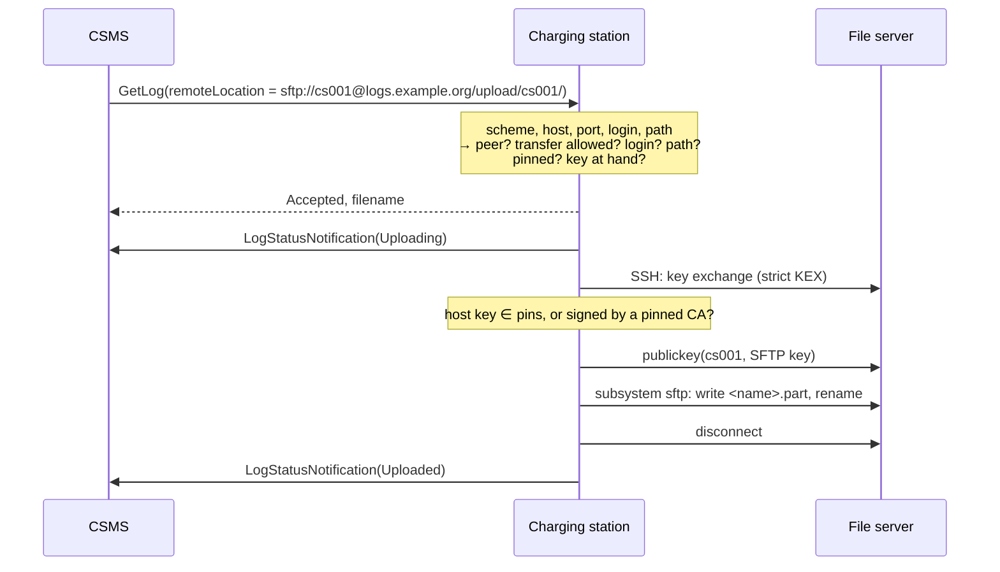

# SFTP for Logfile Uploads and Firmware Downloads

**Version 0.2, Draft**, 2026-11-13
[CC-BY-SA 4.0](https://creativecommons.org/licenses/by-sa/4.0/) · [OpenChargingTechnology/Whitepapers](https://github.com/OpenChargingTechnology/Whitepapers) · reference implementations (planned, chapter 12): [Vanaheimr/Hermod](https://github.com/Vanaheimr/Hermod) (SSH stack, SFTP client and server), [OpenChargingCloud/WWCP_Node](https://github.com/OpenChargingCloud/WWCP_Node) (SSH peers, SFTP areas), [OpenChargingCloud/WWCP_OCPP](https://github.com/OpenChargingCloud/WWCP_OCPP), [OpenChargingCloud/ChargingStation](https://github.com/OpenChargingCloud/ChargingStation), [OpenChargingCloud/LocalController](https://github.com/OpenChargingCloud/LocalController), [OpenChargingCloud/CSMS](https://github.com/OpenChargingCloud/CSMS)

OCPP lets a CSMS ask a charging station to upload its logs and diagnostics to a URL, and to download
its firmware from one. The URL names the protocol, and SFTP is one of them. What OCPP does not say
is how the station knows that the server which answers at that URL is the one that was meant. Over
HTTPS and FTPS a certificate chain answers that, well or badly. Over SFTP nothing does: the request
carries a host name, a port, a login and a path, and no host key.

A station that dials whatever host a request names and takes whatever host key it is shown hands
its logs to anybody who can write that request or sit on that path, and takes its firmware from the
same. This paper closes the gap without a new message:

- **No trust on first use, ever.** A file transfer goes only to a server whose host key the station
  held *before* the request arrived.
- **The server is an SSH peer of the station.** The station reads the host, the port and the login
  from the URL of the request, and looks them up in its own configuration of SSH peers
  ([OCPP over SSH](../OCPP-over-SSH/README.md), section 7.3). There it finds the host keys the
  server may show, whether that server may be used for this kind of transfer, and the key the
  station signs in with.
- **Nothing found, nothing done.** A request that names a server the station does not hold as a
  file server is rejected in its response, before a single packet leaves the station.
- **A key per file server and login.** The station signs in with a key it made for this login at
  this server, and for nothing else.
- **A connection of its own, or a channel of the one that is there.** The station opens an SSH
  connection, checks the host key, signs in, moves the file over the `sftp` subsystem and closes
  the connection. Where a peer says so and the login is the one of the connection the station
  keeps to it anyway, the transfer is one more channel of that connection.

This holds for `GetLog` in all its log types, for `GetDiagnostics` of OCPP 1.6, for
`UpdateFirmware` and `SignedUpdateFirmware`, and for `PublishFirmware` at a Local Controller. To
this paper a diagnostics log, a security log and a firmware image are files to be moved, and
nothing more: what is in them, how they are made and what is done with them is OCPP's and the
vendor's.

*Status*: a draft for discussion. Chapter 12 says what the reference implementations have of it
today, and chapter 13 what was decided on 2026-11-13 and which questions are open.

## Contents

1. [Motivation](#1-motivation)
2. [Design](#2-design)
3. [The URL](#3-the-url)
4. [File servers are SSH peers](#4-file-servers-are-ssh-peers)
5. [From the request to the transfer](#5-from-the-request-to-the-transfer)
6. [Uploads](#6-uploads)
7. [Downloads](#7-downloads)
8. [Configuration and the OCPP Device Model](#8-configuration-and-the-ocpp-device-model)
9. [The station's keys](#9-the-stations-keys)
10. [The file server](#10-the-file-server)
11. [Security considerations](#11-security-considerations)
12. [Implementation status](#12-implementation-status)
13. [Decisions and open questions](#13-decisions-and-open-questions)
14. [Relation to other white papers](#14-relation-to-other-white-papers)
- [References](#references)

---

## 1. Motivation

### 1.1 What OCPP says

| Message | OCPP | Direction of the file | Where the URL is |
|---|---|---|---|
| `GetDiagnostics` | 1.6 | station → server | `location` |
| `GetLog` | 1.6 (security extension), 2.x | station → server | `log.remoteLocation` |
| `UpdateFirmware` | 1.6 | server → station | `location` |
| `SignedUpdateFirmware` | 1.6 (security extension) | server → station | `firmware.location` |
| `UpdateFirmware` | 2.x | server → station | `firmware.location` |
| `PublishFirmware` | 2.x, to a Local Controller | server → Local Controller | `location` |

The station says which protocols it speaks in `OCPPCommCtrlr.FileTransferProtocols` (OCPP 2.x:
`FTP`, `FTPS`, `HTTP`, `HTTPS`, `SFTP`) or `SupportedFileTransferProtocols` (OCPP 1.6). The
credentials, where there are any, travel in the URL. The outcome is reported by
`LogStatusNotification`, `DiagnosticsStatusNotification`, `FirmwareStatusNotification`,
`SignedFirmwareStatusNotification` and `PublishFirmwareStatusNotification`.

### 1.2 What is missing

An `sftp://` URL names a host, a port, a login and a path. An SSH client needs two more things, and
OCPP has a place for neither:

- **The host key of the server.** Without one, the first handshake decides who the server is. An
  interactive user is asked; a station cannot be, and a station that answers "yes" by itself has
  authenticated nobody.
- **The credential of the login.** A password in the URL is a password in every log the request
  passes through. A key has no place in a URL at all.

### 1.3 Why trust on first use is no answer here

For its OCPP connection a station may learn a host key on first use, on probation, until a signed
pin set confirms it ([OCPP over SSH](../OCPP-over-SSH/README.md), section 10.4). That works
because the connection lasts: there is time to confirm, and the station executes nothing before.
A file transfer is over before anybody could confirm anything. The log is gone, or the firmware
image is on the station, at the moment the question would be asked.

And the two directions have different victims:

- **An upload discloses.** Logs hold identifiers of customers, authorization tokens, the station's
  configuration, its neighbours on the network and its faults. Whoever can make a station upload
  them to a host of their choosing has them.
- **A download installs.** A signed image is still checked after the download, and must be. A
  station of OCPP 1.6's plain `UpdateFirmware`, without a signature, has nothing but the server it
  believed.

### 1.4 Non-goals

- A new file transfer protocol, or a change of the OCPP messages. The requests stay as they are.
- Carrying the files inside the OCPP connection. That is what `BinaryDataTransfer` and the bulk
  channels of [EVQI Transport](../EVQITransport/README.md) are for.
- What a log contains, how it is collected and packed, how a firmware image is verified and how
  it is installed. A log and an image are files here (section 2.1, principle 7).
- HTTPS and FTPS. They have their certificates, and
  [TLS Client/Server Configuration](../TLSConfiguration/README.md).

---

## 2. Design

### 2.1 Principles

1. **The request chooses among servers, it never introduces one.** Which servers exist, what they
   may show and what they may be used for is configuration. The URL of a request picks one of
   them, a login and a path.
2. **The configuration is better protected than the request.** A CSMS that may send `GetLog` must
   not be able to make a file server out of any host by the same right
   (section 8.4, decision 3).
3. **Checked before answered.** Everything that can be decided without the network is decided
   before the response, so that a refusal is a `Rejected` and not a failure some minutes later.
4. **No softening.** Trust on first use, `OnPinMismatch` `Record` and `Accept`, and probation do
   not exist for file transfers. A host key that no pin and no CA vouches for ends the transfer.
5. **Keys, not passwords.** The station signs in with a key it made itself and never gave away.
6. **One model for all nodes.** A Local Controller downloads a published firmware image by the
   same rules, and a CSMS that fetches a file from another server would too.
7. **A file is a file.** The transport is handed a file and a place to put it, or a place and
   somewhere to put the file. A `DiagnosticsLog`, a `SecurityLog` and a firmware image differ in
   who makes or uses them, which is OCPP's logic and the vendor's, and in nothing the transport
   sees. So a file server is allowed uploads, downloads or both, and not log types.

### 2.2 Decisions and rejected alternatives

| | Chosen | Rejected, and why |
|---|---|---|
| Where the host key comes from | the station's SSH peer configuration | the URL (`;fingerprint=`), `customData` of the request: trust would come from the very message that is to be checked |
| Trust on first use | never | on probation, as for OCPP: nobody can confirm in time (section 1.3) |
| Connection | of its own, closed after the transfer; a channel of the station's connection to that peer where the peer says `Shared` and the login is that connection's (decision 4) | one way only: a station that dials its Local Controller over SSH has a believed connection there already, and a file server of somebody else has none |
| Credential | a key per file server and login (decision 2) | one `SFTP` key for all file servers: every server could tell which other logins are the same station's, and one key withdrawn would be all of them withdrawn; a password from the URL (question 1) |
| A missing peer | `Rejected` in the response | accepted and failed later: the CSMS would learn it by a time-out |
| Scope of a file server | per peer: which directions, which logins, which paths | every peer for everything: a time server would become a place to send logs to |
| What is transferred | a file, whatever it is | a grant per log type, an archive format, a signature check: OCPP's logic and the vendor's, not the transport's |

---

## 3. The URL

OCPP gives the location as a URL. For SFTP this paper reads it as the expired but widely
implemented [draft-ietf-secsh-scp-sftp-ssh-uri](https://datatracker.ietf.org/doc/html/draft-ietf-secsh-scp-sftp-ssh-uri-04) does:

```
sftp://[<user>[;fingerprint=<fingerprint>]@]<host>[:<port>]/<path>
```

- **`host`** is a DNS name or an IP address literal. It is compared with the address of a peer as
  text: names without regard to case and in their ASCII form (A-labels), addresses in their
  canonical form. A name is never resolved in order to compare it, and a name does not match a
  peer that is configured by its address, or the other way round.
- **`port`** is 22 where the URL names none. Host *and* port find the peer.
- **`user`** is the login of the SSH user authentication. Where the URL names none, it is the
  `UserName` of the peer, and where that is empty the station's own identity.
- **A password** (`user:password@`) is never sent, and a request that carries one is rejected
  (question 1). A password in a URL was written into every log on its way.
- **`;fingerprint=`** is never a source of trust. Where it is present in the notation
  `SHA256:<base64>` and names none of the keys the peer is pinned to, the request is rejected: the
  sender expects another server than the station knows. Other notations are ignored. A `/` of the
  base64 is written `%2F`, as everywhere in a URL before its path; the `:` after `SHA256` is a part
  of the parameter, and no password.
- **`path`**: after the first `/`, percent-decoded once. A path that starts with `~/` is relative
  to the home directory of the login; every other path is absolute. A path with a `..` segment, a
  NUL or a control character after decoding is rejected.
- Query and fragment are rejected: SFTP has neither, and a server would see them as part of a name.

For an upload the path names a **directory**; the station chooses the file name and reports it
(section 6.2). For a download it names the **file**.

---

## 4. File servers are SSH peers

### 4.1 The lookup

A station that speaks SSH has SSH peers: hosts it holds a host key for, by pins or by a CA
([OCPP over SSH](../OCPP-over-SSH/README.md), sections 7.2 and 7.3). A file server is one of them,
with a few variables more (section 8.1). The request is answered from four lookups, all of them in
the station's own configuration:

| | Question | Answered by |
|---|---|---|
| 1 | Is there a peer with this host and port? | `Address`, `Port` |
| 2 | May this peer be used in this direction? | `FileTransfers` |
| 3 | May the station sign in there under this login? | `FileTransferUsers`, `UserName` |
| 4 | May a file go to, or come from, this path? | `UploadPaths`, `DownloadPaths` |

Only when all four say yes does the station take from the same peer what it needs to dial:

- **`HostKeyPins` and `HostCAs`**: who the server is. A peer has at least one of them; a peer with
  neither cannot exist (OCPP over SSH, section 7.3).
- **The private key of the login**: the key the station made for this login at this peer
  (chapter 9). Where the transfer is a channel of the connection the station keeps to the peer
  (section 5.3), that connection's key was used already, and no other is needed.

### 4.2 What a peer is not allowed to be

- **A peer on probation is no file server.** A peer whose host key was learned on first use - the
  host of an `ssh://` network connection profile may be one - takes no file transfer until its key
  is pinned, however its trust is configured.
- **`OnPinMismatch` is `Refuse`**, whatever the peer says for its other channels.
- **A peer is no file server by being a peer.** `FileTransfers` is empty by default: a time
  server, a name server and a Local Controller the station speaks OCPP to are no places to send
  logs to until somebody says so.
- **An SSHFP record makes no peer**, and neither does a host key the server announced by
  `hostkeys-00@openssh.com`.

### 4.3 Address and port

An SSH peer has one address and one port, and a station has one peer per address, as it keeps one
connection to a host ([OCPP over SSH](../OCPP-over-SSH/README.md), section 7.3). A request finds
its file server by both: the host of the URL is the address of the peer, and the port of the URL -
22 where it names none - is the port of the peer. The right host on another port is no file server.

So an SFTP server on a second port of a host that is a peer already, with a host key of its own,
cannot be a second peer under that address. It is entered under a name or address of its own, or
it waits for peers that are found by address and port (question 5).

---

## 5. From the request to the transfer

### 5.1 Before the response



The station answers `Rejected` when

1. the URL is no valid `sftp://` URL as chapter 3 reads it, or carries a password;
2. no peer has that host and port;
3. the peer does not allow this direction, this login or this path;
4. the peer's host key is not pinned (section 4.2), or a `;fingerprint=` of the URL contradicts it;
5. the station has no key for this login at this peer, or the key is not confirmed as enrolled
   (chapter 9) - unless the transfer is a channel of a connection that lasts (section 5.3).

OCPP 2.x responses carry a `statusInfo`, with one of two reason codes:

| `reasonCode` | Cases | |
|---|---|---|
| `InvalidURL` | 1 | The request is malformed, and saying so discloses nothing. |
| `FileServerNotPermitted` | 2 to 5 | One code for all of them: the response does not say which hosts the station knows and which logins it has. The station's own log and the security event (section 8.5) say exactly what was missing. |

Requests without a status in their response are answered as their version allows:

| Request | Refusal |
|---|---|
| `GetLog` (1.6, 2.x) | `Rejected` |
| `UpdateFirmware` (2.x), `SignedUpdateFirmware` (1.6) | `Rejected` |
| `PublishFirmware` (2.x) | `Rejected` |
| `GetDiagnostics` (1.6) | a response without `fileName`, then `DiagnosticsStatusNotification` `UploadFailed` |
| `UpdateFirmware` (1.6) | the empty response, then `FirmwareStatusNotification` `DownloadFailed` |

Every refusal of the cases 2 to 5 is a security event: somebody with the right to send requests
asked the station to move a file to or from a place its configuration does not know.

### 5.2 The connection

1. **Resolve** the host name with the station's own resolvers
   ([Secure Name Resolution](../SecureDNS/README.md)), never those of the operating system.
2. **Connect and exchange keys**, with the algorithms and the strict KEX of
   [OCPP over SSH](../OCPP-over-SSH/README.md), section 11.2.
3. **Check the host key**: it is one of `HostKeyPins`, or a host certificate for the host name of
   the URL signed by one of `HostCAs`, valid and not revoked. Anything else ends the connection
   before the authentication starts, and nothing of the station is sent to that server.
4. **Sign in** with `publickey`, the login of the request and the key of that login at that peer.
   Nothing else is offered: no password, no keyboard-interactive, no other key of the station.
5. **Open one `session` channel with the subsystem `sftp`.** No shell, no `exec`, no forwarding is
   asked for, and none a server offers is taken.
6. **Transfer** (chapters 6 and 7).
7. **Disconnect.** The connection is not kept for a next request.

One transfer runs at a time per direction. A second `GetLog` while an upload is running cancels
the first, as OCPP says (`AcceptedCanceled`); the same holds for `UpdateFirmware`.

### 5.3 As a channel of a connection that is there

A station that dials its Local Controller or its CSMS over SSH keeps a connection to it whose host
key it believes and whose login it is ([OCPP over SSH](../OCPP-over-SSH/README.md), section 7.2).
Where that host is also the file server, a second connection would prove the same things again. So
a peer may say `FileTransferConnection` `Shared` (section 8.1), and then:

- **A request whose login is the login of that connection** - or that names none - opens the
  `sftp` subsystem as one more channel of it: steps 5 and 6 of section 5.2, and the channel is
  closed afterwards, not the connection. Where no connection lasts, it is made as every channel
  has it made, and stays.
- **A request with another login** has a connection of its own, as section 5.2 says, with the key
  of that login.
- **Everything of section 5.1 holds**: the peer is a file server, in this direction, for this
  login and path, and its key is pinned. A connection on probation carries no file, shared or not.
- **The server decides** whether that login may open `sftp`. A station's login is confined to
  OCPP unless the server grants it more (OCPP over SSH, section 5.1), and a refusal is
  `NotSupportedOperation` for an upload and `DownloadFailed` for a download: the station does not
  fall back to a connection of its own under a login the peer's configuration gave no key.
- **A transfer shares the TCP connection with OCPP**, not its flow control: every channel has a
  window of its own. A long transfer over a slow line still competes with the messages; a peer
  where that matters stays `Dedicated`, which is the default.

### 5.4 Failures and retries

`retries` and `retryInterval` of the request are for what may be better a minute later, and for
nothing else:

| What happened | Retried | Upload reported as | Download reported as | Security event |
|---|---|---|---|---|
| name not resolved, connection refused or timed out, connection lost | yes | `UploadFailure` after the last try | `DownloadFailed` after the last try | - |
| no common algorithm, no strict KEX | no | `UploadFailure` | `DownloadFailed` | `InvalidSSHAlgorithms` |
| host key neither pinned nor signed by a pinned CA | **no** | `UploadFailure` | `DownloadFailed` | `InvalidFileServerHostKey` |
| login refused | no | `PermissionDenied` | `DownloadFailed` | `FailedToAuthenticateAtFileServer` |
| no `sftp` subsystem | no | `NotSupportedOperation` | `DownloadFailed` | - |
| `SSH_FX_PERMISSION_DENIED`, `SSH_FX_NO_SUCH_FILE` | no | `PermissionDenied` | `DownloadFailed` | - |
| the name of the upload, or its `.part`, is taken | no | `UploadFailure` | - | - |
| quota, disk full, other `SSH_FX_FAILURE` | yes | `UploadFailure` after the last try | `DownloadFailed` after the last try | - |

A wrong host key is final for the request. A retry would only ask the same attacker again, and a
server whose key really changed needs a new pin, not a new attempt. OCPP 1.6 has fewer status
values; there every failed upload is `UploadFailed`.

---

## 6. Uploads

### 6.1 What is covered

`GetLog` with every `logType` (`DiagnosticsLog`, `SecurityLog`, and `DataCollectorLog` of OCPP
2.1), and `GetDiagnostics` of OCPP 1.6. To the transport they are one thing: a file of the
station, sent away.

### 6.2 What the transport is given, and what it does

The logic above it - OCPP's and the vendor's - decides what the file is: which log, of which time
window, one file or an archive of several, signed or not. It hands the transport **a file and its
name**, and the name is what the response of the request reports. The transport does the rest:

- **Written under another name, then renamed.** The station writes `<name>.part` and renames it
  when the last byte is acknowledged. A consumer on the server never reads half a file.
- **Never over a file that is there.** The station looks whether `<name>` or `<name>.part` is
  there, opens `<name>.part` with `SSH_FXF_CREAT | SSH_FXF_EXCL`, and renames with the plain
  `SSH_FXP_RENAME`, which fails where the name was taken meanwhile - not with
  `posix-rename@openssh.com`, which would write over it. A name that is taken is a failure of the
  upload, and is not tried again; so a name should carry what makes it unique: the station's
  identity, the `requestId`, the time. A `.part` that an attempt before left behind is neither
  written over nor removed: it may be somebody else's. The station does not list, read, delete or
  overwrite anything else on the server, and a server should not let it (chapter 10).
- **A retry starts anew.** An upload is not resumed: the station cannot read what arrived, and
  must not have to.
- **Progress and outcome are told to the logic above**, which reports them:
  `LogStatusNotification` `Uploading` before the connection is made, `Uploaded` after the
  rename, and the failures by the table of section 5.4.

---

## 7. Downloads

### 7.1 What is covered

`UpdateFirmware` of OCPP 1.6 and 2.x, `SignedUpdateFirmware` of OCPP 1.6, and `PublishFirmware`
at a Local Controller. To the transport they are one thing: a file of a server, fetched.

### 7.2 What the transport does, and what it hands over

- **Into a place of its own**, with the size limited before the first byte: the station asks for
  the attributes of the file, and refuses what is larger than it may hold
  (`FileTransferMaxDownloadSize`, section 8.2).
- **Resumed after an interruption.** SFTP reads at an offset. A retry continues where the last
  attempt stopped when size and modification time of the remote file are what they were, and
  starts anew otherwise. `DownloadPaused` (OCPP 2.x) says that the station waits for its next
  attempt.
- **Read only.** The station opens the file for reading and nothing else.
- **`retrieveDateTime`** is when the connection is made. The check of section 5.1 happens when the
  request arrives *and* again then: a peer that is no file server any more at that time is not
  dialled.
- **Handed over complete, or not at all.** The logic above gets the file once its last byte is
  there, and reports `Downloaded`. What follows is that logic's: the check of
  `signingCertificate` and `signature`, the installation, the further status notifications.

### 7.3 What the transport does not replace

The host key authenticates the server, not the file. A believed server may hold an old image with
a known weakness, or a wrong one, and a server that was taken over serves what it likes. Whether an
image is genuine and whether it may be installed is decided after the download, by the signature
and the version, in OCPP's logic and the vendor's. For the unsigned `UpdateFirmware` of OCPP 1.6
the transport gives what it can - a server the station believed, a login that server knows - and
that is more than `http://` and `ftp://` give, and less than a signature.

### 7.4 A Local Controller

`PublishFirmware` asks a Local Controller to fetch an image and to offer it to its stations. Both
halves fit this paper:

- **The Local Controller downloads** as a station does: the file server is one of its SSH peers,
  with `Download` allowed.
- **The Local Controller publishes** under `sftp://` on its own SSH server, in a read-only area
  (chapter 10), and names that URL in `PublishFirmwareStatusNotification`. Its stations dial it
  over SSH already, or hold its host key for that; the CSMS then sends them `UpdateFirmware` with
  the Local Controller's URL. A station behind a Local Controller needs no route to the Internet
  to be updated, and no certificate to believe its Local Controller.

In the other direction a Local Controller can be the file server its stations upload to, and pass
the files on. That is storage and forwarding on the Local Controller, and not specified here.

---

## 8. Configuration and the OCPP Device Model

### 8.1 Per peer: `SSHPeerController`

The instances of `SSHPeerController` ([OCPP over SSH](../OCPP-over-SSH/README.md), section 7.3)
get seven variables more:

| Variable Name | req/opt | Mutability | Data Type | Default Value | Values List / Limits | Description |
|---|---|---|---|---|---|---|
| FileTransfers | optional | rw | MemberList | "" | `Upload`, `Download` | The directions this peer may be used in as a file server, whatever the file is. Empty: it is none. |
| FileTransferUsers | optional | rw | string | "" | comma separated, ≤ 8, each ≤ 32 characters | The logins a request may name. Empty: only `UserName`, or the station's own identity where that is empty too. |
| UploadPaths | optional | rw | string | "" | comma separated, ≤ 8, each ≤ 255 characters | Directories an upload may go to, each with everything below it. Empty: none, even where `FileTransfers` has `Upload`. An operator who wants security logs apart from diagnostics names two directories, and the CSMS sends each request to its own. |
| DownloadPaths | optional | rw | string | "" | comma separated, ≤ 8, each ≤ 255 characters | Directories a download may come from, each with everything below it. Empty: none. |
| FileTransferConnection | optional | rw | OptionList | `Dedicated` | `Dedicated`, `Shared` | `Shared`: a request whose login is the login of the station's connection to this peer goes as one more channel of it (section 5.3). `Dedicated`: every transfer has a connection of its own. |
| FileTransferPublicKey | optional | ro | string | "" | one variable instance per login | The public key the station signs in with under this login at this peer, as a line of `authorized_keys` (chapter 9). The instance is the login, and there is one for every entry of `FileTransferUsers`. |
| FileTransferPendingPublicKey | optional | ro | string | "" | one variable instance per login | The next key of that login during a rotation; empty otherwise. |

`{id}` in a path stands for the station's identity, so that one value serves a fleet:
`UploadPaths` `/upload/{id}/`.

The variables this paper relies on and does not change: `Address`, `Port`, `UserName`,
`HostKeyPins`, `HostCAs`. `OnPinMismatch` is not read for a file transfer.

A peer of a station that speaks OCPP over a WebSocket and SSH for nothing but its files:

| Variable | Value |
|---|---|
| `SSHPeerController.Peers` | `files` |
| `SSHPeerController[files].Address` | `logs.example.org` |
| `SSHPeerController[files].Port` | `2222` |
| `SSHPeerController[files].HostKeyPins` | `SHA256:hOEj1ea61PSArpO3/qj2Drlp024D2eiJ7DJQNNLl+hU` |
| `SSHPeerController[files].FileTransfers` | `Upload,Download` |
| `SSHPeerController[files].FileTransferUsers` | `cs001` |
| `SSHPeerController[files].UploadPaths` | `/upload/{id}/` |
| `SSHPeerController[files].DownloadPaths` | `/firmware/` |
| `SSHPeerController[files].FileTransferPublicKey[cs001]` | `ssh-ed25519 AAAAC3NzaC1lZDI1NTE5AAAAI… cs001@files` (read only) |

With it, `sftp://cs001@logs.example.org:2222/upload/cs001/` is a place for logs, and
`sftp://cs001@logs.example.org:2222/firmware/station-4.2.1.bin` a place firmware comes from.
`sftp://cs001@logs.example.org/upload/cs001/` is neither: port 22 is not the port of that peer.

### 8.2 Station-wide

| Component | Variable | Mutability | Data Type | Default | Description |
|---|---|---|---|---|---|
| `OCPPCommCtrlr` | FileTransferProtocols | ro | MemberList | - | Lists `SFTP` when the station can speak it, whether or not a peer is a file server yet. |
| `SSHPeerController` | FileTransferConnectTimeout | rw | integer (s) | 30 | From the first packet to the open `sftp` channel. |
| `SSHPeerController` | FileTransferIdleTimeout | rw | integer (s) | 60 | Without a byte moving, a transfer counts as lost (and is retried). |
| `SSHPeerController` | FileTransferMaxDownloadSize | rw | integer (bytes) | station-specific | A file larger than this is not downloaded. |

### 8.3 OCPP 1.6

`SupportedFileTransferProtocols` lists `SFTP`. The SSH peers have their configuration keys in
[OCPP over SSH](../OCPP-over-SSH/README.md), section 9.5: `sshPeers`, and per peer
`sshPeer.<name>.url`, `.hostKeyPins`, `.hostCAs` and the others. A file server has more,
named and read like the variables of section 8.1: `sshPeer.<name>.fileTransfers`,
`.fileTransferUsers`, `.uploadPaths`, `.downloadPaths` (CSL strings, rw), `.fileTransferConnection`
(rw), and per login `sshPeer.<name>.fileTransferPublicKey.<login>` and
`.fileTransferPendingPublicKey.<login>` (ro). A peer is added by its `url` with its pins, as that section says,
and is no file server until `fileTransfers` is written. The station-wide values of section 8.2
are `sshPeers.fileTransferConnectTimeout`, `sshPeers.fileTransferIdleTimeout` and
`sshPeers.fileTransferMaxDownloadSize`.

### 8.4 Who may make a file server

A CSMS that could add a peer with `SetVariables` and name it in a `GetLog` a second later would
have configured nothing in advance. The rule of this paper is only as strong as the write of the
peer, so that write needs more than the right to send requests:

- **On the station**: its web interface, its command line and its configuration file, by an
  account with the right to configure its connections.
- **Over OCPP**: a write of `Address`, `Port`, `HostKeyPins`, `HostCAs`, `FileTransfers`,
  `FileTransferUsers`, `UploadPaths`, `DownloadPaths` or `FileTransferConnection` is taken only
  from a request signed by a
  signer of pin sets the station believes, as the pins of `SSHClientController` are
  (OCPP over SSH, section 10.4); unsigned, each entry is `Rejected` with the reason code
  `Unsigned` (decision 3).

With that, the party that operates the OCPP connection - a CSMS, a Local Controller in between, or
whoever took one of them over - can choose among the file servers the operator's security role
approved, and cannot add one.

### 8.5 Security events

| Security event | Critical | When |
|---|---|---|
| `FileTransferRefused` | yes | A request named a file server, a login or a path the configuration does not allow (section 5.1, cases 2 to 5). TechInfo: the action, the URL without its userinfo, and what was missing. |
| `InvalidFileServerHostKey` | yes | A file server showed a host key that neither a pin nor a CA vouches for. TechInfo: the peer, the fingerprint shown. |
| `FailedToAuthenticateAtFileServer` | no | The file server did not take the station's key. |
| `InvalidSSHAlgorithms` | yes | (OCPP over SSH) Only algorithms the station must not use, or no strict KEX. |
| `ReconfigurationOfSecurityParameters` | no | (existing) A peer became a file server, ceased to be one, or what it allows changed. |

---

## 9. The station's keys

### 9.1 A key per file server and login

The station signs in at a file server with a key of its own for that login at that server
(decision 2): one Ed25519 key pair for every entry of `FileTransferUsers` of every peer, made by
the station itself, kept where only its own process may read it, and never exported. This is the
purpose `SFTP` of [OCPP over SSH](../OCPP-over-SSH/README.md), section 10.1, which is a family of
keys here and not one key:

- **Made when the login is.** The key pair is made when a login is added to `FileTransferUsers`,
  or at the first read of its `FileTransferPublicKey`, whichever comes first.
- **Gone when the login is.** A login taken out of `FileTransferUsers`, or a peer that is one no
  longer, has its private keys deleted. Added again, it gets new ones. So does a peer whose
  address or port changes: under the same name it is another server, and its keys were never
  shown there.
- **Not shared.** Two file servers cannot tell from the keys that two logins are the same
  station's, a key that leaked from one login opens no other, and a server operated by somebody
  else is given a key that is good for nothing but that server.
- **`SSHClientController.ClientPublicKey[SFTP]`**, the one key of that purpose the station had
  before, is not used for file transfers, and reads empty.

### 9.2 Enrolment

The server needs the `authorized_keys` line of the login. The station shows it in
`FileTransferPublicKey` of the peer, on its web interface and its command line, and over OCPP with
the messages of OCPP over SSH, section 9.3, which get two optional fields for it:

| Message | Field | Type | Card. | Description |
|---|---|---|---|---|
| `SignSSHKey`, `SSHKeySigned` | `peer` | string[0..50] | 0..1 | With the purpose `SFTP`: the name of the file server, as in `SSHPeerController.Peers`. |
| `SignSSHKey`, `SSHKeySigned` | `login` | string[0..32] | 0..1 | With the purpose `SFTP`: the login the key is for. |

- The CSMS asks with `TriggerMessage`, `customTrigger` `SignSSHKey:SFTP:<peer>:<login>`, and the
  station answers with `SignSSHKey`; it sends one by itself when a login is added, and when a key
  reaches its `ClientKeyMaxAge[SFTP]`.
- The CSMS installs the key where that login lives - in its own store, by `InstallSSHKey` at a
  Local Controller, by whatever the operator's SFTP server takes - and answers `SSHKeySigned` with
  the same `peer` and `login`.
- **Not used before it is confirmed.** Until an `SSHKeySigned` or a confirmation on the station
  itself, a request for that login is rejected (section 5.1, case 5): the server would refuse the
  login anyway.

### 9.3 Rotation

As OCPP over SSH, section 10.3, per key: the new key is shown in `FileTransferPendingPublicKey` and
sent with `SignSSHKey`; after `SSHKeySigned` the station offers the new key first and the old one
second. As a file transfer connects rarely, the old key is kept until the first transfer succeeded
with the new one, or the CSMS withdraws it.

### 9.4 The key of a shared connection

A transfer that is a channel of the station's connection to the peer (section 5.3) was signed in
with that connection's key, the station's own (`Station`). No key of this chapter is made for the
login of that connection unless it is also listed in `FileTransferUsers` for a peer that is
`Dedicated`.

### 9.5 Certificates

A user certificate for a key, returned in `SSHKeySigned`, lets a file server trust one CA line in
place of a line per station and login (OCPP over SSH, section 10.5).

---

## 10. The file server

Any SFTP server will do. What it should be, for this paper to hold what it promises:

| | Requirement |
|---|---|
| Logins | One per station, named in the URL. A fleet login shared by all stations lets each station write as any other. |
| Authentication | `publickey` only, with the key the station made for that login at this server, or a certificate for it. |
| What a login may do | The `sftp` subsystem, and nothing else: no shell, no `exec`, no forwarding, no agent. |
| Uploads | A directory per station that takes new files and nothing else: no listing, no reading, no overwriting, no deleting, no renaming but of the station's own `.part` file, and that never over a file. A quota. A station that cannot see whether a name is taken learns it from the open or the rename. |
| Downloads | Read-only, and only the images that station may have. |
| Host key | Stable, and announced to the stations (as a pin) *before* it changes: two pins for the time of a change. Or a host certificate of a CA the stations hold. |
| What arrives | Is untrusted input: a file name and a file from a device in the field. |

A sketch for OpenSSH, untested:

```
# /etc/ssh/sshd_config
Match Group stations
    ChrootDirectory /srv/stations/%u
    ForceCommand internal-sftp -u 0077
    AuthenticationMethods publickey
    PasswordAuthentication no
    AllowTcpForwarding no
    AllowAgentForwarding no
    X11Forwarding no
    PermitTTY no
```

with `/srv/stations/cs001` owned by root, an `upload` directory in it the station may write to, and
a `firmware` directory it may only read. OpenSSH alone does not make a directory write-only; a
mover that takes finished files out of `upload` gives nearly the same.

In the reference implementations a node's SSH server already serves virtual SFTP areas per role
(logs and logos). An upload area per station and a firmware area, for logins of the purpose
`SFTP`, are two more areas of the same kind on a Local Controller and a CSMS; the `.part` name is
held as the `.filepart` of WinSCP is today.

---

## 11. Security considerations

### 11.1 What this is against

| Attacker | Without this paper | With it |
|---|---|---|
| On the path between station and file server | answers the handshake, receives the logs, serves the firmware | shows a host key the station does not hold; the transfer ends before anything is sent |
| Controls DNS for the server's name | the same, from anywhere | the same as above: the name was only a way to the pinned key |
| Can send OCPP requests (a CSMS taken over, a Local Controller, a stolen operator account) | names their own server in `GetLog` and collects the logs of the fleet | is refused in the response, and reported, unless they can also sign as the security role (section 8.4) |
| Took over an approved file server | has what is uploaded from then on, and serves what they like | unchanged for uploads: the peer was believed. A firmware image is still held to its signature, by the logic above (section 7.3) |
| Has the key of one login at one file server | signs in as that login, there | can write into that station's upload directory and read its firmware, and nothing else, if the server is as chapter 10 says |

### 11.2 What it is not against

- **A file server that is believed and should not be.** A pin says who the server is, not what it
  does with the logs.
- **Old firmware.** A believed server may hold an old signed image. Protection against a downgrade
  is the station's, by the version it is willing to install.
- **The content of logs.** What must not leave the station must not be in the log; the transport
  cannot know.

### 11.3 Rules that are easy to get wrong

- **The comparison of the host is textual** (chapter 3). A station that resolves the name and
  compares addresses lets DNS decide which peer a request means.
- **The check happens twice for a transfer that is scheduled**: when the request arrives and when
  the connection is made (section 7.2).
- **The response says little** (section 5.1). The reason codes do not tell the sender of a request
  which peers a station has.
- **No fallback.** A station that cannot reach its file server over SFTP does not try the same
  host over FTP or HTTP, and a rejected `sftp://` request is not a reason to accept a weaker URL
  next. Whether weaker protocols are listed in `FileTransferProtocols` at all is the operator's
  decision, and a station that lists `SFTP` and `HTTPS` only is the recommended one.
- **Nothing of the station before the host key.** The login name is sent after the key exchange,
  and after the check of the host key; a wrong server does not even learn who asked.

---

## 12. Implementation status

Nothing of this paper is built yet. What the reference implementations have of its parts:

| | Today |
|---|---|
| SFTP client | Hermod has one: upload, download, streams with offsets, `posix-rename@openssh.com`, `limits@openssh.com`. |
| SSH peers | WWCP_Node keeps the peers of a node and one shared connection to each; the station adds the hosts of its `ssh://` connections. A peer has no file transfer variables. |
| `SSHPeerController` | [OCPP over SSH](../OCPP-over-SSH/README.md), section 12.3, names it as built for OCPP 2.1, with the configuration keys of OCPP 1.6. It was not on the master branches of WWCP_OCPP and ChargingStation when this draft was written. |
| The keys | The station makes and rotates one key of the purpose `SFTP`, shown as `ClientPublicKey[SFTP]`; nothing signs in with it. There are no keys per file server and login, and `SignSSHKey` has no `peer` and `login`. |
| A shared connection | WWCP_Node hands out the node's connection to a peer for one more channel of a subsystem; nothing asks it for `sftp`. |
| `GetLog`, `GetDiagnostics`, `UpdateFirmware` | The messages exist in WWCP_OCPP for 1.6 and 2.x. The station nodes answer `Accepted` and transfer nothing. |
| `FileTransferProtocols` | The station nodes of WWCP_OCPP list `HTTPS`. |
| SFTP server | A node serves SFTP areas for its accounts (logs, logos); a station's login gets OCPP only, and there is no upload or firmware area. |
| `InstallSSHKey` with the purpose `SFTP` | The Local Controller installs keys of the station's own purpose only. |

---

## 13. Decisions and open questions

### 13.1 Decisions

Decided on 2026-11-13:

1. **Where file servers live:** they are instances of `SSHPeerController`, and of nothing else,
   found by address and port. A Local Controller the station dials over `ssh://`, whose pins are
   in `SSHClientController` today, is entered there as well to be a file server (section 4.1,
   section 8.1).
2. **Keys:** one key per file server and login, made by the station (chapter 9). The one key of
   the purpose `SFTP` is not used for file transfers; `SignSSHKey` and `SSHKeySigned` say which
   peer and login a key is for.
3. **Signed writes:** a write over OCPP that makes or changes a file server is taken only when a
   signer of pin sets signed it (section 8.4). Without that, "configured in advance" would mean
   "configured one message earlier".
4. **Connections:** a connection of its own, or - where the peer says `Shared` and the login is
   the one of the station's connection to it - a channel of that connection (sections 5.2, 5.3).
5. **What a file is:** a diagnostics log, a security log and a firmware image are files to be
   transferred, and everything else about them is OCPP's logic and the vendor's (section 2.1,
   principle 7). So a file server is allowed directions and not log types (section 8.1), and the
   transport packs no archive and checks no signature (sections 6.2, 7.3).

### 13.2 Open questions

1. **A password in the URL.** *Proposed*: rejected. The alternative is a switch per peer,
   `AllowPassword`, for servers of others that take no keys.
2. **`OnPinMismatch` `Record` on a test bench.** *Proposed*: no exception; a test bench pins its
   key like everybody else.
3. **A Local Controller as file server for its stations' uploads** (section 7.4): now, or after
   the download half? *Proposed*: after.
4. **Standardization.** The reason codes, the security events, the variables and the two fields
   of `SignSSHKey` are proposals for OCPP, together with OCPP over SSH.
5. **Two SSH servers on one host.** A peer is found by its address, so a file server on another
   port of a host that is a peer already needs a name of its own (section 4.3). *Proposed*: left
   as it is until somebody has such a host.

---

## 14. Relation to other white papers

- [OCPP over SSH](../OCPP-over-SSH/README.md): the SSH peers (sections 7.2, 7.3), the station's
  keys and their enrolment (sections 9.2, 9.3, chapter 10), the algorithms (section 11.2) and the
  signed pin sets (section 10.4) this paper builds on. Its section 7.2 announced SFTP for logs and
  firmware as a channel of the shared connection; here that is one of two ways (decision 4). Its
  decision 9, one key per purpose, becomes a key per file server and login for `SFTP`
  (decision 2), and its `SignSSHKey` and `SSHKeySigned` get `peer` and `login` (section 9.2).
- [Key Pins and TLS 1.3 Raw Public Keys for Local Controllers](../EVQITransport/RawPublicKeys.md):
  who signs a pin set, section 5.7.
- [Signed OCPP Messages and Signer Roles](../SignedMessages/README.md): the signature that a write
  of a file server needs (section 8.4), and the roles behind it.
- [Secure Name Resolution](../SecureDNS/README.md): how the host name of the URL is resolved
  (section 5.2).
- [OCPP 2.x Firmware Updates with Software Separation](../FirmwareUpdateSeparation/README.md):
  what is done with an image once it is on the station.
- [Advanced Diagnostics](../AdvancedDiagnostics/README.md): what `GetLog` is asked for.
- [TLS Client/Server Configuration](../TLSConfiguration/README.md): the same question for HTTPS
  and FTPS.
- [EVQI Transport](../EVQITransport/README.md): bulk channels, for files inside the OCPP
  connection.

## References

- [RFC 4251](https://datatracker.ietf.org/doc/html/rfc4251), [RFC 4252](https://datatracker.ietf.org/doc/html/rfc4252), [RFC 4253](https://datatracker.ietf.org/doc/html/rfc4253), [RFC 4254](https://datatracker.ietf.org/doc/html/rfc4254): the Secure Shell protocol
- [draft-ietf-secsh-filexfer-02](https://datatracker.ietf.org/doc/html/draft-ietf-secsh-filexfer-02): SSH File Transfer Protocol, version 3
- [draft-ietf-secsh-scp-sftp-ssh-uri-04](https://datatracker.ietf.org/doc/html/draft-ietf-secsh-scp-sftp-ssh-uri-04): URI scheme for SFTP
- [OpenSSH PROTOCOL](https://cvsweb.openbsd.org/src/usr.bin/ssh/PROTOCOL): `posix-rename@openssh.com`, `limits@openssh.com`, `hostkeys-00@openssh.com`
- [OpenSSH PROTOCOL.certkeys](https://cvsweb.openbsd.org/src/usr.bin/ssh/PROTOCOL.certkeys): SSH certificates
- [draft-ietf-sshm-strict-kex](https://datatracker.ietf.org/doc/draft-ietf-sshm-strict-kex/): strict KEX
- Open Charge Alliance: OCPP 1.6 with *Improved security for OCPP 1.6-J*; OCPP 2.0.1 and 2.1, use cases L01 to L03 (firmware) and N01 (logs)

## License

© 2026 GraphDefined GmbH

This document is published under the
[Creative Commons Attribution Share Alike 4.0 International (CC-BY-SA 4.0)](https://creativecommons.org/licenses/by-sa/4.0/).
You are free to share, adapt, and build upon it, even for commercial purposes, as long as you give
appropriate credit and distribute your work and contributions under the same license.

Verbatim quotations from the OCPP specifications remain © Open Charge Alliance and are subject to
their license (CC BY-ND 4.0).
