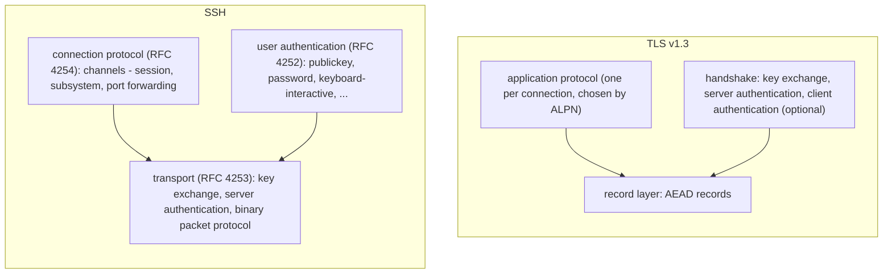
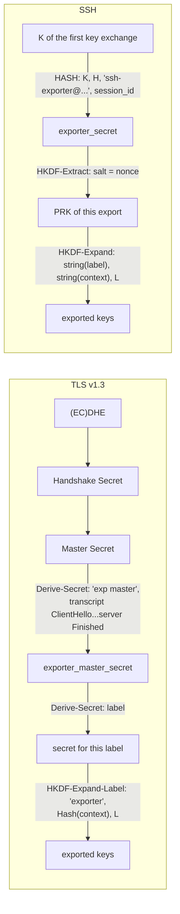

# SSH Keying Material Exporter

**Version 0.1, Draft**, 2026-11-26
[CC-BY-SA 4.0](https://creativecommons.org/licenses/by-sa/4.0/) · [OpenChargingTechnology/Whitepapers](https://github.com/OpenChargingTechnology/Whitepapers) · reference implementation: [Vanaheimr/Hermod](https://github.com/Vanaheimr/Hermod) (`SshExporter`) · first user: [NTS Key Establishment over SSH](../NTS-over-SSH/README.md)

The Transport Layer Security (TLS) protocol has had a ***Keying Material Exporter*** since [RFC 5705](https://datatracker.ietf.org/doc/rfc5705) in March 2010. An application layer protocol that runs inside a TLS connection can ask it for keys that only the two ends of this one connection know. SSH has never had one. This white paper defines one, **`ssh-exporter@open.charging.cloud`**, independently of any protocol that uses it. It also compares the exporter with that of TLS v1.3, and the encrypted connections of TLS and SSH with each other, because the design follows from where the two differ.

It answers four questions:

1. How do two TLS v1.3 connections and two SSH connections differ in what they protect, how they authenticate, and what an observer sees?
2. How does the TLS v1.3 exporter work, and which of its properties do protocols built on it rely on?
3. How does an SSH connection export keys that are as good, and why does the SSH exporter need a nonce where the TLS exporter does not?
4. What does a protocol designer have to decide when moving a protocol that uses the TLS exporter to SSH?

The exporter was first specified as option A of the white paper [NTS Key Establishment over SSH](../NTS-over-SSH/README.md) (section 4.3), and as method `0x0001` of its [SSH Key Binding record](../NTS-over-SSH/nts-ke-ssh-key-binding.md) (section 5.2). Section 4.5 of that white paper asks for it to be specified on its own, because other protocols over SSH can use it as well. This document does so. The construction, the label in the hash and the test vectors are unchanged, so an implementation of either document is one of the other.


## 1. Terms and Notation

The key words **MUST**, **MUST NOT**, **SHOULD**, **SHOULD NOT** and **MAY** are to be interpreted as described in [RFC 2119](https://datatracker.ietf.org/doc/html/rfc2119) and [RFC 8174](https://datatracker.ietf.org/doc/html/rfc8174) when, and only when, they appear in all capitals.

| Term | Meaning |
|---|---|
| `\|\|` | concatenation of octet strings |
| `string(x)` | the SSH encoding of [RFC 4251, section 5](https://datatracker.ietf.org/doc/html/rfc4251#section-5): a `uint32` length in network byte order, followed by the octets of `x` |
| `HASH` | the hash function of the SSH key exchange method, e.g. SHA-256 for `curve25519-sha256` and SHA-512 for `sntrup761x25519-sha512` |
| `K` | the shared secret of an SSH key exchange, encoded as the key exchange method encodes it for its own key derivation: as `mpint` for the classical methods, as `string` for the hybrid post-quantum ones |
| `H` | the exchange hash of an SSH key exchange ([RFC 4253, section 8](https://datatracker.ietf.org/doc/html/rfc4253#section-8)) |
| `session_id` | the session identifier: `H` of the first key exchange of a connection ([RFC 4253, section 7.2](https://datatracker.ietf.org/doc/html/rfc4253#section-7.2)) |
| HKDF | the HMAC-based key derivation function of [RFC 5869](https://datatracker.ietf.org/doc/html/rfc5869), with its two steps HKDF-Extract and HKDF-Expand |
| exporter | a function `Exporter(label, context, L)` that returns `L` octets which only the two ends of one connection can compute |
| channel binding | a value that names one connection, so that an authentication in a higher layer can be tied to it ([RFC 5056](https://datatracker.ietf.org/doc/html/rfc5056)). It need not be secret, only unique |


## 2. Two Ways to Protect a Connection

TLS and SSH both turn a TCP connection into one that is confidential and authenticated. They were designed for different jobs, though. TLS secures *one* application protocol, usually HTTP, between a client that knows the server's name and a server with a certificate for it. SSH secures *a session* between a user and a host, and several channels of it at once. The differences below are the ones that matter when keys are exported. The table at the end of the section sums them up.


### 2.1 Layers



TLS v1.3 is one protocol with two parts: the handshake, which agrees on keys and authenticates, and the record layer, which carries the handshake after its first flight and then the application data. Client authentication is part of the handshake, or a post-handshake message.

SSH is three protocols stacked on each other. The *transport* agrees on keys and authenticates the server. *User authentication* runs inside the encrypted transport, as a protocol of its own. Only afterwards does the *connection protocol* open channels. An SSH connection without an authenticated user carries no data, while a TLS connection without an authenticated client usually does.


### 2.2 Key Exchange and Negotiation

**TLS v1.3**: the client sends its offers in the `ClientHello`, with a key share of its preferred group. The server chooses one cipher suite, one group and one signature algorithm, and answers with its key share in the `ServerHello`. Everything after the `ServerHello` is already encrypted. The client can send application data after one round trip (1-RTT). If the server needs a key share of another group, a `HelloRetryRequest` costs one more round trip.

**SSH**: both ends send a `SSH_MSG_KEXINIT` with their lists of algorithms, without waiting for each other. For every category, the algorithm chosen is the first one on the *client's* list that the server also has, with further conditions for the key exchange and host key algorithms. Encryption, MAC and compression are negotiated separately for each direction. The key exchange itself follows, then `SSH_MSG_NEWKEYS`, then the service request and the user authentication. Altogether an SSH connection needs several more round trips than TLS v1.3 before the first data can flow.

SSH uses ephemeral (EC)DH in every key exchange method in use today, and TLS v1.3 in every full handshake; only a TLS v1.3 resumption in the mode `psk_ke` goes without. Both therefore have forward secrecy: a later theft of a long-term key does not reveal earlier keys. Both have hybrid post-quantum key exchanges, TLS v1.3 the group `X25519MLKEM768`, SSH the methods `mlkem768x25519-sha256` and `sntrup761x25519-sha512`. An exporter inherits that protection, in TLS as in SSH.


### 2.3 Server Authentication and Trust

**TLS v1.3**: the server sends its certificate chain and a `CertificateVerify`, a signature over the transcript of the handshake so far. The client validates the chain against its trust anchors and checks the server's name in the certificate. Raw public keys ([RFC 7250](https://datatracker.ietf.org/doc/html/rfc7250)) are possible, but rare.

**SSH**: the server signs the exchange hash `H` with its host key. `H` covers both version strings, both `KEXINIT` messages, the host key itself and both key exchange values. The client checks the host key against a pinned key (`known_hosts`), or against an SSH certificate authority that signed an OpenSSH certificate for it. There is no chain and no revocation list of X.509 kind, and the server's name is checked against the pinned key or the certificate's principals, not against a certificate's subject.

In both protocols the server's signature covers the key exchange. In both, therefore, nobody between the two ends can choose the keys without the server's private key.


### 2.4 Client Authentication

**TLS v1.3**: a client certificate is requested by the server (`CertificateRequest`) and sent in the handshake with a `CertificateVerify`. It is optional, and in most deployments missing: the application protocol authenticates the client instead, for example by HTTP Basic Authentication or a token.

**SSH**: user authentication always takes place, as a protocol of its own after the key exchange. A user name is always sent. A server may accept the method `none`, but no server that wants to know who connects does. The methods can be combined (`partial success`), and a server can ask for several of them. The `publickey` method signs the `session_id` together with the request, so a signature for one connection is worthless on any other ([RFC 4252, section 7](https://datatracker.ietf.org/doc/html/rfc4252#section-7)).

The consequence for exporters: in TLS v1.3 the exporter is derived *before* the client has authenticated (section 3.2), and in SSH as well (section 4.4). In neither protocol does the exporter say who the client is. In SSH, however, a protocol that uses the exporter inside a channel knows that the client has authenticated, because channels exist only afterwards.


### 2.5 What an Observer Sees

| | TLS v1.3 | SSH |
|---|---|---|
| software of the peers | nothing directly | both version strings, e.g. `SSH-2.0-OpenSSH_10.0` |
| algorithms offered | the `ClientHello` | both `KEXINIT` messages |
| name of the server | the Server Name Indication, unless the client uses Encrypted Client Hello (ECH) | none is sent |
| identity of the server | encrypted (the certificate is sent after the `ServerHello`) | the host key, in the clear in the key exchange reply |
| identity of the client | encrypted (client certificate) | encrypted (user name, user key) |
| application protocol | ALPN, in the `ClientHello` | encrypted (channel type, subsystem name) |
| sizes and timing | record lengths, unless padded | packet lengths with EtM and AES-GCM; with `chacha20-poly1305@openssh.com` and encrypt-and-MAC they are encrypted, though TCP still shows approximate sizes |

Neither protocol hides that it is used. SSH shows the server's identity to a passive observer, while TLS v1.3 shows what the client asks for. Inside a private charging network, the host key that an observer sees is the same one every station has pinned anyway.


### 2.6 Key Derivation

**TLS v1.3** has a key schedule of three stages ([RFC 8446, section 7.1](https://datatracker.ietf.org/doc/html/rfc8446#section-7.1)). Each stage is an HKDF-Extract that adds one input, and each secret is derived over the transcript hash of the messages up to that point:

```
Early Secret     = HKDF-Extract(0, PSK)                      # PSK = 0 without resumption
Handshake Secret = HKDF-Extract(Derive-Secret(Early Secret, "derived", ""), (EC)DHE)
Master Secret    = HKDF-Extract(Derive-Secret(Handshake Secret, "derived", ""), 0)

client/server_handshake_traffic_secret = Derive-Secret(Handshake Secret, "c/s hs traffic", ClientHello...ServerHello)
client/server_application_traffic_secret_0 = Derive-Secret(Master Secret, "c/s ap traffic", ClientHello...server Finished)
exporter_master_secret                 = Derive-Secret(Master Secret, "exp master",     ClientHello...server Finished)
resumption_master_secret               = Derive-Secret(Master Secret, "res master",     ClientHello...client Finished)
```

`Derive-Secret(S, label, messages)` is `HKDF-Expand-Label(S, label, Transcript-Hash(messages), Hash.length)`, and `HKDF-Expand-Label` puts the prefix `"tls13 "` before every label. Handshake and application data have keys of their own, and every secret has a purpose of its own.

**SSH** has a single step ([RFC 4253, section 7.2](https://datatracker.ietf.org/doc/html/rfc4253#section-7.2)). Six keys are hashed from `K`, `H`, one letter and the `session_id`:

```
Initial IV, client to server      = HASH(K || H || "A" || session_id)
Initial IV, server to client      = HASH(K || H || "B" || session_id)
Encryption key, client to server  = HASH(K || H || "C" || session_id)
Encryption key, server to client  = HASH(K || H || "D" || session_id)
Integrity key, client to server   = HASH(K || H || "E" || session_id)
Integrity key, server to client   = HASH(K || H || "F" || session_id)
```

A key longer than the hash is extended by `K2 = HASH(K || H || K1)`, `K3 = HASH(K || H || K1 || K2)` and so on. There is no extract step, no transcript beyond `H`, and no secret for anything but the six keys. This is the gap an SSH exporter has to fill. The letter is the place where it fits in (section 4.1).


### 2.7 Records and Packets

**TLS v1.3** knows only AEAD ciphers: AES-GCM, ChaCha20-Poly1305 and AES-CCM. A record carries at most 2<sup>14</sup> octets of plaintext. Its header of five octets is in the clear and always says `application_data`. The real content type is encrypted inside the record, and padding with zeros hides the length of the content. The nonce is the record's 64-bit sequence number XORed with a per-direction IV, and the sequence number is never sent.

**SSH** packets ([RFC 4253, section 6](https://datatracker.ietf.org/doc/html/rfc4253#section-6)) are `packet_length`, `padding_length`, payload, 4 to 255 octets of random padding, and a MAC. The MAC covers an implicit 32-bit sequence number and the packet. Over the years three constructions have come up:

- *encrypt-and-MAC*, the original construction of RFC 4253, with a MAC over the plaintext;
- *encrypt-then-MAC* (`*-etm@openssh.com`), where the length stays in the clear but is authenticated;
- AEAD: `aes128-gcm@openssh.com` and `aes256-gcm@openssh.com` (OpenSSH's variant of [RFC 5647](https://datatracker.ietf.org/doc/html/rfc5647), which takes the MAC from the cipher instead of negotiating it), with the length in the clear as additional data, and `chacha20-poly1305@openssh.com`, which encrypts the length with a key of its own.

CBC modes and the encrypt-and-MAC construction are still allowed by the standards, but a careful configuration offers AEAD and EtM only.


### 2.8 Rekeying and Key Updates

**TLS v1.3** updates keys with a `KeyUpdate` message. The next traffic secret is derived from the current one by `HKDF-Expand-Label(secret_N, "traffic upd", "", Hash.length)`. No new (EC)DH exchange takes place. Keys that were used before cannot be computed from the new ones, but whoever has stolen a traffic secret can follow every later one.

**SSH** rekeys with a complete new key exchange, with fresh (EC)DH values, a new `K` and a new `H`. Either end can start it, and RFC 4253 recommends it after one gigabyte or one hour. It also recovers from a stolen traffic key: the next key exchange leaves the thief out again. The `session_id` stays that of the first key exchange, so user authentication and anything bound to the session identifier stay valid.

Neither update changes the exporter. In TLS v1.3 the `exporter_master_secret` stays as it is, and in SSH the `exporter_secret` of section 4.1 stays as well. Both ends of a connection therefore agree on exported keys however updates and exports interleave.


### 2.9 Resumption and Early Data

**TLS v1.3** can resume an earlier session with a pre-shared key from a `NewSessionTicket`, with or without a fresh (EC)DHE exchange. With the PSK, the client can send *0-RTT early data* in its first flight, protected by keys from the `client_early_traffic_secret`, which, like the `early_exporter_master_secret`, depends only on the PSK and the `ClientHello`. Early data has no forward secrecy and can be replayed.

**SSH** has neither. Every connection performs a full key exchange. A client that wants to save round trips keeps its connection open and opens more channels on it, which is what OpenSSH's `ControlMaster` does.


### 2.10 One Stream or Many Channels

A TLS connection carries one byte stream. Several requests at once need a protocol that multiplexes, such as HTTP/2, on top of it. An SSH connection carries any number of *channels*, each with its own flow control window: interactive sessions, subsystems such as `sftp`, and forwarded TCP connections. The connection usually outlives each of its channels, and an SSH connection that carries OCPP for weeks, as in [OCPP over SSH](../OCPP-over-SSH/README.md), is normal.

For an exporter that has a direct consequence. A TLS exporter is called once or twice per connection, usually right after the handshake. An SSH exporter may be called again and again, by different channels and different protocols, over the whole lifetime of the connection (section 5.2).


### 2.11 Transcript Integrity

**TLS v1.3** authenticates the whole handshake. The `Finished` messages are MACs over the transcript, and no message can be removed, added or changed without both ends noticing.

**SSH** authenticates the key exchange through `H`, but not the messages that follow it during the handshake. These are authenticated by the implicit sequence numbers of the binary packet protocol. The *Terrapin* attack ([CVE-2023-48795](https://terrapin-attack.com/)) showed that an attacker could shift these sequence numbers during the initial key exchange, and so silently remove the first encrypted messages, for instance the `SSH_MSG_EXT_INFO` of [RFC 8308](https://datatracker.ietf.org/doc/html/rfc8308). The countermeasure, *strict key exchange* (`kex-strict-c-v00@openssh.com` / `kex-strict-s-v00@openssh.com`), resets the sequence numbers with every `SSH_MSG_NEWKEYS` and refuses unexpected messages during the first key exchange.

The exporter of section 4 depends only on `K`, `H` and the `session_id`, so Terrapin does not affect it. Terrapin removes messages at the beginning of the encrypted connection; it does not change what a channel carries later. A protocol on the exporter relies on the integrity of the connection as a whole, though, and strict key exchange closes the one known gap in it. An implementation that offers the exporter **SHOULD** therefore also offer strict key exchange, and **MAY** refuse to export where the peer has not negotiated it.


### 2.12 Channel Binding

TLS offers three channel bindings: `tls-server-end-point` (the hash of the server's certificate), `tls-unique` (the first `Finished` message, defined for TLS 1.2 and earlier only) and `tls-exporter` ([RFC 9266](https://datatracker.ietf.org/doc/html/rfc9266)), 32 octets of the exporter with the label `EXPORTER-Channel-Binding` and an empty context.

SSH has one value that names a connection: the `session_id`. It is signed by `publickey` user authentication, and OpenSSH's agent protocol uses it in `session-bind@openssh.com`. An Internet-Draft of 2007 proposed it as *the* channel binding of SSH ([draft-williams-sshv2-channel-bindings](https://datatracker.ietf.org/doc/html/draft-williams-sshv2-channel-bindings-00)). It expired without becoming an RFC.

A channel binding must be **unique**, but it need not be **secret**. The `session_id` is unique, because it covers both ends' ephemeral key exchange values. But it is no secret: it is handed to SSH agents, possibly to other hosts through agent forwarding, and it shows up in debug output. It may therefore name a connection, as in the bound one-time password of [SSH Authentication Extensions for OCPP](../SSHAuthExtensions/README.md), but it **MUST NOT** be the only input of a key. The output of an exporter is both unique and secret, in TLS as in the SSH exporter of section 4. The `tls-exporter` channel binding taken from it is declared not secret by RFC 9266 ("MUST NOT use channel binding as a secret key"), though, so that it can be handed around like any other channel binding. Keys are taken from the exporter itself, never from a channel binding.


### 2.13 Summary

| | TLS v1.3 | SSH |
|---|---|---|
| layers | handshake and record layer | transport, user authentication, connection protocol |
| negotiation | server chooses from the client's offer | first algorithm on the client's list the server has; ciphers, MACs and compression per direction |
| round trips to the first data | 1 (0 with early data) | several |
| server authentication | X.509 chain (or raw public key), signature over the transcript | host key, pinned or certified by an SSH CA, signature over `H` |
| client authentication | optional, client certificate in the handshake | always, a protocol of its own after the key exchange |
| identity of the server | encrypted, SNI in the clear | host key in the clear, no name sent |
| key derivation | HKDF key schedule in three stages, secrets per purpose | `HASH(K \|\| H \|\| letter \|\| session_id)`, six keys |
| ciphers | AEAD only | AEAD, EtM, and legacy constructions |
| key update | `KeyUpdate`, a one-way ratchet without (EC)DH | full new key exchange with (EC)DH |
| resumption, early data | yes | no |
| multiplexing | one stream | channels, each with flow control |
| handshake transcript | fully authenticated by `Finished` | `H`, plus strict key exchange |
| channel binding | `tls-exporter` (RFC 9266), unique, taken from secret exporter output | `session_id`, unique but not secret |
| keying material exporter | yes, RFC 5705 and RFC 8446 section 7.5 | none standardized; section 4 of this document |


## 3. The TLS v1.3 Exporter

### 3.1 Definition

[RFC 8446, section 7.5](https://datatracker.ietf.org/doc/html/rfc8446#section-7.5) (now [RFC 9846](https://www.rfc-editor.org/rfc/rfc9846.html#section-7.5)) defines:

```
TLS-Exporter(label, context_value, key_length) =
    HKDF-Expand-Label(Derive-Secret(Secret, label, ""),
                      "exporter", Hash(context_value), key_length)
```

`Secret` is the `exporter_master_secret` of section 2.6, or the `early_exporter_master_secret` for exports during 0-RTT. Each label first yields a secret of its own; the context is then hashed and becomes the context of the final expansion.


### 3.2 Properties

1. **Bound to the handshake.** The `exporter_master_secret` is derived over the transcript from the `ClientHello` to the server's `Finished`. It therefore commits to the server's certificate and signature, and to everything negotiated. It does not commit to the client's certificate, which comes later ([RFC 8446, section 7.1](https://datatracker.ietf.org/doc/html/rfc8446#section-7.1)).
2. **Deterministic.** The same label, context and length always yield the same octets on the same connection. A protocol that needs two different keys needs two different labels or contexts. NTS-KE ([RFC 8915](https://datatracker.ietf.org/doc/html/rfc8915)) relies on this, and on one exchange per connection: it derives its two keys with the same label and the contexts `... || 0x00` and `... || 0x01`.
3. **No context equals the empty context.** In TLS v1.3 both are the same. In TLS 1.2 ([RFC 5705](https://datatracker.ietf.org/doc/html/rfc5705)) they were not: no context and a context of length zero give different output.
4. **Unchanged by `KeyUpdate`**, and different for every connection, a resumed one included, because the transcript is.
5. **Labels from a registry.** IANA keeps the "TLS Exporter Labels". Labels for private use begin with `EXPERIMENTAL`.
6. **Early exporter.** Exports during 0-RTT come from the `early_exporter_master_secret`. They have no forward secrecy and can be replayed, like early data.
7. **TLS 1.2.** The exporter of RFC 5705 derives from the `master_secret` and both randoms. Without the extended master secret ([RFC 7627](https://datatracker.ietf.org/doc/html/rfc7627)) two connections could end up with the same master secret (the "triple handshake" attack). RFC 9266 therefore allows `tls-exporter` over TLS 1.2 only with the extended master secret, and only where renegotiation is disabled.

Protocols built on the TLS exporter include NTS-KE (`EXPORTER-network-time-security`), the `tls-exporter` channel binding, EAP-TLS v1.3, and the bound one-time password of the [TOTP token format](../TimeBasedOneTimePasswords/totp-token-format.md) (`EXPORTER-Time-Based-One-Time-Password-v1`).


## 4. The SSH Exporter

This section is normative.


### 4.1 The Exporter Secret

When the first key exchange of a connection completes, both ends compute:

```
exporter_secret = HASH(K || H || string("ssh-exporter@open.charging.cloud") || session_id)
```

`K`, `H` and `HASH` are those of the first key exchange, so `H` equals `session_id`. `K` **MUST** be encoded exactly as the key exchange method encodes it for its own key derivation: as `mpint` for the classical Diffie-Hellman and elliptic curve methods, and as `string` for the hybrid methods `mlkem768x25519-sha256` and `sntrup761x25519-sha512`. `exporter_secret` is as long as one output of `HASH`.

The formula is that of RFC 4253, section 7.2, with an SSH string in place of the letter. The string begins with its length, `00 00 00 20`, where a letter of RFC 4253 is a single octet from `"A"` to `"F"`. The input is therefore never one that the connection hashes for its own keys. The name follows the naming of [RFC 4251, section 6](https://datatracker.ietf.org/doc/html/rfc4251#section-6): a name that is not registered with IANA carries the domain of whoever defined it.


### 4.2 Exporting

An export takes a nonce, a label, a context and a length:

```
PRK = HKDF-Extract(salt = nonce,
                   IKM  = exporter_secret)

SSH-Exporter(nonce, label, context, L) = HKDF-Expand(PRK,
                                                     info = string(label) || string(context),
                                                     L)
```

HKDF-Extract and HKDF-Expand use HMAC with `HASH`. `L` is at most 255 times the output length of `HASH`, as HKDF requires. The label is encoded in US-ASCII. A missing context is the empty context, which is encoded as `00 00 00 00`, as in TLS v1.3. Because both label and context carry their length, no pair of label and context runs together into the octets of another.


### 4.3 The Nonce

- The nonce **MUST NOT** be empty. An implementation **MUST** refuse an export without one.
- A protocol that exports **MUST** say which end chooses the nonce and how it reaches the other end. The nonce **SHOULD** travel inside the SSH connection, where it is protected like every other message.
- The end that chooses it **MUST** choose a nonce of its own for every run of the protocol. 32 octets from a cryptographically secure random number generator are **RECOMMENDED**.
- A protocol **MUST** fix the length of its nonce, and that length **MUST NOT** exceed the block size of `HASH`: 64 octets for SHA-256, 128 for SHA-384 and SHA-512. The nonce is the key of the HMAC in HKDF-Extract, and HMAC pads a shorter key with zero octets and hashes a longer one ([RFC 2104, section 2](https://datatracker.ietf.org/doc/html/rfc2104#section-2)). Nonces of different lengths, such as `N` and `N || 00`, could otherwise yield the same keys.
- The nonce need not be secret, and one end alone may choose it. Whoever chooses it is one of the two ends that share the exported keys anyway, so it gains nothing by choosing.
- A protocol in which both ends must compute the same value without sending anything, such as a channel binding, **MAY** define a fixed nonce. It then **MUST** make sure by its context that no two exports on one connection yield the same keys where they must not.


### 4.4 Lifetime

- `exporter_secret` is computed once, when the first key exchange completes, and kept for the lifetime of the connection. `K` may be wiped afterwards, as usual.
- A rekey **MUST NOT** change `exporter_secret`. Both ends therefore agree on exported keys however rekeys and exports interleave, just as `KeyUpdate` leaves the TLS v1.3 exporter alone.
- `exporter_secret` exists before user authentication. A user authentication method **MAY** use the exporter, for instance to bind a credential to the connection. A protocol in a channel can rely on the fact that the client has authenticated, because channels exist only afterwards.
- When the connection ends, an implementation **SHOULD** wipe `exporter_secret`. Exports after that **MUST** fail.


### 4.5 What an Implementation Offers

An SSH implementation that supports the exporter offers `SSH-Exporter(nonce, label, context, L)` to whatever runs in the connection: to the handlers of subsystems and channels on a server, and to the user of a client connection. It **SHOULD NOT** hand out `exporter_secret` itself. Where a server hands a channel to another process, for instance a subsystem run behind a privilege separation boundary, it **MAY** hand that process `exporter_secret`, over a channel that is as confidential as the process boundary.

An SSH server that does not give its subsystems the exporter, such as OpenSSH today, cannot use it. A protocol that also has to work behind such a server needs another source of keys, as method `0x0002` (*Transported Secret*) of the [SSH Key Binding record](../NTS-over-SSH/nts-ke-ssh-key-binding.md) provides for NTS-KE.


## 5. The Two Exporters Compared

### 5.1 Side by Side



| | TLS v1.3 exporter | SSH exporter |
|---|---|---|
| defined in | RFC 8446 section 7.5 (RFC 9846), RFC 5705 for TLS 1.2 | this document |
| secret of the connection | `exporter_master_secret` | `exporter_secret` |
| derived from | the (EC)DHE secret (and a PSK, where resumed) through the key schedule | `K` of the first key exchange, in one hash |
| commits to | the transcript from the `ClientHello` to the server's `Finished`: offers, choices, server certificate and signature | `H` of the first key exchange: version strings, offers, host key, key exchange values |
| commits to the client's identity | no | no |
| hash function | that of the cipher suite (SHA-256 or SHA-384) | that of the key exchange method (SHA-256, SHA-384 or SHA-512) |
| inputs of an export | label, context, length | **nonce**, label, context, length |
| label | through `Derive-Secret`, with the prefix `"tls13 "` | `string(label)` in the HKDF info |
| context | hashed, then the context of `HKDF-Expand-Label` | `string(context)` in the HKDF info |
| no context | equal to the empty context | equal to the empty context |
| same inputs, same connection | same keys | same keys; the nonce keeps exports apart |
| key update | `KeyUpdate` leaves it unchanged | a rekey leaves it unchanged |
| available | after the server's `Finished` | after the first `SSH_MSG_NEWKEYS` |
| early variant | `early_exporter_master_secret`, replayable, without forward secrecy | none |
| post-quantum | with a hybrid group such as `X25519MLKEM768` | with a hybrid method such as `mlkem768x25519-sha256` |
| label registry | IANA "TLS Exporter Labels" | none; see section 5.3 |
| availability | most TLS libraries, e.g. OpenSSL's `SSL_export_keying_material` | SSH implementations that implement this document |


### 5.2 Why a Nonce

The TLS exporter is deterministic, and protocols on it are designed for that. NTS-KE runs one exchange per TLS connection, and derives its keys with a context that names only the next protocol, the AEAD algorithm and the direction. A second exchange over the same TLS connection would yield the same keys. That never happens, because RFC 8915 closes the connection after one exchange.

An SSH connection lives for weeks and carries many channels (section 2.10). A protocol moved from TLS to SSH unchanged would run many times on one connection, and a deterministic exporter would then give it the same keys every time:

- a key refresh would change nothing;
- a key that leaked would stay valid for as long as the connection lives;
- two runs of the protocol with different servers behind the same SSH endpoint would share their keys.

A context that differs for every run would avoid this, but only if every protocol designer remembered to add one, and protocols written for TLS do not. The SSH exporter therefore makes the difference mandatory: the nonce enters as the salt of HKDF-Extract, so every run has a pseudorandom key of its own before the label is even read. The price is one value on the wire, which the protocol has to carry from one end to the other.


### 5.3 Why `K`, and Not the Session Identifier

An exporter that hashed only the `session_id` would be easy to implement, because every SSH library exposes it. But the `session_id` is a channel binding and no secret (section 2.12). A passive observer cannot compute it, since `H` covers `K`. But a channel binding is by convention not a secret ([RFC 5056](https://datatracker.ietf.org/doc/html/rfc5056), RFC 9266), and the `session_id` is handled accordingly. Keys derived from it would be as secret as its least careful holder: an agent it was forwarded to, or a debug log. The one value of an SSH connection that SSH keeps between its two ends and never hands out is `K`. That is why RFC 4253 derives the connection's own keys from it, and why the exporter has to as well.


### 5.4 Why the First Key Exchange

A rekey produces a new `K` and a new `H`. An exporter that followed them would change in the middle of a protocol run, whenever one end happened to rekey, and the two ends would have to agree on *which* key exchange an export belongs to. Fixing the exporter at the first key exchange, as RFC 4253 fixes the `session_id`, avoids this. The price is that the exported keys do not gain the post-compromise security of a rekey (section 2.8). The TLS v1.3 exporter makes the same choice.


### 5.5 Labels

There is no registry of SSH exporter labels. A protocol that uses the SSH exporter **SHOULD** use the label it uses with the TLS exporter where there is one, so that an implementation has one function `Exporter(label, context, L)` with interchangeable sources. NTS-KE over SSH does this with `EXPORTER-network-time-security`. Labels of new protocols **SHOULD** begin with `EXPORTER-`, and labels for experiments with `EXPERIMENTAL-`, as in TLS. The two exporters never collide even when labels are the same, because they start from different secrets.


## 6. Guidance for Protocol Designers

A protocol that uses the TLS exporter and is to run over SSH as well has to decide the following.

1. **Who chooses the nonce, and where does it travel?** Usually the end that answers, so that the nonce comes with the answer and costs no extra round trip. NTS-KE over SSH sends it in the server's *SSH Key Binding* record.
2. **What goes into the context?** The same as over TLS. The nonce takes care of uniqueness per run, so the context only has to separate the keys of one run from each other.
3. **Connection or channel?** All channels of one connection share one `exporter_secret`. Two channels get different keys, because they use different nonces. The nonce does not keep them apart *within* one end, though: it is no secret, and whatever may call the exporter on that end can derive the keys of any nonce it learns. An implementation therefore offers the exporter only to handlers it would trust with the keys of every channel (section 4.5). If a protocol has to tie keys to *one* channel, it puts what names the channel into the context.
4. **Who is the client?** The exporter does not say, in SSH as in TLS. A protocol that needs to know uses the identity that SSH user authentication established, which the server's channel handler can be told.
5. **What if the exporter is missing?** It is, behind OpenSSH. A protocol that has to work there needs a second source of keys and a way to negotiate which source is used, inside the SSH connection, so that nobody between the ends can push the peers to the weaker one. The *SSH Key Binding* record of NTS-KE over SSH is one such negotiation.
6. **Strict key exchange.** Prefer it (section 2.11).


## 7. Security Considerations

- **Secrecy.** `exporter_secret` is computed from `K`, which only the two ends of the connection know. The exported keys are therefore as secret as the connection's own keys, and like them they have forward secrecy where the key exchange is ephemeral, which it is in every method a careful configuration offers. With a hybrid post-quantum key exchange they are protected against an attacker who records today and has a quantum computer later.
- **Authentication.** The keys are worth as much as the authentication of the connection. The client **MUST** check the server's host key, against a pinned key or an SSH certificate authority, before it trusts any exported key. A client that accepts any host key exports keys that it shares with whoever answered.
- **Separation from the connection's keys.** The hash input of `exporter_secret` begins like those of RFC 4253, but continues with a length field where those continue with a single letter, or with an earlier key in the case of key extension. No key of the connection is computed from the same input, and none can be computed from `exporter_secret`.
- **Separation of exports.** Different nonces of the length a protocol fixes give independent pseudorandom keys (section 4.3). Different labels or contexts under the same nonce give independent output of HKDF-Expand.
- **Hash functions.** The exporter uses the hash of the key exchange method. Key exchange methods with SHA-1 are deprecated ([RFC 9142](https://datatracker.ietf.org/doc/html/rfc9142)). An implementation **SHOULD NOT** offer the exporter on a connection that uses one.
- **Wiping.** `exporter_secret` lives as long as the connection, which is longer than `K` usually lives in memory. Implementations **SHOULD** keep it no longer than the connection, and **SHOULD** wipe it when the connection ends.
- **Before authentication.** `exporter_secret` is available to an unauthenticated client. That gives it nothing, since it is the client's own connection, but a server **MUST NOT** treat an export as proof of who the client is.


## 8. Users

| Protocol | How it uses the exporter |
|---|---|
| [NTS Key Establishment over SSH](../NTS-over-SSH/README.md) | Method `0x0001` of the [SSH Key Binding record](../NTS-over-SSH/nts-ke-ssh-key-binding.md). The NTS-KE server chooses a 32-octet nonce for every exchange and sends it in its response. Both ends export the two NTP keys with the label and contexts of RFC 8915. |
| [SSH Authentication Extensions for OCPP](../SSHAuthExtensions/README.md) | Version 0.1 binds the one-time password of `totp@open.charging.cloud` to the `session_id`. Section 8.1 below proposes to take the binding from the exporter, as over TLS. |
| SSH channel binding *(WIP)* | A candidate: an exporter with a fixed nonce and an empty context would give SSH what `tls-exporter` gives TLS: a channel binding that is unique and taken from secret exporter output, while the binding itself, as in RFC 9266, is not treated as a secret. |

### 8.1 Proposal: One-Time Passwords Bound by the Exporter

A node that signs in at an HTTP back end with [HTTP TOTP Auth](../HTTPAuthExtensions/README.md) can bind its one-time password to the TLS connection. Section 6 of the [TOTP token format](../TimeBasedOneTimePasswords/totp-token-format.md) defines the binding: both ends export 32 octets with the label `EXPORTER-Time-Based-One-Time-Password-v1` and an empty context. The token is then read off a second HMAC, keyed with this exporter material, instead of off the first one. A token read on the way is useless on any other connection.

The same node can sign in at an SSH back end with a user name and a one-time password ([SSH Authentication Extensions for OCPP](../SSHAuthExtensions/README.md)). With the SSH exporter, the one-time password can be bound there in exactly the same way:

```
exporter_material = SSH-Exporter(nonce   = session_id,
                                 label   = "EXPORTER-Time-Based-One-Time-Password-v1",
                                 context = "" (empty),
                                 L       = 32)

slot  = floor(unixtime / validity)                           // 8 octets, big-endian
inner = HMAC(hash, key = shared_secret (UTF-8), slot)
bound = HMAC(hash, key = exporter_material,     inner)
totp  = length characters of the alphabet, read off bound
```

- **The nonce is the `session_id`.** User authentication offers no place where one end could send a nonce to the other before the password is sent, least of all with the `password` method. Section 4.3 therefore allows a fixed nonce, and the `session_id` is one that both ends already have and that differs for every connection. Its length is that of `HASH`, which is fixed and within the block size. Every attempt on one connection derives the same `exporter_material`, as over TLS. That is what a binding needs, and the server accepts each one-time password once anyway.
- **One code path.** Label, context, length and the second HMAC are those of the TOTP token format. An implementation has one function that binds a token to `exporter_material`, and two sources of it: the TLS exporter for `wss://` and `https://`, and the SSH exporter for `ssh://`. The test vectors of the token format then apply to SSH unchanged, with the exporter material of Appendix A.4 as input.
- **Before user authentication.** The exporter exists from the first `SSH_MSG_NEWKEYS` on (section 4.4), so it is there when the one-time password is sent.
- **What it adds to the binding by the `session_id`.** Both stop a token from being relayed to another connection, because both differ for every connection. A binding needs nothing more. The exporter material is also secret, though, and the `session_id` is not (section 2.12). A token bound by the exporter therefore depends on a key that never leaves the two ends: no SSH agent, debug log or forwarded agent ever sees it. The binding is also the same over TLS and SSH, which is the main gain.
- **Where the exporter is missing.** Behind an SSH server that does not offer the exporter, the binding by the `session_id` of version 0.1 remains possible. Which binding a login expects belongs to its configuration, and **MUST NOT** be negotiated in the clear.

Adopting this would change [SSH Authentication Extensions for OCPP](../SSHAuthExtensions/README.md): either `totp@open.charging.cloud` takes its binding from the exporter, or a second method name says that it does.


## 9. Implementation Status

- **[Vanaheimr/Hermod](https://github.com/Vanaheimr/Hermod)** (C#), `SshExporter` in `Hermod/SSH/Transport`. It computes `exporter_secret` in the first key exchange of every connection, for all key exchange methods it supports: `curve25519-sha256` (and `@libssh.org`), `ecdh-sha2-nistp256`/`384`/`521`, `diffie-hellman-group14-sha256`, `diffie-hellman-group16-sha512`, `mlkem768x25519-sha256` and `sntrup761x25519-sha512` (and `@openssh.com`). A rekey leaves the secret alone, and the end of the connection wipes it. Every export takes a nonce and refuses an empty one. A server hands the exporter to subsystem handlers with the session, a client exposes it on the connection. Hermod also implements strict key exchange. The tests cover the vectors of Appendix A, both ends agreeing for every key exchange method, another nonce, a rekey and another connection.
- **[Vanaheimr/Norn](https://github.com/Vanaheimr/Norn)** (C#) uses it for NTS-KE over SSH, as client and as server.
- **[OpenChargingCloud/WWCP_Node](https://github.com/OpenChargingCloud/WWCP_Node)** hands it to the subsystems of its shared SSH listener.
- **OpenSSH** does not offer it. A subsystem process behind `sshd` sees neither `K` nor `H`.


## 10. References

- [RFC 2119](https://datatracker.ietf.org/doc/html/rfc2119), [RFC 8174](https://datatracker.ietf.org/doc/html/rfc8174): requirement levels.
- [RFC 4251](https://datatracker.ietf.org/doc/html/rfc4251): The Secure Shell (SSH) Protocol Architecture.
- [RFC 4252](https://datatracker.ietf.org/doc/html/rfc4252): The Secure Shell (SSH) Authentication Protocol.
- [RFC 4253](https://datatracker.ietf.org/doc/html/rfc4253): The Secure Shell (SSH) Transport Layer Protocol.
- [RFC 4254](https://datatracker.ietf.org/doc/html/rfc4254): The Secure Shell (SSH) Connection Protocol.
- [RFC 2104](https://datatracker.ietf.org/doc/html/rfc2104): HMAC: Keyed-Hashing for Message Authentication.
- [RFC 5056](https://datatracker.ietf.org/doc/html/rfc5056): On the Use of Channel Bindings to Secure Channels.
- [RFC 5647](https://datatracker.ietf.org/doc/html/rfc5647): AES Galois Counter Mode for the Secure Shell Transport Layer Protocol.
- [RFC 5705](https://datatracker.ietf.org/doc/html/rfc5705): Keying Material Exporters for Transport Layer Security (TLS).
- [RFC 5869](https://datatracker.ietf.org/doc/html/rfc5869): HMAC-based Extract-and-Expand Key Derivation Function (HKDF).
- [RFC 7250](https://datatracker.ietf.org/doc/html/rfc7250): Using Raw Public Keys in TLS and DTLS.
- [RFC 7627](https://datatracker.ietf.org/doc/html/rfc7627): TLS Session Hash and Extended Master Secret Extension.
- [RFC 8308](https://datatracker.ietf.org/doc/html/rfc8308): Extension Negotiation in the Secure Shell (SSH) Protocol.
- [RFC 8446](https://datatracker.ietf.org/doc/html/rfc8446), [RFC 9846](https://www.rfc-editor.org/rfc/rfc9846.html): The Transport Layer Security (TLS) Protocol Version 1.3.
- [RFC 8915](https://datatracker.ietf.org/doc/html/rfc8915): Network Time Security for the Network Time Protocol.
- [RFC 9142](https://datatracker.ietf.org/doc/html/rfc9142): Key Exchange (KEX) Method Updates and Recommendations for Secure Shell (SSH).
- [RFC 9266](https://datatracker.ietf.org/doc/html/rfc9266): Channel Bindings for TLS v1.3.
- [draft-williams-sshv2-channel-bindings-00](https://datatracker.ietf.org/doc/html/draft-williams-sshv2-channel-bindings-00): SSHv2 Channel Bindings (expired).
- Bäumer, Brinkmann, Schwenk: *Terrapin Attack: Breaking SSH Channel Integrity By Sequence Number Manipulation*, 2023, <https://terrapin-attack.com/>.
- [NTS Key Establishment over SSH](../NTS-over-SSH/README.md) and its [SSH Key Binding record](../NTS-over-SSH/nts-ke-ssh-key-binding.md).


## Appendix A. Test Vectors

All values are hexadecimal. The vectors of section A.3.1 of the [SSH Key Binding record](../NTS-over-SSH/nts-ke-ssh-key-binding.md#a31-from-the-key-exchange) are vectors of this exporter as well, with the label `EXPORTER-network-time-security`. Their first and last key exchanges are used again here, with a label for experiments and an empty context.

### A.1 The Secret Label

```
string("ssh-exporter@open.charging.cloud")
  00000020 7373682d6578706f72746572406f70656e2e6368617267696e672e636c6f7564
```


### A.2 `curve25519-sha256`, HASH = SHA-256

`K` is the shared secret of [RFC 7748, section 6.1](https://datatracker.ietf.org/doc/html/rfc7748#section-6.1), encoded as `mpint`.

```
K               000000204a5d9d5ba4ce2de1728e3bf480350f25e07e21c947d19e3376f09b3c1e161742
H = session_id  202122232425262728292a2b2c2d2e2f303132333435363738393a3b3c3d3e3f
exporter_secret ab559ef9a78c59a68f7be3063df264e2a7ccbe83a49f76ed2aed1327cf89776e

label           "EXPERIMENTAL-ssh-exporter-example"
info            00000021 4558504552494d454e54414c2d7373682d6578706f727465722d6578616d706c65
                00000000
```

| nonce | context | L | PRK | output |
|---|---|---|---|---|
| `1f1e1d1c1b1a191817161514131211100f0e0d0c0b0a09080706050403020100` | empty | 32 | `a2d98772f94b8fb96dd30707c7c9ad0d278d0ff90a411ad709ce7069b1e4781f` | `24e43833ca29c45d69bc2441ac8667d46b7ff034ca7d13a79fe3201153a35b9c` |
| `1f1e1d1c1b1a191817161514131211100f0e0d0c0b0a09080706050403020100` | empty | 64 | as above | `24e43833ca29c45d69bc2441ac8667d46b7ff034ca7d13a79fe3201153a35b9c`<br/>`d681f7c5da464437d015762852be9791093c40c36210d3de8890fe0dff6f9665` |
| `1f1e1d1c1b1a191817161514131211100f0e0d0c0b0a09080706050403020100` | `"channel 0"` (`6368616e6e656c2030`) | 32 | as above | `d999b23876d3973b3fc72affb52c8e3e4343a78367740c30f6f8f1138b081efa` |
| `000102030405060708090a0b0c0d0e0f` | empty | 32 | `9508a964c2526d74437c8328d62ce3bccfe46abc8d440e7c72234207acdab794` | `bc7abe47c8d2f7a58a64844b5aa6b18f380908599e5a9469056446d4bd41c144` |

The second row shows that a longer output begins with the shorter one, as with every use of HKDF-Expand. The last row shows a nonce of 16 octets, as a protocol that fixes its nonces at that length would use.


### A.3 `sntrup761x25519-sha512`, HASH = SHA-512

`K` is a pattern of the length of the hash, encoded as `string`, as the hybrid methods encode it.

```
K               00000040
                808182838485868788898a8b8c8d8e8f909192939495969798999a9b9c9d9e9f
                a0a1a2a3a4a5a6a7a8a9aaabacadaeafb0b1b2b3b4b5b6b7b8b9babbbcbdbebf
H = session_id  c0c1c2c3c4c5c6c7c8c9cacbcccdcecfd0d1d2d3d4d5d6d7d8d9dadbdcdddedf
                e0e1e2e3e4e5e6e7e8e9eaebecedeeeff0f1f2f3f4f5f6f7f8f9fafbfcfdfeff
exporter_secret 2d3d49427d4a01a90e66867b65064c5ae726c4ceb833aa06cf03a8a54e1f667c
                36289f14bfd84e15d4a6793e1bbc7532f3ab4bdc68bab34b0aa471a5068ff4dd

nonce           1f1e1d1c1b1a191817161514131211100f0e0d0c0b0a09080706050403020100
label           "EXPERIMENTAL-ssh-exporter-example", empty context, L = 32
PRK             ac0a32957f57e5f41866387c4d8313183a6d93b8995d2c84acfe5070af261894
                80d5dd64e36838e2ac5af9ea77c5c5d8a6d8c207f556880fe5e6e251dbc31615
output          341447481a4526b74663ffadc41fe437cb07c7fb661c5dc1e49377e12d34f836
```


### A.4 Exporter Material for a Bound One-Time Password (Section 8.1)

The connection of A.2, with the `session_id` as nonce:

```
nonce = session_id  202122232425262728292a2b2c2d2e2f303132333435363738393a3b3c3d3e3f
label               "EXPORTER-Time-Based-One-Time-Password-v1", empty context, L = 32
info                00000028 4558504f525445522d54696d652d42617365642d4f6e652d54696d652d50617373776f72642d7631
                    00000000
PRK                 f5946f03655cf4695f6ed02af80a71f01dd70ab666670396cf655786b0e410b0
exporter_material   40f294c52877ab676e1c139752f7be2d2d3ed650e5f1eb7069cdc036e9492c04
```
