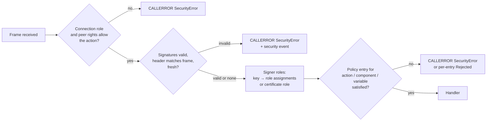

# Signed OCPP Messages and Signer Roles

**Version 0.2, Draft**, 2026-11-12
[CC-BY-SA 4.0](https://creativecommons.org/licenses/by-sa/4.0/) · [OpenChargingTechnology/Whitepapers](https://github.com/OpenChargingTechnology/Whitepapers) · reference implementations: [OpenChargingCloud/WWCP_Core](https://github.com/OpenChargingCloud/WWCP_Core) (signature policies, user roles), [OpenChargingCloud/WWCP_OCPP](https://github.com/OpenChargingCloud/WWCP_OCPP) (the signed OCPP messages), [OpenChargingCloud/ChargingStation](https://github.com/OpenChargingCloud/ChargingStation) (station)

TLS authenticates a hop, not an author. A Local Controller, a load balancer, a protocol gateway
or a CSMS that relays a command for somebody else ends the TLS connection and can read and change
every message it passes on. Even where no intermediary is involved, TLS only says that a message
came over a connection the CSMS holds. It does not say who in the operator's organisation
authorized a firmware update. Nor can a station tell the everyday operation of a CSMS apart from a
change of its own security configuration.

For several years the WWCP_OCPP reference implementation has carried an answer to this, the
*OCPP End-to-End Security Extensions*:

- Every OCPP request and response may carry a `signatures` array.
- A *signature policy* decides which messages a node signs with which key, and how it verifies
  what it receives.
- *User roles* bind public keys to roles, so that a station can make the execution of a request
  depend on who signed it.

The extensions have tests, but they were never written down outside the code.

This paper writes them down and takes them further:

- Chapter 1 documents what is implemented and how it relates to the signed messages of OCPP 2.1
  (Part 4, chapter 7).
- Chapter 2 lists what is wrong with it. In particular it answers three questions that were left
  open:
  - What does a signature cover? Is the OCPP frame, with the action, protected?
  - What can the rule engine that maps messages to keys and roles express?
  - How do roles and their keys get onto a charging station?
- Chapters 4 to 6 propose the answers: what a signature covers (chapter 4), a policy that maps
  messages to signer roles (chapter 5), and the provisioning of roles and keys with new device
  model components and messages (chapter 6).

[EVQI Transport](../EVQITransport/README.md), chapter 7, already sets the direction for CBOR
channels:

- COSE signatures with the OCPP context in the protected header;
- messages signed by default;
- effective permission = connection role ∩ signer role.

This paper is the detailed design of the JSON side and of the *signer role* that EVQI refers to.
The rights profile of a peer, for a station connected to several back ends (EVQI section 11.3.3),
is the third factor of the same intersection.

---

## Contents

0. [Summary](#0-summary)
1. [Starting point](#1-starting-point)
2. [Findings](#2-findings)
3. [Requirements and non-goals](#3-requirements-and-non-goals)
4. [What a signature covers](#4-what-a-signature-covers)
5. [From messages to signer roles: the policy](#5-from-messages-to-signer-roles-the-policy)
6. [Provisioning roles and keys on a charging station](#6-provisioning-roles-and-keys-on-a-charging-station)
7. [Implementation plan](#7-implementation-plan)
8. [Questions and decisions](#8-questions-and-decisions)
9. [References](#9-references)

---

## 0. Summary

**What exists.** WWCP_OCPP signs and verifies the payload of every OCPP 1.6 and 2.1 request and
response, and of every OCPP 2.1 SEND message:

- The signature is ECDSA over secp256r1, secp384r1 or secp521r1.
- It is carried in a `signatures` array inside the payload.
- Signature policies of signing and verification rules select keys and actions by the message's
  JSON-LD context, which can be matched by prefix.
- A user role is an id with a set of public keys. One handler, `SetVariables` of the test station
  node, executes only for the `admin` role once roles are configured.
- Messages to manage roles and policies over OCPP exist in name.

**What is wrong.** The most important findings of chapter 2 are these:

1. **The action is protected; the frame is not.** A signature covers the payload plus a
   JSON-LD `@context` that names the action, its direction and, for the core messages, the
   protocol version. The receiver rebuilds that context from the action of the frame. A payload
   therefore cannot be moved to another action, which answers the first open question better
   than feared.
   - Not covered: the message ID, the destination, the source, a time and a nonce. A signed
     request can be replayed at any time, and to any station that trusts the same key. A signed
     response can be passed off as the answer to another request of the same action.
   - The signer's name, description, timestamp and algorithm lie outside the signature.
2. **A valid signature only says "signed by the key it carries".** The verifier takes the public
   key from the signature itself. Trust only begins with the role check, and the code base has a
   single one.
3. **Stripping the signatures is enough.** A message without signatures passes a `VerifyAll`
   rule, because then the policy's default action (`AcceptUnverified`) decides.
   - The verification actions `Drop` and `Reject` let the message through.
   - The signing actions other than `Sign` have no effect.
4. **What is verified is the library's own re-serialization of the parsed message**, not the
   bytes received.
   - Only another WWCP_OCPP can verify it, and fields the parser does not know are not covered.
   - A standard peer validating against the OCPP 2.1 schemas refuses the message, because every
     schema says `additionalProperties: false`.
5. **The management messages cannot carry what they manage.**
   - `AddUserRole` sends neither the role's id nor its keys, and its own parser requires the id.
   - `UpdateUserRole` and `DeleteUserRole` carry nothing at all.
   - A signature policy loses its rules on the wire.
   - The station accepts all of them and stores nothing.

**What is proposed.**

1. **A protected header in every signature, carrying the OCPP context.** It holds the protocol
   version, message type, action, message ID, source, destination, signing time and expiry,
   optionally a nonce, the key id and algorithm, and for a response the hash of the signed request
   (chapter 4).
   - The same field set serves three encodings:
     - the embedded `signatures` array, as a detached General JWS over the RFC 8785
       canonicalization of the payload;
     - the OCPP 2.1 `<Action>-Signed` wrapper;
     - COSE on EVQI's CBOR channels.
2. **A policy table instead of hand-written checks** (chapter 5).
   - Each action, and each component and variable of the device model, says which signer roles
     it requires and how many of them (a quorum).
   - Each entry also says what happens when that is not met.
   - The adapter evaluates the table before any handler runs, together with the connection role
     and the peer's rights profile.
3. **One role model for every way into a node.** A role is the node's `Role`: a name and
   permissions of the form `resource:operation`. It is the same whether somebody signs in to the
   web interface, opens the SSH console or signs an OCPP message.
4. **Provisioning with a root of trust** (chapter 6).
   - An *owner* key is installed out of band: at manufacture, or on site with physical presence.
   - Role assignments are signed, versioned data objects. They are installed by
     `AddSignerRole` / `UpdateSignerRole` / `DeleteSignerRole`, which replace today's
     `AddUserRole` / `UpdateUserRole` / `DeleteUserRole`, and read by a new `GetSignerRoles`. Or
     they come as certificates with EVQI's role extension under a `MessageSigningRootCertificate`.
   - Two device model components, `MessageSignatureController` and
     `SignerRoleController[<role>]`, plus OCPP 1.6 configuration keys, configure the rest.
5. **Fix the verification semantics first.** It is the smallest step, it can be tested on its
   own, and it needs no new message (chapter 7, phase 1).

---

## 1. Starting point

### 1.1 Why sign OCPP messages

| No. | Use case |
|---|---|
| U1 | **Local Controller.** TLS ends at the Local Controller, which can read and alter everything. OCPP 2.1 recommends signing critical commands and replies for exactly this case (Part 4, §6). |
| U2 | **Separation of duties within an operator.** A firmware update, a new trust anchor or a change of the security profile is authorized by a security officer or a release manager. It is not authorized merely by whoever controls the CSMS application. |
| U3 | **Third parties through the CSMS.** A service company, an e-mobility provider (remote start, reservation) or a DSO and energy manager (charging limits) sends commands that the CSMS relays but cannot forge. |
| U4 | **Evidence.** Some messages matter later: tariffs, transaction events, meter values under calibration law. They stay verifiable after the fact, by a party that was not on the connection. |
| U5 | **Containment of a compromised CSMS.** A CSMS that is taken over can do what the operator does every day, but it cannot change trust anchors, firmware or the station's role table. |

### 1.2 Signed messages in OCPP 2.1

OCPP 2.1 Edition 2, Part 4, chapter 7, defines a signed variant of every OCPP-J message:

- **Format.** The action is replaced by `<Action>-Signed`, e.g. `BootNotification-Signed`.
- **Encoding.** The payload is replaced by a JWS in the Flattened JSON Serialization (RFC 7515)
  whose JWS payload is the original payload.
- **Protected header.** It SHALL contain `OCPPAction` and a field named `OCPPMessageTypedId`. It
  SHOULD contain `x5t#S256`, the SHA-256 hash of the DER encoding of the signing certificate.
- **Algorithms.** ES256, RS256 and RS384, the algorithms of the TLS connection.
- **Handling.** A receiver SHALL extract the encapsulated message and process it normally. It MAY
  use the signature. A charging station that supports signing and receives a signed request SHALL
  answer with a signed reply.
- **Keys.** The specification prescribes none. TLS keys MAY be used. How a certificate is found
  from its hash is out of scope.

What this leaves open:

- **What the second header field binds is ambiguous.** Its name says *message type*, and the text
  says it contains "the message ID (<MessageTypeId>)". Binding the message type (2 to 6) protects
  little, while binding the message ID would bind the frame. Two implementations can read this
  differently and fail to verify each other.
- **Not bound:** destination, source, time, and which request a response answers.
- **Verification is optional.** A receiver is never required to refuse anything.
- **No authorization model.** Nothing says who may sign what.
- **No raw keys.** Keys are identified only through certificates.
- **No implementation in WWCP_OCPP yet.** There is no `-Signed` action at a06dc241.

### 1.3 The End-to-End Security Extensions in WWCP_OCPP

The state described here is that of WWCP_Core 4920c0b9, WWCP_OCPP a06dc241, Styx 21d00134 and
ChargingStation 0ba7c990.

#### 1.3.1 Where the code lives

| Part | Code |
|---|---|
| Signing, verification, rules | [`SignaturePolicy`](https://github.com/OpenChargingCloud/WWCP_Core/blob/4920c0b9/WWCP_CoreData/DataStructures/SignaturePolicy.cs), [`SigningRule`](https://github.com/OpenChargingCloud/WWCP_Core/blob/4920c0b9/WWCP_CoreData/DataStructures/Complex/SigningRule.cs), [`VerificationRule`](https://github.com/OpenChargingCloud/WWCP_Core/blob/4920c0b9/WWCP_CoreData/DataStructures/Complex/VerificationRule.cs) in WWCP_Core. A second, older copy lives in `WWCP_OverlayNetworking`, which WWCP_OCPP does not reference. |
| Signature, key pair | [`Signature`](https://github.com/OpenChargingCloud/WWCP_Core/blob/4920c0b9/WWCP_CoreData/DataStructures/Complex/Signature.cs), [`KeyPair`](https://github.com/OpenChargingCloud/WWCP_Core/blob/4920c0b9/WWCP_CoreData/DataStructures/Complex/KeyPair.cs), [`SignInfo`](https://github.com/OpenChargingCloud/WWCP_Core/blob/4920c0b9/WWCP_CoreData/DataStructures/Complex/SignInfo.cs) |
| User roles | [`UserRole`](https://github.com/OpenChargingCloud/WWCP_Core/blob/4920c0b9/WWCP_CoreData/DataStructures/Complex/UserRole.cs). The role lookup is [`ANetworkingNode.GetValidUserRolesFor`](https://github.com/OpenChargingCloud/WWCP_Core/blob/4920c0b9/WWCP_CoreData/NetworkingNode/ANetworkingNode.cs#L1181-L1202). |
| Pattern matching | [`JSONLDContext.Matches`](https://github.com/Vanaheimr/Styx/blob/21d00134/Styx/Entities/JSONLDContext.cs#L157-L171) in Styx |
| Messages | `WWCP_OCPPv2.1/Messages/Common/E2ESecurityExtensions` in WWCP_OCPP. The OCPP 1.6 copies are mostly commented out. |
| Signing and verifying in the adapters | every file under `WWCP_OCPPv2.1/OCPPAdapter/Outgoing` and `…/Incoming`, e.g. [outgoing `Reset`](https://github.com/OpenChargingCloud/WWCP_OCPP/blob/a06dc241/WWCP_OCPPv2.1/OCPPAdapter/Outgoing/Firmware/Reset.cs#L156-L194) and [incoming `Reset`](https://github.com/OpenChargingCloud/WWCP_OCPP/blob/a06dc241/WWCP_OCPPv2.1/OCPPAdapter/Incoming/Firmware/Reset.cs#L186-L200). The OCPP 1.6 adapters sign and verify in the same way. |
| The only role check | [`TestChargingStationNode`, `OnSetVariables`](https://github.com/OpenChargingCloud/WWCP_OCPP/blob/a06dc241/WWCP_OCPPv2.1_ChargingStation/TestChargingStationNode.cs#L2394-L2420), and its copy in `TestBatterySwapStationNode` |

#### 1.3.2 Wire format

A signed `Reset` request in the standard OCPP-J frame looks like this:

```json
[2, "19223201", "Reset", {
    "type":        "Immediate",
    "signatures":  [{
        "keyId":       "BHx1…",
        "value":       "MEUCIQ…",
        "name":        "ahzf",
        "timestamp":   "2026-11-10T12:00:00.000Z"
    }]
}]
```

| Field | Content | Written |
|---|---|---|
| `keyId` | the signer's **public key** itself, as an EC point, base64 | always |
| `value` | the ECDSA signature, DER encoded, base64 | always |
| `algorithm` | `secp384r1` or `secp521r1` | only when not `secp256r1` |
| `encodingMethod` | the encoding of `keyId` and `value` | only when not base64 |
| `signingMethod` | the signing method | only when not `JSON` |
| `name`, `description`, `timestamp` | who signed, why, and when, as the signer states it | when set |
| `customData` | as in OCPP | when set |

*Source:* [`Signature.ToJSON`](https://github.com/OpenChargingCloud/WWCP_Core/blob/4920c0b9/WWCP_CoreData/DataStructures/Complex/Signature.cs#L479-L515).

#### 1.3.3 Signing

[`SignaturePolicy.SignMessage`](https://github.com/OpenChargingCloud/WWCP_Core/blob/4920c0b9/WWCP_CoreData/DataStructures/SignaturePolicy.cs#L672-L813)
works in five steps:

1. **Serialize.** The message model is serialized together with its JSON-LD context (`ToJSON(true, …)`),
   e.g. `"@context": "https://open.charging.cloud/context/ocpp/v2.1/csms/ResetRequest"`
   ([`ResetRequest`](https://github.com/OpenChargingCloud/WWCP_OCPP/blob/a06dc241/WWCP_OCPPv2.1/Messages/Firmware/ResetRequest.cs#L47)).
2. **Text.** That object is written as compact text by Newtonsoft.Json and encoded as UTF-8.
3. **Hash.** SHA-256 for secp256r1, and SHA-512 for secp384r1 and secp521r1.
4. **Sign.** ECDSA over the hash (BouncyCastle `NONEwithECDSA`), DER encoded.
5. **Send.** The signature is added to the message, and the message is sent as
   `ToJSON(false, …)`: without `@context`, with `signatures`.

The keys come from three sources, and every one of them signs, so a message may carry several
signatures:

- the call's own `SignInfos`;
- the message's `SignKeys` and `SignInfos`;
- **every** signing rule whose context matches the message's context.

#### 1.3.4 Verification

[`SignaturePolicy.VerifySendMessage`](https://github.com/OpenChargingCloud/WWCP_Core/blob/4920c0b9/WWCP_CoreData/DataStructures/SignaturePolicy.cs#L1248-L1341),
which `VerifyRequestMessage` and `VerifyResponseMessage` call, works as follows:

1. **Parse.** The adapter parses the payload into the message model that the frame's action
   selects.
2. **Rebuild.** It serializes the model again with `@context` and removes `signatures`.
3. **Pick a rule.** The verification rule of highest priority whose context matches is chosen.
   Without one, the default action applies.
4. **No signatures.** When the message carries no signature, the policy's *default* action alone
   decides, not the matching rule: `AcceptUnverified` accepts, anything else refuses.
5. **Apply the action:**
   - `AcceptUnverified`: every signature is marked `Unverified`, and the message is accepted.
   - `Drop` and `Reject`: the signatures are marked `DropMessage` and `RejectMessage`, and the
     method returns `true`, so the message is accepted.
   - `VerifyAny` and `VerifyAll`: each signature is checked against the public key in its own
     `keyId`, on the curve its `algorithm` names (secp256r1 when none is named).
6. **Refusal.** When the result is `false`, the adapter does not call the handler. Since
   WWCP_OCPP 9cecf85a it answers with a CALLERROR `SecurityError` whose description gives the
   reason, and signs nothing; whoever sent the request gets the result `SecurityError`. Before,
   it answered with the action's own response, with status `Rejected`, and no CALLERROR was sent.
   - A refused response is handed to the code that sent the request, also with the result
     `SignatureError`.
   - Since WWCP_OCPP 1431cde5, a 2.1 node answers a response it cannot read with a
     CALLRESULTERROR `FormationViolation` (Part 4 §4.2.3). A signature that does not hold draws
     none.

#### 1.3.5 Signature policies and the rule engine

A
[`SignaturePolicy`](https://github.com/OpenChargingCloud/WWCP_Core/blob/4920c0b9/WWCP_CoreData/DataStructures/SignaturePolicy.cs#L41-L240)
has:

- an id, a priority, `notBefore` and `notAfter`;
- a set of signing rules and a set of verification rules;
- a default signing action (`ForwardUnsigned`) with an optional key;
- a default verification action (`AcceptUnverified`) with an optional key.

| Rule | Fields | Actions |
|---|---|---|
| `SigningRule` | context pattern, priority, action, key pair, generators for signer name, description and timestamp | `ForwardUnsigned`, `Drop`, `Reject`, `Sign` |
| `VerificationRule` | context pattern, priority, action, key pair | `AcceptUnverified`, `Drop`, `Reject`, `VerifyAny`, `VerifyAll` |

**This is the "mapper" of the second open question.** It maps messages to keys and actions by
their JSON-LD context:

- **Matching.** A pattern matches exactly, or as a prefix when it ends in `...`. Matching is
  case-sensitive. For example, `https://open.charging.cloud/context/ocpp/v2.1/csms/...` matches
  every OCPP 2.1 message the CSMS sends.
- **Context names.** The contexts follow the scheme `…/ocpp/<version>/<sender>/<Message>`. The
  sender is `cs` for the charging station and `csms` for the CSMS in 2.1, and `cp` and `cs`
  (central system) in 1.6.
  - 25 extension messages have no version in their context, e.g.
    `…/ocpp/csms/addUserRoleRequest`.
  - `UpdateSignaturePolicyRequest` and `DeleteSignaturePolicyRequest` are filed under `cs/`,
    although the CSMS sends them.
- **Which policy applies.** Each adapter applies the first of its policies
  ([`SignaturePolicies.First()`](https://github.com/OpenChargingCloud/WWCP_OCPP/blob/a06dc241/WWCP_OCPPv2.1/OCPPAdapter/OCPPAdapter.cs#L153-L154)).
- **Forwarding nodes.** A forwarding node holds a `ForwardingSignaturePolicy`
  ([`OCPPWebSocketAdapterFORWARD`](https://github.com/OpenChargingCloud/WWCP_OCPP/blob/a06dc241/WWCP_OCPPv2.1/OCPPAdapter/Forwarding/OCPPWebSocketAdapterFORWARD.cs#L329-L345)),
  but the forwarding code never signs or verifies with it.

#### 1.3.6 User roles

- **The role.** A [`UserRole`](https://github.com/OpenChargingCloud/WWCP_Core/blob/4920c0b9/WWCP_CoreData/DataStructures/Complex/UserRole.cs)
  is an id, a description and a set of key pairs.
- **Where roles live.** A node keeps them in a public, in-memory list, `ANetworkingNode.UserRoles`.
- **The lookup.** `GetValidUserRolesFor(message)` returns every role that has a key whose public
  key bytes equal the `keyId` of a signature with status `ValidSignature`.
- **Predefined ids.** `vendor`, `admin` and `user`
  ([`ChargingStationSettings.UserRoles`](https://github.com/OpenChargingCloud/WWCP_OCPP/blob/a06dc241/WWCP_OCPPv2.1_ChargingStation/AChargingStationNode.cs#L57-L73)).
- **The only check.** It is the one in `OnSetVariables` of the test station node:
  - once any role is configured, a `SetVariables` request without a valid signature of an
    `admin` key gets `Rejected` for each of its entries, with "Access denied!";
  - without roles, every request passes, so a standard CSMS keeps working.
- **Unused access rights.** `ComponentAccessRights` maps a device model component to
  `ReadOnly`, `ReadWrite` or `AppendOnly`. It exists in the 2.1 messages, but its field in
  `UserRole` is commented out and nothing reads it.

#### 1.3.7 Management messages

| Message (CSMS → station) | Payload as implemented | Station (test node) |
|---|---|---|
| `AddSignaturePolicy` | `signaturePolicy`: id, priority, `notBefore`, `notAfter`, but **no rules, keys or default actions** (`SignaturePolicy.ToJSON`) | `Accepted`, nothing stored |
| `UpdateSignaturePolicy` | only `signatures` and `customData` | `Accepted`, nothing stored |
| `DeleteSignaturePolicy` | `signaturePolicyId` | `Accepted`, nothing stored |
| `AddUserRole` | the role under the key **`signaturePolicy`**, serialized by `UserRole.ToJSON`, which writes **neither `id` nor keys**. [`UserRole.TryParse` requires `id`](https://github.com/OpenChargingCloud/WWCP_Core/blob/4920c0b9/WWCP_CoreData/DataStructures/Complex/UserRole.cs#L397), so the receiver's parser refuses what the sender's serializer writes | `Accepted`, nothing stored |
| `UpdateUserRole`, `DeleteUserRole` | only `signatures` and `customData`: no role, no id | `Accepted`, nothing stored |
| `SecureDataTransfer` | AES-CTR encrypted data with key id, nonce and counter | decrypts and answers (section 2.6) |

*Station handlers:*
[`TestChargingStationNode`](https://github.com/OpenChargingCloud/WWCP_OCPP/blob/a06dc241/WWCP_OCPPv2.1_ChargingStation/TestChargingStationNode.cs#L1545-L1620).

#### 1.3.8 The station program

The station ([ChargingStation](https://github.com/OpenChargingCloud/ChargingStation/blob/0ba7c990/ChargingStation/ChargingStation.Configuration.cs#L1898-L1922))
builds its OCPP 2.1 side on `TestChargingStationNode`:

- It passes `SignaturePolicy: null`, so the defaults apply: sign nothing, accept unverified.
- It configures no roles, so the `SetVariables` gate stays open.
- A signature it receives is checked against its own `keyId` and otherwise ignored.

The station therefore behaves like a standard OCPP station. The extensions are dormant.

#### 1.3.9 Tests

Tests exist for both directions (`CS_SignedMessages_Tests`, `CS_WithSignaturePolicy_Tests`,
`CSMS_SignedMessages_Tests`, `CSMS_WithSignaturePolicy_Tests`), for signed charging tariffs, for
the overlay network with a Local Controller, and for the `admin` gate (`SetVariablesUserRoleTests`).
All keys are fresh secp256r1 keys. What the tests leave out:

- **Only one status is ever asserted:** `ValidSignature`.
- **No negative tests.** No test strips signatures, tampers with a payload, replays a message,
  moves a signature to another action, or expects `InvalidSignature` or `UnknownSigner`.
- **Stripping only shows indirectly.** An unsigned `SetVariables` against a `VerifyAll` rule gets
  through verification with `ResultCode.OK`. Only the role gate then turns it into `Rejected`
  ([`SetVariablesUserRoleTests`](https://github.com/OpenChargingCloud/WWCP_OCPP/blob/a06dc241/WWCP_OCPPv2.1_Tests/CSMS/SetVariablesUserRoleTests.cs#L137-L143)).
- **Empty or disabled tests:**
  - `CSMS_WithSignaturePolicy_Tests.AddSignaturePolicy_Test` sends nothing.
  - The signature assertions on `BinaryDataTransfer` are commented out.
  - No test sample of a role or policy message carries a role or a policy.
- **Wrong keys in tests:**
  - Three tests sign the station's responses with the CSMS's key.
  - The overlay network test signs the station's messages with the Local Controller's key.

---

## 2. Findings

Found by reading the code at the commits named in section 1.3; none of them is reproduced by a test yet.

| No. | Severity | Finding | Where |
|---|---|---|---|
| F1 | high | A message whose signatures were stripped passes a `VerifyAll` rule: with no signature, the default action decides, not the rule. | [`SignaturePolicy.cs` L1257–1266](https://github.com/OpenChargingCloud/WWCP_Core/blob/4920c0b9/WWCP_CoreData/DataStructures/SignaturePolicy.cs#L1257-L1266) |
| F2 | high | "Valid" means "valid for the key in `keyId`", which the sender chooses. `VerificationRule.KeyPair` and `DefaultVerificationKeyPair` are never used, so any self-made key yields `ValidSignature`. Trust exists only where a handler asks for a role. | [L1308](https://github.com/OpenChargingCloud/WWCP_Core/blob/4920c0b9/WWCP_CoreData/DataStructures/SignaturePolicy.cs#L1308) |
| F3 | high | The verification actions `Drop` and `Reject` set a status and return `true`; nothing reads that status, so the message is processed. | [L1287–1295](https://github.com/OpenChargingCloud/WWCP_Core/blob/4920c0b9/WWCP_CoreData/DataStructures/SignaturePolicy.cs#L1287-L1295) |
| F4 | high | Not covered by a signature: message ID, destination, source (overlay network path), time, nonce. Requests can be replayed later and to other stations that trust the same key; a signed response can answer another request of the same action. | section 2.1 |
| F5 | high | Roles cannot be provisioned: `AddUserRole` does not round-trip, `UpdateUserRole`/`DeleteUserRole` carry nothing, a policy loses its rules on the wire, and the station stores none of it. | section 1.3.7 |
| F6 | medium | Signer name, description, timestamp, algorithm and encoding are outside the signature. The timestamp can be changed freely; `algorithm` chooses the curve the verifier uses. | [L772–795](https://github.com/OpenChargingCloud/WWCP_Core/blob/4920c0b9/WWCP_CoreData/DataStructures/SignaturePolicy.cs#L772-L795) |
| F7 | medium | What is verified is the re-serialization of the parsed model, not the bytes received. Fields the parser does not know are not covered; another implementation cannot reproduce the bytes; a change of a serializer in the library (a new optional field with a default, another number or date format) invalidates old signatures. | section 2.5 |
| F8 | medium | The embedded `signatures` field violates every OCPP 2.1 JSON schema (`additionalProperties: false` in all 181), so a strictly validating standard peer refuses signed messages. | section 2.5 |
| F9 | medium | Signing rule actions are ignored: every matching rule that has a key signs, whatever its action. `ForwardUnsigned`, `Drop` and `Reject` have no effect, the default signing action and its key are never used, and `GetSigningRules` matches exactly where `HasSigningRules` matches prefixes. | [`SignInfo.ToSignInfo`](https://github.com/OpenChargingCloud/WWCP_Core/blob/4920c0b9/WWCP_CoreData/DataStructures/Complex/SignInfo.cs#L95-L116), [L595–640](https://github.com/OpenChargingCloud/WWCP_Core/blob/4920c0b9/WWCP_CoreData/DataStructures/SignaturePolicy.cs#L595-L640) |
| F10 | medium | Authorization is hand-written per handler, and only one handler has it. A role is matched by comparing raw EC point bytes, so the same key in compressed and uncompressed form are two keys. Roles live only in memory. | section 2.3 |
| F11 | medium | `SecureDataTransfer` encrypts with AES-CTR, and the node's nonce and counter are the constant 1 for every message; one key therefore yields the same key stream for every message. The ciphertext is not authenticated unless the message is also signed. | [`GetEncryptionNonce`/`GetEncryptionCounter`](https://github.com/OpenChargingCloud/WWCP_Core/blob/4920c0b9/WWCP_CoreData/NetworkingNode/ANetworkingNode.cs#L1160-L1170) |
| F12 | low | The policy's `notBefore`, `notAfter` and `priority` are never consulted, and only the first policy is applied. | section 1.3.5 |
| F13 | low | P-384 is hashed with SHA-512 (JOSE `ES384` uses SHA-384), and signatures are DER where JOSE and COSE use the raw `r‖s` form: the signatures cannot be re-expressed as JWS or COSE without re-signing. | [L774–778](https://github.com/OpenChargingCloud/WWCP_Core/blob/4920c0b9/WWCP_CoreData/DataStructures/SignaturePolicy.cs#L774-L778) |
| F14 | low | Forwarding nodes neither verify nor countersign. A countersignature cannot be expressed: a signature added to a message that already carries one covers the earlier signatures, but the verifier removes all of them before checking. | section 1.3.5 |
| F15 | low | JSON-LD contexts of the extension messages carry no version and partly name the wrong sender (section 1.3.5). Because the context is part of what is signed, renaming one later breaks every signature made under the old name. | section 1.3.5 |
| F16 | low | No negative tests (section 1.3.9). | section 1.3.9 |
| F17 | medium | Binary messages cannot carry a verifiable signature: the binary parser of `BinaryDataTransferResponse` drops the signatures it receives, the response is verified with its own signatures inside the signed bytes, and the binary TLV format writes a signature count but no signatures. The overlay network test's signature assertions for `BinaryDataTransfer` are commented out for this reason. | `WWCP_OCPPv2.1/Messages/Common/BinaryStreamsExtensions/Messages/BinaryDataTransferResponse.cs`, incoming `BinaryDataTransfer` adapter |

### 2.1 What a signature covers today (open question 1)

The fear was that only the parameters of a message are signed, not the OCPP-J array with its
action. The answer has two parts.

**The action is bound.** The signed text is the payload plus `@context`, and the context names
the message: `…/v2.1/csms/ResetRequest`. The context does not travel on the wire. The receiver
derives it from the class it parsed the payload into, and the frame's action chose that class.

- **Another action.** Moving the payload of a signed `Reset` request into a `ChangeAvailability`
  frame makes the receiver compute `…/v2.1/csms/ChangeAvailabilityRequest`, and the signature no
  longer verifies.
- **Another direction or version.** The same holds for request versus response and, for the core
  messages, for OCPP 1.6 versus 2.1.
- **Message type.** The message type is bound indirectly: a CALL carries a `…Request` context, and
  a CALLRESULT a `…Response` context.

**The frame is not bound.** Everything else in the frame, and everything about the circumstances
of the message, is outside the signature:

| Not covered | Attack it allows |
|---|---|
| message ID | Replay of a signed request under a new ID; a signed CALLRESULT can be attached to another CALL of the same action, e.g. an old `Accepted`. |
| destination (overlay network: `destination` or source route) | A request signed for station A is executed by station B when both trust the key. This is the normal case for an operator-wide `admin` key. |
| source / network path | A message can be presented as coming from another node. |
| time, expiry | A `Reset`, `UnlockConnector` or `RequestStartTransaction` signed once stays valid forever. The `timestamp` in the signature is outside the signature, so it is no defence. |
| nonce | Two identical requests cannot be told apart. |
| the request a response answers | A response cannot prove that it answers *this* request. |
| unknown payload fields | Not part of the verified text (F7). |
| signer metadata | Name, description, timestamp, algorithm (F6). |

**OCPP 2.1 §7 has the same gap.** It binds `OCPPAction` and possibly the message ID (section
1.2), but nothing else.

TLS does mitigate all this on a direct connection: an attacker on the path cannot inject anything.
But the point of message signatures is the case where the path is *not* trusted (U1, U3). There, a
Local Controller that has seen one signed `UpdateFirmware` or `Reset` can send it again whenever
it likes, to every station behind it.

### 2.2 Verification and trust

Three separate questions are mixed up in today's code:

1. **Is the signature mathematically valid?** It is checked against the key the message brings
   along (F2).
2. **Is the key trusted?** Nowhere, except implicitly through question 3.
3. **May the holder of this key do this?** In one handler only, by role (F10).

**Combined with F1, the protection disappears.**

- A `VerifyAll` rule refuses a message signed by a stranger's key only when the signature is
  broken. A stranger's valid signature passes.
- A stranger can also simply leave the signatures out, and the message passes as well.
- Only a role check stops either of them. Every action without one, which is every action except
  `SetVariables` in the test node, runs for anybody who can deliver the message.

### 2.3 What the rule engine can and cannot express (open question 2)

**What it can do:**

- One rule per message type, for a direction and protocol version, or for a whole family by
  prefix: everything the CSMS sends in 2.1, every extension message.
- Priorities between overlapping verification rules.
- Several signatures on one outgoing message, from several matching signing rules.
- Generated signer name, description and timestamp per rule.

**What it cannot do:**

| Missing | Why it matters |
|---|---|
| Naming **who** must have signed (role, key, quorum) | A rule can demand "signed", but not "signed by the security officer" or "signed by two of the release managers". The role is checked elsewhere, by hand. |
| Conditions on the content | `Reset` `OnIdle` versus `Immediate`, `SetVariables` on `SecurityCtrlr` versus `DisplayMessageCtrlr`, `ChangeAvailability` of one EVSE versus the whole station, `SetChargingProfile` by purpose (`ChargingStationExternalConstraints` for an energy manager). |
| Device model granularity | `ComponentAccessRights` exists but is not wired; a rule cannot say "this role may write `DNSClientController` but not `SecurityCtrlr`". |
| Mixed requests | A `SetVariables` with entries of different sensitivity is one request; there is no per-entry decision. |
| An explicit default for the unknown | A new action or a vendor extension falls to the default, which today is `AcceptUnverified`. |
| A way to transport and inspect a policy | The policy cannot be read or written over OCPP (F5) and is not part of the device model. |
| Validity and selection | `notBefore`, `notAfter`, `priority` of a policy are inert; only the first policy counts (F12). |

**Context patterns are the wrong key.**

- **Not stable.** A context URL is a library-internal name. It is case-sensitive and partly
  inconsistent (F15).
- **Different per encoding.** A COSE or JWS message has no such context.
- **Policies belong to people.** A policy written by an operator should name the OCPP action as
  it appears in the frame (`Reset`, `SetVariables`), its direction and its version.

### 2.4 Provisioning (open question 3)

Today roles can only be set in code, by adding to `ANetworkingNode.UserRoles`.

- **No transport.** The management messages exist but cannot carry a role (F5).
- **No persistence.** The station stores nothing.
- **No device model view.** No component shows the roles.
- **No root of trust.** Nothing says who may change the roles at all.

As written, a working `AddUserRole` would let anyone who can send it to the station make
themselves `admin`: it is not itself subject to a role check. Chapter 6 proposes the missing
pieces.

### 2.5 Interoperability

**Only WWCP_OCPP can verify.** The signed text is defined by the library's own serializers:

- their property order and their date format (`yyyy-MM-ddTHH:mm:ss.fffZ`);
- their number formatting;
- the JSON-LD context names, which are not published anywhere.

An implementation in another language cannot reproduce it without reimplementing every
`ToJSON` method, and it then has to follow every change made to them.

**The embedded field breaks the schemas.** All 181 OCPP 2.1 schemas forbid additional properties
at the top level, so a strictly validating peer answers a signed message with `FormatViolation`.
Only `customData` allows extra properties, and it requires a `vendorId`.

### 2.6 Side finding: `SecureDataTransfer`

`SecureDataTransfer` is outside the scope of this paper, but F11 should be fixed before anybody
relies on it. Following EVQI (its section 7.2), message-level encryption without authentication
should not be used. An AEAD (AES-GCM or ChaCha20-Poly1305) with a fresh nonce per message, or
COSE_Encrypt with ECDH-ES, replaces it.

**Decided (Q20):** AES-CTR stays as it is, and AES-GCM is added as a second method.

- Phase 1 already gave every message a nonce of its own.
- The binary request and response carry `Parameter` (UInt16), `KeyId` (UInt16), `Nonce` (UInt64),
  `Counter` (UInt64) and `Ciphertext`, written big-endian. `Parameter` has always been 0 so far.
  It now selects the method:

| `Parameter` | Method | IV | `Ciphertext` |
|---|---|---|---|
| 0 | AES-CTR, as before | the 8 bytes of `Nonce` and the 8 bytes of `Counter`, each in the machine's byte order (little-endian on every platform the library runs on); kept for compatibility | the ciphertext |
| 1 | AES-GCM | 96 bits: the 8 bytes of `Nonce` and the last 4 bytes of `Counter`, as they are on the wire (big-endian) | the ciphertext followed by the 16-byte tag |

AES-GCM in detail:

- **Key.** The key of `KeyId`, as for AES-CTR. Its length (16, 24 or 32 bytes) gives AES-128,
  AES-192 or AES-256.
- **Additional authenticated data.** The first 20 bytes on the wire (`Parameter`, `KeyId`,
  `Nonce`, `Counter`), so that changing any of them breaks the tag.
- **Nonce.** It must never repeat under one key. The sender draws a random `Nonce` per message
  and counts `Counter` up.
- **The response** uses the method of its request.
- **Refusals.**
  - A receiver that does not know the `Parameter` answers `Rejected`.
  - A tag that does not verify is refused, and no plaintext is handed on.
- **Signatures.** AES-CTR stays without authentication, unless the message is signed as well.

---

## 3. Requirements and non-goals

### 3.1 Requirements

| ID | Requirement |
|---|---|
| R1 | A signature binds the payload **and** its OCPP context: protocol version, message type, action, message ID, source, destination, signing time and validity; a response binds the request it answers. |
| R2 | A message without the signatures its policy requires is refused, as is a message with an invalid signature or an unknown signer. Refusal is an explicit, logged result, never a silent pass. |
| R3 | A key is trusted only through a role assignment or a certificate chain the station holds; a key that the message brings along is never trusted by itself. |
| R4 | Authorization is data: a policy table maps actions (and device model components and variables) to required signer roles, with a quorum, evaluated before any handler runs. |
| R5 | One role model for every way into a node: web interface, SSH console, OCPP. |
| R6 | Roles and keys can be provisioned remotely and locally, are stored persistently, and can be read back. Changes to them are themselves signed by a role entitled to make them and are protected against replay and rollback. |
| R7 | A station cannot be locked out by its own role table: removing the last owner key is refused, and a local recovery path exists. |
| R8 | Interoperable encodings: the OCPP 2.1 `<Action>-Signed` JWS for standard peers, COSE for EVQI CBOR channels; one semantic header for all. |
| R9 | Signatures are verifiable after the fact by third parties (U4): the signed object can be stored as received. |
| R10 | Backward compatibility: a station without configured roles behaves like a standard station; old-format signatures can be accepted during a migration window, by explicit configuration. |
| R11 | Countersignatures by intermediaries (Local Controller, a CSMS forwarding to third parties) without invalidating the original signature. |

### 3.2 Non-goals

- Message-level encryption (see EVQI 7.2; section 2.6 only flags the existing extension).
- Firmware image signatures: the firmware signing PKI of OCPP stays the authenticity anchor of the
  image; this paper governs who may *trigger* an update.
- Replacing TLS: signatures are on top of an authenticated connection, not instead of it.
- Signed data structures inside messages (charging tariffs, signed meter values) — they keep their
  own signatures; section 4.4 only aligns their format.

---

## 4. What a signature covers

### 4.1 The protected header

Every signature carries a protected header. Its fields are signed together with the payload:

| Field | Content | CALL | CALLRESULT / CALLRESULTERROR | SEND |
|---|---|---|---|---|
| `alg` | `ES256`, `ES384`, `ES512`, `EdDSA`, `ESB256` (brainpool, where metrology demands it), later ML-DSA (EVQI 7.2) | M | M | M |
| `kid` | key id: the RFC 7638 JWK thumbprint (SHA-256, base64url) of the public key, or the RFC 9679 COSE key thumbprint for COSE | M¹ | M¹ | M¹ |
| `x5t#S256` | SHA-256 of the DER signing certificate, when the key is certified (OCPP 2.1 §7.4) | O¹ | O¹ | O¹ |
| `OCPPVersion` | the WebSocket subprotocol: `ocpp1.6`, `ocpp2.0.1`, `ocpp2.1` | M | M | M |
| `OCPPMessageTypeId` | 2, 3, 5 or 6 | M | M | M |
| `OCPPAction` | the action (for a response: the action of the request), as in OCPP 2.1 §7 | M | M | M |
| `OCPPMessageId` | the message ID of the frame (a response: that of the request) | M | M | M |
| `OCPPSource` | the identity of the signer's node (station identity, `CSMS`, a Local Controller's id) | M | M | M |
| `OCPPDestination` | the identity of the node that shall execute or receive it; for a multicast/broadcast the group name | M | M | M |
| `iat` | signing time, NumericDate (RFC 7519 §5.3 permits replicating claims as header parameters) | M | M | M |
| `exp` | end of validity; default `iat` + `MessageSignatureController.MaxSignatureAge` | O | O | O |
| `OCPPNonce` | a nonce chosen by the signer, unique per `kid` within the validity window | O² | – | O |
| `OCPPRequestHash` | SHA-256 (base64url) over the concatenated signature values of the request, when the request was signed | – | M | – |
| `OCPPSignerName`, `OCPPSignerDescription` | today's `name` and `description`, now protected | O | O | O |
| `crit` | the `OCPP…` fields the verifier must understand (RFC 7515 §4.1.11) | M | M | M |

¹ At least one of `kid` and `x5t#S256`.
² Mandatory when the signer is not the sender of the frame (section 4.3).

**Verification rules** (in addition to the signature itself):

- **Header against frame.** `OCPPVersion`, `OCPPMessageTypeId`, `OCPPAction` and
  `OCPPMessageId` equal the frame and the connection.
- **Destination.** For a request or SEND, `OCPPDestination` is the verifying node itself, or a
  group it belongs to. A response is not checked for it. A node is known to its peers under
  aliases (`CSMS`, `CentralSystem`), and the response binding below ties a response to its
  requester more tightly than a name does.
- **Time.** `iat` lies no further in the future than `MaxClockSkew`, and `exp` (or the default)
  has not passed.
- **Freshness.** The pair (`kid`, `OCPPNonce`), or the pair (`kid`, `OCPPMessageId`) when there is
  no nonce, has not been seen within the validity window. The station keeps a replay cache for
  the window, which is minutes, so it stays small.
- **Response binding.** For a response, `OCPPRequestHash` matches the request that was sent under
  that message ID.

Trustworthy time is a precondition, see
[Secure Time Synchronization](../SecureTimeSync/README.md). A station whose clock is not
synchronized accepts only messages whose `OCPPNonce` it has asked for, or none (Q8).

### 4.2 Three encodings, one header

1. **OCPP 2.1 `<Action>-Signed`** (standard peers, JSON).
   - The Flattened JWS of Part 4 §7, with the header of section 4.1.
   - `OCPPMessageTypedId` is also set, to the message ID, for peers that read the 2.1 field.
   - The JWS carries the payload bytes, so no canonicalization is needed. A Local Controller
     forwards the JWS unchanged.
2. **Embedded `signatures`** (WWCP peers, JSON; also signed data objects, section 4.4).
   - The `signatures` array becomes the `signatures` member of a *General JWS JSON Serialization*
     (RFC 7515 §7.2.1) with a **detached payload** (RFC 7515 Appendix F).
   - Each element is `{ "protected": …, "header": …, "signature": … }`.
   - The detached payload is the RFC 8785 (JCS) canonicalization of the payload **as received**,
     without `signatures`.
   - Unknown fields are covered, and any implementation can reproduce the bytes.
   - Towards a peer that validates the 2.1 schemas, the array travels inside `customData`
     (`"vendorId": "org.openchargingcloud.signatures"`), which the schemas allow.
3. **COSE** (CBOR connections: EVQI channels, and OCPP 2.1 as CBOR over the subprotocol
   `ocpp2.1cbor`).
   - A `COSE_Sign1` (RFC 9052, tag 18) with a **detached payload**. `alg` is the COSE
     algorithm under label 1, `kid` under label 4 and `crit` under label 2; every other field
     of section 4.1 keeps its name, as a text label in the protected header (EVQI 7.2).
   - `kid` is the RFC 9679 COSE Key Thumbprint (SHA-256) of the signer's public key.
   - The signer's public key may travel with the signature: as a `COSE_Key` in the
     unprotected header, under the text label `OCPPSignerKey`. It is what `jwk` is to the JWS;
     COSE has no header parameter of its own for a bare public key, and `x5chain` carries
     certificates (Q22).
   - The detached payload is the CBOR of the message without `signatures`, in the
     deterministic encoding of RFC 8949 §4.2.1 - of the message as it is read from its JSON
     form. A point in time is whole milliseconds there, so a signer whose CBOR could carry
     more signs what the JSON form says, and every receiver builds the same bytes (Q24).
   - The signature is an element of `signatures` like the others: in a CBOR message the
     `COSE_Sign1` itself, in a JSON message `{ "cose": "<base64url of its bytes>" }`. It signs
     the same bytes wherever the message is read, so it crosses a node that translates
     between a CBOR and a JSON connection and is verified behind either. A node that does
     not know the message carries the signature along and cannot verify it (Q23).
   - Written are `ES256`, `ES384` and `ES512` (-7, -35, -36), as for the JWS; the
     fully-specified `ESP256`, `ESP384` and `ESP512` of RFC 9864 (-9, -51, -52) are read as
     well (Q26).
   - Several signers are several `COSE_Sign1` next to each other. `COSE_Sign` with several
     signers in one structure, and countersignatures (RFC 9338) of a forwarding node, are
     not built.

The verifier builds the same decision input from all three: header fields, key, payload and
validity. Policy and roles (chapter 5) see no difference.

The current format (`keyId`, `value`, …) becomes *format 0*:

- It is accepted only while `MessageSignatureController.AcceptFormat0` is `true`.
- It counts at most as `Unverified` for the policy, because it does not bind the frame.
- It is never produced again.

### 4.3 Signer and sender are not always the same

In U3 a third party signs a request that the CSMS sends. The CSMS assigns the OCPP message ID, so
the signer cannot know it in advance. Two ways solve this:

- **The signer chooses the ID.** The signer chooses `OCPPMessageId`, and the CSMS sends the frame
  under exactly this ID. Message IDs only need to be unique per station identity (Part 4 §4.1.4),
  and a UUID chosen by the signer is unique enough.
- **A nonce instead of the ID.** The signer leaves the ID open (`OCPPMessageId: "*"`) and sets
  `OCPPNonce`. The verifier then checks freshness by the nonce.

The first way is simpler and keeps response binding intact. The second is needed where a relay
cannot choose IDs freely (Q3).

### 4.4 Signed data objects

Charging tariffs, role assignments (chapter 6) and other data that is stored and verified later
use the embedded form (section 4.2, encoding 2) on the object itself:

- The OCPP fields of the header are replaced by `typ` (the object type, e.g. `ocpp-user-role`),
  `iat` and `exp`.
- Version and object id are in the payload.

This keeps one signature format in the library, and it allows a countersignature by the CSMS or a
Local Controller without touching the original.

**Until phase 4: key pin sets.** Signed data objects are verified only from phase 4 on. Until
then, the key pin sets of
[Key Pins and TLS 1.3 Raw Public Keys](../EVQITransport/RawPublicKeys.md) (section 5.7, work
package K4) are protected by a message signature, as on the SSH path (a signed `SetVariables`):

- The station's verification rule for pin sets opts out of the `iat`/`exp` check, so that a
  station without synchronized time can take them.
- The opt-in belongs to that one rule, not to the policy. Every other check stays, and so does
  `OutOfTime` for every other message. Q8 is unaffected.
- Through a Local Controller, the signer uses `NonceInsteadOfMessageId`.
- The pin set's version replaces freshness. The station accepts only a greater version, and it
  compares and stores the version atomically. The replay cache gives no protection without a
  time window.
- Once phase 4 verifies signed data objects, pin sets become one.

---

## 5. From messages to signer roles: the policy

### 5.1 The decision chain



**Effective permission = connection role ∩ peer rights ∩ signer role** (EVQI 7.4 and
11.3.3). The chain runs **in the adapter, once, for every action**, before the handler. Today it is
the handler's job, and only one handler does it.

### 5.2 The policy table

A policy entry:

```json
{
    "id":            "firmware",
    "match":         { "action": "UpdateFirmware", "direction": "CSMS->CS", "versions": ["ocpp2.0.1", "ocpp2.1"] },
    "require":       { "anyOf": ["release-manager"], "count": 2 },
    "onViolation":   "Refuse",
    "description":   "Firmware updates need two release managers"
}
```

| Field | Meaning |
|---|---|
| `match.action` | the OCPP action as on the wire, or `*`; no library-internal context names |
| `match.direction` | `CSMS->CS` or `CS->CSMS`; on a Local Controller per side |
| `match.versions` | optional, default all |
| `match.component`, `match.variable`, `match.instance`, `match.evse` | for `SetVariables`, `GetVariables`, `SetVariableMonitoring`, `GetReport`: one entry per device model target; wildcards allowed |
| `match.where` | optional conditions on payload fields with a closed set of operators (`equals`, `in`), e.g. `{ "type": { "in": ["Immediate"] } }` for `Reset`, `{ "chargingProfile.chargingProfilePurpose": { "equals": "ChargingStationMaxProfile" } }` for `SetChargingProfile` |
| `require` | `Unsigned` (no requirement), `AnySigner` (a valid signature by any assigned role), or `anyOf` / `allOf` of role ids with `count` (quorum, n of m distinct keys) |
| `onViolation` | `Refuse` (CALLERROR `SecurityError`, security event) or `Record` (execute, security event; for a migration) |

Resolution and defaults:

- **The most specific entry wins.** Component and variable beat component, component beats the
  action, an action beats `*`, and `where` beats no `where`. Two equally specific entries that
  both match are a configuration error, refused when the policy is written.
- **The default entry** (`*`) decides everything else: `Unsigned` while
  `MessageSignatureController.Mode` is `Off` or `Observe`, the configured default when it is
  `Enforce` (Q5).
- **`SetVariables` and friends are decided per entry.** An entry outside the signer's rights gets
  `Rejected` with `reasonCode` `NotAuthorized` (Q6). The rest is applied as the request's
  *DataConsistencyModel* says, so `ACID` refuses the whole request.
- **The policy protects itself.** Writing the policy, the roles or the components of section 6.3
  requires the permission `signatures:edit`, whatever the table says. By default only the node's
  `systemadmin`, the owner of section 6.1, holds it.

### 5.3 Roles are the node's roles

[WWCP_Node](https://github.com/OpenChargingCloud/WWCP_Node/blob/ae966592/WWCP_Node/Web/Role.cs)
has a role model already:

- **Role.** A role is a name with permissions of the form `resource:operation`, e.g. `dns:edit`
  or `*:read`.
- **Operations.** There are three: `read`, `edit` and `run`.
- **Configuration.** Roles are data, and the configuration file may add roles or change them.
- **Usage.** The web interface and the SSH console check against it.
- **The node's roles.** The node brings two: `systemadmin` (`WWCPNode.AdminRole`, every operation
  on `*`, which the configuration file cannot narrow) and `viewer` (`*:read`). Each kind of node
  adds its own: `cpo` and `installer` on a charging station, `cpo` on a Local Controller. Q12
  adds a third role to the node: `support`.
- **The resources.** The node's are `configuration`, `dns`, `nts`, `certificates`, `ssh` and
  `log` (`NodeResources`). Each kind of node adds what it is made of:
  - a charging station `evses`, `rfid`, `availability`, `power`, `calibration`, `display`,
    `session`, `connections`, `v2g`, `meters`, `providers`, `nameplate` and `commissioning`
    (`StationAccess`);
  - a Local Controller `csms`, `stations` and `openadr` (`LocalControllerAccess`).

This paper uses the same roles for signed messages:

- A role assignment (section 6.2) binds keys to a node role. There is no separate "user role"
  vocabulary.
- Each OCPP action is mapped to the permission it needs. The mapping is a table the station
  ships, and the policy table of section 5.2 can override it. On a charging station:

| Action | Permission | Note |
|---|---|---|
| `GetVariables`, `GetBaseReport`, `GetReport` | `<resource of the component>:read` | per entry. `DNSClientController` → `dns`, `NTPClientController` → `nts`, unknown → `configuration`. A report leaves out what its signers may not read |
| `SetVariableMonitoring` | `<resource of the component>:edit` | per entry: a monitor changes what the station does with its variable. Decided 2026-11-12 for now; to be refined |
| `SetVariables` | `<resource of the component>:edit` | per entry |
| `InstallCertificate`, `DeleteCertificate`, `CertificateSigned` | `certificates:edit` | |
| `GetLog` | `log:read` | |
| `Reset` `OnIdle` (2.1, also with `evseId`), `Soft` (1.6) | `reset:run` | new resource. A 1.6 station waits with a `Soft` reset until nothing is charging, as with `OnIdle`, instead of ending running transactions as the 1.6 text says |
| `Reset` `Immediate` or `ImmediateAndResume` (2.1), `Hard` (1.6) | `reset-immediate:run` | new resource |
| `TriggerMessage` for `StatusNotification` | `state:run` | new resource: the EVSE status reported again |
| `TriggerMessage` for `SignChargingStationCertificate`, `SignV2GCertificate`, `SignV2G20Certificate`, `SignCombinedCertificate` | `certificates:edit` | a new key and certificate are requested |
| `TriggerMessage` for any other message | `node:run` | new resource |
| `SyncNetworkTime`, `TestTimeServer` | `nts:run` | as `syncNTS` on the command line ([Secure Time Synchronization](../SecureTimeSync/README.md), section 3.2.7) |
| `RequestStartTransaction`, `RequestStopTransaction` | `session:run` | |
| `UnlockConnector` | `unlock:run` | new resource of the station |
| `ChangeAvailability` | `availability:edit` | |
| `SetChargingProfile` with `TxProfile`, `TxDefaultProfile` or `PriorityCharging` | `session:run` | the operator's everyday load management |
| `SetChargingProfile` with `ChargingStationMaxProfile` or `LocalGeneration` | `power:edit` | what the station may draw and deliver: the installer's |
| `SetChargingProfile` with `ChargingStationExternalConstraints` | – | refused whatever the role: external constraints come from an energy management system or the grid operator, not from a CSMS (K01.FR.22, the same in OCPP 2.0.1 and in OCPP 2.1 Edition 2; a Local Controller counts as a CSMS here, use cases K24 and K25) |
| `ClearChargingProfile` | the permissions of the profiles it would clear | criteria without a purpose need all of them together; criteria that name `ChargingStationExternalConstraints` or `LocalGeneration` are refused whatever the role (OCPP 2.1 K10.FR.06): a profile of local generation a CSMS has set is cleared by its identification |
| `UpdateFirmware`, `PublishFirmware` | `firmware:edit` | new resource; a metrologically relevant station also needs `calibration:edit` (EVQI 6.3) |
| `SetNetworkProfile` | `connections:edit` | where the station dials and what it proves itself with there |
| `AddSignerRole`, `UpdateSignerRole`, `DeleteSignerRole`, `SetSignaturePolicy` | `signatures:edit` | new resource; `systemadmin` only |
| `GetSignerRoles`, `GetSignaturePolicy` | `signatures:read` | every role with `*:read` |

**In OCPP 1.6** the table is the same in the words of 1.6:

| Action at a 1.6 charge point | Permission |
|---|---|
| `Reset` `Soft` | `reset:run` |
| `Reset` `Hard` | `reset-immediate:run` |
| `TriggerMessage`, `ExtendedTriggerMessage` for `StatusNotification` | `state:run` |
| `ExtendedTriggerMessage` for `SignChargePointCertificate` | `certificates:edit` |
| `TriggerMessage`, `ExtendedTriggerMessage` for anything else | `node:run` |
| `InstallCertificate`, `DeleteCertificate`, `CertificateSigned` | `certificates:edit` |
| `GetLog`, `GetDiagnostics` | `log:read` |
| `SyncNetworkTime`, `TestTimeServer` | `nts:run` |
| `RemoteStartTransaction`, `RemoteStopTransaction` | `session:run` |
| `UnlockConnector` | `unlock:run` |
| `ChangeAvailability` | `availability:edit` |
| `SetChargingProfile`, `ClearChargingProfile` with `TxProfile` or `TxDefaultProfile` | `session:run` |
| `SetChargingProfile`, `ClearChargingProfile` with `ChargePointMaxProfile` | `power:edit` |
| `ClearChargingProfile` without a purpose | both |
| `UpdateFirmware`, `SignedUpdateFirmware` | `firmware:edit`, and `calibration:edit` on a metrologically relevant charge point |
| `ChangeConfiguration`, `GetConfiguration` | key by key, see below |

OCPP 1.6 has neither external constraints nor local generation. `ChangeConfiguration` and
`GetConfiguration` are decided key by key, as `SetVariables` and `GetVariables` are entry by
entry: the first part of a key says which component it belongs to (`dns.` the DNS client,
`ntp.`, `nts.` and `ntske.` the network time), the component says the resource, and every
other key belongs to `configuration`. A key its signers may not change is answered
`Rejected`. A key they may not read is an unknown key when asked for by name, and left out
when all keys are asked for. Reservations, the local list, the cache and `DataTransfer` are
not in the table yet and fall to the default of Q5.

**New resources (Q12).** Six go into the node's list, because every kind of node has them:

- `node`: the node itself. `run` makes it send a message no other resource covers.
- `reset`: `run` restarts the node once it is idle.
- `reset-immediate`: `run` restarts it at once, ending what is running. On a Local Controller
  that disconnects every station behind it from the CSMS.
- `state`: what is going on, apart from how the node is configured. `read` shows it, `run` has it
  reported again. On a charging station that is the state of each EVSE. On a Local Controller it
  is whether the line to the CSMS stands and since when, which stations were last seen when, and
  the limits in force.
- `firmware`: its firmware.
- `signatures`: its signer roles and its signature policy.

One goes into the station's list: `unlock`, whose `run` releases a connector.

The first draft proposed six names: `station`, `charging`, `firmware`, `metrology`, `network` and
`signatures`. Where the station already has a resource for the same thing, that resource is used:

- `network` is `connections`;
- `charging` is split by purpose into `session` and `power`;
- `metrology` is `calibration`;
- `station` is split into `node`, `reset`, `reset-immediate`, `state` and `unlock`. They name any
  kind of node, except `unlock`.

**The role `support`.** The node brings a third role, the same on every kind of node, for an
operator's telephone support. Many people will hold it, so it may do almost nothing:

- `state:read` and `state:run`: see what is going on, and have the EVSE status reported again;
- `reset:run`: restart the node once it is idle;
- `unlock:run`: release a stuck cable, on a charging station.

Nothing else: no configuration, no `log:read`, no `session:run`, no `firmware`, and no
`reset-immediate` (decided 2026-11-12: the support does not restart a node at once). An
operator gives single accounts more through a further role.

**Who holds them by default:**

- `signatures:edit`: `systemadmin` only.
- `node:run`, `reset:run`, `reset-immediate:run`, `state:run` and `firmware:edit`: `cpo` on a
  charging station and on a Local Controller, on a charging station `unlock:run` as well. The
  station's `installer` inherits them. Restarts and firmware rollouts are the everyday business
  of the operator's CSMS. A metrologically relevant station is protected by `calibration:edit`, which only the
  installer holds.
- Reading `signatures`, `firmware` and `state`: every role with `*:read`, `viewer` included.
  Signer roles and the policy hold public keys and rules, nothing secret.
- Reading the log: only roles with `log:read`. A Local Controller asks for it as the station does
  (`NodeHTTPAPI.ToReadTheLog`), because the log shows its stations and their connections.

The rights hold on all three ways in: the web page, the SSH console and a signed OCPP message.

**Metrologically relevant.** In 1.6 and 2.1, `UpdateFirmware` names no component, so the firmware
is the station's.

- A station is metrologically relevant when it holds at least one calibration certificate
  (`calibration`) *or* signs sessions over a meter it reads (`meters`).
- The station derives this itself. The message does not say it; otherwise a signer could leave
  it out and so avoid `calibration:edit`.
- Both sources are changed only with `calibration:edit` or `meters:edit`, i.e. by the installer.
  A `cpo` signer cannot downgrade the station.
- The nameplate has no field for it, and needs none: a derived classification cannot be
  forgotten.

**A Local Controller** applies its own resources to the messages addressed to itself:

| Action at the Local Controller | Permission |
|---|---|
| `SetNetworkProfile`, and anything that changes the line to the CSMS or the login there | `csms:edit` |
| DNS and NTS settings | `dns:edit`, `nts:edit`, as on the web page and the SSH console |
| `InstallCertificate`, `DeleteCertificate`, `CertificateSigned` | `certificates:edit` |
| `Reset` | `reset:run` or `reset-immediate:run`, by type as on the station |
| `TriggerMessage` | `node:run`, or `certificates:edit` for a certificate |
| `InstallSSHKey`, `DeleteSSHKey` | `stations:edit` |
| `GetInstalledSSHKeys` | `stations:read` |
| `GetFile`, `ListDirectory` | `configuration:read` |
| `SendFile`, `DeleteFile` | `configuration:edit` |
| `SetVariables`, `GetVariables` | per entry, by the resource of the component as on the station: the DNS controllers `dns`, the NTS ones `nts`, the certificates `certificates`, the line to the CSMS `csms`. Not built yet, see below |
| `GetLog` | `log:read` |

No signed message gets `stations:*`, the Local Controller's server for its stations, with one
exception: the three SSH key messages (white paper "OCPP over SSH", section 9.3) change and list
the logins of the stations on the Local Controller itself, and that is this resource. A message
the Local Controller forwards is checked by the station, against the station's own resources.
The Local Controller's role is no power of attorney for the station.

A Local Controller manages its DNS, its NTS and its connections as a charging station does, and
shows them through the OCPP device model in the same way (decided 2026-11-12). LocalController
78f9a3a5 does not: it is not on WWCP_OCPP_Node's device model bridge, and decides a
`SetVariables` or a `GetVariables` as a whole, by `configuration:edit` and
`configuration:read`. That is a placeholder until it has its device model.
It serves the configuration keys of OCPP 1.6 for the same settings, as the station does. Its
server for its stations gets device model variables as well, by a controller that is still to
be defined: writing them needs `stations:edit`, the second exception to the rule above.

One policy decides everything addressed to the Local Controller itself, whether it comes from
the CSMS or from one of its stations, and its direction is `CSMS->CS`: an entry a CSMS writes
for its stations applies to the Local Controller as well. With the mode `Enforce` the default
of Q5 therefore asks for a signature also on what a station addresses to the Local Controller,
a `BootNotification` it answers itself for one.

**Implementing it.** Every resource added to `NodeResources.All` changes what `*` means. The full
suites of every kind of node must run, not only the new tests. When `ssh` came in, tests turned
red in WWCP_Node, in the Local Controller and in the EV, and the refusal texts list the resources
too. `state` is real work besides: every kind of node has to separate what is going on from how
it is configured, on its pages and in its API, so that `support` sees the one without the other.

The result:

- one place to read who may do what (Configuration > Roles);
- one audit trail;
- no drift between what a technician may do on the web page and what the same technician may
  sign for OCPP.

EVQI's certificate roles (`evqi:operational`, `evqi:security-admin`, …) are role *names* in the
same model. A signer certificate with the EVQI role extension (OID `1.3.6.1.4.1.60483.42.1`)
names a node role.

### 5.4 Errors and events

**Refusal.** A refused message is answered with CALLERROR `SecurityError` (Part 4 §4.2.3). The
`errorDescription` gives the reason, the offending policy entry or role, and never key material.
Device model entries refused one by one stay `Rejected` in the normal response (section 5.2).

**New security events.** `SecurityEventNotification` gets new types:

- `MessageSignatureMissing`;
- `MessageSignatureInvalid`;
- `MessageSignerUnknown`;
- `MessageSignerNotAuthorized`;
- `MessageReplayed`;
- `MessageSignatureExpired`;
- `RoleTableChanged`.

The CSMS learns about every refusal, and about every change of roles, also one made locally.

**Audit log.** Every signed message that changed something is written as received, with its
signatures, into the node's signed log (EVQI 6.7), so that it can be verified again later.

---

## 6. Provisioning roles and keys on a charging station

### 6.1 Root of trust

- **Owner.** The owner is the node's role `systemadmin`. It holds every permission,
  `signatures:edit` among them, and no other role holds `signatures:edit` by default (Q12). An
  *owner key* is a signer key bound to `systemadmin`. Whoever holds an owner key decides who may
  sign what on this station.
- **The first owner key comes out of band.** There are three ways, and all of them are configured
  locally:
  1. **At manufacture.** The manufacturer installs the operator's owner key or owner root
     certificate, ordered with the station.
  2. **At commissioning, with physical presence.** On the station's local web interface or SSH
     console, as the station's local administrator. This is the same trust the station already
     places in its first `root` SSH key.
  3. **By the CSMS, once.** Only when `MessageSignatureController.AllowFirstOwnerByCSMS` is
     `true`, and only while no owner exists: trust on first use, off by default (Q2).
- **Owner keys change only by owner signature.** After that, only a request signed by the owner
  (quorum per policy) changes owner keys: rotation means adding the new key and removing the old
  one.
- **No lockout** (R7). The last owner key cannot be removed over OCPP. Recovery is local: a
  factory reset of the role table at the station, which is a security event.
- **The CSMS itself is not owner** unless the operator decides so (Q1). The point of U5 is that a
  compromised CSMS cannot rewrite the role table.

### 6.2 Two ways to bind a key to a role

| | Role assignment (raw keys) | Role certificate |
|---|---|---|
| What the station stores | a signed role assignment object per role | a trust anchor per role group (`MessageSigningRootCertificate`) |
| Who is trusted | exactly the listed keys | every key with a valid certificate under the anchor, whose role extension names the role |
| Rotation of a signer | `UpdateSignerRole` signed by the owner | issue a new certificate; nothing on the station |
| Revocation | remove the key | short-lived certificates (hours to days, EVQI 6.2), or OCSP/CRL where reachable |
| Fits | small operators, few signers, bootstrap | fleets, operators with a PKI, short-lived technician certificates |
| How a message names the key | `kid` (JWK thumbprint) | `x5t#S256`, the certificate in `x5c` (JWS) or `x5chain` (COSE) |

Both are proposed; a station supports at least role assignments.

A **role assignment** is a signed data object (section 4.4). It is the *signed role assignment*
that EVQI section 7.4 names as the alternative to a role certificate:

```json
{
    "role":         "service",
    "description":  "Service technicians of ACME Ltd.",
    "permissions":  [ "log:read", "reset:run", "session:run", "configuration:read" ],
    "keys": [
        {
            "kid":        "NzbLsXh8uDCcd-6MNwXF4W_7noWXFZAfHkxZsRGC9Xs",
            "jwk":        { "kty": "EC", "crv": "P-256", "x": "…", "y": "…" },
            "label":      "Technician 4711",
            "notBefore":  "2026-11-10T00:00:00Z",
            "notAfter":   "2027-11-10T00:00:00Z"
        }
    ],
    "version":      7,
    "issued":       "2026-11-10T12:00:00Z",
    "signatures":   [ { "protected": "…", "signature": "…" } ]
}
```

Acceptance rules:

- **Signers.** The object is signed by keys holding `signatures:edit`, with the quorum the policy
  requires for `AddSignerRole` and `UpdateSignerRole`.
- **Version.** `version` is greater than the stored version of that role, which protects against
  rollback and replay.
- **Permissions.** `permissions` is optional. Without it the station's own definition of the role
  applies. A role defined on the station cannot be widened over OCPP unless the policy allows
  it (Q4).
- **Private keys.** They are never part of the object. A station refuses an object that contains
  `d` or `private`.
- **Algorithms.** Keys are accepted as JWK (`EC` P-256, P-384, P-521, brainpool; `OKP` Ed25519)
  or COSE_Key. The thumbprint `kid` is checked against the key.

The station stores the object **as received**. It can show it, export it and prove later who
authorized which key.

### 6.3 Device model

Two components, following the `…Controller` naming of the
[Secure DNS](../SecureDNS/README.md) and [Secure Time Synchronization](../SecureTimeSync/README.md)
papers:

#### 6.3.1 `MessageSignatureController` (no instance)

| Variable | Mutability | Type | Default | Description |
|---|---|---|---|---|
| `Enabled` | rw | boolean | true | Whether signatures are produced and verified at all. |
| `Mode` | rw | OptionList `Off`, `Observe`, `Enforce` | `Off` | `Off`: signatures ignored (today's behaviour). `Observe`: verified, policy evaluated, violations only reported (`onViolation: Record` for every entry). `Enforce`: the policy applies. Switching away from `Enforce` requires `signatures:edit`. |
| `Formats` | rw | MemberList `JWS-Signed`, `Embedded`, `COSE` | per connection | Which encodings the station sends; it accepts all it supports. Where nothing is said, the embedded JWS alone (Q25). |
| `AcceptFormat0` | rw | boolean | false | Accept the current format (section 4.2) as `Unverified`. |
| `Algorithms` | ro | MemberList | – | The algorithms this station verifies. |
| `SignResponses` | rw | boolean | true | Sign every response to a signed request (OCPP 2.1 §7.2 requires it). |
| `SignOwnMessages` | rw | MemberList of actions | `""` | Requests the station signs by itself, e.g. `TransactionEvent`, `MeterValues`, `SecurityEventNotification`. |
| `MaxClockSkew` | rw | integer (s) | 300 | Tolerance for `iat` in the future. |
| `MaxSignatureAge` | rw | integer (s) | 900 | Validity of a signature without `exp`. |
| `ReplayCacheSize` | ro | integer | – | How many (`kid`, nonce/ID) pairs the station keeps. |
| `Roles` | rw | string, comma separated ids | `systemadmin` | The `SignerRoleController` instances, each a node role (section 5.3). A new id with its variables in the same request (`ACID`/`BASE`, as in the DNS paper) creates a role definition without keys; keys come by section 6.4 only. |
| `PolicyVersion` | ro | integer | 0 | Version of the policy table (section 6.4). |
| `OwnKeyId` | ro | string | – | `kid` of the station's own signing key (section 6.5). |
| `AllowFirstOwnerByCSMS` | rw | boolean | false | Section 6.1, option 3. Writable only locally. |

#### 6.3.2 `SignerRoleController[<role>]`

| Variable | Mutability | Type | Description |
|---|---|---|---|
| `Description` | rw | string | Text. |
| `Permissions` | rw | string, comma separated `resource:operation` | The role's permissions on this station. Writing requires `signatures:edit`. Those of `systemadmin` are every operation on `*` and cannot be written. |
| `KeyIds` | ro | string, comma separated | The `kid`s of the keys currently assigned. |
| `CertificateGroup` | rw | string | The `certificateGroup` of `MessageSigningRootCertificate` anchors whose certificates may carry this role (section 6.2). |
| `Version` | ro | integer | The version of the stored role assignment. |
| `LastUsed` | ro | dateTime | When a signature of this role was last accepted. |

Keys are deliberately **read-only** in the device model:

- A public key as a JWK is longer than a comfortable variable.
- Adding a key must carry the owner's signature over the *assignment*, not merely over a
  `SetVariables` request.
- The station must store the signed object as evidence.

### 6.4 Messages

`AddSignerRole`, `UpdateSignerRole` and `DeleteSignerRole` replace today's `AddUserRole`,
`UpdateUserRole` and `DeleteUserRole` (Q10), and get a defined payload:

- **Why the new names.**
  - *User* belongs to a vocabulary the node has given up (its `UserRole` is obsolete, section
    5.3), and in OCPP a user is usually the driver.
  - A bare *Role* would read as the connection role of EVQI chapter 6, which EVQI 7.4 intersects
    with the signer role. It would also suggest that the message defines a role, when it assigns
    keys to one.
  - `…SignerRole` matches `SignerRoleController[<role>]` of section 6.3.
- **What the rename costs.** No peer loses anything: today's messages carry no payload a peer
  could rely on (F5).

Each message is signed as section 4 describes, and the policy entry for it requires
`signatures:edit`:

| Message | Request | Response |
|---|---|---|
| `AddSignerRole` | `signerRole`: a role assignment (section 6.2) for a role without keys yet | `status` `Accepted` / `Rejected`, `reasonCode` (below) |
| `UpdateSignerRole` | `signerRole`: a role assignment with a higher `version`; replaces the keys of the role, and its permissions only as far as section 6.2 lets an assignment carry them (Q4) | as above |
| `DeleteSignerRole` | `role`, `version` (the version being deleted, so that a stale delete is refused) | as above |
| `GetSignerRoles` *(new)* | optional `roles` filter | `signerRoles`: the stored role assignments as received |
| `SetSignaturePolicy` *(replaces Add/Update/DeleteSignaturePolicy)* | `policy`: the policy table of section 5.2 as a signed data object with `version` | as above |
| `GetSignaturePolicy` *(new)* | – | `policy` as stored |

`reasonCode` values:

- `NotAuthorized`;
- `VersionNotNewer`;
- `UnknownRole`;
- `RoleExists`;
- `InvalidKey`;
- `KeyLimitReached`;
- `WouldLockOut` (removing the last owner key);
- `InvalidPolicy` (e.g. two equally specific entries, section 5.2).

**Role certificates** use the certificate messages that exist already:

- `InstallCertificate` with a new `certificateType` `MessageSigningRootCertificate` and a
  `certificateGroup`, as the DNS and NTS papers do for their root certificates.
- `GetInstalledCertificateIds` and `DeleteCertificate` work as for every other type.

**OCPP 1.6:**

- The same messages are sent as actions of the OCPP 1.6 security extensions, as WWCP_OCPP
  already does for the other extension messages.
- Configuration keys stand for the variables of section 6.3:
  - `signatures.enabled`, `signatures.mode`, `signatures.formats`;
  - `signatures.acceptFormat0`, `signatures.maxClockSkew`, `signatures.maxSignatureAge`;
  - `signatures.roles` and `signatures.roleCertificateGroups`.
  The rules for comma separated lists are those of the Secure DNS paper (its section 3.2).
- `InstallCertificate.req` of the 1.6 security extensions gets `MessageSigningRootCertificate` in
  the same way.

### 6.5 The station's own keys

The station signs responses, and the messages listed in `SignOwnMessages`, with a key of its own:

- **Not the TLS key.** It is a different key from the TLS client key (key separation, EVQI 6.8).
  It is generated on the station, in a secure element or TPM where one exists.
- **Certificate.** The station obtains a certificate for it by `SignCertificate` with a new
  `certificateType` `MessageSigningCertificate`, answered by `CertificateSigned`.
- **Raw key.** Without a PKI, the CSMS learns the key's thumbprint from
  `MessageSignatureController.OwnKeyId`, and the key itself from `GetSignerRoles` for the built-in
  role `station`.
- **Meters.** Meter keys (signed meter values) stay the meters' own. The station countersigns
  where it forwards them.

### 6.6 Local provisioning

The station's web interface and SSH console get a page and commands for signer roles:

- list the roles, their keys and their versions;
- import a role assignment file;
- install the first owner key (section 6.1, option 2);
- reset the role table, a security event that needs the station's local administrator.

They write through the same code path as the OCPP messages, so a role assignment imported locally
is checked exactly as one received over OCPP. The first owner key is the only exception, because
nothing exists yet to check it against.

---

## 7. Implementation plan

Each phase is one commit series that stays green; tests first, as negative tests where possible.

### Phase 1: correct verification semantics (no format change)

1. **F1.** A rule that requires signatures refuses a message without them; the rule's action
   decides, not the default.
2. **F3.** `Drop` and `Reject` refuse. The adapter answers both with the action's response and
   status `Rejected`; a silent drop needs the adapter and comes with phase 3.
3. **F9.** The matching signing rule of highest priority decides: `Sign` signs with every matching
   `Sign` rule, `ForwardUnsigned` adds no key, `Drop` and `Reject` refuse to send. The default
   action and key apply when no rule matches.
4. **F2.** A rule that names a key pair, and the default rule with `DefaultVerificationKeyPair`,
   accept signatures by that key only; any other signer is `UnknownSigner`. A rule without a key
   pair keeps checking the mathematics only and leaves the signer to the user roles until
   phase 3.
5. **F11.** `SecureDataTransfer` gets a random nonce per message.
6. **Negative tests.** Stripped, tampered, moved to another action, unknown key, `Drop`/`Reject`,
   signing actions, nonces, and a replay test that asserts today's gap and is turned around in
   phase 2.

*Status:* built on 2026-11-10 in WWCP_Core f6d9d100 and WWCP_OCPP 66ddb043 (the tests), both on
master and pushed, and pinned in the ChargingStationCLI superproject since cb4ee69.

Phase 1 leaves the binary path (F17) as it is. Because a rule that wants signatures now refuses
a message without them, a set-up that wants every message signed has to exempt
`BinaryDataTransfer` explicitly until the binary serialization carries signatures; the overlay
network test does so.

### Phase 2: protected header and JCS

1. The header of section 4.1 is implemented in the embedded form of section 4.2.
2. The JCS canonicalization of the received payload is verified.
3. The replay cache is added.
4. Format 0 is accepted behind `AcceptFormat0`.
5. Test vectors are published next to the paper, as for TOTP.

*Status:* built on 2026-11-11, on .NET 11, in four commits:

- WWCP_Core 76b2c24d: RFC 8785 and JWS.
- WWCP_Core 257d1ad6: the protected header.
- WWCP_Core 83894c48: decimals in the canonical form on .NET 11.
- WWCP_OCPP 34b7e7a8: the adapters and tests, on 7596db59.

All four are on master and pushed, and pinned in the ChargingStationCLI superproject since 9e5f622.
What the implementation does:

- **Signing.** Every JSON message a signature policy signs gets a JWS signature in the embedded
  form.
  - The payload is the RFC 8785 form of the JSON that goes on the wire, without `signatures`.
  - The protected header holds `alg` (ES256, ES384, ES512 as r‖s, which also fixes F13), `kid`,
    `OCPPVersion`, `OCPPMessageTypeId`, `OCPPAction`, `OCPPMessageId`, `OCPPSource` where it is
    known, `OCPPDestination` (requests and SEND), `iat`, `OCPPRequestHash` (responses to signed
    requests), `OCPPSignerName`, `OCPPSignerDescription` and `crit`.
  - The unprotected header carries the signer's public key as `jwk`, so that a rule without a key
    can still check the mathematics.
  - Signing is deterministic (RFC 6979).
  - `exp` and `OCPPNonce` are read, but not written yet.
- **Binding.** The node's OCPP adapter binds its policy to the node.
  - `OCPPSource` is the node's identity.
  - `OCPPVersion` is the WebSocket subprotocol of the library (`ocpp2.1`, `ocpp1.6`), not yet that
    of each connection.
  - A policy refuses to be bound to a second node.
- **Verifying.** The adapters hand the payload as received to the policy, so that unknown fields
  are covered (F7).
  - The checks of section 4.1 run in this order: critical fields, key, mathematics, header against
    frame, time, freshness.
  - A failure is told apart as `InvalidSignature`, `WrongFrame`, `OutOfTime`, `Replayed`,
    `UnknownSigner` or `BrokenSignature`.
  - A signature of format 0 is `Format0NotAccepted` by default. With `AcceptFormat0` it is checked,
    and counts as `Unverified` even when it is valid.
- **Relays.** WWCP_OCPP's Local Controller sends what it forwards under request ids of its own,
  so that the requests of the stations behind it do not collide (WWCP_OCPP ef49eba6).
  - A signature bound to the message id cannot pass it, and neither can the response.
  - Nodes whose messages pass such a relay set `SignaturePolicy.NonceInsteadOfMessageId`. Their
    signatures then carry `OCPPMessageId: "*"` and an `OCPPNonce` of their own (section 4.3, Q3).
  - A response is then bound to its request by `OCPPRequestHash` alone.
  - The overlay network tests run this way.
- **Binary messages** keep format 0, and a valid binary signature counts as before phase 2. They
  have no form yet that binds the frame (F17), and counting them as unverified would make every
  rule that wants binary messages signed unsatisfiable. They get one with phase 5 (Q19).
- **Not yet.**
  - Signed data objects (charging tariffs, section 4.4) keep format 0 until phase 4 (Q21).
  - The `customData` envelope towards peers that validate the 2.1 schemas is not built. Q9 sends
    `-Signed` to them instead (phase 5).
- **Tests.**
  - RFC 8785 and JWS are checked against the RFCs' examples and against V8 and OpenSSL, through
    97 numbers and three signatures made by Node.js.
  - The protected header is checked by negative tests for every check above.
  - [test-vectors/](test-vectors/README.md) holds 15 vectors made by an independent JavaScript
    implementation. The reference implementation passes them: the same RFC 8785 form, the same
    signing input and the same decision for every frame.
  - Tests that signed messages an hour in the past, or compared signing times to the millisecond,
    now sign at the current time and compare whole seconds (`iat` is a NumericDate).

### Phase 3: policy table and roles

1. The decision chain of section 5.1 moves into the adapter.
2. The policy table of section 5.2 is added, with the action → permission mapping of section 5.3.
3. Roles become node roles.
   - `node`, `reset`, `reset-immediate`, `state`, `firmware` and `signatures` are added to
     WWCP_Node's `NodeResources`, `unlock` to the station's `StationAccess`, and the role
     `support` to WWCP_Node.
   - `cpo` gets the new rights of section 5.3 on the charging station and the Local Controller.
   - Every kind of node separates its state from its configuration, on its pages and in its API.
   - The Local Controller asks for `log:read`.
   - A 1.6 station waits with a `Soft` reset until nothing is charging.
   - The full suites of every kind of node run, because `*` changes (section 5.3).
4. The `SetVariables` gate in `TestChargingStationNode` is replaced by the table.
5. The rule against `ChargingStationExternalConstraints` from a CSMS is checked against the
   OCPP 2.1 text (section 5.3).

*Status:* items 1, 2 and 4 are built (2026-11-12) in WWCP_Core ec3ec309 and WWCP_OCPP de004abd,
both on master and pushed. Of item 3, the six resources and the role `support` are in WWCP_Node
baf880e (2026-11-12, pushed). The Local Controller's part is LocalController 78f9a3a5
(2026-11-12, pushed); it has no route for `state:run` and no device model yet. The charging station's part is
ChargingStation d5a79d1 (2026-11-12, pushed), read against section 5.3:

- **As the section says:** the resource `unlock`; the station's own `support`, the node's three
  rights and `unlock:run`; the new rights of `cpo`, which `installer` inherits; the signature
  policy of the OCPP 2.1 node held to the station's roles, with the table of WWCP_OCPP and the
  direction `CSMS->CS`; `SetVariables` and `GetVariables` decided per entry, with
  `SSHClientController` and `TLSClientController` counted as `connections`. The station is
  metrologically relevant when it holds a calibration certificate or reads a meter for one of
  its EVSEs. The EVSEs page, `GET api/v1/status/evses` and the `evses` command ask for
  `state:read`.
- **Beyond the section:** the four pin set variables of section 4.4 have policy entries that
  ask for no signer role, because the station holds them to the pin set signers of their
  connection itself, whatever the mode.
- **Open:** a 1.6 station does not wait with a `Soft` reset yet, and its 1.6 node is not held
  to the roles yet: the table for OCPP 1.6 came after d5a79d1. `reset`, `reset-immediate`, `unlock`,
  `firmware:edit`, `node:run` and `state:run` are asked for by signed requests only: neither
  the page nor the console has an action for them.

Item 5 is checked (2026-11-12) against OCPP 2.1 Edition 2, part 2 (2025-12-03):

- **K01.FR.22 is unchanged:** "The CSMS SHALL NOT set chargingProfilePurpose to
  ChargingStationExternalConstraints in a SetChargingProfileRequest." The rule of section 5.3
  stands. Use cases K24 and K25 say the same of a Local Controller, which "is not seen as an External
  Control System".
- **`LocalGeneration` may come from a CSMS:** the purpose "is usually originating from an external
  system, or a local controller, [...] but can also be provided by a CSMS". `power:edit` stands.
- **Clearing differs:** K10.FR.06 in its 2.1 wording forbids the CSMS a
  `ClearChargingProfileRequest` whose criteria name `ChargingStationExternalConstraints` *or*
  `LocalGeneration`, and a clearing by criteria leaves profiles of both purposes alone. The table
  refuses both since WWCP_OCPP a2f470b8 (decided 2026-11-12); in de004abd it still let the second pass
  with `power:edit`.

- **The policy table** (`MessagePolicyEntry`) and **what each action needs**
  (`ActionPermission`) are in WWCP_Core. An entry is read and written as the JSON of section 5.2.
- **The chain runs in the signature policy.** Every incoming adapter verifies through it, so that
  is the one place for every action. `SignaturePolicy.Decide` runs after the signatures are
  verified and before the handler; `DecideVariable` decides one entry of a device model request.
- **`Mode`** is `Off`, `Observe` or `Enforce`, and `Off` by default: a node then behaves as
  before. With another mode, the signatures of a request are verified also where no verification
  rule asks for them.
- **The station's table** (`ChargingStationActionPermissions`, WWCP_OCPP) is the one of
  section 5.3. The entries of `SetVariables` and `GetVariables` are decided one by one; with
  `ACID` and `BASE` none of the request is applied.
- **The node says** who a key belongs to and what a role may do. WWCP_OCPP's nodes answer the
  first from their user roles; the test charging station knows one role, `admin`.
- **The table for OCPP 1.6** (`ChargePointActionPermissions`, WWCP_OCPP 85ea5a64) is the one of section
  5.3 in the words of 1.6. The test charge point decides `ChangeConfiguration` and
  `GetConfiguration` key by key.
- **A refusal is a CALLERROR `SecurityError`** (WWCP_OCPP 9cecf85a, OCPP 2.1 and 1.6), as section
  5.4 asks: its description names the permission that was missing or the policy entry that
  refused, and no response of the action is sent.
- **The security events of section 5.4 are sent** (WWCP_Core c3053df1, WWCP_OCPP b977a5a2, OCPP
  2.1 and 1.6), all but `RoleTableChanged`, which waits for the role messages of phase 4.
  - A policy violation says what was wrong with the signatures: `MessageSignatureMissing`,
    `MessageSignatureInvalid`, `MessageSignerUnknown`, `MessageSignerNotAuthorized`,
    `MessageReplayed` or `MessageSignatureExpired`. A request whose signatures do not hold is
    reported as well, not only one whose signers lack a permission.
  - The station queues one security event per request, also for one that was executed all the
    same (`Observe`, `onViolation: Record`). Its `techInfo` names the action and the reason.
    A request whose entries are refused one by one is one event.
  - A refused response is not reported: the answer to a security event must not be the next
    one.
- **`GetBaseReport`, `GetReport` and `SetVariableMonitoring` are decided per entry** (WWCP_OCPP
  4f687cf8), with `match.instance` and `match.evse` matched as for `SetVariables`.
  - A report leaves out what its signers may not read. A report of which nothing is left is
    an `EmptyResultSet`, and no `NotifyReport` follows.
  - A monitor on a variable its signers may not edit is `Rejected` with the reason code
    `NotAuthorized`; the other monitors of the request are set. In 4f687cf8 the right to read
    was enough; since WWCP_OCPP 50e80f77 a monitor needs the right to edit.
  - `GetMonitoringReport`, `ClearVariableMonitoring`, `SetMonitoringBase` and
    `SetMonitoringLevel` are decided as a whole.
- **The first step of the chain is built** (WWCP_Core fd594584, WWCP_OCPP 3443b7d4, OCPP 2.1 and
  1.6): the connection role and the peer's rights profile.
  - The incoming adapter asks its node what a connection may carry (`RightsOfConnection`): the
    permissions of its role, and the requests the rights profile of its peer accepts.
  - The signature policy holds a request against both before it verifies a signature. What the
    connection may not carry is refused with CALLERROR `SecurityError`, whoever signed.
  - A request decided per entry passes this step, and each entry is held against the
    connection by itself: over a connection that may only read, a variable is read and not set.
  - A node that fails to say what a connection may carry lets nothing over it. A node that
    says nothing lets over it what its signers may do.
  - Nothing of it is looked at while the mode of the policy is `Off`.
  - No security event is sent for this step: the chain of section 5.1 has none there, and
    section 5.4 names no type for it.
  - **Open:** the station does not say yet what its connections may carry. An entry of a rights
    profile with a qualifier, as `SetChargingProfile:ChargingStationExternalConstraints`, is not
    understood: only the name of the request is compared.
- **Tests:** `MessagePolicyTests` (the modes, the station's table, quorum, specificity, entries
  refused when written, JSON) and `SetVariablesUserRoleTests` (a request with entries of
  different sensitivity over the network). WWCP_Core 249, Overlay 28, OCPP 2.1 2171, OCPP 1.6 689,
  OCPP_Node 197, ChargingStation 946, all green.

### Phase 4: provisioning

1. Role assignments are signed data objects.
2. The messages of section 6.4 are built, with persistence in the station. In WWCP_OCPP, for 1.6
   and 2.1, `AddSignerRole`, `UpdateSignerRole` and `DeleteSignerRole` replace `AddUserRole`,
   `UpdateUserRole` and `DeleteUserRole`, `SetSignaturePolicy` replaces the three signature
   policy messages, and `GetSignerRoles` and `GetSignaturePolicy` are new.
3. The device model components of section 6.3 are added, with the 1.6 keys.
4. The web page and the CLI of section 6.6 follow.
5. `RoleTableChanged` is sent. The other security events of section 5.4 are sent since phase 3.
6. Charging tariffs (E2EChargingTariffs) are signed in the form of section 4.4 too (Q21).
7. Key pin sets (EVQI Transport, K4) move from a message signature without the time check to a
   signed data object (section 4.4).

### Phase 5: standard and EVQI encodings

1. OCPP 2.1 `<Action>-Signed` is added to WWCP_OCPP, both directions.
2. COSE is added on EVQI CBOR channels, with Styx COSE. Built for OCPP 2.1 with its CBOR form
   (subprotocol `ocpp2.1cbor`): WWCP_Core 011c651d and WWCP_OCPP f88c44d8, in the form of
   section 4.2 and with the decisions Q22 to Q26. What a node writes is
   `SignaturePolicy.Formats` (`JWS`, `COSE` or both), and a connection may say otherwise for
   the messages that leave over it (`Formats` of section 6.3.1, Q27): WWCP_Core 0dbd2a66, WWCP_OCPP
   cc333ecb, and `signatureFormats` of a connection in ChargingStation 3574244.
3. Role certificates with the EVQI role extension follow.
4. Binary messages get COSE_Sign1 with the header of section 4.1 (F17, Q19).
5. `OCPPVersion` names the subprotocol of each connection (Q17).

### Phase 6: intermediaries

1. The Local Controller verifies by its `ForwardingSignaturePolicy`.
2. It countersigns (RFC 9338 or a JWS countersignature).
3. It forwards signed objects unchanged.

### Beside the phases: `SecureDataTransfer` with AES-GCM

AES-GCM as the second method of section 2.6 (Q20), in the request and the response, with
negative tests: a changed header field, a changed ciphertext, a changed tag, an unknown
`Parameter`.

*Status:* built on 2026-11-11 in WWCP_OCPP b24cb1eb, on master and pushed.

- `SecureDataTransferMethods` holds both methods. The request and the response encrypt and
  decrypt through it, and `TryDecrypt` gives no plaintext for an unknown method or a tag that does
  not verify.
- WWCP_OCPP's test nodes answer by the method of the request, and `Rejected` when they cannot
  decrypt.
- The ciphertext for a fixed key, header and text is the one OpenSSL computes. Over the network,
  a local controller answers AES-GCM in AES-GCM, and an unknown `Parameter` with `Rejected`.

---

## 8. Questions and decisions

All fourteen were decided on 2026-11-10, for now: Q10 with other names than first proposed, the
others as proposed. A phase that finds a reason against one reopens it.

Q15 to Q21 came up while phase 2 was built, and were decided on 2026-11-11.

Q22 to Q26 came up while the COSE signature was built for OCPP 2.1 as CBOR, and were decided
on 2026-11-12. Q27 came up the same day, when the signatures a node writes became a matter
of the connection.

| No. | Question | Decision |
|---|---|---|
| Q1 | Is the CSMS an `owner` by default? | No. The operator decides; by default the CSMS holds the everyday roles only, so that a compromised CSMS cannot rewrite roles (U5). |
| Q2 | May the CSMS install the first owner key (trust on first use)? | Offered, off by default, writable only locally (section 6.1). |
| Q3 | Relayed requests: signer-chosen message ID, nonce, or both? | Both: signer-chosen `OCPPMessageId` when the relay can use it, `OCPPNonce` with `OCPPMessageId: "*"` otherwise (section 4.3). |
| Q4 | May a role assignment over OCPP define or widen a role's permissions, or only bind keys to roles defined on the station? | Only bind keys by default; defining permissions over OCPP needs a policy entry that allows it. |
| Q5 | Default for actions without a policy entry in `Enforce` mode? | `AnySigner` for CSMS → station requests, `Unsigned` for station → CSMS messages and for `Heartbeat`; exceptions per EVQI 7.3. |
| Q6 | `SetVariables` with mixed entries: per entry `Rejected`, or the whole request? | Per entry with `NotAuthorized`, unless the request asks for `ACID`. |
| Q7 | Format 0: how long is it accepted? | Behind `AcceptFormat0`, off by default from phase 2; removed one release after phase 5. |
| Q8 | A station without synchronized time: refuse all signed commands, or accept with station-issued nonces? | Accept only messages carrying an `OCPPNonce` the station handed out (a new `GetSigningNonce` exchange), otherwise refuse; time sync is a precondition of `Enforce`. |
| Q9 | Embedded `signatures` towards standard peers: inside `customData`, or only `-Signed`? | `-Signed` towards standard peers, `customData` only where a peer is known to need the embedded form. |
| Q10 | Keep the message names `AddUserRole`/`UpdateUserRole`/`DeleteUserRole`, or rename (the node's web roles are also called user roles)? | Rename them to `AddSignerRole`/`UpdateSignerRole`/`DeleteSignerRole`, with a new `GetSignerRoles` (section 6.4 gives the reasons). The first proposal, keeping the names because they are on the wire already, did not hold: nothing on the wire can carry a role today (F5). The three signature policy messages are replaced by `SetSignaturePolicy`/`GetSignaturePolicy`. |
| Q11 | Component names `MessageSignatureController`, `SignerRoleController`, certificate types `MessageSigningRootCertificate`, `MessageSigningCertificate`, 1.6 prefix `signatures.`? | As proposed. |
| Q12 | Resource names `station`, `charging`, `firmware`, `metrology`, `network`, `signatures` in the node's permission model? | Agreed on 2026-11-12 with the sessions working on the Local Controller and the charging station, and decided by Achim (section 5.3). New in the node's list: `node`, `reset` (when idle), `reset-immediate`, `state`, `firmware` and `signatures`; new in the station's: `unlock`. For the rest the station's own resources are used: `connections`, `session` and `power` by purpose, `calibration`, `availability`. A 1.6 `Soft` reset is treated as `OnIdle` and needs `reset`, the station waiting until nothing is charging; `Hard` needs `reset-immediate`. `TriggerMessage` is checked per requested message. A new node role `support` for telephone support holds `state:read`, `state:run`, `reset:run` and `unlock:run`, nothing else. The owner is `systemadmin`, the only holder of `signatures:edit`. `cpo` gets the new rights on the station and the Local Controller. Every role with `*:read` reads `signatures`. Whether a station is metrologically relevant it derives itself, from its calibration certificates and signing meters. |
| Q13 | Remove the stale copy of the signature classes in `WWCP_OverlayNetworking`? | Yes, if nothing outside WWCP_Core references it. Nothing does: the only reference is WWCP_Core's own `WWCP_OverlayNetworking_Tests`. Done after phase 1 in WWCP_Core ba199945, on master and pushed, and pinned in the ChargingStationCLI superproject since cb4ee69. The overlay now uses WWCP_CoreData's classes, and its copies of `ACustomData`, `CustomData` and `Vendor_Id` went too, because the signable base class needs them from the same assembly. |
| Q14 | Where does the paper live? | Its own folder `SignedMessages`, listed under the OCPP papers of the repository README. |
| Q15 | When do nodes whose messages pass a relay that renumbers them (WWCP_OCPP's Local Controller) sign with `OCPPMessageId: "*"` and `OCPPNonce`? | When the operator sets it: `SignaturePolicy.NonceInsteadOfMessageId`, off by default. Signed messages through such a relay need it. |
| Q16 | Is `OCPPDestination` checked on responses too? | No (section 4.1). The message id and `OCPPRequestHash` bind a response more tightly than a name, and nodes are known under aliases (`CSMS`, `CentralSystem`). |
| Q17 | Does `OCPPVersion` name the library's protocol or each connection's? | The library's for now (`ocpp2.1`, `ocpp1.6`), which keeps 1.6 and 2.x apart. Each connection's comes with phase 5. |
| Q18 | Does a signer write `exp` by default? | No. The verifier's `MaxSignatureAge` applies. `exp` is written only where a signer sets it explicitly, e.g. for a command signed in advance. |
| Q19 | When do binary messages get a form that binds the frame (F17)? | With phase 5: COSE_Sign1 with the header of section 4.1. Until then they keep format 0, with the semantics of phase 1. |
| Q20 | What happens to `SecureDataTransfer` without authentication (F11)? | AES-CTR stays as it is. AES-GCM is added as a second method, selected by `Parameter` (section 2.6), and built. |
| Q21 | Do signed data objects such as charging tariffs move to the JWS form? | Yes, with phase 4, in the form of section 4.4, as role assignments do. |
| Q22 | How does a COSE signature carry the signer's public key, where it carries one? | As a `COSE_Key` in the unprotected header, under the text label `OCPPSignerKey` - what `jwk` is to the JWS. COSE has no header parameter of its own for a bare public key. |
| Q23 | Does a COSE signature end where a node translates the message to JSON? | No. It signs the deterministic CBOR of the message, which every node that knows the message builds alike, so it travels in a JSON message as `{ "cose": "<base64url>" }` and is verified behind a JSON connection as behind a CBOR one. It ends at a node that does not know the message: that node carries it along and cannot verify it. |
| Q24 | Which precision has a point in time in what a COSE signature signs? | Whole milliseconds, as the JSON form of a message has them. The payload is the CBOR of the message as read from its JSON form, so that a signer does not sign what no receiver sees. |
| Q25 | Which signatures does a node write where nothing is said? | The embedded JWS alone. A node writes COSE, or both, only where it is set to (`Formats`); it verifies every signature it can read. |
| Q26 | Which COSE algorithm identifiers? | `ES256`, `ES384` and `ES512` are written, as for the JWS. The fully-specified `ESP256`, `ESP384` and `ESP512` of RFC 9864 are read as well. |
| Q27 | How is `Formats` "per connection" where a node signs before it sends? | The policy asks, for each message it signs, what the connection that message leaves over says; where the connection says nothing, the policy's own `Formats` applies. A request and a message without an answer leave for the next node of their destination; a response leaves for the node its request came from - by that node's name, so two connections to nodes of one name are not told apart for a response. The station has it as `signatureFormats` of a connection. |

---

## 9. References

**OCPP** (Open Charge Alliance):

- OCPP 2.1 Edition 2, Part 4 (JSON over WebSockets): §4.1.4 message IDs, §4.2.3 CALLERROR and
  CALLRESULTERROR, §6 Local Controller, §7 Signed Messages
- OCPP 2.1 Edition 2, Part 2 (Specification: `SecurityEventNotification`, certificate management,
  device model) and Part 3 (JSON schemas)
- OCPP-J 1.6 Specification; OCPP 1.6 Security Whitepaper Edition 3

**IETF:**

- RFC 7515 JSON Web Signature (§4.1.11 `crit`, §7.2.1 General JSON Serialization, Appendix F
  detached content) · RFC 7518 JSON Web Algorithms · RFC 7519 JSON Web Token (§5.3 replicated
  claims) · RFC 7638 JWK Thumbprint
- RFC 8785 JSON Canonicalization Scheme (JCS)
- RFC 9052 and RFC 9053 COSE · RFC 9338 COSE Countersignatures · RFC 9679 COSE Key Thumbprint
- RFC 8949 CBOR (§4.2.1 deterministic encoding) · RFC 9864 Fully-Specified Algorithms for JOSE and COSE
- RFC 5280 X.509 PKI Certificate and CRL Profile · RFC 6960 OCSP

**Related white papers in this repository:**

- [EVQI Transport: Multi-Channel Communication between Charging Stations and CSMS](../EVQITransport/README.md)
  (chapter 6 role certificates, chapter 7 COSE-signed messages, section 11.3.3 rights profiles
  of several back ends)
- [Secure Time Synchronization for OCPP v1.6 and v2.x](../SecureTimeSync/README.md)
- [Secure Name Resolution for OCPP v1.6 and v2.x](../SecureDNS/README.md)
- [Metrological CBOR (CBOR Tag 44252)](../MetrologicalCBOR/README.md)
- [OCPP 2.x Firmware Updates with Software Separation](../FirmwareUpdateSeparation/README.md)
- [Safe & Secure OCPP v2.x Device Model Updates](../SafeAndSecureDeviceModelUpdates/README.md)

---

## License

© 2026 GraphDefined GmbH

This document is published under the
[Creative Commons Attribution Share Alike 4.0 International (CC-BY-SA 4.0)](https://creativecommons.org/licenses/by-sa/4.0/).
You are free to share, adapt, and build upon it, even for commercial purposes, as long as you give
appropriate credit and distribute your work and contributions under the same license.

Verbatim quotations from the OCPP specifications remain © Open Charge Alliance and are subject to
their license (CC BY-ND 4.0).
